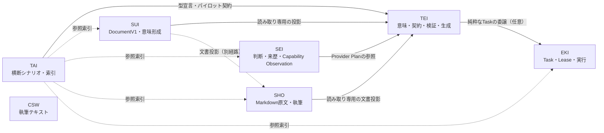

# YI ConstellationのTEI移行適合性と初回検証計画

状態: **調査・提案。製品要求の受理、設計の採用、実装置換の完了を示しません。**
対象: TEI、SUI、SEI、EKI、TAI、SHO、CSW、および代表的なアプリケーション切片。
初回の結論: **実装置換は行わず、参照連携と限定的な投影・生成の検証までを扱います。**

## 1. 結論

7製品を、製品固有のデータ正本と意味を維持したままTEIへ接続できるかで評価しました。

- **TEIは共通のモデリング・検証・生成の基盤として使えるが、製品アプリケーション全体の生成器ではない。** 現行の生成器が扱うのは、契約に束縛した単一の関数・投影と、Target Profileごとの実行物です。画面、認可、テナント分離、永続化、編集履歴までを生成する仕組みではありません。
- **最初に進めるべきなのは、製品が持つ意味のうち、平坦なrecordに落とせる部分の読み取り専用投影です。** SUIのDocumentV1投影、SEIのCapability Observation、EKIの純粋な検証Task、SHOのMarkdown索引、TAIの型宣言検証が候補になります。
- **製品固有の正本は移しません。** SUIのDocumentV1、SEIの判断・契約、EKIのTaskとAuthority、TAIの横断シナリオ、SHOの原Markdown、CSWの本文は、それぞれの製品に残します。
- **CSWは移行対象にしません。** 実行コード、データモデル、APIを持たない日本語テキスト群であり、TEIへ載せる意味の正本がありません。
- **新しい中央Host、Registry、認可基盤、意味正本は作りません。** 既存のTEI CLI、Workspace、Data Provider、Plugin runtime、Generator Selection、Target Profileを再利用します。

推奨する移行方式は、製品ごとに次の順です。

| 方式 | 対象 | 判断 |
| --- | --- | --- |
| 参照連携 | SUI、SEI、EKI、SHO、TAI | 最初に採用する。製品はTEIの成果物を読み、正本は製品側に残す |
| 共通部品の再利用 | TAI、EKI、SUIの限定的な検証 | 参照連携で不足が確認できた部品だけを再利用する |
| TEIモデルからの部分的コード生成 | SUIのDocumentV1投影、TAIの投影契約 | 平坦なrecordと単一関数に限定する |
| 段階的な実装置換 | 今回は採用しない | 参照連携と部分生成の検証が通った後に、製品ごとに別判断する |

## 2. 調査範囲と固定版

各リポジトリの`main`を取得し、README、設計文書、ADR、関連Issue、API定義、データモデル、コード生成機構を読みました。コミットは2026年11月11日時点の取得値です。

| リポジトリ | 固定したmain | 主に読んだ資料 |
| --- | --- | --- |
| TEI | `be814895e` | `docs/architecture.md`、`docs/status.md`、`plan/adr/0043`、`plan/adr/0045`、`tools/reference-generator-selection`、`tools/reference-target-profile`、`tools/reference-sui-adoption`、`tools/reference-cognition-*`、`tools/reference-tei-eki-contract` |
| SUI | `7d1bc058` | `02_Architecture/schemas.md`、`api.md`、`01_Plans/adr/ADR-0101`、`ADR-0102`、`ADR-0114`、`ADR-0058`、`03_Implement` |
| SEI | `cd6eb02` | `README.md`、`architecture/README.md`、`contracts/CONTRACT_CATALOG.md`、`plan/adr/ADR-0014`、`runtime/go/teiintegration`、`runtime/go/teiprojection` |
| EKI | `f3492f5` | `research/integration/tei-usage-requirements-review.md`、`architecture/CONTRACT_BOUNDARIES.md`、`spec/external/openapi.json`、`spikes/tei-workload-projection` |
| TAI | `c78506d` | `README.md`、`docs/tei-construction-migration-plan.md`、`docs/product-landscape.md`、`integrations/`、`tools/reference-tei-model`、`analysis/` |
| SHO | `6ee50d4` | `README.md`、`src/g1b-reader.cjs`、`plan/research/fixtures/RI-L0-01.expected.json`、`skills/`、`plan/design/` |
| CSW | `73efa57` | `README.md`、`AGENTS.md`、`skills/`、`plan/` |

KON Dataspaceは、既存の独立製品化保留方針を尊重し、調査対象にも変更対象にも含めていません。KON固有の計画、Issue、設計変更は本調査で扱いません。

### 2.1 調査の限界

- 実DB、実認可、実テナント、実配備、実利用者による受入は確認していません。
- 各製品の全テストを実行したのではありません。実行したのは、TEI側の既存参照試験とWorkspace検証です。
- 性能と保守性は、まだ測定していません。本資料では測り方と停止条件だけを定めます。
- 製品のIssue本文と設計文書の記述を、実装済み・検証済みと同一視していません。

### 2.2 API・データモデル・コード生成の現状

| 製品 | 主な公開面 | データモデル | コード生成・型同期 |
| --- | --- | --- | --- |
| TEI | `tei` CLIの`validate`、`inspect`、`view`、`source-index`、`deployment-provider-plan`、`self-build`など | `.tei` WorkspaceのData、Relation、Query、Command、Capability、Application、Plugin、RunPlan、EffectRule、Period | Generator SelectionとTarget Profile。投影関数と単一実行物を生成する |
| SUI | `GET/PUT /docs/{docId}`、epistemic投影、管理面のartifact取得 | DocumentV1、Card、Island、Edge、Affiliation、sources、レビュー情報 | TypeScript型、Pydantic、JSON Schemaを手で対応。drift試験あり。TEI Generatorは未使用 |
| SEI | `sei` CLI、`teiintegration`、`teiprojection` | Semantic Reference、Decision Memory、Capability Observation、Cognitive Method、Semantic Interchange | JSON Schema、Go struct、fixtureを手で対応。汎用のコード生成は未使用 |
| EKI | Task API、結果取得、Artifact API、Worker/Admin面 | TaskRequest、AdmittedTask、WorkOrder、Lease、ResultClaim、AcceptedResult | OpenAPIとGo structを手で対応。TEI Generatorは未使用 |
| TAI | 製品横断の参照とSCN-001。常駐APIは持たない | シナリオ、評価記録、パイロット契約 | 製品コードの生成はしない。パイロットでTEI Generatorを使う |
| SHO | `sho-inspect` CLI | Markdown raw bytes、リンク出現、ブロック行、Expected JSON | NodeのReader。汎用のコード生成は未使用 |
| CSW | なし | 執筆Skill本文 | なし |

## 3. 判断基準

### 3.1 守る境界

1. **製品固有のデータ正本を維持する。** 正本の管理主体、変更権限、ライフサイクルをTEIへ移さない。
2. **認知・探索・実行・執筆の意味を維持する。** SUIの意味形成、SEIの判断と来歴、EKIの委任と実行、SHOの執筆と出典、TAIの横断シナリオを、TEIの都合で薄めない。
3. **既存のTEI機能を再利用する。** 新しいHost、Registry、認可基盤、意味正本を作らない。
4. **生成物と意味を分ける。** 生成できたこと、検証に通ったこと、業務上の意味が受理されたことを別に扱う。
5. **欠落を製品側の回避実装で覆わない。** TEIに足りない契約は、TEI側のIssueとして返す。

### 3.2 適合度の見方

| 記号 | 意味 |
| --- | --- |
| ◎ | 既存のTEI機能で、対象を限定して検証できる |
| ○ | 既存機能と薄いAdapterで検証できる |
| △ | 契約または実装の不足があり、検証前に論点を決める必要がある |
| × | TEIへ移さない。製品固有の責務として残す |

## 4. 製品別Fit/Gap

### 4.1 要約

| 製品 | 製品固有の正本 | 適合度 | 最初の対象 | 移行方式 | 移行しない領域 |
| --- | --- | --- | --- | --- | --- |
| TEI | 意味の正本、契約、生成器、Provider選択 | 基盤 | 自身のWorkspace検証と生成器 | 基盤 | 製品固有の認可・実行権限・業務判断 |
| SUI | DocumentV1、Card、Island、Edge、Affiliation、テナント文書 | ○ | DocumentV1の平坦な投影とIsland階層 | 参照連携＋部分生成 | Canvas操作、Undo、保存、認可、SafeMode、LLM |
| SEI | Decision Memory、Capability Observation、Cognitive Method、Semantic Interchange | ○ | TEI Provider PlanからCapability Observationへの写像 | 参照連携 | 判断、Authority、契約、来歴、Product Access |
| EKI | TaskRequest、Admission、Lease、Result、Worker | △ | 純粋なTEI検証Taskの受理と結果取得 | 参照連携 | Scheduler、配置、Lease、Result Acceptance、予算 |
| TAI | SCN-001、横断シナリオ、製品間の索引 | ○ | SCN-001の型宣言検証と投影契約 | 参照連携＋部分生成 | 横断判断、公開Gate、製品の意味正本 |
| SHO | Markdown原文、リンク索引、編集・保存 | ○ | Markdown索引の読み取り専用投影 | 参照連携 | Writer、保存、Parser選択、出典の同一性 |
| CSW | 執筆Skill本文 | × | なし | 移行しない | 全文 |

### 4.2 SUI

製品固有の責務。 SUIは、未整理の観測、カード、島、関係、横断的所属、文章化、レビュー状態を扱う。`DocumentV1`が唯一の永続文書契約であり、カード、島、エッジ、所属、根拠リンク、レビュー情報を含む[^sui-schema]。APIは`GET/PUT /docs/{docId}`を中心に、テナント認証、ETag、SafeMode、監査、epistemic投影を持つ[^sui-api]。TypeScript型とPydanticモデルを手で対応させ、JSON Schemaとdrift試験で守っている。TEI Generatorによる型生成は使っていない。

既存のTEI接続。 SUIはTEI Referenceのepistemic artifactを、同一信頼境界内のローカルI/Oで読む方式を採択済みである（ADR-0101 Option A）[^sui-adr101]。テナント業務面への公開は、文書単位の紐付けを管理面で登録する方式を採択している（ADR-0102 案B）[^sui-adr102]。TEIへのhandoffはローカルJSONの受け渡しを暫定採用している（ADR-0114）[^sui-adr114]。TEI側には、SUIの島階層を制約として写す`reference-sui-adoption`と、Canvasの操作を汎用のAction境界へ接続する`reference-sui-interaction`がある。

移行できる最小機能。

- `DocumentV1`のうち、Card、Island、Edge、Affiliationの平坦な属性をrecord契約としてTEI Workspaceへ写す。
- 島階層の親子制約を、TEIの関係制約として検証する。
- 投影結果を読み取り専用artifactとして返し、SUI側の既存consumerで検証する。

TEI側の既存対応。 `reference-sui-adoption`は、SUIのIslandHierarchyContractV1をTEIのData/Relationで表し、親子関係、根の一意性、循環、参照先の存在を検査する。`reference-generator-selection`は、契約とfixtureから投影関数を生成し、Go、Python、JavaScript、Java、WASM、WASIの候補を同じ期待値で選抜できる[^tei-gen]。`reference-sui-interaction`は、Canvasの操作を汎用のcommit境界へ渡す参照で、保存のCAS、認可、検証の順序を固定する[^tei-sui-interaction]。

不足する契約。

- 入れ子構造、optionalの欠落とnullの区別、未知フィールドの保持、文字列以外の配列。
- `std.decimal`の精度保持。座標や金額では、float64経由の丸めが問題になる。
- DocumentV1全体の同一性、ETag、テナント境界、SafeModeの投影。
- Canvasのドラッグ、ズーム、グリッド吸着、島への移動、Undoのまとまりを、汎用Actionだけで等価に表せないこと。

依存関係。 SUIからTEIへの読み取り専用依存は既にある。TEIからSUIへの書き込み依存は作らない。TEIはSUIのDocumentV1を正本として扱わない。

必要な試験。

- 既存のSUI DocumentV1試験をbaselineにする。
- 同じDocumentV1 fixtureをTEIの投影契約へ通し、選択した属性の値、欠落、未知フィールドの扱いを比較する。
- 島階層のvalid/invalid fixtureを、SUIの契約試験とTEIの`reference-sui-adoption`の両方に通す。
- Canvas操作は、既存の`reference-sui-interaction`の負例を使い、等価でないことを確認する。

移行しない領域。 Canvasの操作感、Undo/Redo、未保存状態、保存API、認可、テナント分離、SafeMode、LLMによる意味形成、epistemic候補の自動適用。

### 4.3 SEI

製品固有の責務。 SEIは、Observation、Interpretation、Recommendation、Decision、Authority、Execution、Outcomeを区別し、Decision Memory、Capability Observation、Cognitive Method、Semantic Interchange、Semantic Referenceの5契約をJSON SchemaとGo runtimeで扱う[^sei-catalog]。JCS+SHA-256とraw-bytes+SHA-256の表現規則を持つ。TEIをCapability Providerの一つとして扱うが、TEI固有のApplication、Database、Deployment構造をSEIの意味契約へ取り込まない（ADR-0014）[^sei-adr14]。

既存のTEI接続。 `runtime/go/teiintegration`は、外部のTEI実行ファイルを呼び、`deployment-provider-plan`の結果をCapability Observationへ写す[^sei-tei-cli]。`runtime/go/teiprojection`は、TAI側で作られたDecision投影artifactを読み取り、封筒と平坦なDecision項目を検証する[^sei-tei-projection]。ただし、この投影はSEIのDecision recordへ変換する経路にまだ接続されていない（SEI #785）。

移行できる最小機能。

- TEIのProvider Planから、SEIのCapability Observationへの写像を、既存の`teiintegration`で検証する。
- TEIの部分的な失敗を、SEIの`Unknown`、`not observed`、`unavailable`、`not_verified`へどう写すかを固定する。

TEI側の既存対応。 `tools/reference-cognition-port`は、提案を候補として返し、受理・権限・実行から分離する。`tools/reference-cognition-handoff`は、提案をShared Acceptanceの変更候補へ変換するが、受理はしない[^tei-cognition]。SEIの`F1-tei-partial-degradation` fixtureは、TEIの部分劣化をCapability Observationでどう表すかの材料になる。

不足する契約。

- TEIのProvider Planのどの欠落が、SEIの`Unknown`と`unavailable`のどちらに対応するか。
- TEIの実行結果を、SEIのObservationとして受け取るときの、時点、対象、Provider、Assuranceの対応。
- Decision投影をSEIのDecision Memoryへ取り込む経路。現状は読み取りだけで、SEIの正本へ書かない。

依存関係。 SEIからTEIへの一方向の参照。TEIはSEIを必須依存にしない。SEIはTEIを必須Providerにしない（ADR-0014）。

必要な試験。

- 固定したTEI Provider Planを入力に、SEIのCapability Observation契約へ写す。
- 部分劣化、未観測、取得不能、競合を別の結果として保持する。
- Decision投影は、SEIのDecision Memory契約に照らして、参照と未決を保持できるかだけを確認する。書き込みは行わない。

移行しない領域。 Decision、Recommendation、Authority、Responsibility、Semantic Lineage、Cognitive Methodの意味、Product Access、監査・開示の判断。

### 4.4 EKI

製品固有の責務。 EKIは、TaskRequestを受理し、Admission、Placement、Lease、WorkOrder、ResultClaim、AcceptedResultへ進める分散実行基盤である。外部契約はOpenAPIで定義され、Client、Worker、Adminの面を分ける[^eki-contract]。TEIの仕事をEKIへ投影するSpikeと、TEI側の契約適合試験がある。

既存のTEI接続。 EKIの`research/integration/tei-usage-requirements-review.md`は、TEIの決定的なCLI操作をEKIへ載せる場合の速度、Artifact経路、Resultの三値対応、Runtime Class、副作用の欠落を整理している[^eki-research]。TEI側の`tools/reference-tei-eki-contract`は、EKIの実OpenAPIから抜き出した契約に対して、TEIらしいJob要求がどこで表現できなくなるかを19ケースで検査する[^tei-eki]。2026年11月11日にこの19ケースを実行し、50件のNode試験がすべて通った。

移行できる最小機能。

- `tei validate`のような純粋で決定的な読み取りTaskを、EKIのTaskRequestとして受理させ、状態と結果を取得する。
- TEIの仕事を、EKIのTask IDとResultの来歴へ結び付ける。

TEI側の既存対応。 `deployment-provider-plan`、`validate`、`scenario`、`source-index`などのCLI。`reference-target-profile`は、oneshot、long-running、batchの実行モデルと、filesystem、sqlite、remoteの保存先を宣言できる。ただしremoteは参照実装の対象外である[^tei-target]。

不足する契約。

- 入力Artifactの本体を渡す経路と、結果本体を取得する経路。EKIのOpenAPIには501の宣言が残る。
- `effect_mode`が`none`に限られ、業務副作用を持つTEIの配備を純粋計算として偽装できないこと。
- 実行体のdigestをClient側から固定する欄がないこと。
- 単一の`deadline`が、TEIの開始期限、目標時刻、最新有用時刻を包含しないこと。
- 公開状態が`completed`でも、AcceptedResultや業務上の完了を意味しないこと。
- Runtime Class、実行環境、toolchainの来歴がResultにないこと。

依存関係。 TEIからEKIへの一方向の実行委譲。EKIはTEIへ依存しない。EKIの製品境界試験が、TEIへの依存がないことを検査している。

必要な試験。

- 同じ`tei validate`入力を、ローカルCLIとEKI Taskの両方へ渡す。
- EKI側は、受理、queued、running、completedの状態と、結果本体の有無を別に記録する。
- 純粋な読み取りTaskだけを対象にし、副作用のある配備は対象外とする。
- `completed`を業務上の受理と読み替えない。

移行しない領域。 配置、Lease、Fencing、Worker認証、Result Acceptance、予算、委任の連鎖、副作用の確定、管理画面。

### 4.5 TAI

製品固有の責務。 TAIは、個人・組織・社会の知的課題を横断して扱い、SCN-001の観測、解釈、判断、成果、再観測を追跡する。製品群の全体像と接続の索引を持ち、各製品の意味の正本を複製しない[^tai-landscape]。TAIは中央Hostでも統一Runtimeでもない。

既存のTEI接続。 `tools/reference-tei-model`は、SCN-001で使う型宣言をTEIで検証する。`integrations/pilot-sui-document`、`pilot-sei-decision`、`pilot-eki-task-request`、`pilot-mmi-format-profile`は、各製品の意味をTEIの契約とfixtureへ写すパイロットである。`docs/tei-construction-migration-plan.md`は、SUIを最初の対象にしたフィージビリティ計画を持つ。

移行できる最小機能。

- SCN-001で使う型宣言をTEI Workspaceで検証する。
- 既存のパイロット契約を、製品側の独立したExpectedで再確認する。
- 製品横断の索引を、TEIのSource IndexとContract digestへ結び付ける。

TEI側の既存対応。 `reference-generator-selection`、`reference-target-profile`、`reference-cognition-*`、`reference-tei-eki-contract`。TAIのパイロットは、TEIの生成器で投影候補を作り、製品側のconsumerで読む形をとっている。

不足する契約。

- TAI自身の横断的な判断・公開GateをTEIへ移す契約はない。移すべきでもない。
- 製品横断の索引は、各製品の正本を参照するだけで、TEIのCanonical Worldへ取り込まない。
- TAIのシナリオ固有の意味は、TEIの汎用モデルへ一般化しない。

依存関係。 TAIから各製品への参照。TAIは製品の実行時依存にならない。各製品はTAIに依存しない。

必要な試験。

- SCN-001の型宣言をTEIで検証し、TAI側の期待と照合する。
- 既存のパイロット4件を、同じ入力と同じ独立Expectedで再実行する。
- TAIの公開Gateや判断記録を、TEIの生成成功と混同しない。

移行しない領域。 横断的な判断、公開可否、製品間の優先順位、シナリオの意味、Ownerの受入。

### 4.6 SHO

製品固有の責務。 SHOは、著者のMarkdown原文、リンク索引、出典、編集、保存を扱う。現在のmainにあるのは、Markdownのリンクを読み取る限定Readerであり、Composer、Editor、Writerの完成版ではない[^sho-readme]。原文のraw bytesが正本で、リンク出現、ブロック行、順序はsnapshot-localである。Writer、保存、Vault、納品は別のIssueで扱う。

既存のTEI接続。 TEI側の`tools/reference-okf-k1`は、TEIのMarkdownを読み取るprobeを持つ。TEI #3394は、REA ObservationからTEI Source Candidateを経てSHOの文書投影へ渡す経路を追跡している。SHO #18はOKF知識バンドル、SHO #19はTEI Studio共通文書機能、SHO #20はポータブルVaultを扱う。いずれも、TEIの意味受理とSHOの原文保存を同一視しない。

移行できる最小機能。

- TEIのモデルまたは設計情報から、SHOの読み取り専用の文書投影（見出し、リンク、表）を作る。
- 元のMarkdown raw bytesと、投影の入力に使ったParserの版・scopeを記録する。

TEI側の既存対応。 `reference-okf-k1`、TEIのSource Index。TEIの`*.tei.md`の新形式Parserは未束縛であり、SHOの通常Markdown編集をTEIのParserへ依存させない[^tei-status]。

不足する契約。

- TEIの意味モデルとSHOの文書構造の対応。見出し、引用、表、リンク出現の同一性。
- 非単射な投影の逆写像。SHOの編集をTEIのSourceへ戻す経路は、まだ無い。
- 文書のraw bytes、Parser版、scope、未取得・partialの区別。

依存関係。 SHOからTEIへの読み取り専用参照。TEIからSHOへの書き込みはしない。SUIからSHOへの文書投影は別の経路であり、TEIを経由しない。

必要な試験。

- SHOの`RI-L0-01.expected.json`を独立Expectedとして、同じMarkdown raw bytesをTEIの文書投影へ通す。
- リンク出現、行、順序、未解決参照の扱いを比較する。
- SHOのWriter、保存、Vaultは対象外とする。

移行しない領域。 Markdownの編集、保存、Parserの選択、原文の同一性、出典の真正性、納品、外部同期、公開。

### 4.7 CSW

製品固有の責務。 CSWは、文化的体系、親和図法、執筆フローの3つの日本語テキストを育てる。実行コード、データモデル、APIを持たず、利用者は本文をAIに読ませて使う[^csw-readme]。AGENTS.mdは、多目的化、インストーラー、パッケージ依存、CI/CD、ビルド・リリース基盤を追加しないよう定めている。

判断。 TEIへ移行しない。TEIのモデルへ載せる意味の正本がなく、載せると本文の直接編集というCSWの前提を壊す。TEIの文書投影やOKFを参照するとしても、CSWの本文と執筆手順をTEIの契約へ変換しない。

### 4.8 代表的なアプリケーション切片

| 切片 | 製品側の正本 | TEIで検証できること | 移行しないこと |
| --- | --- | --- | --- |
| SUI Canvasのカード移動 | DocumentV1、Undo、保存、認可 | 汎用Action境界の負例とCASの順序 | 操作感、島への移動、Undoのまとまり |
| SEIのResume/Review投影 | Decision Memory、来歴、未決 | 読み取り専用の投影と独立Expected | Decisionの確定、Authority、監査 |
| EKIのTaskRequest | Task、Lease、Result | 純粋な検証Taskの受理と結果取得 | 配置、実行、Result Acceptance、副作用 |
| SHOのResearch Index Reader | Markdown raw bytes、リンク索引 | 読み取り専用の文書投影 | Writer、保存、Parser選択 |
| TAIのSCN-001 | シナリオ、判断、公開Gate | 型宣言の検証と投影契約 | 横断判断、公開可否 |

## 5. 移行方式の比較

| 方式 | 変更するもの | 利点 | 費用・危険 | 向く製品 | 今回の判断 |
| --- | --- | --- | --- | --- | --- |
| 参照連携 | 製品がTEIのCLIまたはartifactを読む | 製品の正本を変えず、最短で検証できる。失敗時も製品単独で動く | 版ずれ、写像の手修正、二重定義が残る | SUI、SEI、EKI、SHO、TAI | 最初に採用する |
| 共通部品の再利用 | 製品がTEIの契約・検証・投影部品を呼ぶ | 検証規則を共有でき、写像の重複を減らせる | 言語・Runtime・依存の追加。製品の実行時依存になり得る | TAI、EKI、SUIの限定範囲 | 参照連携で不足が確認できた部品だけ |
| 部分的なコード生成 | TEIの契約から投影関数・型・検証を生成する | 意味変更の追従を自動化できる。生成物の来歴を残せる | 入れ子・optional・配列・精度の制約。生成物の手修正が再発する | SUIのDocumentV1投影、TAIの投影契約 | 平坦なrecordと単一関数に限定して試す |
| 段階的な実装置換 | 製品の一部をTEI生成物へ置き換える | 長期的な重複を減らせる | 認可、保存、UI、運用の移管が必要。切り戻しの設計が要る | 今回はなし | 採用しない |

### 5.1 全面作り直しを前提にしない理由

- SUIのCanvas、SEIの判断、EKIの実行、SHOの執筆、TAIの横断判断は、TEIの生成器が扱う単一関数より広い。
- TEI自身が、統合モデラー、画面編集、汎用実行基盤、認可を完成させていない[^tei-status]。
- 製品の意味の正本をTEIへ移すと、製品の変更権限と受入責任が曖昧になる。
- 全面移行の失敗は、製品の利用者に直接影響する。参照連携と部分生成なら、失敗を製品内に閉じ込められる。

### 5.2 推奨する順序

1. 参照連携で、同じ入力と同じ独立Expectedを使い、製品の意味が失われないかを確認する。
2. 参照連携で不足する契約を、TEI側のIssueへ返す。
3. 不足が解消した範囲だけ、部分的なコード生成を試す。
4. 部分生成の生成物が、製品の既存試験と独立Expectedを通った場合だけ、段階的な置換を別Issueで判断する。

## 6. 依存関係



実線は検証対象の依存、破線は製品横断の参照である。TAIから各製品への破線は、実行時依存でも中央Hostでもない。CSWはどの製品にも依存しない。

| 依存 | 向き | 現在の状態 | 禁止する向き |
| --- | --- | --- | --- |
| SUI → TEI | 読み取り専用 | ADR-0101/0102で採用済み。TEI artifactをローカルI/Oで読む | TEI → SUIのDocumentV1書き込み |
| SEI → TEI | 読み取り専用 | `teiintegration`がProvider Planを読む | TEI → SEIのDecision書き込み |
| SHO → TEI | 読み取り専用 | OKF K1 probeと文書投影の計画 | TEI → SHOの原文書き換え |
| TAI → TEI | 参照・検証 | 型宣言検証とパイロット | TEI → TAIの横断判断 |
| TEI → EKI | 実行委譲（任意） | 純粋Taskの参照のみ | EKI → TEIの必須依存 |
| SUI → SHO | 文書投影（別経路） | 固定fixtureの試験のみ | TEIを経由した中央文書Registry |

## 7. 機能次元のFit/Gap

「TEIで置換できるか」を見る表であり、製品の能力評価ではない。

| 製品 | 意味モデル | データ永続化 | API・認証 | コード生成 | Plugin・Target | 画面・操作 |
| --- | --- | --- | --- | --- | --- | --- |
| TEI | 基盤 | △ PostgreSQL/Oracle。SQLite提供元なし | △ 認可は製品側の責務 | ○ 単一関数・投影 | ○ Plugin runtimeとTarget Profile | × Studioは参照用 |
| SUI | △ 平坦なrecordのみ | × 複数DB、Document全体保存 | × テナント認証、ETag、SafeMode | △ 投影関数のみ | △ 参照Action境界 | × Canvas、Undo、IME |
| SEI | △ 契約はSEIが所有 | × SEIの保存・来歴 | ○ 読み取り参照 | × 生成対象外 | △ Capability Provider | × Resume/ReviewはSEI |
| EKI | △ Taskの一部 | × EKIのTask/Lease | × EKIの認可・予算 | × 生成対象外 | △ 純粋Taskの委譲 | × 管理画面 |
| TAI | ○ 型宣言の検証 | × TAIのシナリオ | × 横断判断 | △ 投影契約 | △ パイロット | × 横断UI |
| SHO | △ 文書投影のみ | × Markdown原文・保存 | × 編集権限 | × 生成対象外 | × | × Writer、Vault |
| CSW | × | × | × | × | × | × |

## 8. 初回の検証計画

### 8.1 原則

- 製品の実装は置き換えない。TEI側の参照実装と、製品側の既存consumerを並べる。
- 同じ入力bytesを、BaselineとProbeの両方へ渡す。
- 期待値は、TEIの出力から作らない。製品の契約、既存試験、独立したfixtureから先に固定する。
- 成功、失敗、未取得、部分、Unknownを別の結果として記録する。
- 実行しなかった検証を合格と書かない。

### 8.2 共通の手順

1. 対象のコミットとfixtureのSHA-256を固定する。
2. 製品側の契約または既存試験から、独立Expectedを先に作る。
3. Baselineを実行し、出力と終了コードを記録する。
4. Probeを実行し、出力と終了コードを記録する。
5. BaselineとProbeを、互いにではなく、独立Expectedと比較する。
6. 差分を、意味の損失、表現の差、未実装、不具合に分類する。
7. 判定と残る危険を、対象の版とコマンド付きで記録する。

### 8.3 検証項目

| ID | 対象 | Baseline | Probe | 独立Expectedの出所 | 合格条件 | 停止条件 |
| --- | --- | --- | --- | --- | --- | --- |
| V-SUI-01 | DocumentV1の平坦な属性投影 | SUIのDocumentV1試験とJSON Schema | TEIのrecord投影契約と生成関数 | SUI `02_Architecture/schemas.md`と既存fixture | 選択属性の値、欠落、未知フィールドの扱いが一致する | 入れ子、optional、配列、精度のいずれかで説明できない差が出る |
| V-SUI-02 | Island階層の制約 | SUIのIslandHierarchyContractV1試験 | TEI `tools/reference-sui-adoption` | SUIのvalid/invalid fixture | validは通り、invalidは同じ理由で拒否する | 親子、循環、根の一意性のいずれかが一致しない |
| V-SUI-03 | Canvasのカード移動 | SUIのCanvas操作と保存の既存試験 | TEI `tools/reference-sui-interaction` | SUIの操作仕様と既存の負例 | 等価でないことを確認し、移行しない判断を記録する | 汎用Actionで等価と主張できる差が出る |
| V-SEI-01 | Provider PlanからCapability Observation | SEI `teiintegration`の既存試験 | 固定したTEI Provider Plan | SEIのCapability Observation契約とfixture | Unknown、未観測、取得不能、競合が保持される | 部分劣化が成功または単純な失敗に丸められる |
| V-SEI-02 | Decision投影の読み取り | SEI `teiprojection`の既存試験 | TAIのDecision投影artifact | SEIのDecision Memory契約 | 参照、未決、Rationaleが保持される | SEIのDecision正本へ書き込む必要が出る |
| V-EKI-01 | 純粋な検証Task | ローカルの`tei validate` | EKIのTaskRequestと結果取得 | EKI OpenAPIとTEI validate JSON | 受理、状態、結果本体、Runtime Classの有無を別に記録する | 501、`effect_mode`、deadline、結果本体のいずれかで意味が落ちる |
| V-EKI-02 | 副作用のある配備 | TEIのローカル配備 | EKIのTaskRequest | TEIのEffectとUnknownの契約 | 純粋計算として受理されない | `effect_mode: none`で受理される |
| V-TAI-01 | SCN-001の型宣言 | TAI `reference-tei-model` | TEI `validate` | TAIのSCN-001型宣言 | すべての参照型が解決し、未解決が理由付きで出る | 型の欠落をTEI側で補う必要が出る |
| V-SHO-01 | Markdown索引の読み取り | SHO `sho-inspect` | TEIの文書投影 | SHO `RI-L0-01.expected.json` | リンク出現、行、順序、未解決参照が一致する | 原文bytes、Parser版、scopeのいずれかが失われる |
| V-CSW-01 | 執筆テキスト | なし | なし | CSWの本文 | 移行しない判断を記録する | なし |

### 8.4 独立Expectedの書き方

独立Expectedは、次の条件を満たす表またはfixtureである。

- 対象の入力（ファイル、bytes、SHA-256）を固定する。
- 期待する観測（値、欠落、エラー、状態）を、製品の契約または既存試験から書く。
- TEIの出力を見た後に期待値を書き換えない。
- baselineの出力を期待値にしない。baselineとprobeの一致だけを合格にしない。
- 未取得、部分、Unknown、拒否を、成功と別の列に置く。
- 失敗した場合に、意味の損失か、実装の不足か、期待値の誤りかを分類できるようにする。

### 8.5 比較指標

| 観点 | 測るもの | Baseline | Probe | 判定の案 |
| --- | --- | --- | --- | --- |
| 機能同等性 | 独立Expectedに対する一致件数 | 既存試験の合格件数 | 同じfixtureでの合格件数 | 選択範囲で一致し、未取得・Unknownを保持する |
| 保守性 | 手修正したファイル数、二重定義の数、写像の数 | 現行の型・Schema・試験 | TEI契約、fixture、Adapter | 生成物の手修正が0で、写像が1ファイルに閉じる |
| 性能 | p50/p95のレイテンシ、メモリ、ビルド時間 | 製品の現行経路 | TEI経由の経路 | 説明できない10%超の劣化がない（提案。Owner判断） |
| 複雑性 | 新しい実行時依存、ファイル数、設定項目、中央部品の数 | 現行 | Probe | 新しい中央Host・Registry・認可基盤が0 |

性能の10%は案であり、測定前に合格条件として固定しない。対象ごとにOwnerが決める。

### 8.6 実行順

1. **SUI**: 既存の投影・階層・Action参照があるため、最初に独立Expectedを固定できる。
2. **TAI**: SCN-001の型宣言と既存パイロットを再確認する。
3. **SHO**: 読み取り専用の文書投影を、既存のExpectedで確認する。
4. **SEI**: Capability Observationの写像を確認する。
5. **EKI**: 純粋Taskの受理と結果取得を確認する。副作用は対象外とする。
6. **CSW**: 検証を行わず、移行しない判断だけを記録する。

## 9. 本調査で実行した確認

2026年11月11日に、TEIの現在のmainで次を実行しました。製品の移行や受入ではありません。

```text
go run ./cmd/tei validate -workspace reference/workspace -json
```

結果は`ok: true`、`declarationCounts.total: 71`、`worldFingerprint: sha256:c92de09f...`、`sourceIndexFingerprint: sha256:1827f4b4...`だった。3件の`*_CONTRACT_NOT_CURRENT`警告は残った。これは参照Workspaceの履歴契約に関する警告であり、意味の受理や製品適合を示さない。

```text
go test ./tools/reference-sui-adoption/... ./tools/reference-cognition-handoff/... ./tools/reference-cognition-port/... ./tools/reference-tenant-isolation/... -count=1
```

4パッケージが成功した。

```text
node --test tools/reference-tei-eki-contract/probe.test.cjs \
  tools/reference-sui-interaction/bridge.test.mjs \
  tools/reference-sui-interaction/sui-http-ports.test.mjs \
  tools/reference-sui-interaction/native-edit.test.mjs
```

50件が成功し、失敗は0件だった。内訳は、EKI契約の19件、SUI Action境界の11件、SUI HTTP契約の9件、SUI native editの11件である。

これらは、TEI側の参照実装が現在のmainで動くことの確認である。SUI、SEI、EKI、SHO、TAIの実装がTEIへ移行できることの証明ではない。

## 10. 既存Issueとの重複整理

本調査は、既存の移行計画、横断設計、製品側の接続Issueを置き換えない。次のように役割を分ける。

| Issue | 現在の役割 | 本調査との関係 | 取る行動 |
| --- | --- | --- | --- |
| TAI #394 | TEI構築移行の残課題 | 本調査の親トラッカー。製品横断のFit/Gapは本調査で補う | 本調査から参照する。新しい重複Issueは作らない |
| TAI #73 / #74 | 製品横断の分類・統合配布 | 本調査は移行適合だけを扱い、配布・公開は扱わない | 参照のみ |
| TAI #422 / #488 / #547 | 製品価値・横断監査・整合性 | 本調査は実装可能性の調査であり、価値監査ではない | 参照のみ |
| TAI #271 | Activity継続とHandoff | SEI/SHOのHandoffと関係するが、本調査は移行方式を扱う | 参照のみ |
| TEI #1119 | Critical Path Program | 実装順序とGateの管理。本調査の段階計画とは目的が違う | 段階計画の依存先として参照する |
| TEI #4191 | 業務意味の可搬性・既存システム再実現 | 設計候補が重なる。本調査は製品別Fit/Gapと初回検証に限定する | 設計を複製せず、参照する |
| TEI #2390 | Pluginの外部Consumer利用 | 共通部品の再利用の前提。本調査は製品側の適合を扱う | 参照のみ |
| TEI #4124 / #4194 | TEIとEKIの実行資格・期限・予算 | EKIの詳細な契約論点。本調査は最小の純粋Taskに限定する | 詳細は委ねる |
| TEI #4195 | TEI成果物のEKI経由の配置 | 本調査の対象外。段階的置換の後段 | 参照のみ |
| SUI #3184 | epistemic review UX | SUIの既存TEI接続の親Issue | 参照のみ |
| SUI #3369 / #3371 / #3387 | 投影の公開範囲、payload、ローカルI/O | SUIの実装上の中核。本調査は移行判断だけを扱う | 詳細は委ねる |
| SEI #785 | Decision投影が未接続 | SEIのDecision投影の停止条件 | 本調査のV-SEI-02の前提にする |
| SEI #677 / #767 | 横断Handoff、TEIからSEIへの限定受渡し | 本調査のCapability Observationと関係する | 参照のみ |
| EKI #112 / #113 | TEI利用から出た契約・Scenario | EKIのFit/Gapの正本 | 本調査は最小の純粋Taskだけを扱う |
| EKI #69 | EKIがTEIへ依存しないことの検査 | 依存方向の根拠 | 維持する |
| SHO #16 / #18 / #19 / #20 | Reader、OKF、TEI連携、Vault | SHOの移行候補と停止線 | 参照のみ |
| CSW #543 | Framework Registryの研究 | CSWの製品計画。TEI移行とは無関係 | 参照しない |

### 10.1 新規Issueの要否

本調査の成果は、TAI #394のコメントまたは子Issueで追跡できる。製品ごとの実装Issueは、検証計画のV-IDが実行可能になった時点で、各製品のOwnerが起票する。TEI側の契約不足は、既存のTEI #4191、#2390、#4124、#4194へ返し、新しい中央設計Issueを作らない。

## 11. Owner判断が必要な事項

| ID | 判断 | 選択肢 | 推奨 | 影響 |
| --- | --- | --- | --- | --- |
| OD-01 | SUIのDocumentV1をTEIのどこまで写すか | 平坦な属性のみ / 入れ子まで / 全体 | 平坦な属性のみから始める | 投影の範囲と生成器の拡張 |
| OD-02 | TEIのコード生成をどこまで許すか | 単一関数 / 投影型 / アプリ全体 | 単一関数と投影型に限定する | 生成物の保守と責任 |
| OD-03 | SEIのCapability ObservationをTEIの契約へ寄せるか | SEI契約を維持 / TEI契約へ寄せる | SEI契約を維持し、写像だけをTEIで検証する | SEIの意味の独立性 |
| OD-04 | EKIの副作用とResult AcceptanceをTEIへ移すか | 移さない / 一部を移す | 移さない | 実行権限と監査 |
| OD-05 | SHOの原文とTEIの意味の対応をどこまで持つか | 読み取り専用投影 / 双方向 / 保存まで | 読み取り専用投影のみ | 執筆の正本とParser |
| OD-06 | TAIを中央Hostにするか | する / しない | しない。参照索引に留める | 製品間の依存と障害範囲 |
| OD-07 | CSWをTEIへ移行するか | する / しない | しない | CSWの直接編集と配布の簡素さ |
| OD-08 | KON Dataspaceを本計画へ含めるか | 含める / 含めない | 含めない。独立製品化保留を維持する | 他リポジトリへの影響 |
| OD-09 | 性能の合格条件 | 10%以内 / 対象ごと / 測らない | 対象ごとに決める | 移行の採否 |
| OD-10 | 既存Issueの追跡方法 | TAI #394 / 新規親Issue / 製品別Issue | TAI #394を親にし、製品別Issueを子にする | 重複と責任 |

## 12. 未決定・未検証

- TEIの入れ子、optional、配列、未知フィールド、decimal精度の扱い。
- SUIのDocumentV1全体の同一性、ETag、テナント境界、SafeModeの投影。
- SEIのDecision投影をSEIの正本へ書き込む経路。現状は読み取りのみ。
- EKIのArtifact本体、Result本体、`effect_mode`、実行体digest、Runtime Class、公開状態と三値の対応。
- SHOの`*.tei.md` Parserの束縛、Writer、保存、Vault。
- TAIの横断判断と公開GateをTEIへ移さないことの運用。
- 実DB、実認可、実テナント、実配備、実利用者による受入。
- 性能、保守性、複雑性の実測。
- 各製品のOwnerによる意味の受理。

## 13. 参照

[^sui-schema]: SUI `02_Architecture/schemas.md`、`DocumentV1`、Card、Island、Edge、Affiliation。https://github.com/hat47x/sui-sensemaking/blob/7d1bc058/02_Architecture/schemas.md
[^sui-api]: SUI `02_Architecture/api.md`、`GET/PUT /docs/{docId}`、epistemic投影、テナント認証。https://github.com/hat47x/sui-sensemaking/blob/7d1bc058/02_Architecture/api.md
[^sui-adr101]: SUI ADR-0101、TEI epistemic projectionのtransport。https://github.com/hat47x/sui-sensemaking/blob/7d1bc058/01_Plans/adr/ADR-0101-tei-epistemic-projection-transport.md
[^sui-adr102]: SUI ADR-0102、テナント業務面への公開。https://github.com/hat47x/sui-sensemaking/blob/7d1bc058/01_Plans/adr/ADR-0102-tei-epistemic-tenant-plane-disclosure.md
[^sui-adr114]: SUI ADR-0114、TEI handoffのローカルJSON。https://github.com/hat47x/sui-sensemaking/blob/7d1bc058/01_Plans/adr/ADR-0114-tei-handoff-local-json.md
[^tei-gen]: TEI `tools/reference-generator-selection/README.md`。生成言語と投影strategy。https://github.com/hat47x/tei-platform/blob/be814895e/tools/reference-generator-selection/README.md
[^tei-sui-interaction]: TEI `tools/reference-sui-interaction/README.md`。Canvas操作のAction境界と負例。https://github.com/hat47x/tei-platform/blob/be814895e/tools/reference-sui-interaction/README.md
[^tei-target]: TEI `tools/reference-target-profile/README.md`。oneshot、long-running、batch、保存先、更新方式。https://github.com/hat47x/tei-platform/blob/be814895e/tools/reference-target-profile/README.md
[^tei-eki]: TEI `tools/reference-tei-eki-contract/README.md`。EKI OpenAPIに対する19ケース。https://github.com/hat47x/tei-platform/blob/be814895e/tools/reference-tei-eki-contract/README.md
[^tei-cognition]: TEI `tools/reference-cognition-port/README.md`と`tools/reference-cognition-handoff/README.md`。https://github.com/hat47x/tei-platform/blob/be814895e/tools/reference-cognition-port/README.md
[^tei-status]: TEI `docs/status.md`。未完成・未検証の範囲。https://github.com/hat47x/tei-platform/blob/be814895e/docs/status.md
[^sei-catalog]: SEI `contracts/CONTRACT_CATALOG.md`。5契約と表現規則。https://github.com/hat47x/sei-cognition/blob/cd6eb02/contracts/CONTRACT_CATALOG.md
[^sei-adr14]: SEI ADR-0014、SEIとTEIのProduct Boundary。https://github.com/hat47x/sei-cognition/blob/cd6eb02/plan/adr/ADR-0014-sei-tei-product-boundary.md
[^sei-tei-cli]: SEI `runtime/go/teiintegration/tei_cli.go`。TEI CLIのProvider Plan呼び出し。https://github.com/hat47x/sei-cognition/blob/cd6eb02/runtime/go/teiintegration/tei_cli.go
[^sei-tei-projection]: SEI `runtime/go/teiprojection/projection.go`。Decision投影の読み取り。https://github.com/hat47x/sei-cognition/blob/cd6eb02/runtime/go/teiprojection/projection.go
[^eki-contract]: EKI `architecture/CONTRACT_BOUNDARIES.md`と`spec/external/openapi.json`。https://github.com/hat47x/eki-fabric/blob/f3492f5/architecture/CONTRACT_BOUNDARIES.md
[^eki-research]: EKI `research/integration/tei-usage-requirements-review.md`。https://github.com/hat47x/eki-fabric/blob/f3492f5/research/integration/tei-usage-requirements-review.md
[^tai-landscape]: TAI `docs/product-landscape.md`。https://github.com/hat47x/tai-pleroma/blob/c78506d/docs/product-landscape.md
[^sho-readme]: SHO `README.md`。G1b Readerの範囲と限界。https://github.com/hat47x/sho-composer/blob/6ee50d4/README.md
[^csw-readme]: CSW `README.md`と`AGENTS.md`。https://github.com/hat47x/cultural-substrate-weaving/blob/73efa57/README.md
