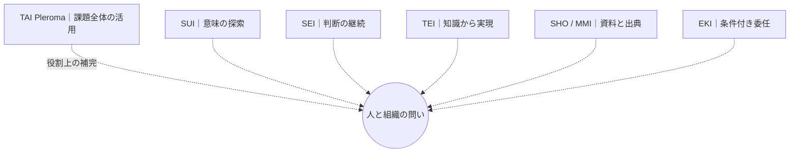
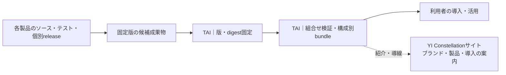

# YI ConstellationとTAIの製品群統合・配布アーキテクチャ（Draft v0）

状態: **Proposed / Ownerレビュー待ち / 実装・統合リリースNOT RUN**  
基準: TAI main `88a6fad6d088f98ccab6080b3b7be24b62399113`（2026-10-27確認）。  
意思決定の追跡: [Issue #74](https://github.com/hat47x/tai-pleroma/issues/74)。  
既存の横断分類: [Draft PR #72](https://github.com/hat47x/tai-pleroma/pull/72)／[Issue #73](https://github.com/hat47x/tai-pleroma/issues/73)。

## 1. 定義：ブランド、製品、リポジトリ、配布物は異なる

| 呼称 | 対象・正本 | この構想で担う役割 | 誤った同一視 |
| --- | --- | --- | --- |
| **YI Constellation** | プロダクトファミリーのブランド、製品紹介ウェブサイトの名前 | 複数の製品を一つの価値観として案内する | 独立したProduct ID／専用GitHubリポジトリ |
| **TAI Pleroma** | 既存の統合製品 | 課題から観測・判断・成果・再評価までの活用知識・統合体験を支える | 全製品の中央Host・汎用意味/権限の正本 |
| **TAIリポジトリ** | `hat47x/tai-pleroma` | 版を固定した組合せ、シリーズ統合検証・配布、サイト制作の開発拠点（構想） | 他製品のソース・API・リリース所有権の移管 |
| **各基盤リポジトリ** | SUI / SEI / TEI / MMI／SHO構想 / EKIなど、個別Ownerの正本 | 製品実装、契約、固有テスト、個別の受入・配布物 | すべてが同じ成熟度／同じ実行基盤 |
| **シリーズ配布構成** | TAIで選んだ具体的な版付き構成単位（提案） | どの組合せを利用者へ届けるかを検証・提示 | 個別製品版を上書きする「唯一の製品リリース」 |

**リポジトリは増やさない**: `YI Constellation`用のリポジトリは作成せず、ブランドサイトの編集・公開用ソースをTAIリポジトリ内で扱う方針。サイトのドメイン・ホスティング・コンテンツ公開権限・正式ロゴは未選択／未受入。

**TAIの二つの役割**: (A) 利用者にとっての課題と成果のつながりを扱う「活用の知識体系・統合体験」、(B) 開発運用にとっての「統合ビルド・検証・構成別リリースの拠点」。前者を後者の技術内部へ混同せず、双方が同じ製品群の利用価値につながる構想として区別する。

## 2. 二つの図を分けて用いる

### ブランドの星座図：価値の関係（構想）



この線は上下関係・API依存・資本関係・配布経路ではない。現在の構想で列挙された五基盤＋TAIの初期図であり、Product/Methodの完全な台帳ではない。分類のOwner判断は#73で追う。

### ビルド・配布図：版付き成果物の受渡し（提案）



この図でだけTAIを**統合・配布工程の中心**に置いてよい。ただし配布上の依存であって、個別製品の意味・実行時AuthorityをTAIが奪うものではない。全製品を単一のプロセスへ組み入れることも前提にしない。

## 3. ビルド・リリースの二段階

### 個別製品側が担うもの

- Source、製品契約、受入テスト、実行・保存・認可、リリース版の妥当性。
- 可能な場合は版付きRelease Artifactとchecksum、対応OS/architecture、利用条件、署名/来歴。
- TAIの組合せに採用されなくても、各製品は単独利用・単独リリースを継続できる。

### TAI側が担うもの（今後の拡張）

- **Select**: 対象profileに必要な製品と版を選択。未採用・未確認の依存を省略または`unknown`で示す。
- **Pin**: source commit、Artifact digest、OS/arch、設定と適合条件を固定。
- **Verify**: 各配布物の取得可能性・byte一致・ライセンス・公開可否。互換性/結合試験は合成と実機を分けて記録。
- **Assemble**: 必要な部分だけを組み合わせ、構成マニフェスト・導入手順・トラブル時の境界を添える。
- **Review/Publish**: シリーズ配布物の責任者が構成全体を審査し、公開対象だけを配布する。

初期の**第一候補**は各製品の固定版成果物を利用する方式。必要性が立証された製品に限りTAI側でsource buildを選べるようにする。全製品の常時一括ビルド、巨大monorepo、統一Runtime／Host、新規の共通Semantic Contractは前提にしない。

## 4. 「何をリリースしたか」を表す単位

シリーズには、個別製品版と独立した**構成リリースID**を提案する。版番号の命名規則、データ形式、署名方式、CIプロバイダ、配布形式は未採用。

```yaml
# 概念例 — 正式schema・リリース済み配布マニフェストではない
familyLabel: YI Constellation
bundleId: example-review-profile
bundleRevision: proposal-001
targetProfile: developer-local
components:
  - logicalProduct: example-provider
    sourceRevision: "<fixed-full-commit-sha>"
    artifactDigest: "sha256:<verified-digest>"
    platform: "linux/amd64"
    evidenceRef: "<product-owned-reference>"
    acceptance: "unreviewed"
bundleValidation:
  method: "not-run"
  result: "unverified"
publication:
  approved: false
```

公開メタデータには、権利・機密性・情報漏洩（依存関係・存在・数・Source/ArtifactのURLを含む）に関する独立確認を要する。外部Productが非公開の場合は、私的な組立てrecordと公開マニフェストを分ける。

## 5. 異なる公開ゲート

| Gate | 何の採否か | ゲートを代替できないもの |
| --- | --- | --- |
| **Product Release** | 個別Productの機能、契約、成果物の受入 | TAIの構成マニフェスト |
| **Bundle Release** | 固定した構成全体の互換性、導入手順、ライセンス、安全性、配布物 | 個々のProductのCI PASSだけ |
| **Website Publication** | ロゴ、名称、製品説明、使い方、参照リンクの公開承認 | GitHubへpushできること |
| **Scenario Artifact Publication** | SCN-001等の具体的な成果物の意味・権限・実物確認 | ブランドサイトの公開承認／Bundle Release |

現行のSCN-001公開gateは`blocked`で、構成配布の審査と混同して解除してはいけない。サイト上で紹介できる**研究・提案**と、具体的な顧客成果物・権限を持つ**公開可能な実成果**も異なる。

## 6. 現在地（事実）と到達構想

**現在の事実（2026-10-27確認）**: TAIの`main`の[`tai-reference.yml`](../.github/workflows/tai-reference.yml)はGo/Pythonの参照検証が中心。[`docs/status.md`](status.md)はSCN-001の合成実証と公開gate保留を記録。TAIのGitHub Releasesは0件（同日照会）。YIサイトの正式な公開実装も確認できない。

**到達構想**: ファミリーブランドのサイトからProduct群の意味・比較・導入案内を読め、必要な構成の版付き配布物へ辿れ、TAI側で組合せの検査証拠と公開判断を追跡できること。

## 7. 非目標とOwner判断

- 全製品の開発ブランチ・保守・Release OwnerをTAIへ集中させない。
- 全製品が必ず同時にアップデートし、単一bundleへ同梱されることを要件にしない。
- ブランド名の確定と、正式Product ID・各製品の採用/実装証拠を混同しない。
- サイト構成、ドメイン、商標・ロゴ、配布方式、bundle schema、対象profile、必要なEvidence水準は[Issue #74](https://github.com/hat47x/tai-pleroma/issues/74)で審査。
- 個別製品の同一性・SHO/MMIやTEI Studio・CSWのProduct分類は[Issue #73](https://github.com/hat47x/tai-pleroma/issues/73)に残す。

次の受入基準と段階的な実装順は[横断配布の要求・受入案](product-family-release-requirements.md)、サイトの情報設計は[YI Constellationサイト構想](yi-constellation-website.md)へ。
