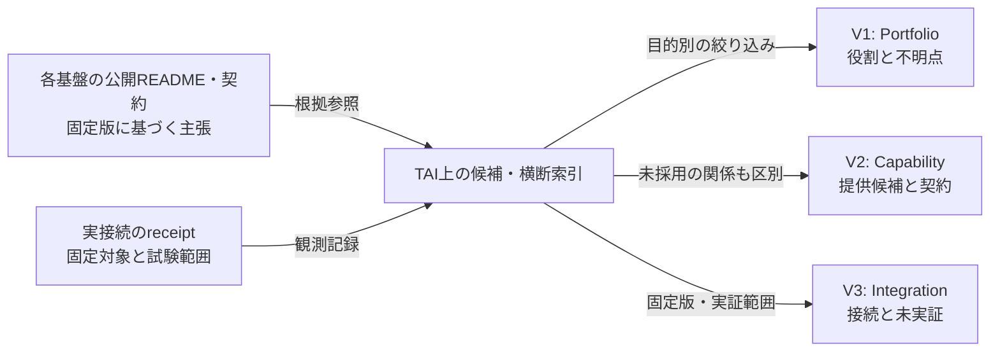

# Product Landscape View Contract v0 — 三つの図を混同しないための設計

状態: **Draft / 提案 / renderer・validator未実装**。  
関連: [横断要求](product-landscape-requirements.md)、[Product Landscape](product-landscape.md)、[知識モデル](product-knowledge-model.md)、[棚卸し](product-inventory-candidates.md)、[受入案](product-landscape-acceptance.md)。  
基準: TAI main `88a6fad6d088f98ccab6080b3b7be24b62399113`。以下の図とデータ例は、採用済みRegistry・実製品間APIトポロジーではない。

## 1. 「TAIが全体をまとめる」の意味を三種類の関係へ分割する

**A. Portfolio/Positioning** — 「どの存在が製品群の対象か」「役割・非役割・利用者価値は何か」。**文書上の位置づけ**。TAIが五基盤を説明することは、親子構成やruntime依存の証拠にはならない。

**B. Capability/Contract** — 「誰がどんな能力を提供するという定義・主張を持ち、利用側にどの版の契約が必要か」。**意味とインターフェースの境界**。Capabilityの名称が一致しても互換性を保証しない。SEIのCapability Observationの正本をTAIが再定義しない。

**C. Integration/Evidence** — 「どの版のどのProductを、何の方法で確認したか」。**接続観測や受入の限定された証拠**。TAIの[接続調査](../integrations/capability-inventory.md)や[状態表](status.md)に記録されたものを参照する。SCN-001の合成観測を正式製品間のE2E完了へ昇格しない。

この三つの問いを一つの線`depends_on`へ畳み込まない。図のノードは表示用投影であり、所有製品のlogical identityを新しく作るものではない。

## 2. Viewpoint設計（登録形式は未決）

| View | 主要な問い | 表示してよい関係 | 必須の付記 | 禁止される誤読 |
| --- | --- | --- | --- | --- |
| V1 **Portfolio** | 何があり、何を担うか | 文書に根拠を持つ役割参照、Product候補、Method候補 | scope、調査対象、分類候補、未決、出典 | TAI↔五基盤の破線 = 確定API依存 |
| V2 **Capability** | どのCapabilityが、誰により提供されると説明されるか | `described_provider`や`provides_capability`等（**正式な語彙は未決**） | 定義と実測の差、責務、Contractと別概念であること | 宣言・同名 = Compatible/Invocable |
| V3 **Integration** | 特定シナリオで何を検証したか | 検証記録に出典を持つ接続・利用対応 | provider+consumer、Source Revision、環境、操作、scope、未検証 | probe PASS = Authority/製品運用 |
| V4 **Impact**（後段） | 変更でどの直接・間接Consumerへ影響する可能性があるか | 型付きContractとSourceの関係 | 直接/推移経路、契約版、Unknown | 推移経路 = 直接利用・承認 |
| V5 **Evolution**（後段） | ある期間に何が廃止・継承されたか | 有効時点と判断根拠を伴う遷移 | valid time、recorded time、Decision refs | 最新が旧版を上書き・旧受理が復活 |

**G1ではV1だけでよい**。V2とV3は既存文章を手作業で読めることを先行条件とし、機械可読グラフ、DB、UI、独自Hostの開発をG1へ持ち込まない。

## 3. V1で実際に記述できること

[TAI README](../README.md)には五基盤の役割が記載されている。したがってV1はTAIを「横断的な課題の整理と知的活動の一巡」という**責務文脈**に置き、SUI・TEI・SEI・SHO（MMI）・EKIを役割別に並べてよい。

ただし:

- SUI/TEI/SEI/EKI/MMIの**個々の実装能力**は各Product側の説明と対応づける。
- SHOの製品同一性、MMIとの構成・置換関係は**未決**と明示する。
- TEI StudioはTEIのConsumer/プロジェクト候補であり、Product同一性のOwner判断前に独立Productを発行しない。
- CSWの方法/Skill群は公開調査で確認できるが、五基盤と同じ組織的地位・実行依存があるとは主張しない。
- TAIと各基盤を結ぶ破線には「TAIのREADMEに書かれた役割参照」を凡例として付す。

この図が答えられない問い（例: 特定APIを本番で呼べるか、稼働中のWorkerがいるか）はV1に混ぜず、V3の証拠調査へ送る。

## 4. Relation assertionを正式な辺へ投影する条件（構想）

```text
candidate assertion
  -> source provenance and revision are known?
  -> subject/object have qualified type and scope?
  -> predicate is defined for those endpoint types?
  -> effective context (time, environment, product version) is specified?
  -> relation class is documentary / proposed / accepted / observed?
  -> evidence and decision state are not conflated?
  -> viewer may see BOTH nodes, edge, labels, evidence existence,
     counts, summary, diff, error details?
  -> render under selected viewpoint; otherwise unresolved/withheld
```

これは専用Resolverの追加ではない。TAIの図に取り込む**前提条件のチェックリスト**であり、実装する場合も製品側のID解決・契約検査を無断で代替しない。凡例と条件を満たさない推測は、実線の確定辺として投影しない。

**不確実性は少なくとも二軸**: (1)関係の採否（候補／合意／否認）、(2)証拠の範囲（文書記述／静的確認／合成試験／実接続観測）。相互の軸を大小比較する単一`confidence`へ潰さない。文書に「accepted」と書かれても実接続がないこと、試験でAPI到達したとしても利用の正式合意がないことは共存できる。

**秘匿データの出力境界**: `visibility=private`のノードを非表示にするだけでは不十分。元の存在を推測できる匿名の線、隣接数、欠損理由、時差分、ツールのエラー本文からも存在を漏らさない。公開ビューでは公開可能な候補と属性だけで再計算した閉じたProjectionを使う。

## 5. VersionとSnapshotの扱い

V1の現在のデータ根拠は、[公開棚卸し](product-inventory-candidates.md)に記載した**特定commit時点のREADME**である。レポジトリの`main`最新内容と旧Snapshotの記載を混ぜず、「調査時点での確認」と「現在の稼働状態」を明確に区別する。

変化の例:

- Productの**改名**は必ずしもProduct同一性を変えない。
- Productの**分割・統合**は、Product同一性とContract移行をそれぞれ検討する。
- Contractの**版変更**は、既存Consumerが自動互換という意味ではない。
- SourceやDecisionが元のbyte列に戻る**A→B→A**でも、旧意味受理・公開権限の自動復活にはならない（[TAI #33](https://github.com/hat47x/tai-pleroma/issues/33)と[Draft #71](https://github.com/hat47x/tai-pleroma/pull/71)）。

Snapshot案: `taiCatalogCommit + productSourceRevisions[] + evidenceRefs[] + viewpoint/filter + asOfTime`。採用前に最少の再現要件を確認する。外部URIの現行内容を読み直して旧図の再現に使ったとは言わない。

## 6. 表示の具体例：これは関係を合成する機械ではない



これは**TAIの情報取り扱いの提案図**であり、TAIに新しい連携API・Runtime・共有DBが実装されているという意味ではない。判定不能な主張を勝手に偽へ変換したり、UI用node IDを恒久的な製品IDとして利用したりしない。

## 7. 拡張判断の手前で止まる条件

- G1の読者による確認がない段階で、専用Product Registryや`tai.*`独自共通契約を確定しない。
- Product/Method分類、SHO/MMI・TEI Studio・CSWの扱い、公開対象と情報の所有権はOwner判断とする。
- 外部基盤のAPI/契約が改訂されても、TAIがその基盤の技術的Authorityを乗っ取らない。
- [TEI Draft #2226](https://github.com/hat47x/tei-platform/pull/2226)のHost非必須、[TEI Draft #2298](https://github.com/hat47x/tei-platform/pull/2298)の`tei.*` namespace/opt-in compositionは、TAI側で公式実装とみなさない。
- 各ビューの受入は、[横断要求](product-landscape-requirements.md)と[未実行の負例](product-landscape-acceptance.md)に紐付ける。
