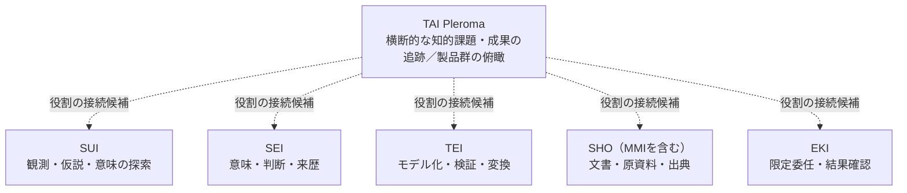

# プロダクト横断の全体像と関係図（Product Landscape v0）

状態: **Draft — 横断情報をTAIに集約する方針の設計提案。製品分類・関係型・接続方式は未採用／未実証を含む。**  
照合基準: TAI main `88a6fad6d088f98ccab6080b3b7be24b62399113`（2026-10-27確認）。  
目的: 個々の製品の内部設計を複製せず、製品群全体の位置づけ・責務・相互関係をTAIから説明できるようにする。

> **図の読み方**: 以下は**役割・利用候補の概念図**であり、製品間の実行時トポロジー、全APIの接続、互換性、運用での受入を示さない。実際の接続・固定版・未検証事項は[接続調査](../integrations/capability-inventory.md)と[現在の状態](status.md)を参照する。

## 1. 既存の五基盤とTAI

この破線は**横断構想上の役割参照**だけを示す。矢印方向は「TAIがその基盤の能力を必要に応じて利用する」という説明であり、実際の依存関係・ネットワーク通信・データ流通を主張しない。基盤同士に線がないことも、相互連携が不存在という意味ではない。

| 対象 | 位置づけの概要（各READMEに基づく） | 公開リポジトリ・詳細 | TAI側に保持すること |
| --- | --- | --- | --- |
| **TAI** | 課題→観測→解釈・判断→成果→再観測の一巡を追えるようにする | [TAI](../README.md)、[最小スライス](architecture-slice-001.md) | 全体の役割整理、横断関係・判断の索引、シナリオと影響先 |
| **SUI** | 未整理な観測・違和感・仮説、意味形成の過程 | [SUI](https://github.com/hat47x/sui-sensemaking) | 利用候補、公開可能な投影の参照・版・利用条件 |
| **TEI** | 知識／モデルと技術を分離し、プラグインによって検証・変換・実現へつなぐ | [TEI](https://github.com/hat47x/tei-platform) | 利用する能力・契約・関係の索引 |
| **SEI** | 観測・解釈・判断・Authority・結果等を区別し、来歴と意味を扱う | [SEI](https://github.com/hat47x/sei-cognition) | 判断や根拠への参照。SEIの意味の正本をTAIに複製しない |
| **SHO（MMIを含む）** | 文書の作成・参照と出典追跡。現時点の検証対象の一つはMMI | [MMI](https://github.com/hat47x/markdown-matrix-injector) | 参照対象・形式・表示／生成物との対応。SHO全体とMMIを同一製品と断定しない |
| **EKI** | 範囲・権限を限定した委任、Taskの受理・実行・結果の区別 | [EKI](https://github.com/hat47x/eki-fabric) | 利用条件と検証記録の参照。Task受付を実行完了としない |

**対象範囲の限界**: この表はTAIの既存READMEで明示された**五つの関連基盤＋TAI**の初期俯瞰であり、TAIが管理するべき「全プロダクト」の完全な棚卸しではない。別の研究プロダクト、ツール、非公開リポジトリの登録対象・公開可否は未調査。未登録を不存在と解釈しない。

追加の公開側棚卸しは[公開リポジトリの候補一覧](product-inventory-candidates.md)を参照。五基盤に含まれないCSW等を、根拠なしにTAIへ実装上依存する製品としては扱わない。SHOという構想上の役割と実在するMMIのソフトウェアも同一IDへ統合しない。

## 2. 何をTAIの正本とするか

- **TAIが管理**: 横断的なProduct IDと説明、プロダクト群の位置づけ、能力の提供・利用の対応、横断関係の合意・未決、影響先の索引、俯瞰用の図とViewpoint。
- **各製品が管理**: 実装、ローカルなモデルやAPI仕様、内部の権限・状態、テストおよび運用証拠。TAIは固定Revisionと参照を持ち、現物を複製しない。
- **SEI等との境界**: 根拠・判断の**横断索引**と、意味・来歴・判断記録の**意味上の正本**を区別する。TAIに汎用Decision/Claim/Evidenceエンジンを二重実装しない。
- **Hostとの境界**: 本書の「全体をまとめる」は中央Host、共通ランタイム、統一DB、統一APIの導入を意味しない。

詳細な型・状態・検査規則は[プロダクト横断情報モデル案](product-knowledge-model.md)を参照する。

## 3. 異なる目的の図を分ける

| Viewpoint | 主な問い | 収録する情報 | 初期対応 |
| --- | --- | --- | --- |
| Product Landscape | どんな基盤があり、何を担うか | Product、役割、対象範囲、未調査表示 | **本書の概念図** |
| Product Positioning | なぜその製品が独立しているか | 目的、利用対象、責務と非責務 | 表の説明のみ |
| Capability Map | どの能力を誰が提供するか | Capability、Provider、利用候補、証拠 | **次段階の提案** |
| Contract & Integration | 何を通じて連携するか | Contract、Consumer、Provider、版、環境 | [接続調査](../integrations/capability-inventory.md)に接続実績を保持 |
| Dependency & Impact | 変更で何に影響するか | 直接関係、契約版、利用者、未確定 | 未実装 |
| Evolution | 過去・現行・将来の違い | 置換関係、判断、時点、移行状況 | 未実装 |

## 4. 既存資料との接続と重複防止

- [最小の知的機能スライス](architecture-slice-001.md): 観測から結果までの**シナリオ内の責務境界**。本書は**製品群の俯瞰**であり、この文書を置き換えない。
- [接続調査](../integrations/capability-inventory.md): 各基盤の具体的な契約・固定版・実接続と未検証を扱う。本書は「接続確認済み」と主張しない。
- [現在の状態](status.md): SCN-001の参照実装と公開gate。全製品の成熟度の判定表ではない。
- [Issue #67](https://github.com/hat47x/tai-pleroma/issues/67): SUI/EKIの接続面に関する調査材料。Ownerの確認なしに、接続契約の正式採用へ昇格させない。
- [Issue #28](https://github.com/hat47x/tai-pleroma/issues/28)・[Issue #33](https://github.com/hat47x/tai-pleroma/issues/33): 観測と成果物のbyte対応、旧判断の再受理に関する負例。一般的な横断カタログ検査へ安易に置き換えない。
- [TEI #1124](https://github.com/hat47x/tei-platform/issues/1124): TEIの編集・投影・Source Acceptanceの実証責務。本書はその実装をTAIに移さない。
- [TEI Draft PR #2226](https://github.com/hat47x/tei-platform/pull/2226): TEI独自Host非必須の方針案。**Draft・未merge**を採用済み実装と扱わず、他者Draftを変更しない。

## 5. 採用判断に必要な次の成果

1. **対象の棚卸し**: 公開・非公開の境界を先に定め、Product / Project / Component / Repositoryの分類候補を作る。未知はunknownのまま残す。
2. **主要な関係を証拠付きで登録**: 最初は「基盤が能力を提供する」「TAIがシナリオで利用候補とする」「確認された参照接続」の区別に限定する。
3. **三つの図**: Product Landscape、Capability Map、Contract/Integration Mapを異なる凡例・根拠条件で作る。
4. **受入**: 名称衝突・根拠不在・過去版の再使用・未観測→不存在の誤推論・非公開情報の露出を負例として検査する。

採否と優先順位はOwner判断を要する。本書の追加だけで、プロダクト分類や契約の正式合意が成立したとは主張しない。
