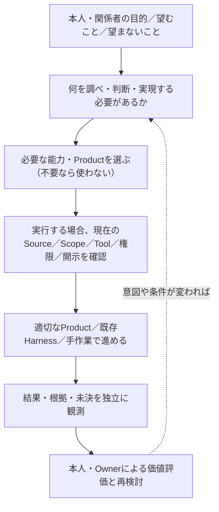

# TAI全体像の横断読解ガイド v0 — 課題から製品選択・証拠・結果まで

状態: **Draft / 読者向けの解釈・検査案 / Owner未受理**。初版2026-11-09、2026-11-11の独立実証を§7〜8へ追補。本書の編集自体は実Harness・実業務の新試験ではない。
照合したTAI main: `0b5115a629863d57566b8db36a6d67bc21727039`。他Productの現行main全件照合、実Harness再実行、実業務の結果観測を実施したという意味ではない。

## 1. この文書の位置

[Product Landscape](product-landscape.md)は「誰が何を担うか」、[View Contract](product-landscape-view-contract.md)は「役割の線と実接続の線を混同しない条件」、[知識モデル](product-knowledge-model.md)は「型・根拠・判断・版」、[配布設計](product-family-delivery.md)は「固定されたProduct Artifactの組合せ」を説明する。

**本書だけが追加する問い**は「一つの利用目的から始めて、これらの別々の説明をどの順に読み、何がまだ言えないかを判断するか」である。新しいViewpoint、Product Registry、canonical Activity Store、共通Contract、Host、Runtime、Owner、受入Gateを導入しない。現行文書に存在するV1〜V5と各Issueへ接続する**読者用の横断ナビゲーション**である。

**中心命題（検証対象）**: YI Constellationの増分価値は、全部のProductを常に動かすことではなく、主体が目的に応じて独立能力を選択・交換・省略でき、解釈・判断・実行・結果の区別を失わずに活動を継続できることにある。これは価値仮説であり実利用者の価値受理ではない。

## 2. 「全体」を一つの図へ押し込まない

| 読者の問い | 既存の閲覧先 | 正本・意思決定の所在 | その資料からは言えないこと |
| --- | --- | --- | --- |
| **何があり、何が独立か** | [Product Landscape](product-landscape.md) V1、[対象棚卸し](product-inventory-candidates.md) | 各Productの固有説明。横断の対象・分類は[TAI #73](https://github.com/hat47x/tai-pleroma/issues/73)で未決 | 公開Repo一覧＝全製品、役割の破線＝API接続 |
| **必要な能力を誰が提供するか** | [View Contract](product-landscape-view-contract.md) V2、[接続調査](../integrations/capability-inventory.md) | CapabilityとContractの詳細は各Provider/Product | 同名Skill/Tool＝実Load済み、互換、呼出資格 |
| **どの条件で利用・観測したか** | V3、[status](status.md)、[SCN-001](../scenarios/SCN-001-shared-space-guidance.md) | 実Source・Consumer・Effect・Meaningは各Owner/Host | 合成PASS＝現実の業務受入、Task受付＝実Effect |
| **どう構成を届けるか** | [配布設計](product-family-delivery.md)、[TAI #74](https://github.com/hat47x/tai-pleroma/issues/74) | 各Productの単体Release、TAIの構成別Release案、YIサイトの公開判断は別 | Bundleの版固定＝現在のProvider/Grant/Use-time適格 |
| **変更後も何を使えるか** | V4/V5（後段）、[TAI #271](https://github.com/hat47x/tai-pleroma/issues/271) | 依存・Evidenceの適用範囲を照合し、各Productが必要な再資格化を実行 | 旧PASSの全用途継承、unknown辺＝無関係 |
| **本人にどんな結果・価値が生まれたか** | [価値研究](yi-constellation/value-needs-requirements-2026-11-01.md)、[評価計画](yi-constellation/value-realization-research-protocol-2026-11-01.md)、[TAI #127](https://github.com/hat47x/tai-pleroma/issues/127) | 本人・影響者の評価、正当なOwnerの採否、実世界のProvider記録 | 正答・納品・Tool成功＝本人の満足、QoL、社会の同意 |

特に **YI Constellation＝ブランド／サイト名**、**TAI Pleroma＝横断する独立Product**、**TAIリポジトリ＝横断索引と構成別配布の作業拠点**は異なる。同じリポジトリで文書を管理することは、TAIが各ProductのRuntime・Source・意味・権限を所有することを意味しない。

`SUI / SEI / TEI / SHO（MMIとの同一性は未決）/ EKI` は初期の五つの関連基盤であり、CSWは探索Method/Skill等の分類候補、TEI StudioはTEIに関係する開発・表示領域の候補である。これらを自動的に第六・第七の正式基盤、または独立Productと確定しない。

## 3. 活動を読む順路（概念上の依存ではなく、問いの順序）

*これは実装済みのWorkflow、強制順序、中央Orchestrator、サービス間の通信図ではない。各段の内部処理も省略された概念図であり、TEIの「有効Pipelineの完全表示」と同じ不存在判断には利用できない。*

- **選択の自由**: 外部Harness＋通常ファイル／Markdown／CLIだけで十分なら、追加のTAI横断SkillやProduct利用を義務化しない。独立したProductの単体利用も維持する（[TAI #168](https://github.com/hat47x/tai-pleroma/issues/168)、[#422](https://github.com/hat47x/tai-pleroma/issues/422)）。
- **認知の境界**: SHO/MMIの出典、SUIの仮説、SEIのDecision/未決、TEIのモデル・実現、EKIの委任・Effectを一つの`success`へまとめない。CSWは探索の豊かさを増す候補であり、正式受理を代行しない。
- **実行の境界**: 外部Harnessは推論・Tool呼出し等を担い得るが、現在の開示、対象への作用、独立観測は各Product/Host/Providerに従う。`read-only`の説明だけではRawの隔離・送出制御を証明できない（[TAI #232](https://github.com/hat47x/tai-pleroma/issues/232)）。
- **時点の境界**: 固定Releaseの再現性と、現在ActivityでのSource/Grant/Provider/Consumer適格性は別（[TAI #74](https://github.com/hat47x/tai-pleroma/issues/74)、[#271](https://github.com/hat47x/tai-pleroma/issues/271)）。
- **成果の境界**: Artifact生成、受領、独立Read/Effect、本人が目的を達したか、第三者に負担を生んだかは別の問い。技術的な結果から人間の価値を自動推論しない。

## 4. SCN-001で「同じ活動」を三つの別の図として読む

題材は架空の施設案内「予約不要」と「会議室は事前予約」の解釈である。合成fixtureと参照接続を使う例であって、実施設の規程、公開許可、全Productの実API互換は未確認。

| 図の種類 | この事例で追うもの | 観測／保留の境界 |
| --- | --- | --- |
| **役割図（V1）** | 原資料をSHO/MMI、異なる解釈をSUI、判断の由来をSEI、規則候補の検査をTEI、必要なら委任をEKI、活動全体の索引をTAIとして説明 | 全Productが必須、製品間が直接接続という意味ではない |
| **接続・証拠図（V3）** | どの固定fixture・API/CLI・出力のどの範囲が実際に読まれ、照合されたか。根拠は[status](status.md)、[接続調査](../integrations/capability-inventory.md) | MMI/SEI/TEI/SUIの限定観測、合成Decision、EKIの`queued`は実業務のEffectやOwner受理ではない |
| **受入・結果図** | 人が例外規則を確かめ、変更案を受け入れ、公表し、利用者への結果を観測したか | [R-01〜R-07](../evaluations/SCN-001-real-object-review.md)の実物受入・公開判断と利用者への効果は別。現在の合成記録から完了を断定しない |

同じデータや名前を表示する場合でも、図ごとに凡例・対象版・実施状態・未実証を付ける。ある図の矢印から他図の「契約」「権限」「効果」を生成しない。

### 読者が試せる質問

1. **TEIをこのケースから外したら何が変わるか？** 必要な規則の意味検査が失われる条件を示せるか。単なる案内文の比較で価値差が無ければ利用を強制しない。
2. **EKIで`queued`となったら何が言えるか？** Taskが受付段階にあることに限り、実作業完了と答えない。
3. **案内文がA→B→Aと元に戻れば、過去の判断を復活できるか？** 文言一致で現在のOwner受理・Authorityを復活させない（[TAI #33](https://github.com/hat47x/tai-pleroma/issues/33)）。
4. **文書・Sourceが新しい版になったら、過去のどの証拠を残すか？** 旧証拠は歴史として保持し、現行利用の資格は影響範囲を検討して再確認する（[#271](https://github.com/hat47x/tai-pleroma/issues/271)）。
5. **外部Harnessを別のものへ替えたら何を再確認するか？** 実Skill Load、Tool到達、Source/Disclosure/Grant、同一Attemptの結果と実Consumerを区別する。実H3 Loadの限定証拠があっても、H2/H3の比較適格は未成立とする（[#168](https://github.com/hat47x/tai-pleroma/issues/168)）。
6. **利用者が「使わない」「延期する」を選んだら失敗か？** 目的と正当な本人意思に照らす。Task完了率だけで価値を評価しない（[#127](https://github.com/hat47x/tai-pleroma/issues/127)、[#422](https://github.com/hat47x/tai-pleroma/issues/422)）。

## 5. G1の読者検査から実証へ進む最小順序（提案）

| 段階 | 最小成果 | 失敗・保留の条件 | 既存Owner |
| --- | --- | --- | --- |
| **A. G1読者確認** | 五基盤＋TAIの役割と、未分類（SHO/MMI・CSW・TEI Studio）・対象外/未調査を言い分けられる | 図の破線を実APIと読む、非公開対象の存在を漏らす、候補を正式製品にする | [#73](https://github.com/hat47x/tai-pleroma/issues/73) |
| **B. 価値のベースライン** | 同じSCN-001等をMarkdown/既存Harness/手作業でも行い、TAI連携の増分・負担を対照する | 製品数・機能数・合成PASSを価値の代理指標とする | [#127](https://github.com/hat47x/tai-pleroma/issues/127)、[#422](https://github.com/hat47x/tai-pleroma/issues/422) |
| **C. 必要時の実Product/Harness証拠** | 実Source read、実Tool/Skill load、利用Consumer、結果を別々に確認する | 不適格な隔離、試験間のSource差、独立Expected不足、実Effect未観測 | [#168](https://github.com/hat47x/tai-pleroma/issues/168)、[#271](https://github.com/hat47x/tai-pleroma/issues/271)、各Product |
| **D. 配布と使用を別判定** | 固定Product/Skill/Adapter構成と、その用途での現在資格を別に報告 | Release PASSを現在権限や文書ClaimのPASSへコピー | [#74](https://github.com/hat47x/tai-pleroma/issues/74)、各Product |
| **E. 人の受理と価値評価** | 対象のOwner受理、実際の結果、本人/影響者の評価 | 自動試験の成功だけで社会的同意・業務公開の許可を宣言 | [#127](https://github.com/hat47x/tai-pleroma/issues/127)、既存の実物レビュー |

**この文書自体では読者試験、H2/H3比較、実Owner受理、実顧客/個人の価値調査、シリーズReleaseを実施していない。** 2026-11-11時点で別PRに記録された**限定的な実Product間E2E**は§7に分けて掲載し、現実の業務E2Eとは扱わない。 #73のG1、#74の配布、#168のHarness、#271の再資格化、#422の価値適正化の完了条件を一つの新しい合否に統合しない。

## 6. 更新規則と反証可能性

- 読者が必要とする問いを示せない項目は、製品・エッジ・共通スキーマを増やす根拠にならない。
- 他Productの仕様や結果は固定Revisionと出典に戻る。TAI側に技術・意味・実行権限の第二正本を設けない。
- 旧Snapshotの記述と最新Issueの追補が衝突する場合、まずそれぞれの確認時点と適用範囲を提示し、旧図を黙って「現在図」に置き換えない。
- 図に「表示されない」ことは、未収集、適用範囲外、秘匿、検査不成立、真の不存在のどれかが未確定である可能性を保つ。TEIの閉じた実効Pipelineにおける不存在判定を、公開範囲未確定のYI/Product Catalogへ移植しない。
- この文書が他の既存資料と同じ説明を増やすだけなら、リンクだけを残し削除する。新しいEngineや永続データ構造を正当化するための文章にはしない。

## 7. 2026-11-11追補：TAIの介在が不要な場合と、横断の必要性が現れる場合

**照合の基準**：TAI main `2a8fd9fa11a082c28e634ec3412aa88354bc4e63`（2026-11-11確認）。本節は既存の実装・試験を**固定した出典の適用範囲に限って**参照する。各Draftの内容はmainの製品保証ではなく、#73の正式分類、#422の価値判断、各Product Ownerの意味・権限受理を変更しない。

| 観測したこと | 言える範囲 | 言えないこと・未解決 |
| --- | --- | --- |
| [TAI Draft #601](https://github.com/hat47x/tai-pleroma/pull/601)：公開TEI実CLI、固定TEI `0600cc2adc383efb38651b59105498193c640e41`。単独read-only調査B0は3コマンド、30,362出力bytesで対象へ到達 | **単独JobではTAI・Product Skillなしでも目的が成立する**例が存在する。Skillの `entries[]` と実CLIの `result.entries[]` 不一致を観測（修正OwnerはTEI #2605） | B1の逐語的なSkill追従で候補0件は**モデルのSkill利用失敗**の証拠ではない。B0/B1/B2のモデル・費用・人手比較はNOT RUN。TAI横断Skillの文脈38,517 bytesは当該Jobでは不要な追加候補であり、時間・Token損失の測定値ではない |
| [TAI PR #594](https://github.com/hat47x/tai-pleroma/pull/594)（merged）：TEI CLIから限定的に能力参照・Revision・Handoff・旧Receiptのstaleを区別 | 同一Activityの参照で「旧Sourceと現Sourceが違う」を検知する最小経路の成立 | 実Product Consumerの受領、現在Grant、意味受理、Skill実Load、横断的な継続価値は未証明 |
| [TAI PR #602](https://github.com/hat47x/tai-pleroma/pull/602)（2026-11-11 merged、merge `c9817b016440810d3d5ed29b229b9d1640e29fb1`）：SUI実Producerテスト→SHO実CLIによる**合成入力の限定Product間受領**、Receipt返送、TEIのread-only証拠の引用、別プロセス再受領を記録。実Harness CLI切替の観測も同PRの実行票にある | Handoff票がSource参照・未決・用途制限を落とさずに運び、Consumerが独立再読取する候補は**抽象構想だけではない**。現在の詳細な状態は同PRの[後続実行票](https://github.com/hat47x/tai-pleroma/blob/14a5076ce516d9e066747fc401e28dec400b1ad3/docs/yi-constellation/cross-product-handoff-execution-tickets-2026-11-11.md)を正とする | G6は`reference-linked-unverified`まで、Claim closure/負例が残る。実Sourceの意味、実UI/Host永続Session、Grant/OS egress、実業務成果・Owner受理、別HarnessのSkill/MCP適格は未証明。「G2〜G6の票が記録された」を全必須条件PASSと読まない |
| [TAI Draft #600](https://github.com/hat47x/tai-pleroma/pull/600)／[#271](https://github.com/hat47x/tai-pleroma/issues/271)：未統合TEI Draft #4076と隔離した実PostgreSQL 16.15・**合成行33件**で、同じWorld fingerprintのまま実行行・Provider・RLS可視範囲が変わる例を観測 | **モデル定義の同一性だけではデータ行Claimを再利用できない**。定義D／行R／不在Zの違いを受入時に保つ必要がある | TEI mainの一般的な実Read機能、Provider現行Grant、同一Session保証、本番データ、SHO/SEI実受領は未確認。J1pは観測ケースで不正な再利用0だが、**必要なReadの節約は未達**。選択的再確認が低コストと主張しない |

上記から、横断製品の仕事を増やす際の**必要性の境界**を、次のように定める（設計仮説）。

- **局所のJob**：Product自身のCLI/UI・外部Harness／手作業で充分なら、TAIの横断Skill・中継・Registryを追加しない。これはTAIに価値がないという一般結論ではなく、**当該用途にTAIの追加介在を義務づけない**という判断。
- **複数Product間の受渡し**：Product固有のread-only Projection、限定Handoff、Consumer独立Readbackを優先する。新しい横断Runtimeより既存[TAI #271](https://github.com/hat47x/tai-pleroma/issues/271)／[PR #602](https://github.com/hat47x/tai-pleroma/pull/602)を参照し、接続が成立しても**どの主体に増分価値が生まれたか**はまだ評価する。
- **Source/Provider/権限の変更後**：過去に正しかった定義DはRevisionで限定評価できても、行R・不在ZはProvider・可視範囲・実Readを別に確認する。特に0行は「可視範囲内で0件」と「世界に存在しない」を区別する。Product/Hostの現行受入なしにTAIが一括でqualifiedへ昇格しない。
- **実外部作用**：Tool成功、受領Receipt、形式的Claim、Product実Readと、Provider/人間が受理するEffect/Outcomeを切り離す。役割は[TAI #168](https://github.com/hat47x/tai-pleroma/issues/168)／[#232](https://github.com/hat47x/tai-pleroma/issues/232)／各Product Ownerに残す。

## 8. 価値を判別する最小の対照（新規Gateではなく既存評価への接続）

製品を何個使ったかでなく、**利用者の目的に対して何を追加する理由があるか**を、同じJob・公開Source・Revision・許可条件・独立Expectedで比較する。#422のValue/Ablation、#488のX01/採点、#127の主体別価値、#271の現在資格を利用し、第二の実験器・評価用Score・全体Ownerを作らない。

| Job/条件 | 最小対照 | 追加経路（必要時のみ） | 判別したい増分と必要な反例 |
| --- | --- | --- | --- |
| **J-L 局所のTEI調査** | B0=既存CLI／Harnessだけ | B1=Product Skill、B2=TAI横断Skill | Sourceを正しく見つけたか、未決を捏造しないか、Schema drift、余計なProduct選択、追加byte/Tool/Token/人手。#601のB0実CLIは既知だがモデル比較は未実施 |
| **J-H 二製品の文書引継ぎ** | B0=明示ファイル＋人による出典照合 | B1=既存Product間Handoff（#602）、B2=用途別TAI索引を任意追加 | Producer/Consumerの実bytes、根拠と未決、受領失敗後の再試行、必要な再説明、欠損・誤帰属。限定受領の正例は存在しても、利用者価値の増分比較は未実施 |
| **J-R 版変更後の再開** | B0=元記録からの再読／確認 | B1=Product Revision照合（#594）、B2=依存対象に限る再資格化（#271/#600） | D/R/Z、Source-only変更、RLSによる0行、Provider変更、ABA、旧Grant。**正しさと再検査費用を別指標**で測り、正確でも節約不能なら節約効果を主張しない |
| **J-O 実際のOutcome** | B0=既存の人手・一般Harness | B1=必要Productだけ選択、B2=横断継続 | 実結果・本人の判断・第三者の負担・停止/延期の自由。現実の資料、Owner Authority、影響者評価が無ければ技術的成功に止める |

評価列は、**誤った成功／適切な保留／不必要な保留／見逃し／開示違反／必要能力の選択／実Consumerが読んだ物／実Outcome／時間・Token・Tool・人手**を別々に保持する。単一の合成スコアやモデル多数決に畳み込まない。

**優先順（提案）**：①既存#601の「不要な追加を避ける」反例を維持 → ②#602の既存実受領で未検証のProduct Oracleと独立Consumerを埋める → ③#271/#600のD/R/ZとGrantの用途別再資格化を実Providerに接続 → ④同条件でTAI任意追加の人間価値と費用を対照。G1 Product分類（#73）、統合配布（#74）、TEIセルフビルド/Studio固有受入、CSW探索Methodの採否を、この順序のために新しく全製品必須条件へ昇格しない。

**反証・撤退**：単独JobでTAI追加が出力品質・確認負担・継続性を改善しなければ当該Jobでは追加しない。複数Product経路でも、既存ファイルやProduct固有APIで同等なら横断の必須Coreを増やさない。逆に、必要なAuthority／Source／Consumerの資格が欠ければ、便利さを理由に安全な確認を削らない。これらは利用価値の判別方針であり、#422・#127の実利用価値受理を**達成済みとするものではない**。

## 9. 2026-11-11追補：活動の継続・表示の完全性・成果の達成は別の契約

**追加の照合基準**：TAI main `2d44d82583354ec46dc8e4241c01d49c8c20d67d`（2026-11-11確認）。前節のmain `2a8fd9fa...` は当時の固定Snapshotであり、過去の観測版を現在の実証へ黙って差し替えない。[PR #602](https://github.com/hat47x/tai-pleroma/pull/602)は**merged**、[PR #624](https://github.com/hat47x/tai-pleroma/pull/624)（SCN-001成果の主張別観測）と[PR #622](https://github.com/hat47x/tai-pleroma/pull/622)（SVG/AXの関係再構成）は**merged**。本追補ではProduct/Providerの新たな実行やOwner受理を行っていない。

### 9.1 三つの別の性質

| 性質 | 適切な質問 | 最小の裏付け・既存Owner | 否定する短絡 |
| --- | --- | --- | --- |
| **Activity continuity** | 次の人・Product・Harnessが、何をしようとしていて何が未決かを再開できるか | 固定された対象・Source・未完の義務・用途と開示Scope・Consumerの独立再読取。[#271](https://github.com/hat47x/tai-pleroma/issues/271)／merged [#602](https://github.com/hat47x/tai-pleroma/pull/602) | 同一Session/票の存在＝現在Grant、Meaning、Product受理 |
| **Capability usability** | 今の対象・環境で、必要なTool/Skillが正しく使えるか。そもそも追加が必要か | 既存Product CLI/契約と独立Expectedを対照。可用性・Tool実Load・Disclosure/Host Grantは別。[#488](https://github.com/hat47x/tai-pleroma/issues/488)／merged [#601](https://github.com/hat47x/tai-pleroma/pull/601) | Tool一覧・Skill説明＝現在利用資格。追加Product＝必ず増分価値 |
| **Outcome attainment** | 誰のGoalのどの部分が、受取先・実Effect・本人評価まで達したか | `T-Draft`／`R-Deliver`／`S-NoUnauthorizedPublish`／`P-Publish`／`Effect`／`Value`を別Claimとして読む。[SCN-001 #624](https://github.com/hat47x/tai-pleroma/pull/624)（Draft）、[#127](https://github.com/hat47x/tai-pleroma/issues/127) | `passed: true`＝成果／適切な停止＝公開達成／Artifact一致＝本来の受取先が受領 |

`#624`の2026-11-11合成記録で、D-04のbytes一致＋別実装SHOの限定Reader一致と、公開gateの拒否は同時に観測されている。**「無断公開を防いだ」は制約の充足であり、公開というGoalは未達。人間の受理・利用者ValueはNOT RUN**。比較なしでも`passed:true`となる場合、また別Attemptの同bytesを今回のGoal達成に流用する場合を負例にしている。これは本書で新しいOutcome Engineを作る理由ではなく、既存#624のClaim別観測を正しく読む理由である。

### 9.2 「図中にない」の意味は閉じた対象範囲を確かめた場合だけ成立する

図は**対象の母集団と閉包条件**が先に明示された場合に限り、「見えないものは（その範囲で）存在しない」と言える。図の完成度や見た目でClosed-Worldを仮定しない。既存[View Contract](product-landscape-view-contract.md)のV1〜V5を追加・統合せず、各図を読むときの注意とする。

| 図・実行証拠の種類 | その図で確かめられること | 「ない」と断言できないこと |
| --- | --- | --- |
| TAI **Portfolio**（V1） | 収集・開示されたProduct/Role候補と未分類 | 未登録、未収集、非公開のProductや関係。公開Projectionの0件は世界の0件でない |
| TAI **Capability / Integration**（V2/V3） | 主張される能力、固定対象の実接続／実Read | 発見されないToolの実不存在、全ての必要Consumerの利用、現行Grant |
| TEI **閉じた実効Pipeline／Self-buildの宣言・実行図** | 定義済みの入力・Node/Edgeと、個々の検査が観測した閉包範囲 | 宣言外の子プロセス作用、暗黙のI/O、自己申告したstateやProvider使用、実行時の未観測枝。TEI [#4299](https://github.com/hat47x/tei-platform/issues/4299)では、childの自己申告だけを用いたstate分離のClaimが、実際には共通state使用でも成立する反例を報告 |
| **Render/A11y** | 表示されたノード・直接Edgeが図の読み手へ伝達されたか | SVG/Accessibility Treeの一致＝Pipeline実行完全性、全Product/Consumerに対する可視化。TAI merged [#622](https://github.com/hat47x/tai-pleroma/pull/622)は関係のAX再構成を対象にし、Screen Reader操作や実Source整合は別 |
| **Effect/Outcome** | 具体的なAttempt、保存物、独立Read、受領・結果のうち実観測したClaim | Digest一致から実Attemptの同一性、`queued`からEffect、適切な拒否からGoal達成、少数の実測から本人の価値 |

**閉包を主張する最小条件（説明用チェック、独立Schema/Gateではない）**： (a) 問い・対象母集団・用途・観測時間を定義、(b) 実際に読まれ／実行された範囲と、省略された範囲を別表示、(c) 証拠の発行者・Source Revision・Attempt/環境・Consumerを追跡、(d) hidden/unknown・失効・到達不能を「不存在」とせず、(e) 実行を示す観測と子プロセス自身の申告を区別する。**TEIの有効Pipelineの可視化目標は尊重するが、TAIの部分的な横断Catalogへ閉世界を誤適用しない。**

### 9.3 CSW三役・TEIセルフビルドとTAI全体像の関係

- **CSWの生成者／批評者／媒介者**は、候補を広げ、別視点で反証し、適切な探究手順を調整する*任意Method*として扱う。媒介者は製品Owner・外部Host Grant・社会的合意の代行者ではない。TAI側で三役の常駐Agent/中央Decisionを義務化しない。[#422](https://github.com/hat47x/tai-pleroma/issues/422)の通常手段B0／汎用発想・批評B1／CSW B2の比較とCSW自身のOwner判断に接続し、独立Oracleで新規性・探索の幅・修正負担・費用を検証するまで「CSW採用で優れる」と主張しない。
- **TEIのSelf-build**はDeclared Graph／Actual Execution／Artifact Evidence／Qualificationを分離する。自己申告をもとに`qualified`へ昇格できないことは[#4299](https://github.com/hat47x/tei-platform/issues/4299)の反例に現れている。TAIがTEI内のBuild/Generator/Stateを監査正本として再実装せず、実Buildで誰がどの出力を観測したかの資格を用途限定で参照する。
- **Diagram completeness**と**実用成果**は別。Product内の有効Topologyが再構成できること、図のEdgeが閲覧者へ正確に伝わること、Product間Handoff/Consumerが正しく成立すること、ユーザーのGoalが達成することは、それぞれ別の試験である。

### 9.4 次に何を比較するか（既存Ownerへの引渡し）

1. **単独Jobを壊さない**：TEIのread-only B0を維持。B1 Product Skill、B2 TAI横断Skillの追加便益と失敗を同一Source/Tool/Profile/独立Expectedで比較。#601/#488が所有。
2. **実Handoffを過大計上しない**：merged #602の合成資料・実SUI/SHO Consumer観測を参照し、未実証の実対象・現行Grant・Product Oracleを#271／各Productへ。新しいTAI共同正本は作らない。
3. **成果のClaimを省略しない**：#624の`passed:true`でもT-Draft保留、別Attempt、公開拒否とGoal未達の反例を既存#28/#127/#422の評価にリンク。新しいOutcome Storeや第二Runnerは作らない。
4. **閉包・自己申告の反例はOwned Productで直す**：#4299はTEIセルフビルド、#622はTAI図のAX再構成（merged）、#232は外部送出と実OS境界であり、TAI全体像ガイドには**「何が実証で、何が読めないか」**だけを残す。

**反証可能な価値仮説**：局所JobでTAIが介在してもGoalの正しさ、再開容易性、必要な判断の減少、総費用に差が出ないなら、そのJobにTAIを必須にしない。多Productでの継続も、普通のファイルとProductの正本参照で同等なら、新しい共有Runtimeを要求しない。安全性・開示・意味・Authorityを削って速度を稼ぐ比較を認めない。

## 10. 2026-11-12追補：量化された主張・証拠閉包・回復を別々に読む

**証拠の固定点**：TAI main `ec9089a8874f7972fd481d62eb11af855f606b14`（2026-11-12照合）、TEI main `ea9e4560a835323c1d6d748486216b9ea011a965`。既存のTAI merged #601（CLI/Skill drift）、#602（SUI→SHO Handoff）、#622（RQ7 AX）、#636/#637/#638（G5/G4 Claims補正）とTAI Draft #600/#624、TEI merged #4409（ETL設計）、Draft #4487（TEA証拠量化）、#4464（表現の可逆性）を**各々の固定観測範囲で読む**。この文書での新CLI/Provider/実Agent試験、Product Owner受理、利用者の価値測定は実施していない。

### 10.1 Claimを「同じsuccess」にせず、問いごとの閉包を示す

| 問いの形 | 正例の最小根拠 | 否定・全称・完了を主張するのに不足し得る根拠 | 既存のOwner／反例 |
| --- | --- | --- | --- |
| **存在**：「特定の対象／行／成果物がある」 | Productの具体的なPositive Witness、Source・Scope・Attempt・位置/内容の照合 | ある対象の発見を、別Audience/時点/母集団の存在へ昇格しない | TEI #2586／TAI #271。実PGではWorld FP一致でもRowsetが変わる |
| **不存在**：「ある条件の対象が一件もない」 | 特定範囲を実Readしたという限定観測までは可能 | Source集合、Query/Filter、Snapshot/期間、RLS/Disclosure、全ページ/全Chunkの**必要閉包**がない0行から、世界全体の不存在は言えない | TAI Draft [#600](https://github.com/hat47x/tai-pleroma/pull/600)のRLS下の0行／実削除後0行の同値 |
| **全称**：「全ての対象が条件を満たす」 | 1反例で全称は否定可能 | いくつかの合格Sample・一部Stage・限られたGraph Edgeでは全母集団の合格を証明しない。宣言Invariantと実履行の観測も別 | TEI TEA Draft [#4487](https://github.com/hat47x/tei-platform/pull/4487)の存在／全称／不存在、TEI [#4464](https://github.com/hat47x/tei-platform/pull/4464)の投影Matrix 11セル判定・未カバー21組 |
| **処理完了**：「Batch/ETLを終えた」 | 固定入力、受理したRun、限定出力Artifactの実記録 | Chunkの部分成功、Stage完了、`exit 0`、Artifact存在から、全入力処理／Publish／Consumer受領／業務受理を一括で導かない。再実行と訂正Runは別 | TEI merged [#4409](https://github.com/hat47x/tei-platform/pull/4409)は設計のみ・実ETL未実装、初回TSV縦断は計画 |
| **同一Task／Attempt**：「同じ操作を再開した」 | Producer/実HostのTask ID・Attempt・Operation Identity、結果の参照 | 同じArtifact digest、同じSessionラベル、同じHandoff票、`duplicate`応答は実結果の完全受領や同一Live Sessionを証明しない | TAI [#624](https://github.com/hat47x/tai-pleroma/pull/624)のEKI実lost-ACK（Draft）。同じTaskの再送は二重実行を抑制したが、Agent再起動後は出力本体が失われた |
| **現在の利用許可**：「この相手へこの情報を渡してよい」 | Productの現在Disclosure/対象と、実Host/Providerの現在Grant、実Recipient/Sinkでの観測 | TicketのAudience・Skill文字列、Source Fingerprint、`noUnapprovedSourceAutoSend:true`等の宣言では外部拒否・非送信を証明しない | TAI merged [#636](https://github.com/hat47x/tai-pleroma/pull/636)／[#637](https://github.com/hat47x/tai-pleroma/pull/637)／[#638](https://github.com/hat47x/tai-pleroma/pull/638)、[#232](https://github.com/hat47x/tai-pleroma/issues/232) |
| **Effect／Outcome**：「作業・業務・人の目的を達した」 | 実Provider独立Readback、業務Ownerの受理、影響を受けた本人の評価を**該当する主張ごとに**観測 | Tool ACK、`queued`、Receipt、別実装のbytes一致、正しい公開拒否、`passed:true`を実業務Goalの合格へ自動昇格できない | TAI Draft [#624](https://github.com/hat47x/tai-pleroma/pull/624)／[#127](https://github.com/hat47x/tai-pleroma/issues/127)、EKI #829 |

**この表は交換Schemaや新しいProof Engineではない。** 既存のTEI/SHO/SUI/SEI/EKIのRead、Handoff、Receipt、Model/Source Revision、Claim、Provider/Host観測を**問いごとに参照して読むための案内**である。閉包の判定・業務意味・Owner受理の責任は各Productに残す。

### 10.2 受け渡した情報を「現在使える」と言うための五つの独立した観点

一つのActivityを製品間で継続する際、次の五つの質問を併記する。強い合否一つに統合せず、該当しない条件は`not-applicable`、知らないものは`unknown`、未試験は`not-run`と区別する（状態語を新しい横断Contractとして強制するものではない）。

1. **Identity / Scope**：元の対象・Occurrence/Edge・Source Revision・Audience・Purposeを特定できるか。Pinned SelectionとSourceを無条件で再束縛しない（[TAI Draft #629](https://github.com/hat47x/tai-pleroma/pull/629)、[TAI Draft #633](https://github.com/hat47x/tai-pleroma/pull/633)）。
2. **Observed Delivery / Consumption**：誰が、どの実行経路で、どのbytes・根拠を実読取したか。G5のAはLocal Node→SHO、BはExternal ARGVからのReceipt返却であり、**Bの当該Attempt実Consumer起動も実二Harness Agent/Live Sessionも未証明**（#640の旧Receipt再掲反例）。Product Skill名の引継ぎは実Loaderを証明しない（merged #636/#638）。
3. **Availability / Current Eligibility**：元のProductが同じ版・必要なSource/Provider/Grantで現在も参照可能か。Source差分とProviderの行差分、Audience変更とHost Recipient許可、Session継続とSource資格は別（[#271](https://github.com/hat47x/tai-pleroma/issues/271)、[#232](https://github.com/hat47x/tai-pleroma/issues/232)）。
4. **Effect / Recovery**：同じTask・Attempt・Idempotency Keyに対する実Providerの状態、結果本体の保存と再取得可否、外部副作用を別に把握したか。ACK喪失時に新しいTask keyで無条件に再実行しない。EKI #829の出力本体喪失とTask状態の差異はEKI Ownerへ戻す。
5. **Human Goal / Meaning**：成果物ができた、公開を正しく止めた、第三者が実受領した、本人が目的を達した、を別Claimにできるか。CSWの媒介者・TEIのValidator・AIがOwner判断を代行したという一般化をしない。

この五つは**完全な直列パイプラインではなく、異なる観測責務**を並べたもの。局所TEI read-only Jobでは一部だけで足りる。実Actionでは現在GrantとEffectの根拠が不可欠。実Harnessの初回資格は従来どおり[TAI #168](https://github.com/hat47x/tai-pleroma/issues/168)のG0実OS read-deny→G1送出→G2完全Tool Reply→独立H2/H3四Slot（現時点0/4）を優先し、この表によって新Hard Gateを追加しない。

### 10.3 既存実験へ還元する、誤って「完了」と読みやすい六つのケース

| Case | 注入・観測 | 正しい限定結果、次のOwner |
| --- | --- | --- |
| Q-ABS | 同じ定義FPの実PGでRLS可視制限と実削除を作り、両方とも0行にする | `visible-rowset=0`。世界で不存在は**unknown**。Provider可視範囲／独立OracleはTEI #2586・TAI #271、Draft #600 |
| Q-BATCH | 固定TSVのChunk 1だけ成功、Chunk 2は未読／遅延／削除訂正 | Stage限定。処理母集団と時点のClosureが無ければ完了とせず、再実行のEffect級別。TEI #1130／merged #4409設計 |
| Q-PROJ | Ordered Collection→Tree、Graph→Tree、Aggregate→詳細の逆方向を試す | 表示ができても順序・Occurrence・多重Edgeや粒度が失われる場合がある。逆写像を勝手に許可しない。TEI #4351／Draft #4464 |
| Q-HANDOFF | TicketのSkill宣言あり／なし、Audience追加、G5 A/B受領 | Product受領≠Skill実Loader、TicketのAudience拡大≠Host Recipient Grant、A/B Receipt一致≠二Agent。TAI merged #636/#637/#638 |
| Q-ACK | EKI実Taskで受領ACKを落とし、同じkey再送、Agent再起動後の本体を別確認 | Duplicate防止と本体取得・Task終端・Effectは別。後者は未達・未知を維持。TAI Draft #624／EKI #829 |
| Q-GOAL | SCN-001でD-04を作成し、公開gateに拒否させる | T-Draft限定成立、無断公開禁止の制約成立。公開Goal未達・利用者Value未評価。TAI Draft #624／#127 |

**後続の順序（提案）**：①既存Receipt/実Readの誤ったClaim昇格を止める（#636/#638はmain統合済み）→②各Ownerの既存独立Expectedで上記未実施だけを反証→③局所Tool-only／Product Skill／必要時TAI Skillの価値・人手・総コストを測る（#488/#422）→④人間による意味とOutcomeのレビュー（#127）。これまでの実装が埋めた「観測あり」と残る「未観測」を同列に扱わず、TAIに第二Evidence台帳／統一Workflowを作らない。

## 11. 2026-11-12追加：歴史証拠と現在用途の適格性を別々に判断する

この追補の問いは、**「過去の証拠を消さずに、今どこまで使えるか」**である。前節§10のClaim型とTAI [#271](https://github.com/hat47x/tai-pleroma/issues/271)のProduct別再資格化を読者向けに接続する。**TEI Draft [#4487](https://github.com/hat47x/tei-platform/pull/4487)のRequired/Consumed Closure・L/D/T、TAI Draft [#633](https://github.com/hat47x/tai-pleroma/pull/633)のPin/再解決、TAI merged [#640](https://github.com/hat47x/tai-pleroma/pull/640)のReceipt replayを新しいTAI Evidence Engineへ複製しない。**

### 11.1 履歴・現在・今回の試行は三つの異なる主張

| 問い | 言えるための証拠 | 他の問いへ昇格させないもの |
| --- | --- | --- |
| **H: 歴史**：過去Attempt Aで何が確かめられたか | 当時のSource・観測範囲・対象・消費した根拠・実出力と、それを実際に観測した主体／環境を固定 | 同じDigest/Receiptは現在のTarget/権限・今回の実Tool呼出を意味しない |
| **U: 現在用途**：履歴Claimを現在の問いUへ利用できるか | 現在Productが再解決したSubject/Workspace Root、Required Source closureと実Consumed Readの関係、Provider Row/Temporal Cut、Disclosure/Grant、現在のConsumer用途を必要に応じ再照合 | World/Source FP一致・同名・同offset・同Manifest/同Root文字列・Skill名の宣言だけで現在資格を付与しない |
| **A: 当該Attempt**：今回のTool/Consumer/Providerが実行されたか | 当該Attemptの実Tool/Consumer起動と現在Read、Provider/Hostが観測したOperation/Effect、独立Expected（必要な場合） | B側が**過去の同ラベルReceipt JSONを再出力**してもA/B Receipt一致を満たす、というSHO [#47](https://github.com/hat47x/sho-composer/pull/47)・TAI merged [#640](https://github.com/hat47x/tai-pleroma/pull/640)の実回帰がある |

Hが成立した過去の記録は、現在UやAが不明になっても**消さない**。ただし現在の公開、編集、外部送出、実行、Owner Meaning受理にはU/Aの該当観測を別途要求する。Claimを一つの`fresh=true`や「緑のReceipt」に畳まず、**何を証明していないか**を用途ごとに明示する。これは既存Receiptへの読解指針であり、新しい正本・署名・Nonceプロトコルの提案ではない。

### 11.2 変更の種類ごとに保持できる根拠が違う

| 変更 | 履歴として残るもの | 今の用途で再判断するもの |
| --- | --- | --- |
| **行の追加・削除・RLS/可視範囲変更** | 固定Snapshotの陽性Witness・反例・旧Rowset | 現在の不存在／全称／Aggregate／Consumer受領。構造FP同値でも実Provider Readを確認。TAI Draft [#600](https://github.com/hat47x/tai-pleroma/pull/600)、TEI #2586 |
| **Source byteだけ変更、Source A→B→A、別Rootへ複製** | 当時のByte/Subject/Revisionと読取証拠 | Current Subject・物理Root/許可Scope・選択の再束縛を確認。別Rootが同Manifest/World/SourceIndex FPでも同じ編集対象ではない。TEI Draft [#4504](https://github.com/hat47x/tei-platform/pull/4504)／TAI Draft [#633](https://github.com/hat47x/tai-pleroma/pull/633) |
| **Definition・Rule・Accepted Meaningが変わる** | 旧定義の検査結果、旧意味での受理の存在 | 現在のOwner-accepted Desired Meaningと実Target Observationを別比較。Legacy Observed（L）≠Target Observed（T）が意図的差分の場合、一律失敗にせずDに対する適合を測る。TEI Draft [#4487](https://github.com/hat47x/tei-platform/pull/4487) |
| **UIへの非可逆Projection・部分Coverage** | 実際に表示できたNode/Edge、提示された範囲 | 隠れたRelation/順序/Occurrenceや逆編集の同一性を推測しない。表示可能・問いに答えられる・安全に操作できるは独立。TEI Draft [#4464](https://github.com/hat47x/tei-platform/pull/4464)／[#4510](https://github.com/hat47x/tei-platform/pull/4510) |
| **Batch/ETLのlate event・補正・再集計** | 旧Run/Generationと当時のChunk/Artifact | Physical Read Complete・必要Source閉包・業務対象母集団・Temporal Cut・公開/受領を分離。同じRunのResume、別Delta Run、Restatementは別。TEI Draft [#4516](https://github.com/hat47x/tei-platform/pull/4516) |
| **Recipient・Skill・Sessionが変わる／Receipt再掲** | 旧Handoff票・旧Consumer受領・旧Operationの限定観測 | 現在Host Grant、実Skill Loader/Tool、当該Consumerの今の再Read、実Session接合。Receipt一致を今回のConsumer呼出証明へ転用しない。TAI merged #636/#637/#638/[#640](https://github.com/hat47x/tai-pleroma/pull/640) |
| **CSWで着想やMethodを変える** | 出典と方法が明示された候補・反例・採否の履歴 | 新たな生成物を検証済み事実や正式意味へ昇格しない。CSWの現行3 Skillは単独利用可能で、MAGI三役の独立効果は研究中。CSW [README](https://github.com/hat47x/cultural-substrate-weaving/blob/main/README.md) |

**必要な閉包（Required）**と**実際に読んだ閉包（Consumed）**を分ける。前者が正しく宣言されていない、後者が一部だけ、または実行ごとに変わるとき、構造Fingerprintsの一致では全称・不存在・同一Current Subjectを断言できない。閉包の定義と実Readの実装は各Productにあり、TAIは用途・未確認・反証先の索引のみ保持する。

### 11.3 実験の最小三対照：既存Ownerに返す

- **R-A Replay**：G5のBを新しい実Consumer起動から旧Receipt JSON再出力へ差し替え、Digest/Label一致は残し、`attempt-consumed`だけを`not-proven`に保つ。SHO merged #47・TAI merged #640を**既にある負例**として利用し、新しいHarnessをこのガイドでは実装しない。
- **R-B Same-Content, Different-Target**：同じSource/Manifestを異なるRootへ複製する／同offsetを別Subjectへ変える。過去の証拠はHとして残すが、Current Pin・Writer/Host Grantがそのまま適用できるとはしない。TEI Draft #4504・TAI Draft #633がOwner。
- **R-C Different-Population, Same-Definition**：同じ定義FPでRLSと実データを変え、0行／全称／ETL合計の再利用を対照。必要なReader/Provider・Temporal Cut・Audienceの証拠が不足すれば`unknown`。TAI Draft #600／TEI Draft #4516／TEI #2586がOwner。

**終了・撤回条件**：既存のProduct-local Read/Tool-only/通常Markdownでこの区別を同じ正確さで維持できるなら、TAI Skill・新共通Validator/Storeを採用しない。正しく保留できたこと、追加のProductが不要だったことを成功候補として評価する。ただし人手修正時間・利用者Goal・費用の便益は別に測り、現時点では証明しない。

**現在の証拠上限**（照合TAI main `eb2900df05bad75c51a740d5010aa03f9e8dcca7`、TEI main `8c3d1a5582cf3e9a40b52b3a2ebaa041739b4fd2`）：SHO #47・TAI #640のReceipt再利用負例は既存mainに統合済み。TEI #4504/#4510/#4516/#4487はDraftで、ここに書いたR-B/R-Cの横断独立試験は**新たに実行していない**。CSWの独立モデルR-D比較はNOT RUN。初回外部Harness [TAI #168](https://github.com/hat47x/tai-pleroma/issues/168)のG0→G2および独立H2/H3四Slotの適格性を上書きしない。

## 12. 2026-11-12追補：投影・引継ぎでの根拠の非増幅（Claim preservation）

この節は、前節のH/U/A（履歴・現在利用・実Attempt）を「**Product内→表示→Handoff→外部Harness/他Product**」の変換にも適用する読解規則である。[TEI Draft #4522](https://github.com/hat47x/tei-platform/pull/4522)がMeaning/Contract/Realization/Evidenceの層間非昇格を**TEI Ownerの設計**として検討しているため、TAIが同じ新Core Schema/共通Verifier/正式Contractを所有しない。[TAI Draft #642](https://github.com/hat47x/tai-pleroma/pull/642)は同Kind同IDの局所診断→派生表示→Pinned Targetの三層試験の**Owner**であり、本書では境界の読み方だけを残す。

### 12.1 非増幅の規則：変換された情報から、根拠のない強いClaimを作らない

ある用途・時点・Scopeでの出力Claimは、**現在資格のある入力Evidenceと、正当な変換規則、独立の追加Witness**から導ける範囲までとする。新たな実観測が無いのに、投影・集約・転送・再表示・同じ文字列の一致だけで、対象の一意性、全件性、現在権限、実行、意味受理を強めない。

- **情報を省くことはできるが、「省かれた＝存在しない」は言えない**。元のCoverage/Unknown/Conflictを隠すなら、表示が部分的であることを読者に知らせる。閲覧上の簡略化とデータ／意味の不存在を混同しない。
- **曖昧さは解消できるが、そのためには根拠がいる**。元の同Kind同ID衝突を非一意のまま示すか、Productが許可Scope/Sourceと一意に束縛できた根拠を新たに提示する。UI/AI/Handoff側で勝手に先勝ち・後勝ちを決めない。
- **新たな論理推論は可能だが、前提の資格を保存する**。一つの実反例で限定母集団の全称を否定できる。一方、合格11セルで未カバー21セルまで全件合格にはならない。演繹的な必然性と実Providerの履行証拠も別。
- **現在資格は履歴から派生しない**。ArtifactやReceiptのbyte一致・構造FP一致は歴史Witnessとして有用だが、実Host Grant、現在Recipient、Workspace Root、実Consumer Read、今回Tool実行を保証しない。権限が取り消されても過去のReceiptを歴史から削除しない。
- **不適格な選択を「ゼロ件」に正規化しない**。検索0件、非公開で不可視、読取失敗、衝突により一意に決められない、未取得、明示的に不存在を確認、は違う。見せる数値の粒度・Scopeと実Read coverageを合わせる。

これは厳密な普遍公理・新しい権限制御ではなく、**根拠を失う操作でClaimが不当に強くなっていないか**を点検する反証可能な規則である。独立OracleやOwner判断をTAIが自動発行するものではない。

### 12.2 層ごとの「できたこと」と「できていないこと」

| Product側の変化・実績 | この範囲で言えること | 次層で別に要るもの |
| --- | --- | --- |
| **TEI 同Kind同ID局所修正**：2026-11-13再照合ではmerged [#4524](https://github.com/hat47x/tei-platform/pull/4524)でValidateのduplicate errorとIndexの曖昧Subject除外を統合済み | Model内で衝突を検出し、曖昧IDをIndex一件へ縮約しない限定実装・試験 | 派生CRUD/Graph/Docsの表示とStudio Pin/AI送信/Writerの拒否は別。TAI merged [#642](https://github.com/hat47x/tai-pleroma/pull/642)のQH-02は受入条件の文書化であり実GUI試験ではない |
| **TEI ETL複数Source**：Draft [#4516](https://github.com/hat47x/tei-platform/pull/4516) §18〜20はSource/Population/Temporal Cut、意味保存Rewrite・Data/Control/Effect/Observationの投影を設計 | 二Sourceの物理Read成功、それぞれの版・結果の履歴。限定的なSQLite JOIN反例はTEI実Providerではない | 共通Tx・Owner承認のas-of cutが無いと、`orders@r2`と`customers@r1`のJOINは同一業務時点とは言えない。LEFT JOIN ON/WHERE変更、Filter/Validate順序変更、Effectful Retryは意味保存を別Expectedで判定 |
| **TEI 投影Matrix**：Draft [#4464](https://github.com/hat47x/tei-platform/pull/4464)の11セル限定判定 | Representation別にpreserved/lossy/refused/uncoveredを分ける候補 | 未カバー21セルを安全扱いしない。表示が可能でも逆編集・実Provider/Owner意味受理は別 |
| **TAI/SHO Handoff G5**：merged [#640](https://github.com/hat47x/tai-pleroma/pull/640)・SHO #47がReceipt replay負例を実回帰 | 旧Receipt JSONの再出力でも同内容一致が成立し得る | 今回B側Consumer起動/実Source Read、実Agent Loader/Tool Reply、Host Grant、実Sessionは別Witness |
| **TEI セルフビルド/CI**：merged [#4456](https://github.com/hat47x/tei-platform/pull/4456)はmainのorphan test（未統合`rea-evidence`コマンド前提）を事実として切分け | 失敗CIの原因が、未統合実装を要求する試験であるという履歴の診断 | 赤をスタブの「緑」で隠さず、実装を採用するか試験の契約を改めるかはOwner判断。CI全体PASSを未実装コマンドの稼働資格と取り違えない |

### 12.3 これ以上Engineを作らずに検証できる四つの負例

| Case | 操作・観測点 | 独立Expected・引渡先 |
| --- | --- | --- |
| **CP-1 一意性消失** | 同Kind同IDを二件宣言し、Model Index、派生CRUD/Graph、QH Pinの各出力を読む | Model局所のエラーをConsumer成功へ自動昇格せず、曖昧Subjectの実ジャンプ/編集/送出は拒否または不適格。TEI #4524／TAI Draft #642／Studio #4515 |
| **CP-2 一貫性のないJoin** | 別時点でordersとcustomersを物理読取完了し、一つのJOINに表示。ON/WHEREを変える | 物理的Read完了は業務共通Snapshotの証拠でない。変更で出力母集団が変われば等価最適化を拒否。TEI Draft #4516/#1130 |
| **CP-3 投影の損失と逆操作** | ordered/多重GraphをTree・要約へ投影し、見えないRelationへ逆編集を試す | 未表示・lost粒度から不存在や単一意味を推論しない。安全な逆写像が無ければ拒否。TEI #4464/#4510 |
| **CP-4 CI/Receiptの外観一致** | 未統合CLIを試験だけが要求する世界、またはBが旧Receiptを返す世界を「PASS表示」しようとする | 実装／実Consumerの当該実行を別に観測できなければ未資格のまま。TAI #640／TEI #4456／TAI #168 |

**優先の位置づけ**：CP-1〜4は横断共通の新Gateを起こすためではなく、各Ownerの既存テストへ割り当てて**単純な誤成功を防ぐ**ための設計レビュー用索引である。特にQH実Product再解決と初回G0実OS拒否→G1送出→G2完全Tool Reply→独立H2/H3四Slotを入れ替えない。CSWの批評者はこの種の反証観点を探索できるが、独立Expected・Owner採否・実Agent Testの代行者ではない。

**証拠の時点**：TAI main `eb2900df05bad75c51a740d5010aa03f9e8dcca7`、TEI main `487f1235e39341091a3f9d415afd7803fea20293`（2026-11-12）。#4524/#4516/#4464/#642は参照時にDraft／未統合。TAI/SHO #640の負例はmain統合済み。**この追補では実Go/CLI/GUI/DB/Harness/OS/ScreenReader、正式Owner意味受理、利用者価値を新たに実行・測定していない。**

## 13. 2026-11-13追補：部分証拠の積極利用と、確定・公開・実行の分離

§10〜12では「根拠を失ってClaimを強くしない」ことを確認した。次の課題は逆向きである。**未取得や未受理が一つあっても、既に観測した有用な事実まで無効化する必要はない**。これは[TEI ETL Draft #4516 §21](https://github.com/hat47x/tei-platform/pull/4516)の部分入力に対するWitness／Bound／Final、[TAI #422](https://github.com/hat47x/tai-pleroma/issues/422)の過剰介在回避、[TAI #271](https://github.com/hat47x/tai-pleroma/issues/271)の用途相対の再資格化を**読者の選択肢**へ結ぶもの。TAI共通のClaim型／演算器／受理Gateを新設する提案ではない。

### 13.1 未完了入力から何を限定的に言えるか

| 主張の使い方（説明上の区別） | 成立に必要な前提 | 不当に強めてはいけないこと |
| --- | --- | --- |
| **陽性Witness**（例：特定の行/Relation/成果物を実見した） | 実Source/実Read・Subject/Scope・時点・独立性の適用範囲が明らか | 「観測時点にこの行がある」→「現在もある」「全Audienceから見える」「全件取得済み」。後の削除は歴史Witnessを消さない |
| **安全な下界／上界**（例：取得済み分だけで合計は少なくとも800円） | 同じ固定業務母集団の確かな部分集合、重複しないFact identity、演算に必要な単位/型、時間Cutと寄与の符号・法則が確認できる。下界は未取得寄与が**非負**等の条件つき | 返品・負の訂正・JOIN重複・RLS/別Cut・Snapshot変更があり得るなら部分SUMを下界にしない。上界にはさらに未取得分の最大寄与など独立の制限が必要 |
| **限定的に読めるProjection**（例：図に表示された関係だけを確認する） | その表示に関するSource/Relation/Revision、Coverage・損失・非開示・未解決の印が保持される | 表示可能→逆編集可能、既表示Edge→実実行、非表示Relation→不存在。TEI Draft [#4464](https://github.com/hat47x/tei-platform/pull/4464)の未カバー21セルも「不可」でなく未判定 |
| **Final/全称/不存在**（例：全件OK、他に該当データなし） | 必要Source・母集団・Query/Predicate・全ページ/Chunk・Provider可視範囲・Temporal Cutの閉包と、用途に応じた独立Oracle/Owner受理 | 0行、EOF、一件の成功、構造`ok`、Receipt一致、部分集計のValueから導かない |
| **限定結果の受領／公開／実作用** | 作成/Delivery/Consumer Readは各々当該AttemptのWitness。**公開と操作**には現在のProduct/Host Grant、Owner Meaning、Effect/Readbackがさらに必要 | 「下界が数学的に正しい」→「その下界を外部に公表してよい」「実DBを更新してよい」ではない |

**簡単な反例**：対象が同じで観測済みの正の売上が800円であっても、未取得の返品が−200円なら最終SUMは600円になり得る。したがって「少なくとも800円」と言えるのは、未取得分に負の寄与がないと確認できた場合だけ。逆に、同じSnapshot・適格なFact IDのもと実見した一件の存在Witnessは、全件未取得でも**その観測時点の限定事実**として利用できる。数式の正しさと業務のTruth、公開資格、実Effectは別。

### 13.2 新しい実Product成果のClaim ceilingを正しく更新する

- **実Provider**：[TEI merged #4539](https://github.com/hat47x/tei-platform/pull/4539)は `reference/workspace` の `order_entry.recent_orders` を、Environment→選択Executor→使い捨てPostgreSQL 16.15→Raw Rows→非永続Function Data Context→別プロセスの`tools/reference-browse-read`で限定実証。実PGの手書きExpected＋独立Reader一致、NULL/境界/列権限/RLS/Source変更負例、拒否時Executor呼出0を区別。**正式`tei` CLIやStudio・他Product Consumerの実Readは未結線**。Connectionのhost-asserted束縛は実Host Grantではなく、RLS0行/行数不足でも`coverage=unestablished`、`EmptyJustified=false`。以前の「mainに実Provider Read入口なし」は、TAI Draft #600が参照した**当時のTEI未統合#4076**の記録に限定し、2026-11-13現在のmain全体へ延長しない。
- **モデル解決とレビュー**：TEI merged [#4513](https://github.com/hat47x/tei-platform/pull/4513)（Data索引）、[#4514](https://github.com/hat47x/tei-platform/pull/4514)（図面Source-only stale）、[#4524](https://github.com/hat47x/tei-platform/pull/4524)（同Kind重複の曖昧Index拒否）、[#4534](https://github.com/hat47x/tei-platform/pull/4534)（構造`okScope`とCRUD`conflicts-require-review`の分離）、[#4551](https://github.com/hat47x/tei-platform/pull/4551)（明示CRUD-onlyの派生表・UnusedData修正）を**それぞれ局所Product実装として**読む。モデルの矛盾を可視化できることはread-only調査の進歩だが、Ownerの意味受理、Studio Apply/Writeの現在権限ではない。[TAI merged #642](https://github.com/hat47x/tai-pleroma/pull/642)と[#646](https://github.com/hat47x/tai-pleroma/pull/646)がQH §10.5〜10.7の既存受入票を更新済み。
- **Handoff**：[SHO merged #48](https://github.com/hat47x/sho-composer/pull/48)で同じMarkdown byte・異なるTEI Source/Targetの3票をSHO実Consumerが受領したが、元TEI Sourceは再読していない。Payload/Receipt一致はTransportation/Contentの限定証拠であり、現在のTarget/Source/Meaningは不適格のまま。実TEI→SUI→SHOの一AttemptでのQH-P0は[既存実行票 §10](yi-constellation/cross-product-handoff-execution-tickets-2026-11-11.md)のOwnerに残る。票のSourceを消して「同じ内容だから同じ対象」にしてはならない。
- **研究と製品利用**：CSWの生成者/批評者/媒介者は、陽性Witness・反例・条件付き下界の発想と反証に使い得るが、正式な独立Oracleや権限主体ではない。SUI探索・TEI三要素表示・SHO資料化が改善しても、TAIの新しい共同正本や強制三Agent構成を必要条件にしない。

### 13.3 小さい反証で「安全な保留」と「無用な拒否」を両方測る

| 独立比較候補（新しいScenario正本ではない） | 合格する限定主張 | 防ぐべき偽成功・過剰拒否 | Owner |
| --- | --- | --- | --- |
| **PB-1 正のFact／負の遅着** | 同Cut/重複なし/非負が確認された部分SUMなら限定下界 | 後着返品・訂正を無視した偽下界、または陽性Witnessまで全拒否 | TEI ETL [#1130](https://github.com/hat47x/tei-platform/issues/1130)／Draft #4516、独立Expected #2514 |
| **PB-2 実PGのRLS/0行** | 当該実Readerと実Readの行/型/Connection観測を限定利用 | `0 rows`から世界不存在、`host-asserted`から現在Host Grantへ飛躍 | TEI #2586／merged #4539、TAI #271／Draft #600 |
| **PB-3 構造OK・CRUD要レビュー** | 衝突を出典つきread-onlyで表示し、比較・修正案を検討 | `ok=true`から意味受理／Writer実行、逆に要レビューだから全Read拒否 | TEI merged #4534/#4551、Studio #1124、TAI merged #646 |
| **PB-4 Source/Receipt同内容** | SHOによる今回のMarkdown bytes受領を認める | TEI元Source/Targetの現在再解決・実二Agent/Effectを偽認定 | SHO merged #48／TAI merged #640、TAI #271/#168 |

**評価手順**：同じUser JobのB0（元のTool/ファイル）、B1（必要時Productの有資格Read）、B2（用途に必要な場合だけTAI Skill/Handoff）を、**安全な有用情報の回収量／偽成功／不要な保留／人間の確認負担／費用**で別々に比較。部分的に正しい情報を得ても公開Goalを満たしたとは判定しないし、不要な追加機構が無ければB0/B1を採用する。[TAI #422](https://github.com/hat47x/tai-pleroma/issues/422)／[#488](https://github.com/hat47x/tai-pleroma/issues/488)／[#127](https://github.com/hat47x/tai-pleroma/issues/127)が評価Owner。B0/B1/B2モデル比較・人間Valueは**NOT RUN**。

**固定版・未実証**：2026-11-13照合 TAI main `32ffba1232cd9b3e73309ba782d58e89efcb726b`、TEI main `1a2271d8c8586e928a8ed90fb516ec573118c9f9`。#4539は実PG限定Read、#4516は設計Draft。実QH-P0全Product/正式`tei` CLI/Studio・Wails、実外部Harness/現在Host Grant、業務Effect/Owner受理・認知負荷/Valueは新たに**実行していない**。#168の実OS G0→G1→G2と独立H2/H3四Slotの優先度・比較適格0/4を変更しない。

## 14. 2026-11-13追補：増分価値と承認の独立評価

§7〜13では証拠の非増幅・部分的な有用性を分離した。今回さらに、**「TAIを追加したから仕事が改善した」**と**「AIが承認の記録を見たから公開できる」**という二つの偽の昇格を実Productの反例へ結ぶ。TAIの価値判定は既存[#422](https://github.com/hat47x/tai-pleroma/issues/422)/[#488](https://github.com/hat47x/tai-pleroma/issues/488)、公開Outcomeは[#127](https://github.com/hat47x/tai-pleroma/issues/127)/Draft [#624](https://github.com/hat47x/tai-pleroma/pull/624)、現在資格は[#271](https://github.com/hat47x/tai-pleroma/issues/271)がOwner。新Skill Router・Approval Registry・Agent Loop・共通Outcome Engineは作らない。

### 14.1 初回の実モデルB0/B1/B2対照から言えること

TAI [merged #647](https://github.com/hat47x/tai-pleroma/pull/647)のJ2は、実TEI＋実SEI CLIとClaude Sonnet subagentを使い、「SEIの推薦`rec-1`が現在のTEIモデルに根拠を持つか」を調べた**各Arm1回、隔離未資格の探索実験**。独立Expectedは事前にリポジトリ外へ固定。`rec-1`の記述内容は現在のモデルと合うが、SEIにTEI版・Source・fingerprintが無く、**根拠として成立したとは断定できない**という結論が全Armで一致した。

| Arm | 使用構成 | 実Tool呼出数 | 記録Token | 観測できた限定結果 |
| --- | --- | ---: | ---: | --- |
| B0 | 実TEI/SEI CLIのみ・Skillなし | 6 | 66,847 | 両Productを読取、版の根拠不足を適切に説明 |
| B1 | B0＋TEI Product Skill | 8 | 74,447 | 結論同じ |
| B2 | B1＋TAI Activity Skill | 8 | 70,884 | 結論同じ |

B2のTAI Skillは実選択・使用され、B1に対して38,517 bytesのSkill入力が増加。B0対B2ではTool呼出が2回多い。ただしn=1でToken・時間の揺らぎもあるため**統計的な費用増、TAI Skill全般の無用性を証明しない**。このJobについてはB0のTool-onlyで十分だった。B2の価値が現れ得る「中断後の再開で未解決根拠を失わない」は未試験。記録：[PR #647保存JSON](https://github.com/hat47x/tai-pleroma/blob/main/evaluations/records/TAI-capability-selection-multiproduct-trial-2026-11-13.json)。この探索は[TAI #168](https://github.com/hat47x/tai-pleroma/issues/168)の実OS G0/G1/G2→独立H2/H3四試行（比較適格0/4）へ算入しない。

**能力選択の読解規則**：B0が安全・十分な場合は製品の既存Toolを使う。B1は実Product固有のSource復帰・誤読抑止の改善が観測された場合、B2は複数の試行や中断再開で根拠・人の再説明・作業費用の増分改善を独立Expectedで確認した場合にだけ候補へ上げる。Productの数が2以上、SkillがLoaderで読まれた、Contextが長くなったというだけではB2を採用しない。逆に一試行の無差から将来の用途も一律不採用としない。

### 14.2 承認の四段階はProduct実観測の限界であってTAI権限階層ではない

[TAI Draft #624の実SEI/SUI/EKI/TEI承認調査](https://github.com/hat47x/tai-pleroma/blob/a345b9fde693624b900924bc41e09d50e332c6c2/evaluations/approval-as-observation-2026-11-13.md)のA0〜A3区分を**証拠の読み方**として援用する。新たな認可/承認方式をTAIが定義したことにはしない。

| 資格 | 何が実際に観測できたか | 主張してはいけないこと |
| --- | --- | --- |
| A0 文言 | Parametersや自由記述に「承認済み」とある | 本人や権限を確定しない |
| A1 自己申告の記録 | 実SEIでagentがowner承認と書いたDecisionをgateがallow。TAI `provisionalApproved`も参照Tool自身が記したSEI Decision由来 | 記録の存在からOwnerの独立承認に昇格しない |
| A2 資格区別のあるProduct記録 | 実SUIではagent資格によるProposal判定が403・記録0、member判定は記録。ただしテスト構成はheader由来主体 | member資格を持つAIと人を区別できず、外部成果物D-04の公開承認や実在の人の判断を証明しない |
| A3 権限あるOwnerによる承認 | 実Product Probeでは**該当する独立観測0件** | SCN-001の公開P-Publish達成を宣言しない |

A3には、特定版の成果物への束縛、作成者と承認者の資格分離、当該行為を許可するOwner権限、実Consumerからの確認が必要。GitHub等でOwner名義の操作が存在しても、AIが同じ資格を用いた可能性を排除しなければ独立した人の承認とは言えない。**承認が未証明のまま公開を止められたこと**は制約充足の限定成果であり、公開Goal未達と両立する。TAIが別のAuthorityを創設して解決したことにしない。

### 14.3 「一つのProduct成功」と「横断価値」を足し算しない

- TEI [merged #4539](https://github.com/hat47x/tei-platform/pull/4539)の実PostgreSQL読取はProduct単独の限定read-only成果で、TAIを追加しなければ未完成になるわけではない。
- **不適格を明示したままの限定閲覧も成果**：TEI [merged #4557](https://github.com/hat47x/tei-platform/pull/4557)（exact HEAD 18/18 CI成功、merge `3b3fa7c`）では、TypeRef不正／宣言Source Root欠落時も、Catalog/Map/Locateのread-only閲覧とValidation NG・partial coverage・Relation未導出を両立させる局所回帰が成立した。**検査失敗を黙って正常化せず、閲覧をすべて停止もしない**。これは実Studio/Owner意味受理・現在Grant・Source閉包を保証せず、TAIのProduct-local成果として扱う。
- TEI Studio [Draft #4587](https://github.com/hat47x/tei-platform/pull/4587)は同じWindows Jobで生成Inspectorから配信Bundle・実WebView2を観測した限定成功。X-TEA三視点[Draft #4570](https://github.com/hat47x/tei-platform/pull/4570)は**別Draft・別Fixture**で合成Desktop Pluginを観測。これらを一つの実Source E2E・Stage1→Stage2 Desktop・Handoff受入へ合算しない。
- 今後のTAI横断の最小一辺は、Productが現在のTEI Subjectを一意に再解決した根拠と許可Projectionを、[既存QH §10](yi-constellation/cross-product-handoff-execution-tickets-2026-11-11.md)の当該Handoff Consumerへ結ぶこと。Selection形成は[TAI Draft #629](https://github.com/hat47x/tai-pleroma/pull/629)、再解決・復帰は[Draft #633](https://github.com/hat47x/tai-pleroma/pull/633)。実Subjectの再読・SHO受領・Host Grant・実Effectは別観測で、スタンプ・同名・Digest一致から一括承認しない。

### 14.4 独立に評価する最小の四ケース（追加試験はNOT RUN）

| Case | 比較の固定条件 | 合格に必要な観測と、結論を保留する条件 | Owner |
| --- | --- | --- | --- |
| AV-1 J2再現 | rec-1の内容一致／版根拠欠落を独立Expectedで先に固定。同じSource/Tool Profile・実行条件でB0/B1/B2を比較 | 正しい保留、偽の根拠付与、Tool/Token・人の負担を分離。n=1の差を一般化しない | TAI #488/#422 |
| AV-2 中断・再開 | rec-1の未解決根拠を保ったまま別Sessionへ移行。新しいSource Readと旧Receiptを区別 | 根拠喪失と不要な再説明をB0/必要時Skill/TAIで対照。今のGrant/Subjectを過去Sessionから推定しない | TAI #271/#488 |
| AV-3 公開承認 | D-04の版、承認者資格、作成者資格、Ownerからの委譲、Consumer Readを別に固定 | A1/A2で公開を進めず、A3を実観測できた場合のみP-Publish評価へ。人の正式承認は現時点0 | TAI #127/#624・Product Owner |
| AV-4 TEI→SHO | TEI元Subjectを実Readし、対象/Scope/Revisionを固定。SHOは当該Attemptの許可bytesを実Read | Delivery PASSとSource再解決/Meaning/Host適用の未達を分ける。新Handoff v2・Agent Loop不要 | TAI QH §10／Product Owner |

**測定の原則**：偽成功率、必要な安全停止、不必要な保留、正しい限定情報の回収、当該Consumer受領、利用者Goal、人手、操作回数、Token/費用を**別の指標**で記録。安全を費用と相殺した総得点だけで採否を決めない。モデル・必要な権限・公開Source・試行順・中断/再試行、独立Expectedと採点者を事前固定。現TAI #168の適格四Sessionを後から探索試行で埋めない。

**CSWとの接合**：CSWの現在の3執筆Skillと研究段階のMAGI三役（生成者・批評者・媒介者）は、反証や探索の*任意の方法*であり、新たな承認主体／独立採点者ではない。TAIの価値比較にCSWを追加する際は、通常の一人/一Agentの検討で同じ結果を得られるB0を残し、初回R-D独立モデル比較が未実施であることを明示する。SUI Canvasでの案の配置・AIの推薦・人間の採用・業務Ownerの意味受理を別の観測として扱い、方法を増やしたこと自体を価値の証拠としない。[CSW main](https://github.com/hat47x/cultural-substrate-weaving/blob/main/README.md) の単独Skill利用を変更しない。

**今回の固定点**：2026-11-13照合 TAI main `76ddd583d01dd8cb90b6d4d62018e0fcba0b9e0c`、TEI main `f3b58e7b580f0ecbea1d2feb156f52c2147f63a7`。#647 J2と#624 ApprovalのProduct局所Probeは実施済みだが、AV-1〜4新比較、実QH-P0三Product同一Attempt、実Owner承認、Stage1→Stage2 Desktop、H2/H3四Slotは**この追補ではNOT RUN**。本書は受入済みSchemaや本番許可ではなくOwner別の読解・計画案。

### 14.5 中断・再開の因果分離：Packetの効果とSkillの効果

§14.1のJ2はB0/B1/B2各1回で全Armが正しく保留した。次は§14.4 AV-2の**情報が残ること**と**TAI Skillがその情報を使うこと**を分けて評価する。Product Skillの有無まで同時に変えると交絡するため、初回は**TEI/SEI実CLI・Model/Tool profile・実行条件・Product Skillの有無を全セル同一**に固定する。既存#488の評価に接続し、TAIに新Runner/Scenario正本/Activity Store/採点Serviceを作らない。

**固定Job**：公開TEI `reference/workspace` とSEIの`rec-1`。T0の独立観測は「推薦文は現モデル内容に合うが、SEIの版/Source/fingerprintがなく、根拠関係は未確認」。ここでSessionを終了し、T1の**新しいSession**で同じ質問に再回答する。T0の会話全文・外部隠れメモリ・独立Expectedを参加Agentへ自動投入しない。各セルのT1 Source/Workspace/可視範囲・Role/Tool権限・回答制約は一致させる。引継ぎPacketは既存Activityの**許可済み参照と未解決事項だけ**から事前に作り、同じbyteを再利用する。現在のRead/Grant・元のSEI根拠の成立をPacketの自己申告で偽装しない。

| セル（新規実験用ラベル） | T1へ渡す許可済みPacket | TAI Activity Skill | この比較で判別すること |
| --- | --- | --- | --- |
| **M00** | なし | なし | CLIと現在Sourceを自分で再発見する基準 |
| **M10** | あり（同一固定byte） | なし | Packetだけの情報・再説明削減効果：M10対M00 |
| **M01** | なし | あり | Packetが無い時のSkill効果：M01対M00 |
| **M11** | あり（M10とbyte同一） | あり | **Packetを同条件にしたSkill増分**：M11対M10。交互作用も別に調べる |

Packetは**同じ根拠を持つための条件**であり、秘密Source、旧Host Grant、独立Expected、承認済みという推測を含めない。SkillがPacket以外の保存記録を自動読取する場合、各セルの情報条件が揃っていないため、その取得・内容・権限を記録し、交絡のままなら比較不適格とする。M01に「実は隠れPacketがある」ときは四セル効果を推定しない。モデル・Tool呼出・Recorder・外部送出の実行範囲は既存Ownerの実記録に基づき判定し、AIの自己申告だけで完了扱いしない。

**二つの初回世界**（4セル×2世界は初回の器の点検であり、独立反復数=8とは数えない）。(W0) T0→T1でSource内容は不変だが、SEIに版Basisがない状態は維持。(W1) T0→T1でTEI Sourceだけを変更する、または同内容の別Workspace Rootへ移す。いずれも**T0のClaimは歴史事実**、現在の根拠同一性は独立再Readまで未資格。W1でA→B→Aの同digest復帰があっても古いPin/Grantを復活させない。W0/W1の違いを片方のArmに偏らせない。初回のW1種類をSource-onlyまたは別Rootのどちらにするかは#271/TEI Ownerが固定し、実験後に選ばない。

**評価者の事前固定Expectedと観測列**：①根拠未成立を「検証済み」にしない、②存在・Source/Scope/Revision・必要Readの現在資格、③未解決事項がPacketや応答で保持される、④漏洩・別Root誤束縛・旧Receipt再生・承認自己申告を成功扱いしない、⑤本当に必要な再Readと不必要な再Read、⑥人間の再説明/修正・手数、⑦実Tool呼出/Token/経過時間。**必要な安全停止と過剰保留、利用者の最終Outcome**を別列にする。実人の介入がないケースの「人間負担」を測定済みと呼ばない。独立Expectedを参加者のSkill/Prompt/Packet/Tool到達可能域に置かず、根拠となる版と評価者を試行前に固定する。

**採否の停止線**：M11がM10に対して正答率・誤昇格回避・再調査負担などの有効な改善を反復観測で示さなければ、少なくとも**このJobについてTAI Skill投資は見送る**。M10がM00より改善しM11がM10と同等なら、まず**簡単な引継ぎメモ／既存Handoff**を採る。いずれかのArmで未確認のRoot/Grant/承認を確定扱いすれば、コストが低くても安全性の不合格を別に残す。一件の探索では因果効果や統計的優位性を確定せず、以後の独立反復・順序の割当は#488/#422のOwnerが承認する。#168のOS G0→G1→G2/H2-H3四Slotの適格分母と混ぜない。

**CSW・TEIとの意味接合**：[CSW Draft #600](https://github.com/hat47x/cultural-substrate-weaving/pull/600)は、元AI案の出典・著者の実質改稿・採用/却下を区別する研究案。これに従い、T0のAI生成Packet、T1で人が修正したPacket、実Ownerが選択した内容を**一つの著者/意味/Authority**へ縮約しない。文面が一致しても書き手の資格は推論せず、改稿された新稿を元案の単なるbyteコピー扱いにしない。CSWのR-D→R-A→R-B、三役の独立効果はまだNOT RUNであり、TAI Skillの価値比較の予備条件にしない。[TEI Draft #4587](https://github.com/hat47x/tei-platform/pull/4587)のN2選択入力／N3 Go選択ファイルは**Builder申告・ビルド前後観測**であって、完全依存閉包/Stage1→Stage2 Desktopではない。こちらのAV-2も輸送・保持の成功を実Consumer/現在Authority/Valueの成功へ足し合わせない。

### 14.6 比較結果を採否に接続する前の検収規則（総費用・失敗・再現性）

前節のM00/M10/M01/M11は、PacketとSkillの**T1時点の処置割付**を分ける最小実験である。ただし「Skill追加でT1の操作が2回減った」だけでは、T0でPacketを作成・Redact・修正・配布する作業が無視される。**導入の意思決定はT0からT1のLifecycle全体で評価**し、単純なToken合計を権限違反や偽成功と相殺しない。

**費用の境界（既存Recorder・人手記録の再利用）**：`Ctotal = Cprepare(T0) + Cdeliver + Cresume(T1) + Crequalify + Crepair`と説明上分解する。ただし異種単位を雑に加算した1点数にはせず、(a)人の作業分・レビュー/再説明分、(b)モデルToken/費用、(c)実Tool呼出と経過時間、(d)失敗・手戻り・不正な受理、を**別ベクトル**で出す。`Cprepare`には根拠/未解決事項の調査・Packet作成・Source/Scope/Disclosure検査・Redactionを含める。M00/M01のPacketなし条件にPacket生成費用を課さず、M10/M11の**同一Packet作成費用を勝手に0扱いしない**。一度作ったPacketを何回利用したかによる償却は、初回1回の費用と別シナリオとして計測。T0共通Jobは全Armへ同じ条件で計上し、現実に発生した追加準備だけを区別する。

**割付・観測の最小成立条件**：各W0/W1世界のT1 Source/Root/Tool profile/公開範囲、モデル版・設定、固定独立ExpectedとSkill bytes/digestを試験前にPinする。Source-only変更と別Rootを事後に選択して都合の良い結果を残さない。新Sessionの情報露出経路（System/Session Memory/Skill Loader/Tool/Packet）とPacket digest、実読取・応答・途中失敗を記録する。SkillがLoaderに存在することと、実モデルがSkill記述を利用したことは別Witness。Source/Root/Grantを再ReadせずPacketだけで現在資格と答えれば、回答内容が偶然一致してもそのClaimは不適格。独立採点者が何を見たかを固定し、AgentにExpectedを見せない。

**分母と停止を先に宣言**：割り当てた全Attemptを失敗・開始不能・timeout・中断・安全停止まで保持するITTと、事前固定の条件を満たした適格AttemptのPPを**別集計**する。成功した再開のみでTokenや正答率を出さない。モデル揺らぎとArm順の影響を切り分ける反復・順序の割付・必要試行数は#488/#422のOwnerが事前に定める。4セル×2世界は**8条件の探索**であって、8独立反復や有意差の根拠ではない。T0 Packetsを人が実際に確認しない場合、確認作業の見積りを実測値と称しない。

| 観測されたパターン（安全性と用途適格が最低条件） | 優先する処遇・次に確かめること |
| --- | --- |
| M10がM00より改善し、M11がM10と同等 | **薄いメモ・既存Handoffを優先**。Packet生成と再資格化の全費用を含め、それでも改善するか確認 |
| M11がM10を反復して上回る | **TAI Skill追加の用途限定候補**。同一Packet/現在Sourceでの差か、隠れTool・追加情報・採点漏洩でないか反証してからOwner採否へ |
| M01がM00を改善し、M11の追加Packetが有効でない | Skill単独の効果候補。Packetの保存・配送を義務化する根拠にはしない |
| いずれも実質的改善がない、または追加機構で不要な失敗が増える | **既存Tool/通常作業を維持**。将来の他Jobや中断期間まで無用と一般化はしない |
| 源泉の誤束縛、Expected漏洩、旧Grant/承認の偽昇格がある | 正確性・権限資格は別途不合格／比較不適格を記録。総費用が小さいことでは相殺しない |

**CSW/TEI研究との共通境界**：[CSW Draft #600](https://github.com/hat47x/cultural-substrate-weaving/pull/600)のSolo/Review/Triadic比較も、役割の多さではなく**著者の実作へ届いた改稿・選択と、その費用**を要する。異なる役割の内部合意を独立根拠に数えない。[TEI Draft #4587](https://github.com/hat47x/tei-platform/pull/4587)のBuild選択入力/生成Assetの一致も、実Builder全依存・Stage2実消費の資格と別。TAIにおいても、Packet生成とPacketの実Readが同じであることと、**内容が現在のDecisionの正当な根拠であること**を独立に確認する。

**停止線／未実施**：ここでの表は採用判断の事前ルール案であり、測定閾値・人間の価値判断・実業務採用は未決。M00〜M11のLifecycle実計測／独立反復／配布履歴／Human Reviewは**NOT RUN**。TAI #488/#422/#271/#127の既存Owner・Expectedを使用し、共通Approval/Cost Serviceや二重Runner/Scenario Storeを作らない。#168の実OS G0/G1/G2／H2-H3適格0/4は変更しない。

**実験状態**：M00/M10/M01/M11のT1新Session、W0/W1、独立反復・人間負担計測は**NOT RUN**。ここで成熟したのは**何を対照すれば情報の効果とSkillの効果を混同しないか**という試験手順・撤退条件であり、効果量、正式採用、認可を主張しない。適用OwnerはTAI #488（Skill ArmとTool/Token）、#271（根拠の再資格化）、#422/#127（価値と人間のOutcome）、TEI Product Owner（実Source/Scope）、TAI #168（独立Harness隔離）。
