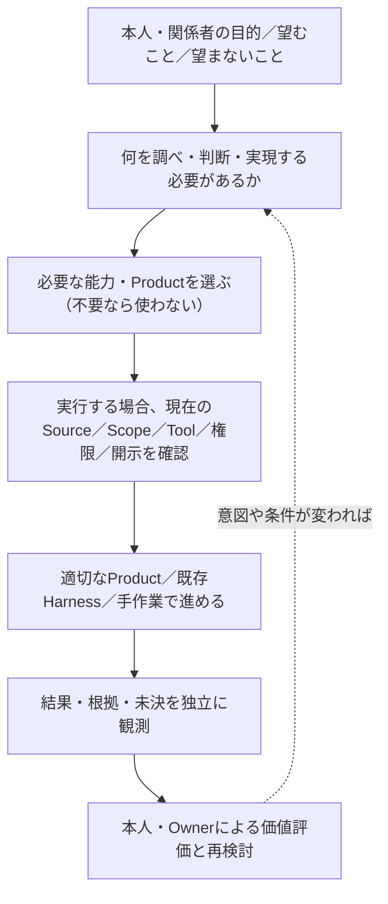

# TAI全体像の横断読解ガイド v0 — 課題から製品選択・証拠・結果まで

状態: **Draft / 読者向けの解釈・検査案 / Owner未受理**。初版2026-11-09、2026-11-11の独立実証を§7〜8へ追補。本書の編集自体は実Harness・実業務の新試験ではない。
照合したTAI main: `0b5115a629863d57566b8db36a6d67bc21727039`。他Productの現行main全件照合、実Harness再実行、実業務の結果観測を実施したという意味ではない。

## 1. この文書の位置

[Product Landscape](product-landscape.md)は「誰が何を担うか」、[View Contract](product-landscape-view-contract.md)は「役割の線と実接続の線を混同しない条件」、[知識モデル](product-knowledge-model.md)は「型・根拠・判断・版」、[配布設計](product-family-delivery.md)は「固定されたProduct Artifactの組合せ」を説明する。

**本書だけが追加する問い**は「一つの利用目的から始めて、これらの別々の説明をどの順に読み、何がまだ言えないかを判断するか」である。新しいViewpoint、Product Registry、canonical Activity Store、共通Contract、Host、Runtime、Owner、受入Gateを導入しない。現行文書に存在するV1〜V5と各Issueへ接続する**読者用の横断ナビゲーション**である。

**中心命題（検証対象）**: YI Constellationの増分価値は、全部のProductを常に動かすことではなく、主体が目的に応じて独立能力を選択・交換・省略でき、解釈・判断・実行・結果の区別を失わずに活動を継続できることにある。これは価値仮説であり実利用者の価値受理ではない。

## 2. 「全体」を一つの図へ押し込まない

| 読者の問い | 既存の閲覧先 | 正本・意思決定の所在 | その資料からは言えないこと |
| --- | --- | --- | --- |
| **何があり、何が独立か** | [Product Landscape](product-landscape.md) V1、[対象棚卸し](product-inventory-candidates.md) | 各Productの固有説明。横断の対象・分類は[TAI #73](https://github.com/hat47x/tai-pleroma/issues/73)で未決 | 公開Repo一覧＝全製品、役割の破線＝API接続 |
| **必要な能力を誰が提供するか** | [View Contract](product-landscape-view-contract.md) V2、[接続調査](../integrations/capability-inventory.md) | CapabilityとContractの詳細は各Provider/Product | 同名Skill/Tool＝実Load済み、互換、呼出資格 |
| **どの条件で利用・観測したか** | V3、[status](status.md)、[SCN-001](../scenarios/SCN-001-shared-space-guidance.md) | 実Source・Consumer・Effect・Meaningは各Owner/Host | 合成PASS＝現実の業務受入、Task受付＝実Effect |
| **どう構成を届けるか** | [配布設計](product-family-delivery.md)、[TAI #74](https://github.com/hat47x/tai-pleroma/issues/74) | 各Productの単体Release、TAIの構成別Release案、YIサイトの公開判断は別 | Bundleの版固定＝現在のProvider/Grant/Use-time適格 |
| **変更後も何を使えるか** | V4/V5（後段）、[TAI #271](https://github.com/hat47x/tai-pleroma/issues/271) | 依存・Evidenceの適用範囲を照合し、各Productが必要な再資格化を実行 | 旧PASSの全用途継承、unknown辺＝無関係 |
| **本人にどんな結果・価値が生まれたか** | [価値研究](yi-constellation/value-needs-requirements-2026-11-01.md)、[評価計画](yi-constellation/value-realization-research-protocol-2026-11-01.md)、[TAI #127](https://github.com/hat47x/tai-pleroma/issues/127) | 本人・影響者の評価、正当なOwnerの採否、実世界のProvider記録 | 正答・納品・Tool成功＝本人の満足、QoL、社会の同意 |

特に **YI Constellation＝ブランド／サイト名**、**TAI Pleroma＝横断する独立Product**、**TAIリポジトリ＝横断索引と構成別配布の作業拠点**は異なる。同じリポジトリで文書を管理することは、TAIが各ProductのRuntime・Source・意味・権限を所有することを意味しない。

`SUI / SEI / TEI / SHO（MMIとの同一性は未決）/ EKI` は初期の五つの関連基盤であり、CSWは探索Method/Skill等の分類候補、TEI StudioはTEIに関係する開発・表示領域の候補である。これらを自動的に第六・第七の正式基盤、または独立Productと確定しない。

## 3. 活動を読む順路（概念上の依存ではなく、問いの順序）

*これは実装済みのWorkflow、強制順序、中央Orchestrator、サービス間の通信図ではない。各段の内部処理も省略された概念図であり、TEIの「有効Pipelineの完全表示」と同じ不存在判断には利用できない。*

- **選択の自由**: 外部Harness＋通常ファイル／Markdown／CLIだけで十分なら、追加のTAI横断SkillやProduct利用を義務化しない。独立したProductの単体利用も維持する（[TAI #168](https://github.com/hat47x/tai-pleroma/issues/168)、[#422](https://github.com/hat47x/tai-pleroma/issues/422)）。
- **認知の境界**: SHO/MMIの出典、SUIの仮説、SEIのDecision/未決、TEIのモデル・実現、EKIの委任・Effectを一つの`success`へまとめない。CSWは探索の豊かさを増す候補であり、正式受理を代行しない。
- **実行の境界**: 外部Harnessは推論・Tool呼出し等を担い得るが、現在の開示、対象への作用、独立観測は各Product/Host/Providerに従う。`read-only`の説明だけではRawの隔離・送出制御を証明できない（[TAI #232](https://github.com/hat47x/tai-pleroma/issues/232)）。
- **時点の境界**: 固定Releaseの再現性と、現在ActivityでのSource/Grant/Provider/Consumer適格性は別（[TAI #74](https://github.com/hat47x/tai-pleroma/issues/74)、[#271](https://github.com/hat47x/tai-pleroma/issues/271)）。
- **成果の境界**: Artifact生成、受領、独立Read/Effect、本人が目的を達したか、第三者に負担を生んだかは別の問い。技術的な結果から人間の価値を自動推論しない。

## 4. SCN-001で「同じ活動」を三つの別の図として読む

題材は架空の施設案内「予約不要」と「会議室は事前予約」の解釈である。合成fixtureと参照接続を使う例であって、実施設の規程、公開許可、全Productの実API互換は未確認。

| 図の種類 | この事例で追うもの | 観測／保留の境界 |
| --- | --- | --- |
| **役割図（V1）** | 原資料をSHO/MMI、異なる解釈をSUI、判断の由来をSEI、規則候補の検査をTEI、必要なら委任をEKI、活動全体の索引をTAIとして説明 | 全Productが必須、製品間が直接接続という意味ではない |
| **接続・証拠図（V3）** | どの固定fixture・API/CLI・出力のどの範囲が実際に読まれ、照合されたか。根拠は[status](status.md)、[接続調査](../integrations/capability-inventory.md) | MMI/SEI/TEI/SUIの限定観測、合成Decision、EKIの`queued`は実業務のEffectやOwner受理ではない |
| **受入・結果図** | 人が例外規則を確かめ、変更案を受け入れ、公表し、利用者への結果を観測したか | [R-01〜R-07](../evaluations/SCN-001-real-object-review.md)の実物受入・公開判断と利用者への効果は別。現在の合成記録から完了を断定しない |

同じデータや名前を表示する場合でも、図ごとに凡例・対象版・実施状態・未実証を付ける。ある図の矢印から他図の「契約」「権限」「効果」を生成しない。

### 読者が試せる質問

1. **TEIをこのケースから外したら何が変わるか？** 必要な規則の意味検査が失われる条件を示せるか。単なる案内文の比較で価値差が無ければ利用を強制しない。
2. **EKIで`queued`となったら何が言えるか？** Taskが受付段階にあることに限り、実作業完了と答えない。
3. **案内文がA→B→Aと元に戻れば、過去の判断を復活できるか？** 文言一致で現在のOwner受理・Authorityを復活させない（[TAI #33](https://github.com/hat47x/tai-pleroma/issues/33)）。
4. **文書・Sourceが新しい版になったら、過去のどの証拠を残すか？** 旧証拠は歴史として保持し、現行利用の資格は影響範囲を検討して再確認する（[#271](https://github.com/hat47x/tai-pleroma/issues/271)）。
5. **外部Harnessを別のものへ替えたら何を再確認するか？** 実Skill Load、Tool到達、Source/Disclosure/Grant、同一Attemptの結果と実Consumerを区別する。実H3 Loadの限定証拠があっても、H2/H3の比較適格は未成立とする（[#168](https://github.com/hat47x/tai-pleroma/issues/168)）。
6. **利用者が「使わない」「延期する」を選んだら失敗か？** 目的と正当な本人意思に照らす。Task完了率だけで価値を評価しない（[#127](https://github.com/hat47x/tai-pleroma/issues/127)、[#422](https://github.com/hat47x/tai-pleroma/issues/422)）。

## 5. G1の読者検査から実証へ進む最小順序（提案）

| 段階 | 最小成果 | 失敗・保留の条件 | 既存Owner |
| --- | --- | --- | --- |
| **A. G1読者確認** | 五基盤＋TAIの役割と、未分類（SHO/MMI・CSW・TEI Studio）・対象外/未調査を言い分けられる | 図の破線を実APIと読む、非公開対象の存在を漏らす、候補を正式製品にする | [#73](https://github.com/hat47x/tai-pleroma/issues/73) |
| **B. 価値のベースライン** | 同じSCN-001等をMarkdown/既存Harness/手作業でも行い、TAI連携の増分・負担を対照する | 製品数・機能数・合成PASSを価値の代理指標とする | [#127](https://github.com/hat47x/tai-pleroma/issues/127)、[#422](https://github.com/hat47x/tai-pleroma/issues/422) |
| **C. 必要時の実Product/Harness証拠** | 実Source read、実Tool/Skill load、利用Consumer、結果を別々に確認する | 不適格な隔離、試験間のSource差、独立Expected不足、実Effect未観測 | [#168](https://github.com/hat47x/tai-pleroma/issues/168)、[#271](https://github.com/hat47x/tai-pleroma/issues/271)、各Product |
| **D. 配布と使用を別判定** | 固定Product/Skill/Adapter構成と、その用途での現在資格を別に報告 | Release PASSを現在権限や文書ClaimのPASSへコピー | [#74](https://github.com/hat47x/tai-pleroma/issues/74)、各Product |
| **E. 人の受理と価値評価** | 対象のOwner受理、実際の結果、本人/影響者の評価 | 自動試験の成功だけで社会的同意・業務公開の許可を宣言 | [#127](https://github.com/hat47x/tai-pleroma/issues/127)、既存の実物レビュー |

**この文書自体では読者試験、H2/H3比較、実Owner受理、実顧客/個人の価値調査、シリーズReleaseを実施していない。** 2026-11-11時点で別PRに記録された**限定的な実Product間E2E**は§7に分けて掲載し、現実の業務E2Eとは扱わない。 #73のG1、#74の配布、#168のHarness、#271の再資格化、#422の価値適正化の完了条件を一つの新しい合否に統合しない。

## 6. 更新規則と反証可能性

- 読者が必要とする問いを示せない項目は、製品・エッジ・共通スキーマを増やす根拠にならない。
- 他Productの仕様や結果は固定Revisionと出典に戻る。TAI側に技術・意味・実行権限の第二正本を設けない。
- 旧Snapshotの記述と最新Issueの追補が衝突する場合、まずそれぞれの確認時点と適用範囲を提示し、旧図を黙って「現在図」に置き換えない。
- 図に「表示されない」ことは、未収集、適用範囲外、秘匿、検査不成立、真の不存在のどれかが未確定である可能性を保つ。TEIの閉じた実効Pipelineにおける不存在判定を、公開範囲未確定のYI/Product Catalogへ移植しない。
- この文書が他の既存資料と同じ説明を増やすだけなら、リンクだけを残し削除する。新しいEngineや永続データ構造を正当化するための文章にはしない。

## 7. 2026-11-11追補：TAIの介在が不要な場合と、横断の必要性が現れる場合

**照合の基準**：TAI main `2a8fd9fa11a082c28e634ec3412aa88354bc4e63`（2026-11-11確認）。本節は既存の実装・試験を**固定した出典の適用範囲に限って**参照する。各Draftの内容はmainの製品保証ではなく、#73の正式分類、#422の価値判断、各Product Ownerの意味・権限受理を変更しない。

| 観測したこと | 言える範囲 | 言えないこと・未解決 |
| --- | --- | --- |
| [TAI Draft #601](https://github.com/hat47x/tai-pleroma/pull/601)：公開TEI実CLI、固定TEI `0600cc2adc383efb38651b59105498193c640e41`。単独read-only調査B0は3コマンド、30,362出力bytesで対象へ到達 | **単独JobではTAI・Product Skillなしでも目的が成立する**例が存在する。Skillの `entries[]` と実CLIの `result.entries[]` 不一致を観測（修正OwnerはTEI #2605） | B1の逐語的なSkill追従で候補0件は**モデルのSkill利用失敗**の証拠ではない。B0/B1/B2のモデル・費用・人手比較はNOT RUN。TAI横断Skillの文脈38,517 bytesは当該Jobでは不要な追加候補であり、時間・Token損失の測定値ではない |
| [TAI PR #594](https://github.com/hat47x/tai-pleroma/pull/594)（merged）：TEI CLIから限定的に能力参照・Revision・Handoff・旧Receiptのstaleを区別 | 同一Activityの参照で「旧Sourceと現Sourceが違う」を検知する最小経路の成立 | 実Product Consumerの受領、現在Grant、意味受理、Skill実Load、横断的な継続価値は未証明 |
| [TAI PR #602](https://github.com/hat47x/tai-pleroma/pull/602)（2026-11-11取得時点open）：SUI実Producerテスト→SHO実CLIによる**合成入力の限定Product間受領**、Receipt返送、TEIのread-only証拠の引用、別プロセス再受領を記録。実Harness CLI切替の観測も同PRの実行票にある | Handoff票がSource参照・未決・用途制限を落とさずに運び、Consumerが独立再読取する候補は**抽象構想だけではない**。現在の詳細な状態は同PRの[後続実行票](https://github.com/hat47x/tai-pleroma/blob/14a5076ce516d9e066747fc401e28dec400b1ad3/docs/yi-constellation/cross-product-handoff-execution-tickets-2026-11-11.md)を正とする | G6は`reference-linked-unverified`まで、Claim closure/負例が残る。実Sourceの意味、実UI/Host永続Session、Grant/OS egress、実業務成果・Owner受理、別HarnessのSkill/MCP適格は未証明。「G2〜G6の票が記録された」を全必須条件PASSと読まない |
| [TAI Draft #600](https://github.com/hat47x/tai-pleroma/pull/600)／[#271](https://github.com/hat47x/tai-pleroma/issues/271)：未統合TEI Draft #4076と隔離した実PostgreSQL 16.15・**合成行33件**で、同じWorld fingerprintのまま実行行・Provider・RLS可視範囲が変わる例を観測 | **モデル定義の同一性だけではデータ行Claimを再利用できない**。定義D／行R／不在Zの違いを受入時に保つ必要がある | TEI mainの一般的な実Read機能、Provider現行Grant、同一Session保証、本番データ、SHO/SEI実受領は未確認。J1pは観測ケースで不正な再利用0だが、**必要なReadの節約は未達**。選択的再確認が低コストと主張しない |

上記から、横断製品の仕事を増やす際の**必要性の境界**を、次のように定める（設計仮説）。

- **局所のJob**：Product自身のCLI/UI・外部Harness／手作業で充分なら、TAIの横断Skill・中継・Registryを追加しない。これはTAIに価値がないという一般結論ではなく、**当該用途にTAIの追加介在を義務づけない**という判断。
- **複数Product間の受渡し**：Product固有のread-only Projection、限定Handoff、Consumer独立Readbackを優先する。新しい横断Runtimeより既存[TAI #271](https://github.com/hat47x/tai-pleroma/issues/271)／[PR #602](https://github.com/hat47x/tai-pleroma/pull/602)を参照し、接続が成立しても**どの主体に増分価値が生まれたか**はまだ評価する。
- **Source/Provider/権限の変更後**：過去に正しかった定義DはRevisionで限定評価できても、行R・不在ZはProvider・可視範囲・実Readを別に確認する。特に0行は「可視範囲内で0件」と「世界に存在しない」を区別する。Product/Hostの現行受入なしにTAIが一括でqualifiedへ昇格しない。
- **実外部作用**：Tool成功、受領Receipt、形式的Claim、Product実Readと、Provider/人間が受理するEffect/Outcomeを切り離す。役割は[TAI #168](https://github.com/hat47x/tai-pleroma/issues/168)／[#232](https://github.com/hat47x/tai-pleroma/issues/232)／各Product Ownerに残す。

## 8. 価値を判別する最小の対照（新規Gateではなく既存評価への接続）

製品を何個使ったかでなく、**利用者の目的に対して何を追加する理由があるか**を、同じJob・公開Source・Revision・許可条件・独立Expectedで比較する。#422のValue/Ablation、#488のX01/採点、#127の主体別価値、#271の現在資格を利用し、第二の実験器・評価用Score・全体Ownerを作らない。

| Job/条件 | 最小対照 | 追加経路（必要時のみ） | 判別したい増分と必要な反例 |
| --- | --- | --- | --- |
| **J-L 局所のTEI調査** | B0=既存CLI／Harnessだけ | B1=Product Skill、B2=TAI横断Skill | Sourceを正しく見つけたか、未決を捏造しないか、Schema drift、余計なProduct選択、追加byte/Tool/Token/人手。#601のB0実CLIは既知だがモデル比較は未実施 |
| **J-H 二製品の文書引継ぎ** | B0=明示ファイル＋人による出典照合 | B1=既存Product間Handoff（#602）、B2=用途別TAI索引を任意追加 | Producer/Consumerの実bytes、根拠と未決、受領失敗後の再試行、必要な再説明、欠損・誤帰属。限定受領の正例は存在しても、利用者価値の増分比較は未実施 |
| **J-R 版変更後の再開** | B0=元記録からの再読／確認 | B1=Product Revision照合（#594）、B2=依存対象に限る再資格化（#271/#600） | D/R/Z、Source-only変更、RLSによる0行、Provider変更、ABA、旧Grant。**正しさと再検査費用を別指標**で測り、正確でも節約不能なら節約効果を主張しない |
| **J-O 実際のOutcome** | B0=既存の人手・一般Harness | B1=必要Productだけ選択、B2=横断継続 | 実結果・本人の判断・第三者の負担・停止/延期の自由。現実の資料、Owner Authority、影響者評価が無ければ技術的成功に止める |

評価列は、**誤った成功／適切な保留／不必要な保留／見逃し／開示違反／必要能力の選択／実Consumerが読んだ物／実Outcome／時間・Token・Tool・人手**を別々に保持する。単一の合成スコアやモデル多数決に畳み込まない。

**優先順（提案）**：①既存#601の「不要な追加を避ける」反例を維持 → ②#602の既存実受領で未検証のProduct Oracleと独立Consumerを埋める → ③#271/#600のD/R/ZとGrantの用途別再資格化を実Providerに接続 → ④同条件でTAI任意追加の人間価値と費用を対照。G1 Product分類（#73）、統合配布（#74）、TEIセルフビルド/Studio固有受入、CSW探索Methodの採否を、この順序のために新しく全製品必須条件へ昇格しない。

**反証・撤退**：単独JobでTAI追加が出力品質・確認負担・継続性を改善しなければ当該Jobでは追加しない。複数Product経路でも、既存ファイルやProduct固有APIで同等なら横断の必須Coreを増やさない。逆に、必要なAuthority／Source／Consumerの資格が欠ければ、便利さを理由に安全な確認を削らない。これらは利用価値の判別方針であり、#422・#127の実利用価値受理を**達成済みとするものではない**。
