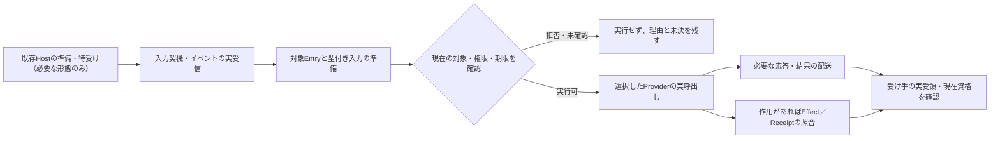

# YIC 複数UI・外部Harness Session接合の後続実証計画（2026-11-14）

> **Status: Proposed / Docs-only / 新しい実Harness・実Product E2Eは NOT RUN。** 本文は既存Ownerの受入票へ実行順と記録方法を接続する補助計画であり、Handoff v2、公開API/ABI、第二Expected/Authority、中央Runner/Session Store/Lock/Registryを定義しない。Ownerの正式採用・外部送出・業務実行を意味しない。

<!-- yic-executive-reading-guide-20261114 -->
### この計画を読む前に

目指すのは、利用者がTEI Studioなどで選んだ対象について、必要なときだけ外部AIに相談し、別の画面やHarnessへ移っても**対象・根拠・未決事項を取り違えずに作業を続けられること**である。AIを使わない通常の製品操作は、そのまま成立させる。

そのため、**仕事の継続（Activity）、AIとの対話（Native Session）、実際の製品操作（Product Operation）、表示や編集（View）**をそれぞれの担当で管理する。イベントを受け取ったこと、AIが回答したこと、製品が実行したこと、利用者や別の受け手が結果を確認したことは、別々の事実として扱う。

実装順も分ける。最優先はTEI StudioのStage1→Stage2実セルフビルドと、TAI #168のOS隔離・送受信・独立四試行である。外部Harness間のSession共有、Desktop内部Workerの配置変更、Webの複数利用者対応、汎用Lifecycle Graphは、必要性と実証結果が揃ってから判断する。

本文の「確認済み」は**その対象版・実行環境・試験範囲内での確認**を意味する。Sourceの現在性、操作権限、実Provider、外部作用、結果の受領、業務上の受理を、CIの成功や資料上の説明だけから補わない。

<!-- yic-current-decision-index-20261114 -->
**いま優先して判断すること**

| 位置づけ | 実行上の最短目標 | 先取りしないこと |
| --- | --- | --- |
| **P0：Studio** | 現行Wails A方式で非Plugin BuildIntent→生成Stage1→Stage2 Desktop→実WebView2を一つのAttemptで確認 | 外部Harnessや新Worker方式をセルフビルドの前提にしない |
| **P0：外部Harness** | TAI #168の実OS拒否G0→送出G1→完全Reply G2→独立H2/H3四試行 | Product-only／Tool-onlyとSkillの実効差を測る前に独自Agent Loopを作らない |
| **次の製品接合** | 実Entry・Source/DBを**起動時の副作用まで**調べ、別Consumerが結果を実受領する | 読み取り名目の暗黙DB更新、Go test子Process、固定署名Fixtureを正式製品資格へ昇格させない |
| **後続のUIとAI** | 一時選択→明示Pin→Source再読取→限定Activity引継ぎを**別々に検収**し、回答候補を元Productへ戻す | 選択位置や表示だけで保存・認可・実Consumer受領を主張しない。旧Session/Receiptも再利用資格ではない |
| **後続のTEI活用度評価** | 実証済みの一つのProduct Adapter/Skillについて、*.tei.mdが実際に担う意味・生成・Plugin部分を測り、改訂時の定義体簡素化を検証（§47） | Goへの単純委譲や宣言だけをセルフビルド成功とせず、初回H2/H3の追加条件にしない |

## 0. 関連Ownerと変えない先行条件

- [TAI #234](https://github.com/hat47x/tai-pleroma/issues/234)：B0〜B4投資比較、Goal/Schedule/並列、[HC-01〜14](https://github.com/hat47x/tai-pleroma/issues/234#issuecomment-6844475381)、[HC-15〜18](https://github.com/hat47x/tai-pleroma/issues/234#issuecomment-6856979920)の後続判断。B4独自Agent Loopは未採用。
- [TAI #168](https://github.com/hat47x/tai-pleroma/issues/168)：初回Blockingは**G0実OS identity/Read-deny正負→G1実Egress→G2実Tool Reply完全性→新規独立H2→H3→H3→H2の4 Slot（直近確認0/4適格）**。本計画を初回の新Blockingにしない。
- [TAI #271](https://github.com/hat47x/tai-pleroma/issues/271)：Activityの目的・参照・未決・根拠と現在資格、別Sessionへの選択的Handoff。[TAI Draft #633](https://github.com/hat47x/tai-pleroma/pull/633)：元PinのProduct再解決、限定Projection、返却先、既存Handoff v1の後続R0〜R5。[TAI Draft #629](https://github.com/hat47x/tai-pleroma/pull/629)：選択集合Q/E/Aとidentity/partialの判定。[TAI #232](https://github.com/hat47x/tai-pleroma/issues/232)/[#562](https://github.com/hat47x/tai-pleroma/issues/562)：機密と回答前観測面。[TAI #422](https://github.com/hat47x/tai-pleroma/issues/422)：利用者価値比較。
- [TAI QH-P0 実行票§10](https://github.com/hat47x/tai-pleroma/blob/main/docs/yi-constellation/cross-product-handoff-execution-tickets-2026-11-11.md)：意図I、元Product再解決R、現在開示P、配送T、Consumer実用途C、Harness Hを独立記録。**QH-P0のI/R/P/T/Cと外部HarnessのHは別資格**。
- [TEI #4515](https://github.com/hat47x/tei-platform/issues/4515)：Workbench-local Subject Pin/UnpinとHost Inspectの再資格化。現時点のGUI Pinと意味Relation Pinは未実装。[TEI #3419〜3422](https://github.com/hat47x/tei-platform/issues/3419)：型付きApplication API、CLI/MCP/HTTP/IPC意味同値とProduct側Acceptance/Effect。
- **別レーンP0**：[TEI #4583](https://github.com/hat47x/tei-platform/issues/4583)：生成N0 Inspector→N1 Go/TS→N2 esbuild→N3 native Wails/実WebView2、BuildIntent/Builder/Stage1→Stage2実再入。Draft #4587の同HEADで生成WebView2限定実証あり。**B1-B/B2/B3の正規BuildIntent・Stage1 Desktop自己再入はNOT RUN**。YICはBuild Engine/Source authorityを所有しない。

## 1. 目的と不可逆な境界

**目的**：人がTEI StudioでSubjectをPinし、必要時だけ外部Harnessへ説明を依頼、SHOまたは別のTEI UIに移っても元の対象・証拠・未決を誤継承せずに回答を候補として受け取る。

三つの継続は別々に採点する。

| 継続対象 | 実体・Owner | 認めない推論 |
| --- | --- | --- |
| Activity continuation | TAI #271が保持するTask意図、必要な参照と未決、許可済みHandoff | 新Session再開を同一Live Session復帰と呼ぶ |
| Native Harness Session continuation | 実Harness/HostのSession・Turn・Tool Event、Profile/Provider実能力、Transcript | 保存Session IDから別UIの閲覧可・多Writer可・完全Log/過去承認の移転を推定 |
| Product Operation continuation | TEI/SHO/EKI等の現在のSource/Attempt/BuildIntent/Receipt/Consumer | AIの「完了」、Tool exit、Interrupt、過去Receipt再出力から実Effectやセルフビルドを推定 |

**既存Sessionの履歴は新しい開示先に対する潜在的な情報源**である。現在のUIへ新規送信してよいという判断だけでは、過去Transcript/Tool Result/Prompt/Session LogをそのUIから閲覧してよいとは限らない。既送のRawは事後の権限撤回で取り消したと扱わない。閲覧可能範囲を現Hostで確認できなければ、旧Sessionへattachせず用途を限定した新Sessionへ縮退する。

Source Revisionは単独の鮮度証明ではない。[TEI #4616](https://github.com/hat47x/tei-platform/pull/4616)の限定実試験ではWorld/SourceIndex/Model Revisionが同じでも実Root存在差でValidationがerror→warningへ変化。Root/Origin、Required/Consumed範囲、Validation現時点、Grant/Recipient、Plugin/Tool byte、Build選択/実消費を用途別に再確認する。0件や空referencesはSubject不存在・未使用・完全取得を証明しない（TEI #4577）。

## 2. 最小利用モード：機能一覧ではなく当該Hostでの実効資格

| モード | 操作 | 当該Attemptで必要な証拠 | 不成立時の縮退 |
| --- | --- | --- | --- |
| M0 Product-only | AIなしのStudio/CLI/SHO | Product単体の対象・Result・Acceptance | M0のまま利用可 |
| M1 Activity handoff | 許可済み目的・参照・unknownを**新Session**へ引継ぐ | Producer Projection、現在開示、既存Handoff v1のConsumer実Read | Product-only。秘密Rawの代替送出禁止 |
| M2 Live view | 同じNative Sessionの現在/過去Eventを**閲覧** | 実Session IDと実Host設定、履歴のAudience/Recipient適合、Tool/Transcript受領完全性 | M1へ。旧Live Session共有と表示しない |
| M3 Live control | 同じSessionへTurn送信/Interrupt/Tool呼出し | M2の資格に加え、Nativeの同時Turn/直列化/操作帰属の**実保証**、送信UIとTurnの結合 | 実証可能な単独操作元のみ。別UIはM2またはM1 |
| M4 Product apply | AI提案をPreview→受理→実変更へ | **元Pinを今再解決**、Product現在Grant、既存Acceptance/Operation ID、Effect/Receipt/独立Consumer観測 | read-only候補として保持。Effect unknownで自動再実行しない |

M0〜M4は実装レイヤーの強制的な一方向状態機械ではない。用途・Audience・Host実能力ごとに成立するモードを限定して表示する**評価上の区分**。M2/M3の追加がProductの正しいM0/M1やTEIセルフビルドの前提にならない。

**同一Sessionの同時操作**について、UI-local mutexを分散端末/別Processまで有効な排他とみなさない。既存Harness/Hostに実保証がなければM3で二Writerを公開せず、実証済み一つの操作元＋他View閲覧/新Session Handoffに縮退する。新中央Lock Serviceを解決策として先行採用しない。

## 3. 後続read-onlyの一往復：既存QH/Pin/HC票を使う

1. **R0 Product読取**：公開合成TEI Workspaceを固定し、実Inspect/Catalog/必要なsource-indexで存在するSubjectのkind/id/Root/Origin、Source/Validation、取得範囲・unknownを観測。SourceIndex空配列だけで存在確認しない。Productのtyped API/CLIで入口差を区別する。
2. **R1 Pin意図**：TEI #4515のWorkbench-local Subject Pinを一時Focusから分離。未実装なら既存CLI上の固定参照を用い**GUI Pin PASSと呼ばない**。同FP別Root、A→B→A、旧Reply遅着では意図保持と現在資格失効を別表示。Relation Graphの描画IDを意味IDとしない。
3. **R2 Disclosure/Consumer**：Productで現時点に再解決した許可ProjectionだけをPreview→明示送出し、既存`yi.handoff.context/v1`とTAI QH-P0で別Process Consumerの実受信/実Readを検証。必要ならSHO Readerを選ぶが、SHOがMarkdown本文を読んだことを元TEI Subjectの独立再解決と呼ばない。
4. **R3 外部Harness**：#168のG0/G1/G2が適格な固定Trialとは別の**後続**Taskで、まずTool-only、必要ならProduct Skillを実Load/Invoke、増分があるJobだけTAI Activity Skillを追加。Provider/Model/Host ProfileとRead/Write/Network Grantを実固定し、送出byte、Tool Replyの終端、実Consumer受信、Answer、unknownを分けて採点。
5. **R4 別UIへ復帰**：M1新SessionのActivity再開を先に対照として成立させる。M2 Native Live view、M3制御は各Harness実Capability Probeで許可された範囲だけ追加。各Reply/Turnを発信時のPin・Root/Scope・元Requestに帰属させ、現Focusへ自動反映しない。
6. **R5 候補→Product適用**：最初の一往復は**read-only結果候補まで**。将来のTEI/SHO Writer・EKI実作用では、現在のProduct Operation/Acceptance/Effect Receiptに引き渡し、interruptやAgent Exitを完了・rollbackとはしない。Stage1→Stage2 Build再入はTEI #4583の別Attemptで独立検証。

Source名、件数、digest、Tool候補一覧、Rendererの過去情報も現在開示がないなら送出しない。生TranscriptをEvidence共有の既定形式とせず、用途上許されたSource/Receipt**参照**と必要な限定Projectionを採用する。

## 4. 同一試験の記録列と独立Expected

**新しいログ正本/Schemaではなく既存Runbook・Product CI・Issue/PR Evidenceに記入する列**：

- Task/Activity目的、Product/Root/Origin/Subject kind+id、Pin意図と固定時点、宣言Source/現在Root・Validation/取得範囲、unknown/partial/permission-denied。
- Harness名/版/Provider/Model/Host Profile/OS identity/Tool・Skill実byte、Native Session/Turn/Tool ID、利用モードM0〜M4、実Grant/Recipient。
- 許可Projectionと実Egress、Tool request/argv/stdout/stderr/Reply終端・切断、Consumer実Readと現在資格、Return Location/独立レビュー。
- 実Operationがある場合のみProduct Attempt/Builder selected-vs-actual/Artifact/Receipt・実Consumer。Read-onlyにEffect必須の偽FAILを作らない。
- 事前固定の独立Expected、合格/不合格/unknown/unsupported/environment-ineligible/NOT RUN、Cost・時間・Tool回数・再説明・誤対象・Undo・人手レビューを**別列**。単一の`verified`や総合点に丸めない。

**既存負例を再利用（第二採点表を作らない）**：

| 試験 | 既存Expectedの参照 | 当該観測の差分 |
| --- | --- | --- |
| 過去機密を含むSessionに別Audience UIがattach | [HC-15](https://github.com/hat47x/tai-pleroma/issues/234#issuecomment-6856979920)・TAI #232/#562 | 現時点の新規Projectionと履歴Transcriptの閲覧資格を別検査 |
| 二UIから同一Sessionへ同時Turn/Interrupt | HC-16 | Nativeの実直列化/帰属に失敗したらM3を限定。UI-local queueの成功を多端末保証としない |
| 旧Reply遅着、Stream欠落、別Root同byte、ABA | HC-17・[PIN-S0](https://github.com/hat47x/tei-platform/issues/4515)・[TAI #271](https://github.com/hat47x/tai-pleroma/issues/271) | 元Pinと現在資格を分け、誤対象への自動反映0。欠けたTool Replyはunknown |
| Agent Interrupt後に実Build/Effectが進む | HC-18・[TEI #4583](https://github.com/hat47x/tei-platform/issues/4583) | Native Turn停止とProduct Attempt/実Artifact/Effectを独立照会。旧Receiptによる成功補完・二重再実行0 |
| SUI/SHO等の同byte別Source/旧Receipt再出力 | [QH-P0](https://github.com/hat47x/tai-pleroma/blob/main/docs/yi-constellation/cross-product-handoff-execution-tickets-2026-11-11.md)・[HC-10〜14](https://github.com/hat47x/tai-pleroma/issues/234#issuecomment-6846699191) | 配送と受理/元Source実Readを区別。別Harnessラベルを実Session切替証拠にしない |
| 同一WorldFP/ModelRevisionだがRoot実在変更 | [TEI #4616](https://github.com/hat47x/tei-platform/pull/4616) | 旧現在Validation資格を再利用しない。構造Claimだけ保持できる場合は保全 |

## 5. 受入順・各Laneの終了条件（新Hard Gateなし）

| Lane | Owner | 最小出口 | 非主張 |
| --- | --- | --- | --- |
| A / 最優先 | TEI #4583/#1824 | N0〜N3を既存BuildIntent/Builderの実Attemptで接合しStage1実Process→Stage2 native Desktop→実WebView2 Consumer | YICがBuilderを代行しない。過去別HEADのCIを合算しない |
| B / 最優先 | TAI #168/#232 | 実OS Read-deny・Egress・Tool Reply完全性を確認して初回H2/H3独立4Slot比較適格へ | M2/M3を初回Gateに追加しない |
| C / 並走 | TEI #4515 + TAI Draft #629 | read-only Subject Pin、同FP別Root/ABA/partialの正負と現在資格 | Workbenchの成功をHost Disclosureへ昇格しない |
| D / 後続read-only | TAI QH §10 + #271 + Draft #633 | 同じProduct Targetを今再解決し、許可Projectionが実Consumerへ届き、Return候補が元対象に帰属 | Body受領だけで元Subjectの再解決・同一Live Sessionとしない |
| E / D後続 | TAI #234/#168/#232 | M1 Activity HandoffとM2閲覧/M3操作を別Harness・実Host能力で比較。HC-15〜18を個別記録 | 二UIが同時接続できると仮定しない |
| F / 価値・投資判断 | TAI #422/#234/#488 | B0 Product-only／B1 Tool+Skill／B2 Adapter／B3統合UIの用途別増分、費用/再説明/誤継承/現在資格を同Taskで比較 | B3が有用でもB4自作Loop必要の証明にならない |

**独自Loop（B4）の再審査**：複数の代表Harnessの適格実Trialで同じ必須Jobの失敗を確認し、Product API/Projection・Native Session/Activity Handoff・OS/Host適格性・薄いAdapterでは解決不能であることを独立Expectedで示し、運用/コスト/権限/移行/撤退とOwner受理が揃った時のみ着手する。

## 6. この計画自体の扱い

- 初回の外部Harness試験に追加のRunner、Session Server、Agent Team、Registry、Central Pin/Lock/Policyを持ち込まない。
- UI/Targetの契約をTAI側で固定せず、TEI/SHO/SUI/SEI/EKI各Ownerの既存CLI/typed APIに委譲する。Go単一バイナリ・外部HostというTEIの既定方針を変更しない。
- Evidenceの保存先は既存Issue/PR/CIや許可済みNAS/S3/KON参照を用途で選び、機密RawをGitHubへ一律投入しない。保存と現在の開示・意味受理を分離する。
- 本文のM0〜M4やR0〜R5は**評価時の呼称**で、公開Product API/共通Protocolのスキーマ番号ではない。各Ownerの既存票・Runbookを唯一の実行/判定資料とする。
- **2026-11-14時点の今回実施**：既存Issue/計画/限定CIの静的照合と、この後続実行カードの設計のみ。HC-15〜18、Product→外部Harness→複数UIの実一往復、実Session二画面接合、Owner受理、TEI Stage1→Stage2 Desktopの統合実行はNOT RUN。

## 7. 2026-11-14 横断更新：AIによる起動候補からProduct実行への停止線

他チャットのTEIスクリプト起動・Plugin/三視点・SUI Raw→Card・EKI実Result Delivery・Lifecycle Graphを照合。以下は**各Ownerの既存設計をYICの後続Jobに組み込む実行順の差分**であり、公開ABI/共通Agent Loop/中央Schemaの採用ではない。本節からTAI #168の初回H2/H3へ新Gateを追加しない。

### 7.1 AIの入力は「要求候補」であって権限・起動実績ではない

[TEI #4495](https://github.com/hat47x/tei-platform/issues/4495)のP0・[#4497](https://github.com/hat47x/tei-platform/issues/4497)のP1・[#4502](https://github.com/hat47x/tei-platform/issues/4502)、共通API [#3422](https://github.com/hat47x/tei-platform/issues/3422)に合わせて、以下の非同一性を維持する。

| 既存TEI Ownerの対象 | YICが依頼・表示・記録してよい範囲 | 禁止する自動昇格 |
| --- | --- | --- |
| Function / Script / Accepted Meaning | 意味とSource/契約への許可済み参照 | Functionの存在・parse成功→公開可能な起動Entry |
| Entry (公開起動契約) | 選択されたComposition/Targetで実DiscoverされたEntry/typed schemaを案内 | Entry表示→Product現在Grant/Artifact収録/実行可能 |
| TriggerDefinition / Occurrence | manual/UI/CLI/Harness/event/schedule/batch別の起動希望と発火事実を区別 | Session Goalや定時通知→実Invocation成功 |
| PreparedInvocation | Productのtyped APIへ対象・input・expected revision・Operation ID・deadlineを**候補**として提出 | AI記述のactor/role/scope/ApprovalをHost Authorityへ変換 |
| Admitted / Started Attempt | Host/Provider実Grant・実Artifact・選択／実Providerの一致・Invocation受理を観測 | 承認要求・ACK・Tool exit→実Run/業務成功 |
| Effect / Result Delivery / Verification | Receipt、結果本文byte、実Consumer読取、業務判定を各Ownerへ照会 | Agent停止/成功発話/Result claim→Commit/Effect/Owner受理 |

**最初の実行縦断はpure/read-only Entry 1件だけ**：TEI #4495の独立Expected EL-01〜12を再利用し、Product直接APIと実CLIの二入口から「公開Entry→型付き要求→実選択Provider→実Output byte」を一つのSource/Toolchain/Attemptで照合する。この試験が成立するまで、YICのHarnessがTEI業務Functionを書込み実行できるというUI表示をしない。Harnessは後段Consumerとして限定Provider Toolを使い、TEI実行正本を持たない。

次に検討する非同期実行は[TEI #4497](https://github.com/hat47x/tei-platform/issues/4497)のTR-01〜12を参照。Goal/Scheduleが追跡・配信するAI Activity、TEI Triggerが要求するEntry、EKI Task/Attemptが担う外部実行を**三つの別系統**として扱う。時差/DST、missed-run、Queue後Grant失効、post-commit時点、Eventの循環、Effect unknownは該当Ownerで検証する。YICにScheduler/Broker/Job Registryを増やさない。

### 7.2 複数View・Pluginの固定対象はProductの資格を引き継ぐ

- [TEI #4515](https://github.com/hat47x/tei-platform/issues/4515)はWorkbench-local **read-only Subject Pinの最小実装**。一時Focusから独立させ、Source/Rootが不明ならunknownとする。
- [TEI #4614](https://github.com/hat47x/tei-platform/issues/4614)はX-TEA三視点の**保存・複数画面でのPin**。Hostへ新しい共有状態を持たせず、呼出側がPin意図を保持する。ページ再起動後もSource変更で失効し、絶対PathやRaw本文を保存しない。**#4515の最小Pinと#4614の持続Pinを別Owner/別段階として実装**。
- [TEI #4611](https://github.com/hat47x/tei-platform/issues/4611)はInspector/Three-viewの「選択Registry→実在Inventory束縛→実Provider Invoke観測」を共通化するProduct課題。Harnessが第二Resolver/Registryを作らず、選択B/実Call A（結果同一）を拒否した**Product Witness**だけを受け取る。
- [TEI #4198](https://github.com/hat47x/tei-platform/issues/4198)ではGraph/AI Chatにおけるpartial tool args・提案Patch・実行承認を分ける研究を保持。YICのWeb Chat表示やStream途中のargsをProductの完全なCommand入力として自動実行しない。UI座標/Graph描画Edge IDをModel identityへ昇格しない。

従って、多View共有のYIC評価は「Product-local Pin Intent→対象の現在再解決→開示Projection→Hostの実Harness Session」で行い、全製品統一Pin保存庫、共通Operation Resolver、認可Coreを要件化しない。

### 7.3 SUI/SHOの原資料、Card、仮説、文章を別のものとして扱う

[SUI #3441](https://github.com/hat47x/sui-sensemaking/issues/3441)は、Raw原文の人間による任意UTF-8 byte range選択→KJ Card→Document Save→別Process再読→**同じ出典箇所への復帰**を既存R2-SRC-01〜08で実証するOwner。既存R0 DocumentV1 Draft #3439／R1 Reference Raw Reader Draft #3440の局所PASSは、実ProductのRoot/Scope/Grantを証明しない。**同文二箇所、同内容別Root、ABA、権限失効、Save 409**を無視しない。

[SUI #3401](https://github.com/hat47x/sui-sensemaking/issues/3401)は情報統合のSource Reference、状況対象/関係/時間、複数View、Scenarioと実作用の非同一性を扱う。Canvas上のCard/Island・AI提案のRelation・未受理の仮説は、TEI Accepted Meaningや実世界の同定結果ではない。YICがSUIから受け取るのは当該Recipientに開示可能な**限定Projectionと出典参照**だけで、Native Raw/Hidden Relation/Source ID/件数からの無断逆生成はしない。

SHOがHandoff Markdownを実Read・保存したことは、元SUI Rawまたは元TEI Subjectを独立再解決した証拠ではない。SHO文書のWriter/保存後ReOpen/OccurrenceはSHOの既存Ownerへ戻し、Product間の任意の同一性をYIC内で補完しない。AI OFFのKJ/文書編集を常に製品比較のB0として保持する。

### 7.4 EKIのTask/Lease/ResultをHarness Tool Eventへ吸収しない

[EKI #829](https://github.com/hat47x/eki-fabric/issues/829)のOwnerが担うTask/Attempt/Lease/Result Claim/Artifact Deliveryについて、YICが見るべき観測は少なくとも(1)Admission、(2)実Lease/Attempt、(3)Result Claim、(4)実Output body/digest、(5)Consumer独立Read、(6)適用対象である場合のみ外部Effectである。ACKだけではBody受領にならず、Agent interruptは実Task cancel/rollbackではない。

[EKI #753](https://github.com/hat47x/eki-fabric/issues/753)のLocal IPC/Connect測定はTransport能力の個別検証で、現時点の実Adapter/Lease/Consumer保証を含まない。M0/MVPでは既存の通信方式を維持し、追加Transportや中央SchedulerをHarness接合のために導入しない。実Egress/Consumer資格は[TAI #168](https://github.com/hat47x/tai-pleroma/issues/168)と[QH §10](https://github.com/hat47x/tai-pleroma/blob/main/docs/yi-constellation/cross-product-handoff-execution-tickets-2026-11-11.md)へ接続。

## 8. 後続の「一仕事ずつ」の実装順と比較票

**既存Lane A/B（TEI DesktopセルフビルドとTAI #168 G0→G2→H2/H3）を独立P0に維持**したうえで、複合したE2E一発合格を要求せず、以下の小さな後続仕事に切る。各ケースのExpected/Checker/Fixtureは記載したProduct Ownerへ置き、本書に二重実装しない。

| 後続仕事 | 最初の正例・負例 | 既存Owner/終了条件 | 未達の場合 |
| --- | --- | --- | --- |
| J-R：read-only Contextの別View/別Consumer | TEI実SubjectとSUI Raw→Cardを各々独立にSourceから再読、別Root/同byteとPartialを注入 | TEI #4515、SUI #3441、TAI QH-P0（I/R/P/T/C列の実行済み範囲のみ） | Productだけ継続。元Sourceの現在資格が無ければ共有しない |
| J-P：公開pure Entryの起動 | Entry未公開・旧Artifact/Provider B選択A呼出し、missing/null/unfetchedを区別 | TEI #4495 EL-01〜12、#3422のAPI/CLI二入口・実Provider Output | YIC側で代替Launcherを作らず、Product修正へ差戻し |
| J-S：ActivityとNative Live Sessionの別資格 | 新Session Handoffを対照に同Session View/Turn、過去秘密Transcript、二UI同時送信、再接続遅着 | TAI #271/#234 HC-15〜18（Host実ID/受領/Recipientを独立観測） | M1限定Handoff、一操作元のみ。Live再接続/多Writerを成功表示しない |
| J-A：非同期TriggerとEffect unknown | Queue後Grant撤回、重複event、ACK loss、cancel後実作用、Result body欠落 | TEI #4497 TR-01〜12、EKI #829の選択適合Jobのみ | 未受理Operationを開始せず、既存Attempt照会。無条件再実行禁止 |
| J-V：製品価値／自作Loop投資判断 | Product-only、Harness Tool-only、＋Product Skill、必要な場合のみ＋TAI Skill、Adapter/UIのありなしを直交比較 | TAI #422/#234/#488、Task/Model/Source/Host/独立Expected固定 | 改善を示せない層は常時機能化しない。B4内製判断保留 |

### J-Pの検収時に必ず見分けるもの

- **Product API/CLIの結果が同じ**ことと、同一実Providerが選択・ロード・実呼出しされたことは異なる。Providerの実Identity/byteをWitnessで照合する。
- **Tool一覧/Skill説明**と実Loader/Invoke、実HostのGrant/公開Entry/実Provider実行は異なる。Unknown・unsupported・permission-deniedを成功やdefaultに置換しない。
- **実数値Output**と業務意味の受理、業務書込み/DB Effect、Owner受理は異なる。pure computationの成功をProtected Writeへ外挿しない。
- **Harnessから製品を起動できる**ことと、YICが独自Agent Loopを持つ必要があることは異なる。ProductのEntry/typed APIが不足する場合、その不足をB4の根拠に数えない。

### J-V評価で記録する実務指標

正しく確認されたTarget割合、誤対象への自動反映件数、独立根拠付きで完了した仕事数、正しく残したUnknown、実Handoff Consumer受領、Session再説明回数、失われた出典、Undo/人の再検証工数、Tool/Skill実Call、Input/Output Token、定額枠と実課金の区別、待ち時間、失敗・再試行、OS/Network隔離の失敗を**分離して記録**する。多数Agent/多Worktreeを比較する場合はSource/branch/変更path/独立ReviewのOwnerを固定し、異なるLaneのCI結果や同じExpectedを重複母数にしない。契約/API互換だけで他サービスのサブスクリプション枠を転用可能とみなさない。

## 9. 採否への帰結と今回の証拠上限

この横断照合が支持するのは、**「既存Harness + Product Tool/Skill + 必要最小のActivity Handoff/Adapter/統合UI」を優先し、Agent Loop自作は未受理のままにする**という実装順である。

独自Loopを再審査するには、TAI #234の既定条件どおり、互いに独立した代表Harnessの適格実試行、Product Entry/Projection/Host/Adapterでは埋まらない重大欠落、保守・運用・費用・移行・撤退の実負担、Owner正式判断が必要。Target/Raw/Grant・Evidenceの正本をYICに移さない。

**今回の新規実施範囲**：既存Issue/Sourceに記載された限定実績の静的照合と本計画の追補のみ。J-R/J-P/J-S/J-A/J-Vの新しいE2E試行、TAI #168の4比較適格（直近0/4）、TEI #4495の実pure Entry縦断、SUI #3441 Product R2、EKI #829 Task/Result実受領、複数UI Session共有、TEI #4583 Stage1→Stage2 Desktop完全再入、Owner受理は**NOT RUN**。局所CI/PASS・Issue起票・Draft PR作成を横断合格に読み替えない。

## 10. 2026-11-14追補：Skill起動判断を三つの依存閉包に分ける

[TAI #488](https://github.com/hat47x/tai-pleroma/issues/488)と[Draft #633](https://github.com/hat47x/tai-pleroma/pull/633)、[TAI #271](https://github.com/hat47x/tai-pleroma/issues/271)の既存判断を受け、**J-R/J-P/J-Sを実際の「必要時Skill呼出し」に接合する前の検証順**を明確化する。新しいSkill Schema/Runner/Loader/共通許可エンジンではなく、**既存Runbookに記録すべき別々の依存**とする。宣言の一致・配送・実呼出し・現在の利用資格を同一のPASSと扱わない。

| 閉包（評価の観点） | Product/Hostの既存Ownerに確認する実体 | 不適格・不明ならどうするか |
| --- | --- | --- |
| **I：Instruction/Package** | Product Skillの選択されたentry、本文だけでなく参照ファイル/Script/必要Tool宣言、実Skill Loaderから見たbyte/digest・版・実Load、実Modelに提示された範囲 | Skillの名称/説明・ディレクトリ存在を実Loadと呼ばない。参照だけ古ければ当該Skill利用資格を止める。Tool-onlyが合法なら継続 |
| **S：Subject/Information** | Productが今再解決したRoot/Origin/Subject/Occurrence、必要なSource・Required/Consumed/取得範囲、時点・単位・粒度・unknown/partial/permission、否定Claimの集合閉包 | Index 0件・同byte別Root・同ModelRevision・未取得を「存在しない」「未使用」「同じ対象」と断言しない。意図は保持し、該当Claimを選択的に再Read |
| **C：Capability/Authority** | 当該Targetに実収録されたArtifact/Entry/Provider、実Tool schema/CLI、選択版と実Invoker/子exe、現在Host/OS/Network Grant、RecipientへのDisclosure、Tool Reply終端、独立Consumer read | 署名/登録/Capability宣言だけで現在利用を許さない。Hostが実Call拒否なら再発見または安全に縮退し、別Tool・広い権限へ黙って切替えない |

**適用順**：Jobの意図とProduct-local Pinの確認 → 必要なInformation/Sourceを今再解決 → Product-only/Tool-onlyで足りるか判断 → 不足する能力がある場合に限り選択SkillのInstruction closureを確認 → 現HostのCapability/Authorityで実Load/Invoke → Tool結果の完全受領とClaim別の現在資格を確認する。これは一律の起動フローを全Jobへ強制しない。純粋read-onlyではEffectは適用外でよい。

**Claimに相対的な再資格化**：歴史観測H、現在の用途に使える資格U、今回の実Attempt Aは別。Source A→B→A、同Tool名の参照Scriptだけ変更、実Root存在差、Audience撤回、Required集合の追加/削除、Providerの選択と実Callの不一致を、それぞれ影響するClaim/Read/Skill/Operationにだけ再検証する。履歴を消さず、古いGrantを回復したとみなさない。依存線の閉包が不明なら「無影響」ではなくunknownを残す。全てのProduct Skillを同時に読ませたり、1件の変更で全Activityを一律失効させたりしない。

**実装境界**：IはSkill Loader/配布元、SはTEI/SUI/SHO/SEI等のProduct Reader、CはTEI Plugin/Entry・Host/EKI・外部Harnessの実Tool受領に根拠を置く。TAI/YICはそれらを参照するだけで、ProductのSource/Policy/Authority/EffectやSkillの第二正本を作らない。TAI [#168](https://github.com/hat47x/tai-pleroma/issues/168)の初回H2/H3四SlotのSkill byte、Task、Tool profile、G0〜G2先行条件は変更しない。

### 10.1 独立試験の再利用先（新しいExpected票を起こさない）

| 最小反例 | 既存試験のOwner | 判別すべきClaim |
| --- | --- | --- |
| Skill本文は同じだが参照Script/Tool schemaが改版、Loaderが一部のみ読んだ | TAI #488 X01〜X03、TEI #2605、TAI #168 H3 | Packageの部分的Loadと実Provider利用を分ける。Skill紹介文から実Closureを捏造しない |
| Sourceは同じdigestだが別Root、あるいはSourceIndex 0件・Reader validationのみ変更 | TEI #4515/#4616/#4577、TAI #271 | Pin意図・Subject存在・現在Validation/対象集合のClosed Worldを区別 |
| Product Toolを発見したが実Provider未収録、Tool結果が8192Bで切れた | TEI #4495 EL-01〜12、TAI #168 G2、TAI QH §10 | Tool discover/selected/loaded/invoked/delivered/consumedを別々に観測 |
| 過去SessionのTool/ReceiptをB側へコピー、現在Grant/Recipientを撤回 | TAI #271/#234 HC-03/05/13、SHO #47、TAI #640 | 実Session、現在Disclosure、同一Attempt・独立Consumerを拒否点まで追う |
| AIの回答が正しいがEvidenceがない、または本当は根拠付きの局所Claimを全拒否 | TAI #621 §14.7 D0〜D3、Draft #585 | 誤昇格だけでなく過剰保留も計測する |

## 11. J-Vの比較を「Packetの価値」と「Skillの価値」に分離する

[TAI Draft #621 §14.5〜14.7](https://github.com/hat47x/tai-pleroma/pull/621)・[TAI #488](https://github.com/hat47x/tai-pleroma/issues/488)を**唯一の評価Owner**とし、本書は後続J-Vに必要な前提条件・観測先の索引を示す。

- **M00**：新SessionにActivity Packetなし／TAI Skillなし。**M10**：同じ許可済みPacketあり／Skillなし。**M01**：Packetなし／Skillあり。**M11**：M10と同一byte Packetあり／Skillあり。
- **Packetだけの効果**はM10−M00、**Packet条件を固定したTAI Skillの増分**はM11−M10、Skill単独の効果はM01−M00として、同じ公開TEI/SEI Source・実CLI・モデル/Tool/Host条件・独立Expectedで比較する。初回のW0/W1×4セルは「8条件」であり8独立反復ではない。Trialの途中でSkill byte/World/Tool・別Root/Targetを変えない。
- 最初のSEI `rec-1`（TAI merged #647）は**版・SourceのBasisが無い**ため、Skillなしでも正しく「未確認」と回答できたn=1の観測。これ単独では**根拠が現在有効な場合に限定再利用できるか**を識別できない。既存[TAI Draft #585](https://github.com/hat47x/tai-pleroma/pull/585)を使い、D0＝Basis欠落、D1＝有効Basis/局所不変、D2＝意味/依存変更、D3＝非意味的変更/対象外Validation不備を**試験前に固定**し、過剰保留と偽再利用を両方採点する。
- Packetの生成/Redaction/送達/現在Source再確認/修復にかかる人手・Token・時間・失敗を**再開後の便益から隠さない**。Tool/Cost低減と秘密漏洩/誤対象/旧Grantの偽継承を一つの点数で相殺しない。全割当Attempt（ITT）と事前に資格を満たしたAttempt（PP）を別集計し、Skillの自己申告で実Load/利用を認定しない。
- **撤退条件**：M10で足り、M11の独立反復で用途上の改善がなければ、YICはTool-only＋限定Handoffを標準候補とする。改善が実証された特定JobだけProduct Skill/TAI Skillを追加する。モデル名/提供者の違いをSkill追加の効果と混同しない。

このJ-Vは外部DSH H2/H3の**Skill Load比較資格**そのものではなく、後続の活動継続・便益の実験である。TAI #168のG0 OS Read-deny→G1 Egress→G2 Tool Reply→新規独立H2→H3→H3→H2（現0/4）を先に進め、比較適格0/4を変更しない。YICの独自Agent Loop内製への投資判断はTAI #234の既定条件に残す。

## 12. 新しいProduct実証を計画へ接続する際のClaim上限

- **TEI Builder pin（2026-11-14最新）**：[Draft #4623](https://github.com/hat47x/tei-platform/pull/4623) HEAD f1e219a25976946bcc8a19ef57f5490333ec8a84で、Caller指定Digestの起動前検査に加え、opt-inのBuildIntent.Resolve／Catalog選択Builder Digestを実子exeの起動前照合へ渡す経路を追加。当該HEADのGitHub Actions **8/8 completed/success**（[Self-build #43539856841](https://github.com/hat47x/tei-platform/actions/runs/43539856841)、[Health #43539856799](https://github.com/hat47x/tei-platform/actions/runs/43539856799)等）を確認した。選択不一致による子起動前拒否は局所成果。ただしCatalogの意味・現在権限／N0～N3の非Plugin ArtifactSet・実工程／完全なRead時依存／OS Loader TOCTOU／**生成Stage1→Stage2 DesktopとStage2 WebView2**は未受入。別HEADの[Desktop Draft #4587](https://github.com/hat47x/tei-platform/pull/4587)の過去Windows Greenと合算しない。TEI #4583のOwnerへ返し、TAIにBuilderを作らない。
- **SUI段階実証**：[SUI Draft #3442](https://github.com/hat47x/sui-sensemaking/pull/3442)のIG0 AI OFF→IG1 Raw/人手範囲→Card保存・原文復帰→IG2二資料→IG3構造化Source/時間→IG4複数View→IG5 Loss付きSHO Consumer→IG6実務価値の順はSUI Owner。AI OFFのIG0/IG1を外部Harness必須にしない。Card occurrence/原文/現在Source資格は保持し、情報が投影で失われた場合の全件・同一性・意味受理を捏造しない。
- **Product Plugin Obligations**：[TEI Draft #4620](https://github.com/hat47x/tei-platform/pull/4620)はContract/Role、exact Selection、Build Inclusion、actual Invocation、Current Grant/Effect、Consumerの区別をStudio主線へ統合するDocs-only案。J-PのEntry/Provider実証に必要なProduct側の意味・ObligationはTEI #951/#1016/#1251/#1129/#1174/#4611で判定し、YICがGraph Compilerや新Hostを設けない。
- **現状**：本追補はDocs-only案。#4623 f1e219aの既存CI 8/8 successは限定確認済み。一方、SUI IG1〜IG6製品E2E、J-V 4セルの実比較、Skill三閉包の実Trial、Live二UI Session、TEIの正式Desktopセルフビルド、H2/H3四適格Slotは**NOT RUN/NOT OBSERVED**。各HEADと各Ownerの試験を合算しない。

## 13. Goal・Schedule・Sessionの再開を独立受入する

### 13.1 外部Harnessの公開仕様から確かめた差分

前章のNative Session/ViewとProduct Applyの区分を、代表Harnessの公開仕様へ接続する。ただし下表は**公開文書に記載されたCapability**であり、YICが実使用するHost/Version/Profileでの実動作保証ではない。

| 参照する公開実装 | 文書上の意味 | 混同を禁止するClaim |
| --- | --- | --- |
| [DSH Goal](https://github.com/deepseek-ai/deepseek-harness/blob/master/packages/goal/goal/README.md) | Objective、phase、revision、round countはSession Logへ保存。Session resume/fork/process restart後は、activeでも**継続許可のarmed状態は復元しない**。明示的なrearmが必要。 | 永続Goalのactive状態≠次Turn実開始≠実作業完了。Goalのround上限・blockedも別 |
| [DSH Schedule](https://github.com/deepseek-ai/deepseek-harness/blob/master/docs/user/guide/schedule.md) | Hostが保存したTaskを期日にSession Inboxへ配送。Host停止中は実行できず、再起動時に期限超過を処理。配送記録は実Model受領・結果ではない。Crash時の重複・配送記録があっても未消費の可能性がある。 | Schedule due≠Inbox保存≠Model実受信≠Tool Invoke≠Product Effect。Exactly-onceを推定しない |
| [Codex App Server](https://learn.chatgpt.com/docs/app-server) | Thread/Turn/Item、履歴ページ読取、thread/start・resume・forkを提供。fork後のThread IDは異なってもrootのsessionIdを共有し得る。 | 同じsessionId≠同じLive Thread、同じWriter、同じAudience。forkを多UI同時制御と呼ばない |
| [Claude Agent SDK](https://platform.claude.com/cookbook/claude-agent-sdk-04-migrating-from-openai-agents-sdk) | resumeに使うSession記録はローカルディスクに保存。新Processで再開できても別Machineで自動共有されない。 | ローカル再開≠ネットワーク共有≠閲覧権限の移転。Managed Agentsの別Hosted APIと混同しない |

評価票にはHarness/実Version/Host/Process、Native Thread IDとfork関係、Goal phaseとarmed、Schedule Task/Delivery、Turn/Tool実Event、元Product Attemptを**観測できた範囲で別欄**に残す。この区分は評価のためのもので、共通Session ID/Schema/Storeは作らない。

### 13.2 後続に置く三つの実Probe（新しいExpected正本は作らない）

| ProbeとOwner | 最小操作・独立観測 | 認める結果と縮退 |
| --- | --- | --- |
| **Resume / Fork**：TAI #234 HC-06/10/17、#271 ASV-03 | 公開read-only Goalを設定→Pause/Host停止→実Resumeまたはfork。明示再許可の前後でGoal phase、実Turn/Toolを別観測。Codexならroot sessionIdと実Thread IDを別記。 | 状態復元だけで自動継続PASSとしない。現在Recipient/履歴範囲を再確認できなければActivity限定Handoffから新Sessionへ |
| **Scheduled Job**：TAI #234 HC-06/18、TEI #4497 TR-05/07、EKI #829 | 公開read-onlyの1 JobについてTask保存→期日→Inbox→Model受領→Tool実処理→Product Consumerを段階観測。Host停止/ACK喪失/再送も注入。 | 配送Receiptから完了を捏造しない。結果不明ならProductの元Operation/Attemptを照会し、勝手に新IDで再実行しない |
| **二つのUI**：TAI #234 HC-15/16/17、#271 ASV-02/04 | UI AでSource公開ContextのSessionを作成し、UI Bで閲覧/Turn候補。Audience差、履歴Tool Result、別Root、遅い旧Replyを注入。 | 新規Projection許可と過去Transcript開示資格を別判定。Native同時Writer保証がなければ閲覧限定または新Session。元Pin以外への自動反映0 |

**実施順と非採用**：本ProbeはTAI [#168](https://github.com/hat47x/tai-pleroma/issues/168)のG0実OS Read-deny→G1実Egress→G2全Tool Reply→独立H2/H3四Slot（比較適格0/4）の**後続**。TEI #4583のセルフビルドも独立P0。既存HarnessのGoal/Session/Schedule＋Product Typed Application API＋許可Handoff v1で用途を満たす間は、YIC独自の常駐Agent Loop、中央Scheduler、Session DB、分散Lock、第二Authorityを導入しない。

**状態**：公開公式資料照合と既存Ownerへの受入手順の接続だけ。DSH再起動、Codex fork、Claude SDK再開、実二UI、Tool受領、Product実作用は本追補ではすべて**NOT RUN**。

## 14. Product Adapterの受渡し：Capability宣言と実行資格の間の具体的な二辺

本節は[TEI Draft #4624](https://github.com/hat47x/tei-platform/pull/4624)（BuildIntent宣言とResolver回答の一致）、[TEI Draft #4625](https://github.com/hat47x/tei-platform/pull/4625)（REA保存Evidenceの実CLI入口）、既存[TEI #3422](https://github.com/hat47x/tei-platform/issues/3422)（CLI/Web/Desktop/IPC共通Application操作境界）、[TAI #232](https://github.com/hat47x/tai-pleroma/issues/232)（機密開示）をJ-R/J-Pに**既存Product Ownerのまま**接続する。YIC用の第二Resolver/Reader/Host/CLI/Authorityは作らない。

### 14.1 宣言→選択→実到達のClaimを実装途中で混ぜない

- **宣言とResolver回答の整合**：TEI #4624のDraft HEAD `2d403f4996c205514dc57d5fc1237127c6bd994b`ではSource Kind/ID、Builder Contract/major・明示Provider/Implementation・Artifact pin/Pinned、Dependency Kind/ID/majorについて、宣言と異なるResolver応答を拒否する。**確認したGitHub Actions 5/5 completed/success**、PR本文にLinux focused/race・Windows GoとNode20件の局所結果。ただし**Resolver整合≠受理済み意味≠実Builder Invoke≠完全Read Closure/Stage2**。同HEADの実験範囲だけを証拠にする。
- **選択と実Invokerの整合**：TEI #4623 HEAD `f1e219a`の**8/8 CI success**は、opt-inのBuildIntent ResolveによるBuilder digest→実Child開始前SHA一致・不一致拒否までの局所証拠。#4624と#4623の別HEAD Greenを**統合End-to-End PASSに合算しない**。共通ResolverとLauncherを同じ実Build Attemptで接続し、非Plugin N0/N2/N3・ArtifactSetの実Consumed byteを別に確認するのは[TEI #4583](https://github.com/hat47x/tei-platform/issues/4583)のP0。
- **実CLI読取りの到達**：[TEI Draft #4625](https://github.com/hat47x/tei-platform/pull/4625) は既存`operations.ExternalCandidates`を呼ぶ `tei external-candidates` のローカルread-only入口。実CLIバイナリをGoでbuildし子Processで実行するテストを含む。`evidence-path`/producer Tool version/Observation ID/Directed Relation ID、および任意のEvidence ID・Received Digest・Source Revision pinを使う。正例では選択対象だけでなく**Unselected、Coverage unknown、AuthorityLimits**も落とさない。外部のREA実Processを再実行するのではなく、保存されたEvidenceを解釈する入口である。
- **実ローカルPathの禁止境界**：#4625は意図的なlocal-file CLI。ローカルPathをStudio Webや遠隔MCP/別Userの自由入力へそのまま渡さない。失敗時診断が内部Pathを含む可能性、`rea`の`Present`が実producer起動証拠でないこと、Digestが同じでもSource Scope/現在Grant/意味受理でないことを保持。[TEI #3394](https://github.com/hat47x/tei-platform/issues/3394) R3-Bでは**Product/Hostが許可済みbyteを取得**するReaderを、R3-Cでは別Consumer実Readを独立に検収する。

### 14.2 最初のYIC読取り協業の実行カード（既存Expected/Fixtureを利用）

| 手順 | 実行・記録の最小単位 | 合否を決める既存Owner |
| --- | --- | --- |
| **P-A Discovery** | Product `tei commands`で実存在を確認。実バイナリ/Tool version/CLI envelopeと`external-candidates`の実Responseを保持 | TEI #4625 R3-A／#3422。DiscoverだけでCLI Invocation PASSとしない |
| **P-B Product-local Reader** | Productが許可した一つの保存Evidenceを、実CLI子ProcessでObservation/Relation ID・pin一致・unknown/unselectedを含めRead | TEI #3394 R3-A。原REA観測時刻と現在Read時刻、byte/raw digestとScopeを区別 |
| **P-C Host boundary** | 外部Harnessへ生Path/原Evidence/内部Errorを直接与えず、Hostが選択済みProjectionだけを開示。秘密または許可不明では拒否・ローカル閲覧のみ | TEI #3394 R3-B／TAI #232 C0～C3・#168 G0～G2。新YIC Readerなし |
| **P-D Handoff consumer** | 現行`yi.handoff.context/v1`に許可済み参照・unknownを限定送出→別Productが**自身のReader**で現在資格を再確認 | TAI QH §10／TEI #3394 R3-C／SHO既存Owner。Receipt replay/見かけの一致では不可 |

**拒否の焦点**：Path traversal・別Root同内容・古いSourceRevision・同名異Evidence、Source存在不明、Relation ID/向き混同、`Coverage unknown`→全件肯定、内部Pathがエラーへ漏れるケース。P-Cは実OS Read-deny/egress資格がない環境では合格にしない。局所CLI成功を公開Remote Tool適格性へ昇格しない。

## 15. DesktopとWeb版の協業境界：同じUI構成でも同じ作業単位ではない

他チャットの[TEI Studio GUI/Web版の構想]を、既存[TEI #1824](https://github.com/hat47x/tei-platform/issues/1824)のWails共通UI/Go Service/接続分離と、[TEI #3422](https://github.com/hat47x/tei-platform/issues/3422)共通Application APIの**後続圧力ケース**として扱う。Webチーム開発の採用済み実装を主張するものではなく、最優先[TEI #4583](https://github.com/hat47x/tei-platform/issues/4583) DesktopセルフビルドのHard Gateに追加しない。

| 意味の単位 | Desktop（既定：独立ローカル開発→Git共有） | 将来Web（候補：単一またはHA開発Server上の共同開発） | YICの境界 |
| --- | --- | --- | --- |
| Workspace/Source | ローカルRoot/Worktree/Branchと実Binary、個人の保存・Commit | Server上の共同Workspaceと共有Revision、複数Userの同時保存・競合 | **同じRepoや同じ画面名≠同じSource Snapshot**。Workspace identity/Revisionの調停はTEI側 |
| Viewer/Audience | Desktop使用者＋選択した外部Harness Recipient | 利用者ごとにログインSession・Tenant/Team・Grant/Disclosureが異なる | 同じ共同Workspace≠同じTranscript閲覧資格。過去Prompt/Tool履歴は再開時に別審査 |
| AI Session/Turn | 外部Harness Native Sessionまたは限定Activity Handoff | 複数User/Browser Tabが同じActivityを見ても、同じLive Native Turnを書けるとは限らない | NativeのWriter/Turn起源が不確定なら一Writer・他は閲覧限定、または新Session |
| Product Operation | 個人がPreview/Pin/typed APIを操作し、保存/Build/Commitの実Attemptを観測 | 共有Sourceへ複数の編集意図、If-Match/CAS競合、他者更新・Grant撤回 | Agent Resultと本番保存/Build/Effectは別。Apply直前にProductが現在Version/Grant再検査 |
| Build/Artifact | ローカルGo/Wails実行とStage1→Stage2のNative証拠 | ServerのJob/Artifact/Host運用は別配備。結果の表示はClient | Web Server内のBuild成功をWindows Desktop Stage2セルフビルドへ流用しない |

**共通UIの実装方針**：Product意味/型付き操作・モデルのSource identityは共有し、表示・Projection・Interaction componentを可能な限り共通化。DesktopではWails IPC、WebではHostが許可したAdapterを選び、**Client UIが直接Host CredentialやRaw Pathを生成しない**。新しいYIC Webサーバ、Session Registry、Lock、共同編集Engine、常駐Agent Loopを先行設計しない。共同SourceのCAS/CRDT/Git運用方式は実際の同時編集要求と[TEI #1824](https://github.com/hat47x/tei-platform/issues/1824) Owner判断へ残す。

**後続最小の四反例**（既存TEI #3422 T08～T13、TAI #234 HC-15～18／TAI #271 ASV-02～07に割り当て、新Oracle/試験Harnessは作らない）：

1. 同一Web Workspaceを共有する2 Userの可視Projectionは一致、過去Harness Transcriptには非公開Tool結果を含む。**新AudienceのView権限だけでは過去Transcript全文を返さない**。
2. 旧Workspace/旧Source RevisionでAgentが変更案を生成中に他Userが保存。画面上は同じSubject IDでも、Apply前にTEI現在Version/必要Grantを照合し、staleなら**Draftは保持・Commit 0**。
3. 二つのBrowser Tabが同時Turnを送る。Nativeが実Turn ordering/actor帰属を証明できない場合は**View-only・新Session縮退**、UI-local mutexをCross-Host Lockと偽らない。
4. Browser切断・再接続と同時に非冪等Operationが進行する。Turn cancel、Session閉鎖、HTTP ACK lossを実Effect/rollbackへ変換しない。元Operation ID/AttemptをProductで照会し、unknownのまま無条件再送しない。

**設計採否**：TEI Studio Web共同作業は将来のProduct受入課題であり、初回YIC H2/H3（0/4）やStage1→Stage2 Desktopをブロックしない。YICが提供する価値は複数画面における限定選択・Activity継続・履歴開示と実操作の透明性であって、Git履歴／共有Workspaceの正本やAgent Loopの中央運用権限ではない。

## 16. 今回の統合変更・未成立の証拠

本節までの§14～15は**Product Owner実装PR・Issueおよび他チャット設計を照合した受入計画の追加**。#4624の既存Workflow 5/5 completed/successは確認したHEADだけの事実。#4625の確認時HEAD `aa86e15e7cf1978d505303151bb6d3b765006a2c`はGitHub Actions **9件中7件completed/success、2件in_progress**であり、本Draftはそれらの結果を追認する実試験ではない。

**NOT RUN/NOT ACCEPTED**：#4624と#4623を同一Desktop Attemptで接続した受入、#4625外部Harness公開利用・Host限定Byte取得・SHO第二Consumer、Webチーム同時編集/権限撤回/旧Reply、TAI #168 G0～G2およびH2/H3新4 Slot（現在比較適格0/4）、TEI #4583 B2/B3 Windows Stage2実行、業務書込み/Owner意味受理。

**次の着手は二つの既存P0を維持**：TEI #4583 Builder/非Plugin ArtifactSet→Stage2 WebView2、TAI #168実OS隔離→送出→完全Reply→独立4 Slot。P-A～P-DとWeb反例は後続のread-only横断実験であり、先行条件を無断で増やさない。新共通API、Egress代替、Session Server、Plugin/Skill Registry、第二受理正本、TEI独自Host、Native Agent Loopの開発判断を本Draftでは行わない。

<!-- yic-harness-web-wasm-substrate-and-port-20261114 -->
## 17. Web/Desktop共通Core・WASMの責務境界（2026-11-14設計候補／実装NOT RUN）

### Wailsの共有可能範囲
Wails v3はDesktopではGo native backend＋OS WebView＋Native Bridgeを用い、Web配信用Server Buildも提供する。したがって「Web版にもWails」を**Go ApplicationとUI資産の再利用**として検討するが、通常ブラウザーでDesktop WebView IPCをそのまま使えるとは扱わない。公式参照：[Technical Overview](https://v3.wails.io/contributing/overview/)／[Architecture](https://v3.wails.io/contributing/architecture/)／[FAQ](https://v3.wails.io/faq/)。

| 状態・処理 | Desktop | Web | Owner/共有範囲 |
| --- | --- | --- | --- |
| UI View/Focus/一時Draft | TypeScript in WebView | TypeScript in Browser | UI部品は共用。Focusを意味的Pinと混同しない |
| Product Action/Current Source/Grant | Wails Bridge→Go Application | AuthZ付きWeb transport→Go Application | TEI #3422の型付きApplication API。Goが正本、transportは別 |
| Activity/用途限定Handoff | Product UIの参照 | Product UIの参照 | TAI #271。Native Session IDと別 |
| Harness Session/Turn/Tool Event | Host側Native Adapter | 実到達可能なHost側Adapter | Native実ID、閲覧Audience、Writerを検証。新Session Storeなし |
| Build/Provider/Effect | 実OS Process/Artifact | 実Server Process/Artifact | Product/Host Ownerの実Attempt。Desktop Stage1→Stage2とWeb Jobは別証拠 |

**WASMは必須共通Runtimeではない。** 同一データから同一結果を得る純粋な検証・型変換・Graph/差分処理・表示補助についてのみ、TypeScript処理／Go native service／Go→WASM実装を比較する。Source/Grant/Disclosure、秘密のHost Credential、外部Harnessの実操作、Build/EffectはWASMの権威にしない。Client計算値は候補であり、Productの現在確認を置換しない。

採否は起動・download byte・Memory・編集直後の応答・Buildサイズ・実SourceとNULL/Bag/同名多重Relation/ABAの挙動一致・debug負担を**同一Fixture・独立Expected**で比べた後とする。初回のTEI Studio Desktop SelfBuild [#4583](https://github.com/hat47x/tei-platform/issues/4583)に新Hard Gateを追加しない。決定Ownerは[TEI #1824](https://github.com/hat47x/tei-platform/issues/1824)/[#3422](https://github.com/hat47x/tei-platform/issues/3422)。

### UI部品とサービス配置をYICの実行方式へ固定しない（2026-11-14 P1）

[TEI Studio Owner #1824](https://github.com/hat47x/tei-platform/issues/1824)と[BuildIntent統合Draft #4634](https://github.com/hat47x/tei-platform/pull/4634)に反映された**配置3案**を、YICでは次の接続条件として扱う。これは新しいYIC Host設計や選定済みプロセス方式ではない。

| TEI側の候補（選定はTEI Owner） | YICから使う共通の境界 | 異なる実証と停止線 |
| --- | --- | --- |
| **A 現行**：Wails Native BridgeとGo Operationが同一Process | Product自身が型付きSource Read/Entry/Attempt/Resultを所有。YICは許可済みContext・候補だけを受渡し | Desktop H1の基線。Process内呼出しを実OS隔離やNative Harness Sessionとの同一Principal保証へ拡張しない |
| **B 候補**：同一GUI exeをself-spawnした従属Go Worker＋Named Pipe/UDS等のlocal IPC | Aと**同じGo Application意味/Operation契約**。IPC identityはProduct/Hostが検証し、UI Task/Native Turn IDとProduct Attemptを区別 | 1 binary配布候補だが別Processの起動・死亡、peer ACL、cancel/ACK loss、Result lookup、メモリ/応答の実測が必要。新YIC Worker Managerを導入しない |
| **C 候補**：別Wails `-tags server`実行物をGUI子Processで監督し、loopback HTTP/WSで接続 | Aと同じProduct Application APIの**限定選択された面**だけ公開する | DesktopとServerは別Artifact/別配備。現`StudioBridge`のCommand/SHO外部Processや全Browser broadcastはそのままWebへ公開不可。Current Grant/Recipient/過去Transcript閲覧をHostが検査する |

A/B/Cの選択は同一Fixture・同じ実Operationで、warm/cold起動、短いCatalog・大きいGraph、編集連続更新、ビルド進捗、p50/p95/p99・メモリ・Serialization、Crash/RestartとWindow close、Receipt回復を比較する[TEI #1824 LPC-01〜08](https://github.com/hat47x/tei-platform/issues/1824#issuecomment-6870456170)のOwner決定であり、**IPCはHTTPより必ず速い／別Processは必ず有利とは仮定しない**。Aの完成をB/Cの実同等性にすり替えず、B/CはP0 Desktopセルフビルドの新Blockingにしない。

UI部品は現行plain TypeScript/CodeMirror/esbuildを基線として再利用可能に設計し、**Web Components/LitとReact等の選択は未採用**。代表PaneでIME/Caret/Pin・遅延応答・Graph/アクセシビリティ・生成後の回帰・Bundleサイズを比較する。Product生成TargetにもWails固有制約や特定UI Frameworkを強制しない。将来SaaSの複数Git/DB環境とServer Buildは発展先であり、現時点のYIC初回G0/G1/G2やStage1→Stage2の検証を待たせない。

### Stateとイベント帰属
一時Focus、Pinned Target intent、Product Source identity/current Revision、Activity、Native Session/Thread/Turn、Product Operation/Attemptは独立した概念。Web同一Workspace・同じSessionの表示・同一Model Revisionを、現在Grant/Transcript閲覧許可/Sourceの連続同一性の根拠としない。Streamの遅着・欠落・別UIでの受信時も、実Native IDと元Pin/Activity/Attemptを対応づけ、確定不能なら候補保留／unknownとする。Productへの自動Applyは行わない。

## 18. 薄いHarness Adapterを実装するための最小受渡し（計画／NOT RUN）

本節の名前は設計用の説明語彙であり、全Harnessに実装を要求する新共通ABI/Registry/Runnerではない。既存TAI #168/#234 HC-01〜18/#271、Draft #648 §§3–16の実証とOwnerを再利用する。

| Adapter操作候補 | 観測しなければならないこと | 縮退・禁止する推論 |
| --- | --- | --- |
| Capability Probe | Native仕様、実Host/Provider/Model/Profile、現在read/session/stream/interrupt可否 | 公開APIの存在から実資格を推定しない。unknown/unsupportedを残す |
| Open/Resume/Fork | 実Session/Thread ID、fork関係、Audience、履歴の開示範囲 | Live継続不可ならTAI Activityから新Sessionへ限定Handoff。過去Grant/Transcriptは移さない |
| Context Delivery | Product許可Projection、Prepared/Actual Delivered、実受領、送出範囲 | Modelが理解した証拠にはしない。Raw Path・秘密資料は送り込まない |
| Turn/Event/Interrupt | Native Turn/Tool ID、欠落/切断/順序、操作元、cancel受領 | UI局所queueは別端末のWriter排他ではない。InterruptはBuild/Effect取消の証拠ではない |
| Candidate Return | 元Pin、Source/Revision、Activity参照、AI候補の実到着 | Productが現在再資格化してPreviewへ渡す。回答=Apply/Owner受理ではない |

<!-- yic-capability-profile-route-qualification-20261114 -->
### 18.1 Native Capabilityの発見と、このHostで使える資格を別票にする

[TAI #234](https://github.com/hat47x/tai-pleroma/issues/234) HC-01〜09・HC-15〜18、[TAI #74](https://github.com/hat47x/tai-pleroma/issues/74)の配布/Install/Load/Invoke資格、[TAI #488](https://github.com/hat47x/tai-pleroma/issues/488)のTool/Skill試験を再利用する。**Harnessの公開仕様や互換APIから、現在の契約・Host・Versionにおける利用可能性を推定しない**。

| 区分 | 具体的な判別対象 | 応答と停止線 |
| --- | --- | --- |
| Native Session面 | Start/Resume/Fork、History Read、同時Turn Writer、Stream/Interrupt、Goal/Schedule | できると明記された機能でも実Hostで未試行ならunknown。Live Session共有不可は限定Handoff新Sessionへ縮退 |
| Native Tool面 | Product CLI/MCP/Skillの発見・選択・実Load/Invoke、引数/出力Schema、実返信終端 | Installed/Listed/Loaded/Invoked/Reply complete/Consumerを別記録。Tool Reply切断は成功にしない |
| Host/OS面 | 送出先/Recipient、実OS Read deny、Workspace/Principal、Network/Log、出力上限 | G0/G1/G2を満たさない実試験を適格なH2/H3四Slotへ入れない |
| Product面 | 現在Source/Subject/Root、明示Entry/Provider、許可Projection、実Operation/Result | 高性能Modelでも未公開Entry・旧Grant・元Source不明は補えない |
| Distribution面 | 対象Harnessに適した配布形式・実インストール・参照Skill閉包・License | 配布Packageがあることと、当該Hostでの実利用を区別。必要Toolだけ使えるならTool-only継続 |

各観測の状態は現行Ownerの語彙（observed / unsupported / unknown / not-run / permission-denied等）を参照し、YICで新Capability Registryや統一ABIを決定しない。明示ToolやFeatureが不足する際、別Provider・Remote API・より広いHost権限への**黙った切替を禁止**する。予定していない追加のSkill/Tool経由で秘密Sourceがモデルへ見える場合、比較の環境・Disclosure不適格を先に記録する。

**実証順**：最初のTAI #168 G0/G1/G2→固定DSH H2/H3四Slot（適格0/4）には別Harness/追加Toolを混ぜない。その後のJ-S/J-Vで、実接続できる第二Harnessを一つ選び、同じ公開Product Taskについて実NativeのCapability/失敗/限定Handoffを比較する。

**実装・受入の順序（既存計画を置換しない）**
1. **独立P0-A** TEI #4583：Builder→実Child→Stage1→Stage2→WebView2の同一Attempt検証。別HEADの成功を合算しない。
2. **独立P0-B** TAI #168：G0物理Read-deny→G1実送出→G2完全Tool Reply→独立H2/H3 4 Slot（現適格0/4）。Session UI/WASMを追加Blockingにしない。
3. **後続J-R/J-P** TEI #4515のSubject Pin、#4625局所read-only CLI、#3394 Host許可Projectionから、各ProductのReaderと実Consumerを照合する。
4. **後続J-S** DSHでActivity→Native Sessionの限定閲覧/Resumeを実験し、HC-15〜18で履歴開示、別UI同時Turn、遅着、Interrupt後のOperationを検査する。Native未対応なら閲覧限定/新Sessionへ縮退。
5. **後続J-V** B0 Product-only、B1 Tool/Skill、B2 Adapter、B3統合UIを同じ公開Task/Source/Disclosure/独立Expectedで比較。別Harnessを追加してProduct Coreが変わるならAdapter境界の失敗として記録。B4独自LoopはB0〜B3で解消不能な実測欠落がある場合のみ再検討。

**反証と停止線**：同名別Workspace、Source A→B→A、Rev同一でもGrant変更、履歴への過剰開示、8KiBで切れたTool Reply、並行Turn/二重Writer、Interrupt後の実Build/Effect不明。合格不能な機能はunsupported/unknown/NOT RUNとして示す。Claim、Tool exit、実Consumer、Host Effect、Owner意味受理を分離し、実験を増やすための第二Authority/Agent Loop/Source Storeは作らない。

**今回の資格**：Wails公式資料と既存Product/TAI計画の照合を追加したDocs-only追補。Go/WASMベンチマーク、実Web共同開発、実二Harness互換、4 Slot新比較、Stage2 Desktop実合格、Owner正式受理はいずれもNOT RUN。

## 19. 並行Draftの収束：実装Owner・統合順序・レビュー条件（2026-11-14）

これまでの議論を新しい標準Schemaや第三の総合文書として統合せず、**既存Draftの責務・正本・採否順序**として再整理する。2026-11-14照合時のGitHub Compare `main...PR head` は、TAI #629がahead 13/behind 18（1ファイル）、#633がahead 29/behind 16（2ファイル）、#621がahead 26/behind 39（2ファイル）、本#648がahead 6/behind 0（新規1ファイル）。すべてOpen Draft／未マージ・当該確認時はmergeable。**異なるファイルであることと、Owner受理／意味整合／今後の無競合統合は別**。

| 統合対象の実Owner | 確定的に残す範囲・参照する唯一の編集先 | 他Draftから持ち込まずに参照すること |
| --- | --- | --- |
| [TAI #629](https://github.com/hat47x/tai-pleroma/pull/629) | Product-local Q/E/A集合、Subject Pin意図、Qualified Source/根拠・Selection再資格。[Interop計画](https://github.com/hat47x/tai-pleroma/blob/docs/shared-harness-selection-requalification-20261112/docs/yi-constellation/harness-skills-interoperability-and-evidence-2026-11-02.md)を正本候補とする | #648のSession接続やWeb Focusを第二Resolver・Global Pin Storeにしない |
| [TAI #633](https://github.com/hat47x/tai-pleroma/pull/633) | Tool-only→必要なProduct Skill→TAI Skill、Product実Handoff/Consumer、Skill三閉包、CLI/Desktop/Webへの適格性。既存[Skill計画 §48〜50](https://github.com/hat47x/tai-pleroma/blob/docs/yic-pinned-handoff-main-reconcile-20261112/docs/yi-constellation/harness-skill-plugin-plan-2026-11-02.md)を実装順の正本候補とする | #648 §17/18のAdapter候補をSkill必須Loaderや全環境共通Host ABIにしない |
| [TAI #621](https://github.com/hat47x/tai-pleroma/pull/621) | Activity引継ぎの価値、Packet×Skill 2×2、D0〜D3の肯定/否定、全Lifecycle工数とITT/PPの判別。[Crossview ReaderとRoadmap](https://github.com/hat47x/tai-pleroma/pull/621)を評価の正本候補とする | #648のM0〜M4 Adapter段階とM00/M10/M01/M11モデル試験を混同しない。初回H2/H3四Slotの母数にも加えない |
| **本[TAI #648](https://github.com/hat47x/tai-pleroma/pull/648)** | Activity≠Native Session≠Product Attempt、二UI接続の履歴開示・Turn帰属・縮退、TEI Studio Desktop/Web/WASMの**評価上の境界**、read-only Product→Host→Consumerの後続試験順。本書は**接合の読解・受入計画** | Pin/Skill/Source/実Build/現Grant/独立Expectedの実装正本を本書へ移さない |

### 19.1 マージ順ではなく、受入に必要な証拠の依存順を固定する

- **P0-A（TEI製品）**：[TEI #4583](https://github.com/hat47x/tei-platform/issues/4583) のBuilderの宣言→Resolver回答→選択実Invoker→非Plugin ArtifactSet実Read→生成Stage1→Stage2 Windows Desktop→そのStage2 WebView2。既存[TEI Draft #4624](https://github.com/hat47x/tei-platform/pull/4624)（Resolver整合、限定CI）、[#4623](https://github.com/hat47x/tei-platform/pull/4623)（pre-start child pin、別HEAD限定CI）、[#4587](https://github.com/hat47x/tei-platform/pull/4587)（過去Windows B0/primitive N0）は別Attempt。**三つのGreenを一つのL3成功に足さない**。TEI独自Host・YIC Build Engineは新設しない。
- **P0-B（TAI実Harness）**：[TAI #168](https://github.com/hat47x/tai-pleroma/issues/168) 実OS禁止Read／Egress／完全Tool Reply→事前割付の独立H2/H3四Slot（現0/4）。WASM・SUI Canvas・複数UI・Native forkを初回Hard Gateへ加えない。
- **後続read-only**：Product Source/Root/Subjectを実Read→Pinの現在性→Tool-only→必要時Skill→Host許可Projection→既存Handoff v1→実Consumer再Read。TEI [#4625](https://github.com/hat47x/tei-platform/pull/4625) のREA `external-candidates`は**local Pathを受けるCLI**の限定候補であり、Studio Webや外部Harnessに任意Pathを公開するToolにはしない。R3-B/Cは[TEI #3394](https://github.com/hat47x/tei-platform/issues/3394)／QH §10の別Consumer資格。
- **後続ユーザー価値**：Native SessionのView-only・一Writer・限定Packet新Session縮退の実測をTAI #234 HC-15〜18/#271 ASVへ委譲。その後TAI #621/#488の同Source・同HostでPacket単独とSkill増分の仕事単位比較を実行。再説明、誤対象、根拠喪失、過剰保留、開示違反、Undo・作成・再資格化・配送費用を別々に記録する。

### 19.2 Draft統合時のレビューチェック（共通の実行器ではない）

1. **差分再確認**：各PRのhead SHAとその時点の`main`を比較し、重複段落や並行追記、他Branchの成功を写し込んでいないか確認。#621/#629/#633にはbehindがあるので、古いmainの段落を復元せずOwnerが必要箇所だけ追従させる。並行Draftを機械的に全部結合しない。
2. **唯一のSource/Expected/Owner**：PinはProduct/TAI #629、SkillとHandoffは#633、Activityの実利は#621、Session Adapterの異質Consumer受入は#648。実Source・Grant・業務意味はTEI/SUI/SHO/SEI/EKI各ProductのOwner、Host/OS強制はTAI #168/#232。独立ExpectedとFixtureの複製禁止。
3. **実績の境界**：docs-onlyで確定できるのは非重複・依存順・停止条件まで。実Tool/Source/Skill Loader/Session/OS隔離/実Consumerの達成は各Jobのexact HEAD・Attempt・Receipt・独立Expectedで判断。現状態のunknown/partial/unsupported/NOT RUNを「計画反映済み」を理由にGreenへ変更しない。
4. **導入と撤退**：最初のUIはProduct-onlyと限定Handoffに縮退できる。採否を判定するのは各製品の業務成果であり、Wails Web/WASM化や外部HarnessのSession API数ではない。B4独自Agent Loopは外部Harness＋既存Adapterで解消できない重大欠落とOwnerの費用・撤退判断が実測で揃うまで保留。

**本節の実施事実**：TAI 4 Draftの現GitHub Compare（changed files/ahead/behind/mergeable）と既存TEI実装PR・他チャット設計の再照合、文書への受入順の反映のみ。Draft再base/merge、Windows Stage2、実OS H2/H3、二UI実Session、WASMの同一Fixture計測、実Handoff Consumer、Product Owner正式受理は**NOT RUN**。本節が承認済みの合意・追加Hard Gateであるとは主張しない。

<!-- yic-harness-activity-causality-qhp0-consumer-matrix-20261114 -->
## 20. Activity→Harness→Productの因果帰属を、一つのSession状態に畳まない（後続設計）

### 20.1 操作の順序でなく、出典と実Observationの辺を照合する

他チャットのTEI設計Build/Evidence、SUIのRaw/Item/Occurrence、SHOのSource/文書Consumer、SEIの判断Basis、EKIのTask/Attempt/Effectを照合すると、YICで本当に共有したいのは**任意のSession全履歴**でなく、当該仕事に必要な次の因果辺である。ただし新しい中央Event Graph/Schemaを設けるのではなく、既存QH-P0のI/R/P/T/C/H、TEI Pin/Operation、TAI Activity、Harness Native Log、EKI/SHO Receiptで実際に追える範囲だけを記録する。

| 辺／問い | Source-of-truthと観測場所 | 成立しても保証しないもの |
| --- | --- | --- |
| Activity intent → Product Pin | TAI #271の目的、TEI #4515のWorkbench/CLIで人が明示したWorkspace+Kind+ID/Scope | FocusやGraph描画IDだけから対象の一意性を推認しない |
| Pin → qualified current Product Read | TEI #1124/#3422、SUI/SHO各Readerの原Source/Root/Revision/Required/Consumed/Validationの実読取り | 同じWorld/Model FP、Digest、表示結果があっても現在Grant・完全閉包・原子的Snapshotではない |
| Product Read → disclosure projection | Source保持Product/Hostの現在Audience/目的/Grant、送信予定byteとRedaction | 取得できたSourceの全件開示可を意味しない。Meta/件数/Path/エラー自体が秘密となり得る |
| Projection → actual external delivery | TAI #168 G1、既存QH Transport Receipt、実Tool argv/egressの観測 | Prepared≠Delivered。Transport受付≠Model実利用 |
| Native Session/Turn → actual Tool Reply | Harness Native実Session/Thread/Turn/Tool ID・実Host Profile・G2 complete stdout/stderr/body | Session名、final answer、Tool exit 0だけで完全受領・意味正答・Product実Readを認めない |
| Tool Reply → Consumer claim | Product/SHO/SEIによる用途相対の実Readと現在Basis、unknown/partialの保持 | SHOが票のMarkdown payloadを再Readしても元TEI Sourceを独立再Readしたとは言えない（QH-07） |
| Candidate → Product Preview/Apply | 元Pin/現在Source/Grant・Acceptance/BuildIntent・Product Operation ID | Agent「完了」、Turn中断、古いReceiptで最新の保存・生成・業務Effectを保証しない |

**観測の接着単位**：実Harnessが発行したNative IDと、送信元のProductが生成/保持したRequest/Pin intent参照、実Tool Invocation/Response、およびProduct側の元Attemptを、同一試行の証拠票に対応付ける。「外部Harness sessionIdとProduct subjectIdが等しい」など別名前空間のID値一致で結合しない。Cross-UIの画面名・Git branch名・Session labelも、実対象のBindingではない。

**不完全取得の停止線**：TEI #3262のrequired/declared/discovered/loaded/parsed/bound/returned、page/continuation/end、Root/Validationの現在性を当該Claimに必要なところまで検査する。複数Readerが別時点でSourceを読んだとき、一致したModelRevisionをもってatomic snapshotとは扱わない。Scope/epochまたは当該必要集合が未確認なら、確認済みの局所Claimを残したまま、横断Claimをunknownにして必要辺だけ再確認する。

**権限の時間方向**：後からGrantを撤回できても、外部Harness/旧Sessionにすでに渡したRaw/Tool結果を取り戻せたとは言わない。新しいAudienceが同じSessionへattachする際には、**今後のProjection**と**すでにSessionに存在するTranscript/履歴Tool Result**を別々に判定。履歴資格が確認できなければM2/M3へ進まず、M1の新Session限定Handoffへ縮退する（TAI #234 HC-15）。

### 20.2 成立した辺だけ残す選択的再資格化

次の変化はすべて「過去のObservationは履歴として残し、現在用途の資格を再判定する」候補。新Watcherや強制Global Invalidationではなく、既存Productが実際に確認できるRead/Validation/Grantを用途ごとに参照する。

| 変化 | 維持可能なもの | 改めて確認するもの | 既存Expected |
| --- | --- | --- | --- |
| 同一Source byte/同じModelRevisionでRoot実在だけ変更 | Pinの意図、過去構造Observation | Current Root/Validation、今回のProduct Reader | TEI #4616、#4515 PIN-S0 |
| Source A→B→A、同名別Scope/別Root | 過去の選択履歴・候補 | 実Origin/Identity/必要Source、現在Grant | QH-02/03、PIN-S0、HC-10〜14 |
| Skill本文不変だが参照Script/Tool更新 | 影響しないTool-only用途、旧Skill使用履歴 | 当該Instruction packageのLoad、実Tool版と必要Skill範囲 | TAI #488、Draft #633 §49/50 |
| Harness転送中にReply切断、Stream後着 | 送出試行・取得済み局所Event | Reply終端/Consumer受領、元TurnとPinの帰属 | TAI #168 G2、HC-17、YH-04 |
| 旧Session/別UserへのAudience変化 | TAI Activity目的の許可可能な限定参照 | 過去Transcript閲覧、現在Projection、実Native Writer権利 | HC-15/16、TAI #271 |
| Interrupt/Host再起動中のProduct Operation | 起動済みOperation/Attemptのidentity | 現Hostでの実Result/Effect、再実行の冪等性・受理 | HC-18、EKI既存Owner |

確認できない属性を「変化なし」と埋めず、既存票のunknown/unsupported/insufficient-evidenceに残す。安全に続けられるProduct単独read-onlyまで一律停止しない。

## 21. 最初の一仕事の実行カード：QH-P0をHarness接続へ接合する前のProduct実縦切り

### 21.1 既存の実証を使う順序

**最初の適用対象は公開・read-onlyのTEI一Subject**。新しいHarness Runtime/中央Store/Schema/総合Oracleを先に実装せず、既存[QH-P0 §10.3](https://github.com/hat47x/tai-pleroma/blob/main/docs/yi-constellation/cross-product-handoff-execution-tickets-2026-11-11.md)および実Product CIと同じFixture/Expectedを再利用する。

1. **Product実存在の確認（I/R）**：公開TEI reference/workspace、実CLI binary/commitとworkspace contentを固定。現行QH票の例である go run ./cmd/tei model catalog -workspace reference/workspace を出発点にし、実Discovery・Inspect・必要Readから**今回存在する一意Subject**を決める。CLI/Workspaceの実構文が変われば現行ProductのUsage/Helpに従い、旧Commandを成功扱いしない。GUI未実装時の選択は「合成Pin」であり、実GUI Pin合格ではない。
2. **Current Product/Disclosure（R/P）**：Source/Root/Origin/Subject Kind+ID/Scope、Required-Consumed/partial/Validation、今回の受信先への開示可能なbyteをProduct/Hostで確認。公開Fixtureでの正例を実OSの秘密Raw拒否と混同しない。Root/Scopeが一意に表せない場合は送出せずFit/Gap票へ。
3. **既存Handoff v1の実Transport（T）**：実SUI Producerが供給した許可票、または実Driverが作った合成票であることを明示して区別。既存 yi.handoff.context/v1 の target/revision/references/evidence/limitations だけを使い、相手SHOの既存Consumer/Node CLIを**別Process**で呼んでpayload原byte/Receipt/exitを観測。Qualified Scopeがv1に表現できなければ、存在しないFieldを捏造せずOwnerへ非適合Gapを戻す。
4. **Consumerが実際に利用した根拠（C）**：SHOによるPayload再Readと、TEI Productが元Subjectを実再Readしたかは別の列。既存[SHO #48](https://github.com/hat47x/sho-composer/pull/48)の同Markdown byte/異Source・異対象3票を対照として再利用。TEI元Source未読ならR/Cの当該Claimはnot-run/insufficient-evidenceであり、Tの成功から補完しない。
5. **外部Harness試行（H、後続）**：ここまでのProduct基線を保存したうえで、TAI #168 G0実OS Read-deny→G1 actual Egress→G2 complete Tool Replyが成立した公開Profileのみ、独立H2/H3 4 Slotとは**別の後続Job**に接続する。まずTool-only。SkillはJob固有の改善が必要な場合だけ、I/S/C三閉包で実Loadを確認して追加する。生PathをRemote CLI/MCP引数として任意開放しない。
6. **結果を元対象へ戻す（J-P/後続）**：外部Answerは元Pin・Root・Source時点・Native Turnの候補として保持し、現在Productで再Read/Preview。AIが使った対象と今のFocus/Workspaceが変わっていれば自動Apply 0。read-onlyの完了判定ではBuild/Effectを要求せず、後日のWriteは既存TEI/SHO/EKI Operationに引き渡す。

### 21.2 一試行の採点欄を統合しない

| QH列 | 最小実Observation | 不成立時の限定結果 |
| --- | --- | --- |
| I / Intent | 誰がどのRoot/Kind+ID/用途を指定したか。合成か実GUI操作か | Synthesized selection / GUI NOT RUN |
| R / Resolution | 実TEI Product Readerが当該Qualified Subjectを実Sourceから読んだか、Coverage/unknown | Product Read不足ならnot-run/unknown |
| P / Projection | 現在Audienceへの許可と実Preview byte/非開示範囲 | Host承認・実Policy未観測なら限定公開Fixtureのみ |
| T / Transport | 既存Handoff v1 payload exact bytes、別Process受領、Receipt | 元Source再解決/現在性には昇格しない |
| C / Consumer | SHO等が実際に何をReadし、何をBasisとしたか | Payload Readのみなら元TEI Source claimはunknown |
| H / Harness | Native Session/Turn/Tool ID、実送出・完全Reply・実受領 | Product-only試験ならnot-run。Skill名はLoader証拠でない |

**受入の切り方**：実CLIでRが成立してもSHOでRが成立したとは表示しない。公開合成Pが成立しても、機密P・OS G0/G1をPASSにしない。Tの局所実証から今回のHをPASSにしない。実HarnessのHが成立しても同じActivityの別UI継続・Product ApplyをPASSへ加算しない。各結果のHEAD/Attempt/Owner/Expectedを記録する。

### 21.3 後続UI・Web・第二Harnessへの伸長条件

- **QH-P1**：実GUI Pinが実装されたら同じ公開SubjectをStudio/CUIで指定し、Focus移動・同Kind同ID別Root・同RevisionのValidation変更・後着Eventを検査。Wails WebViewの画面上の表示一致だけでCLIと同じApplication Operationを消費したと宣言しない（TEI #1824/#3422）。
- **Web/二User**：Browser Tabが共有Workspaceを見ていても、Dirty Buffer/CASとAI Candidate・旧Transcriptは異なる資格。Web Go ServerでCurrent Grantを再検査、Native実Writer保証が不明ならM3を公開せずM1/M2へ縮退（HC-15〜18）。
- **第二Harness**：同一Task・公開Source/Host Disclosure・独立Expectedを保存し、DSHと実接続可能なCodex/Claude Code/OpenCodeの一つでTool実到達/Resume/Reply完全性を比較。Native差はAdapterのCapabilityとして表し、失敗時の代替Harnessが勝手に広いGrantへ昇格しないことを評価。

**撤退／Fit-Gap判定**：Product Source Locator/Scopeを既存v1と既存Product APIだけで安全に結べない、OS Read-denyや実Egressが不適格、Consumerが元Sourceを再Readできない、Native履歴Audience/Writerを判別できない場合は、影響する列と現在の実モードだけを不適格とする。新 Handoff v2/第二Registry/Host/Agent Loop/分散Lockを応急作成せず、既存Product・TAI Ownerに不足する契約を戻す。

## 22. 開発・価値評価への統合：先行二P0を止めず、誤昇格と過剰停止を両方測る

**P0を変更しない**：A=TEI [#4583](https://github.com/hat47x/tei-platform/issues/4583)の実Stage1→Stage2 Desktop/同Attempt BuildIntent+Native WebView2、B=TAI [#168](https://github.com/hat47x/tai-pleroma/issues/168)のG0→G1→G2→独立H2/H3四Slot（比較適格0/4）。いずれも独立Owner/独立証拠で進め、C=Product-local Pin/R3-A、D=QH-P0、E=M1/M2/M3、F=J-Vを後続の必要な用途にのみ接続する。SUIのAI OFF Raw→Card→原文復帰、SHO単独Writer、SEIの局所判断、TEI Studio単独操作はHarness不適格でも維持する。

**SK-02 Native fork独立性の負例（既存Checkerの局所実装修正）**：[TAI Draft #649](https://github.com/hat47x/tai-pleroma/pull/649)では、従来の4件の`session_id`一意性だけでは見逃す**共通root、fork親、fork深度、resume**を、実Native記録がある場合に比較不適格として分類する。DSHの通常forkは親IDを残さず`isSeeded`や`inheritedEventCount`で継承履歴を表す場合があるため、親IDのみを資格判定にしない。新しいSK-02 Checker/Host/Runnerは追加せず、既存の合成E73〜E82とCIの必須ケース一覧を補強する。**観測されないNative lineageを自己申告の`independent_session_observed=true`から保証したとは言わず、実OS/Host隔離・G1/G2・独立Expectedは#168/#232のOwnerに残す**。初回H2/H3四SlotのTask/Tool/独立割付を変更しない。コードPR [#649](https://github.com/hat47x/tai-pleroma/pull/649) HEAD `bac29b0f37e53981fc93bb03d0303bfa1cb29131` の[SK-02 CI #43545823209](https://github.com/hat47x/tai-pleroma/actions/runs/43545823209)は、**合成82/82件の必須ケース・重複/不正JSON・既存SK-03自己試験までcompleted/success**。同HEADのTAI S1 Product-onlyとtai-referenceもsuccess。ただしこれらは外部DSH実資格0/4を変更しない。

**UI/Go/WASMの検証方法**：前§17のWASM案は、Productに既存の現在Source/Grant・実Operation正本を残した状態で、UIに必要な**純粋な局所計算だけ**をTypeScript／Go Service／WASM三条件で比較。最初のQH-P0やH2/H3へWASMを必須にせず、実Studio Desktopの基線取得後に必要な処理だけ測る。再生成後に同じWebViewに表示できたことと、同じSource/Required/Consumed/AuthorityのConsumer資格を得たことは別。

**価値比較の評価者と母数**：B0 Product単独、B1 Tool-only/必要時Product Skill、B2薄いAdapter、B3統合UIの比較は[TAI #422](https://github.com/hat47x/tai-pleroma/issues/422)/[#488](https://github.com/hat47x/tai-pleroma/issues/488)・既存J-V/M00/M01/M10/M11を使用。追加すべき観測は「正しく確認済みの局所Claimを保持したか」「本当に変更・失効した必要辺だけを保留したか」の両方向であり、通知件数・Token節約だけで安全性を相殺しない。Packetの準備・配送・再Read・失効修復コストも増分価値へ算入。小標本の参考比較を一般的効果量とは呼ばない。

**採否**：Tool-only＋既存Handoff v1が足りるJobではTAI Skillを配布標準にしない。B0〜B3の実適格試験で必要なUser Jobが実現できる限り、B4独自Agent Loopを投資対象にしない。B4再検討には、複数代表Harnessの実適格比較、Product API/薄いAdapterで解消できない重大欠落、実運用費用・復旧・Owner受理をすべて要求する（TAI #234）。

**今回の証拠上限**：本§20〜22は既存[QH-P0](https://github.com/hat47x/tai-pleroma/blob/main/docs/yi-constellation/cross-product-handoff-execution-tickets-2026-11-11.md)、TEI #4616/#4625、SHO #48、TAI #168/#234/#271/#488の限定記録を照合した**Docs-only実装・検収計画**。新しいTEI実CLI→SUI→SHOの同一Job、同一SessionのDesktop/Web、二Harnessの対照、実WASMベンチマーク、Stage2 Native Desktop、OS/Network適格H2/H3四Slot、Product/Owner正式受理は**NOT RUN**。別HEAD・別AttemptのCI成功を一つのE2Eへ合算しない。

<!-- yic-harness-surface-web-exposure-typed-entry-gate-20261114 -->
## 23. Web/Native/CLI/Harnessの実行面を区別し、秘密Eventと操作Entryを明示審査する（設計案／実公開NOT RUN）

他チャット[TEI Plugin Contract Draft #4621](https://github.com/hat47x/tei-platform/pull/4621) §17、[Wails Server Surface Draft #4627](https://github.com/hat47x/tei-platform/pull/4627)、[TEI Script Launch Draft #4618](https://github.com/hat47x/tei-platform/pull/4618)の限定成果を、既存TAI #232/#168・HC-15〜18・Product #3421の**実行面資格**へ接続する。これはYIC用第二Gateway/共通HTTP/認証器/ランチャーを新設する提案ではない。

### 23.1 Productの型付き意味と、実行面への公開は独立

| 実行面 | 今できること／検証できている範囲 | 必ず別に確認すること・禁止する昇格 |
| --- | --- | --- |
| Product-local CLI | TEIの既存read-only/Local Evidence CLI等をそのOS Principalの実Processとして試験可能 | ローカルPath引数・内部ErrorをRemote Web/MCPへ転送しない。CLIのhelp/一覧≠Entry実選択≠実Invoker |
| Wails Desktop Native | Go Application/StudioBridgeと生成Workbenchを実WebView2で利用する限定H1/B0実証がある | Native UIの表示＝現在のSource/Owner意味/Build/Grant受理ではない。Web公開にそのまま流用しない |
| Wails Server / Web | Wails v3 Server BuildでGo ServiceがBrowserへBindingされ、標準Go→Browser Eventは接続Browserへbroadcastする | 実Trusted Principal・Workspace・Audienceでサービス/Tool/Transcript/WS payloadを制限。Origin/Host/Tab名≠AuthN/AuthZ/現在Grant |
| 外部Harness/MCP/Skill | 実Tool/Skill Loaderと現在Host Profileに合う用途限定Projectionだけを使う | Skill説明≠Provider実収録/CLI実動作。ローカル生Path/実Secret、未許可Raw/Metadataを渡さない |
| Go→WASM Client候補 | pure/read-only検証・表示補助の速度比較候補 | 権限確認、DB/Provider、秘密の現在Source、Build/Effect/Host実操作のAuthorityにしない |

Wails v3公式[Server Build](https://v3.wails.io/guides/server-build/)はServer Service Bindingの利用と、Goから接続全Browserへの標準Event broadcastを記載する。従って、**個別Audienceにだけ許されたSession/Tool/Raw/Rowset/TranscriptをGlobal Eventへ載せる実装はWebの採用条件を満たさない**。Browserで受信後に非表示とするだけでは遅い。秘密Eventの個別配信方式がProduct/Hostで適格化できない場合は、Server上の対象イベントを送らず、現在Grantで再取得するread-only Query/限定Viewに縮退する。必要なAudience別Deliveryの実装方式の採否はTEI #1824/#3421/Host Ownerに残す。

[TEI #4627](https://github.com/hat47x/tei-platform/pull/4627)はGo Server登録・反射Methodの15件をread・plan・reference command・external child等へ分類し、漏れた新公開面をレビュー要求にする限定テスト。HEAD 9491bf9 のWails Server Jobの成功は**static method inventory＋local loopback/2 browser contextsの表示分離**に限る。Web認証済み2 Principal×2 Workspace×2 Tabの実HTTP/WS拒否、Actorに対する現在Grant、Web実公開適格は未実証。既存Command/SHO external process entryを含むStudioBridgeをそのままPublic Webへ公開しない。

### 23.2 実行面への公開は明示Entry/Selection/Invocationを経由

[TEI #4495](https://github.com/hat47x/tei-platform/issues/4495)の既存区分をそのまま利用する。Function/Script Sourceが存在しても、CLI/Web/Harnessへ公開可能なEntryではない。Trigger（UI、Harness、Schedule等）は起動要求の契機にすぎず、選択済みProvider/Artifact、typed input、対象Revision、Operation identity、現在Host Principal/Grantと実Invocationを別に確認する。

**YICからの利用者操作の認知順**は「目的と固定対象 → 実Product/Tool発見 → 現在のSource・Required/Consumed・開示状態 → 明示Entry/型付き要求 → Preview → Host admit／Provider実invoke → Reply/Consumer/Effectの独立観測」。read-onlyの場合Effectはnot-applicableとする。Tool-onlyで充分なJobにProduct SkillやTAI Skillを常時ロードせず、必要な場合だけ[Draft #633 §49〜51](https://github.com/hat47x/tai-pleroma/pull/633)のInstruction / Subject / Capability閉包を照合する。

**Agentが作成した命令、旧Grant、UI Actor文字列、Role名、Tool descriptionは実Authorityではない**。Prepare段階で表示されたInvoke可能候補と、Admit/Invoke直前のProduct現在資格が異なったら自動切替や実行をしない。Script/Builder/Pluginの選択と実起動が同一Attemptで一致するかは各Product/Host Ownerが実観測する。YICのSession Resume・Goal Armed・Schedule ACKは入場許可でない。中断・timeoutは実Effectのrollbackを意味しない。

### 23.3 Hostが所有するbyte読取りと、Clientが見えるEntryの境界を同じ受入で確認する

他チャットで進んだ[TEI Draft #4630](https://github.com/hat47x/tei-platform/pull/4630)、[TEI Draft #4629](https://github.com/hat47x/tei-platform/pull/4629)、[SUI Draft #3443](https://github.com/hat47x/sui-sensemaking/pull/3443)を、実Product CLI/Hostが持つ意味とYICの薄いConnectionへ接続する。**三つは別Product/別HEAD・別Attempt**であり、合成CIを全体のConsumer E2Eへ合算しない。

| 既存実装側の新しい一辺 | この時点で独立に確認できた範囲 | 外部Harness・Studio Webへ公開するためにまだ必要な証拠 |
| --- | --- | --- |
| **TEI R3-A Local CLI** [#4625](https://github.com/hat47x/tei-platform/pull/4625) | Evidence Pathを受け、保存REA byteからtyped Observation/Directed Relation/Unknown/Unselectedを出す局所入口 | Local PathはHost権限を意味しない。Remoteから任意絶対Path・内部Error Pathを受け取らない |
| **TEI R3-B byte seam** [#4630](https://github.com/hat47x/tei-platform/pull/4630) HEAD `1ad749fc` | `ExternalCandidatesFromBytes(request,raw,at)`がPathなしのbyteを既存R2解析へ渡し、Path版との同一View・Pin一致/誤り・明示Path注入拒否を局所Go Test。既存CIのREA Candidate Contractはsuccess | **実Hostが現在Audience/Root/Grantに基づきSelectorを選び一度だけbounded rawを取得した**というEvidenceと、Disclosure/非公開エラー伏せ、別Consumerの独立受領。FromBytes自体はInputの取得許可を証明しない |
| **TEI Script Launch前段** [#4629](https://github.com/hat47x/tei-platform/pull/4629) HEAD `00ea852` | 不正なCapability Result契約（重複Outcome等）をAdapter実Invoke**前**に拒否しcall=0とする局所Go回帰。確認したHEADの9 Workflowはcompleted/success | Entry公開・選択したProviderの現在資格・許可Host・意味受理・実Child/実Operation Effect。Result契約が正しいだけではInvoke許可にならない |
| **SUI Raw選択位置** [#3443](https://github.com/hat47x/sui-sensemaking/pull/3443) HEAD `08a4aa5` | 1 Text RunでUTF-16画面選択→元UTF-8 byte境界、BOM/CRLF/日本語/非BMP/同文重複/不正境界を局所Referenceで検査。SUI単体検証CI success | R1 Host管理Raw、実DOM複数Node、Card保存→別Process再GET→同Source byteへ復帰、現在Reader/Disclosure。文字位置一致≠元Source Revision/Permission/意味受理 |

**後続に移せる単一read-only Journey**：許可したTEI/SUIのQualified Subjectを人が明示選択→Product/Hostが元Raw/Scope/Requiredを実証→その場のRecipientに対して開示可能なbyte／Locatorだけを生成→外部Harnessから実Toolで取得→完全Replyを確認→別Consumerが自身のProduct APIで現時点Root/Revision/Grantを再Readする。SUIからの引用は実byte位置/Root/Source Revisionを必要に応じて照合する。**このJourneyを動かす新しいYIC Gateway/Reader/Host/全製品共通Raw Schemaは作らない**。R3-B Host実Selector、SUI R1保存、H2/H3 G0/G1/G2、SHO第二Consumerは独立Ownerの未完了試験。

**Web Serverの一つの停止線**：[TEI #4627](https://github.com/hat47x/tei-platform/pull/4627)は現在のWails Server `StudioBridge` 15 exported methodsにreference command/SHO外部子Processも含まれることを可視化した。Client入力の`allowed []string`はHost grantではない。Wailsの全Client broadcast EventにRaw/Transcriptを載せた後、Browser側で隠すことは許可制御でない。共有Webにする前にProduct/Hostが登録Serviceと実受信者別HTTP/WSの**事前拒否**を受入れ、未成立ならM2/M3とRemote Executionを非提供としてM0/M1へ縮退する。静的Inventory・二BrowserContext成功は現在Grant/WS非漏えいの証拠ではない。

### 23.4 REA Host Selectorから実Consumerへ：機能入口の実装とRemote開示資格を分ける（2026-11-14）

[TEI #4637](https://github.com/hat47x/tei-platform/pull/4637) は、[#4630](https://github.com/hat47x/tei-platform/pull/4630) `ExternalCandidatesFromBytes` の後ろへ**既存Studio Hostが起動時に固定したSelector→Workspace実Root照合→`workspace.ReadSource` 上限4MiBの一回取得→byte-only R2/REA Projection**を接続するGo Draft。Caller入力は`workspaceID/selector/observationID/relationID`のみで、`File`/絶対Pathを指定できない。実Captured REA 6.8.0の局所正負例ではRoot交換・symlink脱出・サイズ上限・Raw変更・誤Relation・Selector重複/誤Digest・Error診断の抑制を対象とする。**この実装はWails/HTTP/MCP/外部Harnessに未登録**であり、現在Principal/Grant/Recipient相対Disclosure、Source Revision/RootのA→B→A、別Transportの実Consumerとは独立に受理する。

**Reviewと合流の停止線**：当初の#4637は#4630をbaseにしたStacked Draft。2026-11-14の再照合時は`main`をbaseとする**4ファイル差分**で、#4630由来のbyte-only Operation＋試験2ファイルと、#4637固有Host Reader＋試験2ファイルを含む。既存mainには同時点で`ExternalCandidatesFromBytes`が未存在。従って「#4637だけで追加2ファイルの独立完成」「#4630が既にmain採用」とは言わず、#4630 Ownerがmain統合した後に重複差分を落として**新base/HEADでGo・Host・Windows CIを再検収**する。#4637のHEAD/CIは高速に更新されるため、実試験結果は個別のexact SHA・Workflow Attemptで記録する。初期HEAD `c5f0075`はIssue-to-DesignのみでGo/Studio/Windowsの完了証拠でなかった。**新HEAD `170f9be5907cea4af981582ab4c11c5dafb91e87` の[12 GitHub Workflow](https://github.com/hat47x/tei-platform/pull/4637/checks)はすべてcompleted/success**（REA契約、Repository Health、Wails Host、Windows WebView2 Smokeを含む）。Goの局所Host Readerと拒否例を当該HEADで検査した限定的な製品技術資格として記録する。ただし試験内のLocal Host Consumerであり、利用者別Current Grant、外部Tool/Skill配布、MCP/HTTP、実SHO第二Consumer、Owner意味受理は一切通過していない。

**入口固定で一つ前進した点**：最新実装は `Read(workspaceID,selector,observationID,relationID)` にCaller指定時刻を渡さず、既存Host内のClockを用いる。Callerが時間引数で古いCurrent資格を主張する入口を新設しない。ただしHost ClockはEvidenceのSource Revision履歴、認可/Grant版、A→B→Aを代行しない。これはL0を既存Go局所試験で確認した進展であり、L1〜L3の受入条件は変わらない。

**次の一つの実Product受入順（既存[TEI #3394](https://github.com/hat47x/tei-platform/issues/3394)／#4503／#2516 Expectedを用いる）**：
1. **L0：Local** 同じ実Hostの許可Workspace＋Host固定Selectorから、Raw byte取得・R2 Observation/Directed Relation・Unselected/Unknown/AuthorityLimits・Evidence pinを実Callで照合。Path指定をCallerへ増やさない。
2. **L1：Host Grant/Current Root** Hostの現在Principal/Workspace/Worktree/必要Scope・Granted Readを実取得**直前**に確かめる。Root置換/失効・Private変更・A→B→A・別Principalの拒否を同じProduct Receiptに束縛。保存Evidenceのdigestは現在のSource Revision/Owner意味受理の代替にしない。
3. **L2：Disclosure** その時点のAudience/Recipientへ許されたObservation/Relation/Source位置/Raw Digest/Unknownだけを用途限定Projectionにする。成功PayloadにもSource名/非選択情報が含まれ得るため、Local ResponseをそのままBroadcast/Event/MCP Replyしない。
4. **L3：Independent Consumer** 公開可能なHandoff参照→SHO等別実Processが実Received byteと現在Root/Grantで元TEI Sourceを独立再Readし、異Scope・未承認・取得不能を`unknown/denied`とする。Receipt一致・同byteの引用だけでSource独立受理とは認めない。

**Script Entryとの別線**：[TEI #4636](https://github.com/hat47x/tei-platform/pull/4636)は、main統合済み#4629のResult契約preflightに加え、Input宣言/Effect Kind/Data参照の欠落・重複を**Adapter call0**で拒否する実装として**main統合済み**（PR HEAD `da807abc` のCI 9/9成功、main squash `18470e69`）。[後続の計画更新 #4639](https://github.com/hat47x/tei-platform/pull/4639)もmain統合済みで、公開Entry・実Provider・通常CLIの未達を別に扱う。宣言が正常でも実入力値/NULL・公開Entry・Current Host Grant・選択Provider・Effect成功は未確認。REAのread-only Readerを、公開Script/非冪等Functionの一般Invoke資格として再利用しない。Script受入はTEI #4495、REA Source/Readerは#3394とOwnerを分離する。

**YICの役割**は、Productが許可したSubject/Projectionを薄いAdapterで外部Harnessへ受渡し、実Tool Reply完全性と別Consumer再資格化を見えるようにすることだけ。新Source Store/REA Reader、Host認可・Public Gateway、万能Skill Loader、Agent Loopは作らない。L0〜L3の実E2EとWeb二Principalは**NOT RUN**、このレーンを既存二P0の追加Hard Gateにしない。

## 24. Web×Harness接合の小さな反証と製品ごとの停止線（既存Expected再利用）

**この章は新試験番号/第二Oracleではない**。既存[TAI #234 HC-15〜18](https://github.com/hat47x/tai-pleroma/issues/234)、[TAI #232](https://github.com/hat47x/tai-pleroma/issues/232)、[TEI #3421](https://github.com/hat47x/tei-platform/issues/3421)、[TEI #4495 EL-01〜12](https://github.com/hat47x/tei-platform/issues/4495)、[TEI #4621 WSP-02](https://github.com/hat47x/tei-platform/pull/4621)の独立Expectedを組み合わせる**受入観点の索引**。

| 観測する小試験 | 既存Owner／入力・実証ポイント | 守る停止線と正常な縮退 |
| --- | --- | --- |
| Serverの公開面と二利用者の閲覧 | TEI #4627の登録Method Inventoryを固定→#3421 WSP-02bの2 Workspace×2 Principal×2 Tabで実HTTP/WSを観測 | 許可外のCommand/SHO子Process、別Audience向けEvent/Rowset/Tool履歴は**実受領0**。Originのみで合格不可。失敗なら共有WebでM2/M3を提供しない |
| Transcriptを含む旧Sessionへのattach | HC-15とTAI #232。新User/Workspaceで現在Projectionは見えても、過去Raw/Tool結果を含むNative Sessionを購読 | 旧履歴が読めてはいけない場合はattachを拒否し、M1用途限定Handoffから新Sessionへ。外部に既送の平文撤回を保証しない |
| Product Functionの存在と実行可能性 | TEI #4495 EL-01/02/04/06、Draft #4618。FunctionはあるがEntry非公開、Provider未収録、選択B/実Call A、Actor偽装 | いずれも新Toolに自動fallback/権限拡張0。実Hostのtyped App/Entry検査に委譲。結果値が同じでも誤Invokerは不合格 |
| Web/CUI/Harness間での障害・再送 | TEI #4495 EL-09/10/12、TAI HC-17/18。Reply途中切断、同Operation ID異Input再送、Host効果中にAgent Interrupt | 欠けたReply/Effectはunknown。元Operation/Attemptの観測なしに新IDで二重実行0。AI Turn閉鎖はBuild/Effect取消でない |
| Skill宣言と実在Provider | TAI #488／Draft #633 §51、TEI #4625。SkillにはLocal CLIが記載されるが現Hostは未導入、またはLocal Evidence PathをRemote要求へ流用 | Tool-onlyの適格な安全機能だけ利用継続。現在Productの有効Entryと実Load/実Invocationが無いSkillは候補として表示しても利用可能と記さない |

### 24.1 提供面の縮退を一律停止にしない

M0 Product-onlyは常に独立評価する。Web Serverの現在のHost境界が不適格なら、**Web上の機密Session共有・遠隔Command実行のみ非提供**とし、ローカルDesktop/CLIの正当なread-only調査やSUIのAI OFF作業を止めない。外部HarnessがM3操作非対応でもM1新Session Handoffが安全に成立するなら、そのモードの利便性を比較する。できない場合はM0へ戻る。

初回固定H2/H3四Slot用の公開TEI実験を、Web共有Server/再開Event/新Skillの要求で汚染しない。Webの別Principal/Audience受入は**P1**、純粋Go/WASM比較は後続**P2**、共有Webの共同編集・HAはProductの必要性に応じる**P3**。独立P0はTEI #4583セルフビルドとTAI #168 G0→G2→比較資格4 Slotのまま維持。

## 25. 今回のレビューで反映する差分と未成立資格

- **設計上確定できる差分**：WebにおけるProduct/Host現在資格、Native Transcript旧情報、Global Event、Function Entry/Trigger/Invoker、Skill案内の非同一性と、用途ごとの縮退・既存Owner割付。実装採否／Public Webサービス許可には別実測が必要。
- **局所的な実測**：[TEI #4627](https://github.com/hat47x/tei-platform/pull/4627)のGo method inventoryとloopback/2 BrowserContexts試験は限定CI成功。[TEI #4587](https://github.com/hat47x/tei-platform/pull/4587)のH1 N2→N3生成物byte照合は別HEAD・別Attemptの限定成功。互いの証拠を一つの本番Web/Stage2 Build結果と合算しない。
- **未実施・保留**：認証済み2 Principal×2 Workspace実HTTP/WS・実Audience別Event拒否、Wails Public Webの安全なread-only facade、実外部Harness→Web Serviceの同一Attempt、実Script公開Entry→Product CLI実Invoke、A→B→A／現在Grant/Owner意味受理、二Writer Native保証、H2/H3の新4適格Slot、TEI生成Stage1→Stage2 WebView2、WASM性能比較はNOT RUN。
- **Ownerと重複排除**：実Web/API/Command適格はTEI #1824/#3421/#4495/#4627、Skill導入と実CapabilityはTAI #488/Draft #633、ActivityとTranscriptはTAI #271/#234、OS/LLM送出はTAI #232/#168、Handoff/ConsumerはQH §10。TAI #648は接合の判断/計画のみであり、Webの認証器、Builder、Registry、Session Server、Run Engine、Script Runtimeを実装しない。

本追補は既存Product PRとWails公式資料の仕様・限定CIの照合による**Docs-only設計**。新OS/Web/Browser/Service/Script/Harness/WASMの実験を本作業で実行・受理したわけではない。

<!-- yic-longrun-goal-schedule-operation-recovery-20261114 -->
## 26. 長時間作業の復旧をHarness Goal/DeliveryとProduct結果の独立照会に分ける（設計／新実Trial NOT RUN）

[TAI #234](https://github.com/hat47x/tai-pleroma/issues/234)のGoal/Schedule/多Session比較、前§13の公開実装調査、[TAI #271](https://github.com/hat47x/tai-pleroma/issues/271)のActivity継続、[TEI #4497](https://github.com/hat47x/tei-platform/issues/4497)のTrigger Binding、[EKI #57](https://github.com/hat47x/eki-fabric/issues/57)/[#829](https://github.com/hat47x/eki-fabric/issues/829)のTask/Attempt/Resultを、**YIC独自Schedulerを新設せず**実際の1 Jobの復旧判断へ結び付ける。

### 26.1 段階を一つのrunning/completedにしない

| 状態・識別子 | 実際のOwnerと観測点 | 何を保証しないか |
| --- | --- | --- |
| Goal phase、revision、armed/disarmed、round | 外部Harness/DSH等のGoal Host。実Host/Version/Profile別にProbe | active/completeがTool開始・Product Effect・Owner受理の証拠ではない。再起動・fork後の自律再開を自動推定しない |
| Schedule Definition／due Occurrence | 実Harness Schedule ProviderまたはTEI Trigger Provider | 予定時刻・Task保存はInbox配送でも実Model消費でもない。TZ/DST/missed-run規則は明示 |
| Schedule Delivery／Inbox ACK | 実Hostと実Session/Turn受領 | 配送ACKが実Product Operation入場・Effect・独立Consumerの証拠ではない |
| Native Session／Turn／Tool ID | 外部Harnessの実Native記録 | 同名Session、fork root ID、回答「完了」から同じLive Thread/Writer・Tool Reply終端は推論不可 |
| Activity intent／許可Packet | TAI #271の目的・根拠・未決と現在開示資格 | Session全履歴/過去Grantの継承、業務操作のAuthorityにはならない |
| PreparedInvocation／Entry／Operation identity | TEIなどProductの現在Source/Entry、実Host Admit／既存Operation | HarnessのTool要求・Schedule tickだけでは実行不可。再送前に元Operation確認 |
| EKI Task／Attempt／Lease／ResultClaim（選択時のみ） | EKI #57/#829がOwnerの実Execution/Lease/Verifier/Artifact | Task completed、Worker exit 0、Result metadataだけでは出力本文・Verifier・Product Consumer受理にならない |
| Effect／Consumer／Owner Acceptance | Product/外部Hostの実Commit/Receipt、SHO/TEI等の実Consumer | Native Tool exit、Cancel ACK、過去Receiptの再生から現在Effect/意味受理を推定不可 |

**時間・IDの最小持ち方（新Schemaではない）**：実Jobの既存票へ「Goal/Session/Turn/Occurrence/Operation/Task/Attemptの各Issuer名前空間とNative ID」、「UTCの発生/配送/受信/入場/完了の実観測時刻」、「業務as-of/TZ/DST」、「固定Product Source/Required/Consumed・現在Grant」、「Result body実受領/Verifier/Consumer」を記録。実Hostが発行していないIDをYICで生成したふりをせず、実観測できない列はunknown/not-runとする。単純な同値IDや同timestampだけで横断結合せず、元Product側のRequest・実受領Receipt・Native Tool/Attemptの因果参照を照合する。

### 26.2 再起動時の判断順（適格な既存Providerの利用のみ）

1. **停止時の事実を再取得**：Harnessが中断したときのGoal/Task/Inbox/Native Turnの現在状態と、Product/EKIの元Operation/Attemptを別照会。接続先、Host Principal、Workspace、Source/Artifact選択、Recipientの現在資格を再確認する。旧Transcriptを別UIへ無審査でattachしない。
2. **配送と作用を分ける**：予定発火なし／配送なし／配送済み未受信／受信済みTool不完全／Product開始済み結果不明／独立Result受理済み、を観測できるところまで分ける。最後のreplyが欠落している場合、成功・失敗を想像しない。
3. **結果の既存Owner照会**：元Operation/Task/Attempt/Leaseと出力bodyの所在・digest、Verifier/Consumer・Effect ReceiptをProduct/EKI/実Hostへ確認する。既存Result bodyが読めずMetadataだけならverified/completedにしない。
4. **再開の許可をやり直す**：外部Harness側でGoalのrearmが必要なら、実Host/利用者の明示手順で実施。Goal再開≠旧Operationの再発行。期限・missed-run・再試行予算・Principal/Grant・Source/Selected Providerをその時点で再評価する。
5. **再実行可否**：読み取り/純粋処理で再実行が明示許可され、旧Operationが二重作用しないことを実Ownerが照会できた場合だけ既存のretry契約へ進む。外部Effectがunknown、旧Attemptがin-flight、旧Leaseのfencingが不明、異Input/Artifactで同一OperationIDが再来した場合は**自動再実行しない**。Ownerへpending/unknownで戻す。
6. **UIへ投影**：Activity自体は保存・参照できても、Native Session復元／Agent自律再開／Product再開／成果物受理を別結果として表示。復旧不可なら許可済み限定Packetによる新SessionのActivity再開へ縮退し、同一Live Sessionの復帰とは呼ばない。

この順序は単一の横断状態機械や中央Coordinatorの導入ではない。**どのOwnerの現時点Observationを問い合わせるかの利用手順**。Productの既存Idempotency/Effect/Trigger契約とHarness Native APIをそのまま利用する。

<!-- yic-process-event-lifecycle-semantic-map-20261114 -->
### 26.3 起動とイベント処理を、実行環境に依存しない意味構造として図解する

Webアプリケーション、CLI、バッチ、デスクトップアプリケーション、SaaS上のワーカーは、待受け方やプロセスの寿命が違っても、**何が処理を起こし、どの機能を選び、どこで実行を許可し、結果と外部作用を誰が確認したか**という観点では比較できる。[TEI #4198](https://github.com/hat47x/tei-platform/issues/4198)の型付きLifecycle Graphと、[#4497](https://github.com/hat47x/tei-platform/issues/4497)のTrigger契約、[#4502](https://github.com/hat47x/tei-platform/issues/4502)のScript起動契約を、その共通の読み方に用いる。

これは**TEI独自のイベントループや共通実行Hostの実装計画ではない**。起動・待受け・イベント配送は既存のOS、Webサーバー、Wails、外部SaaS、Scheduler、Harnessが担い、TEIは意味を持つEntry/Function/Operationと検証・生成に必要な契約を表す。CLIには常時待受けがなくてもよいし、定時実行には呼出し元へ返すHTTP応答がなくてもよい。

図の並列経路は**観測を分けるための表現**で、すべての処理に応答と外部作用の両方があるという意味ではない。処理結果が返っても更新は未確定の場合があり、更新済みでも応答ACKが失われる場合がある。グラフの配置や矢印を変更しただけではSourceの意味や実行許可を変更しない。Source-backedな定義と図解Projectionを分離する。

| 入力契機 | Hostが実際に観測するもの | TEI／YICが同一視しないもの |
| --- | --- | --- |
| **CLI・手動操作** | プロセス起動や画面操作による対象Entryへの要求 | UI Focus・コマンド文字列と、Productの現在Grant・実Effect |
| **HTTP/API・Web UI** | 実Request、認証済み呼出元、必要に応じた応答 | HTTP 200／画面更新と、DB Commit・別Consumerの受理 |
| **Timer・Schedule・Batch** | 定時Occurrence、配送、Hostが受領した時刻 | Goal保存、予定時刻、配送ACKと、実Job開始・完了。TZ/DSTや未配達はProvider判断 |
| **外部Event・EKI Task** | Event/Task/Attempt/Lease/実Resultを担当Providerから観測 | Queue投入・Task completedと、出力本文の取得・外部作用・独立検証 |
| **AI HarnessのTool要求** | Native Session/Turn/Toolの実要求、Productへ届いた入力 | モデルの回答・再試行指示・過去の承認と、Product Entry公開・現在権限・実呼出し |

意味上は、**TriggerDefinition（起動の定義）→Occurrence（発生事実）→PreparedInvocation（入力と対象の候補）→Hostによる実行可否の判断→Operation/Attempt→Result/ResponseとEffect/Receipt→受け手の確認**をたどる。必要な相関情報（発生元、時刻、correlation/causation、Source/Schema版、実行者、送達先）は既存Providerが発行した識別子と証拠を参照する。概念としてのEventEnvelopeを直ちに新しい公開ABI・永続テーブルへ固定しない。

入力の評価を、概念上の純粋な変換（現在状態と入力から、次の状態候補・戻り値・作用要求・診断を得る処理）と、実Hostによる作用の許可・実行に分ければ、CLIからのシミュレーションや異なる言語への移植を比較しやすい。ただし、**作用要求は実行済み作用ではない**。実DB Commit、Hostの許可、ACK喪失時の照会と再実行可否は[#1174](https://github.com/hat47x/tei-platform/issues/1174)など既存Ownerのままとする。

**図解の用途**は、①どこで待受け・分岐・検証・応答するかの説明、②DSL/標準Graph/Studio表示と実コードの対応、③Web・バッチ・CLIやGo/.NET/Java等への移植時の意味差分、④AIが提案した変更の影響範囲のPreviewである。図を保存するための第二DSL・Graph Runnerを作らず、意味構造とそのSource位置から図・表・設計書を生成する方向で比較する。モデル変更はTEI既存のPreview/Review/Acceptを通す。

### 26.4 既存の試験へ割り付ける最小の反証

| 確かめる差 | 既存Ownerと試験 | 不合格とする解釈 |
| --- | --- | --- |
| 同じFunctionを手動／定時／Eventで起動候補化 | [TEI #4497 TR-01〜04](https://github.com/hat47x/tei-platform/issues/4497)、#4502 | Triggerが違うだけでFunctionの意味・Entry資格が変わったことにする。Tick到着を実起動とみなす |
| Eventからの更新と応答がずれる | #4497 TR-05〜12、[TEI #1174](https://github.com/hat47x/tei-platform/issues/1174)、[EKI #57](https://github.com/hat47x/eki-fabric/issues/57) | post-commit前配信、ACK喪失の無条件再実行、Task完了をResult本文受領へ昇格 |
| Lifecycle Graphと実Providerの対応 | [TEI #4198 R0〜R4](https://github.com/hat47x/tei-platform/issues/4198)、[#1129](https://github.com/hat47x/tei-platform/issues/1129) | Guard拒否でもProviderが呼ばれる、Effectを二重に呼ぶ、Diagramのレイアウトだけで意味・Buildが失効 |
| AIのTool起動とProduct実行 | [TAI #168](https://github.com/hat47x/tai-pleroma/issues/168)、[#271](https://github.com/hat47x/tai-pleroma/issues/271)、[TEI #4653のConsumer受入設計](https://github.com/hat47x/tei-platform/blob/main/plan/design/CONSUMER_QUALIFIED_CROSS_LANE_ACCEPTANCE_2026-11-14.md) | Native Turn成功・Tool Reply・実Consumer受領・Product Effect・Owner受理を一つの「完了」と表示 |
| DSLの不正宣言が実行側まで流れる | [TEI #4652](https://github.com/hat47x/tei-platform/pull/4652)のA Parser／B Workspace Validator／C Runtime preflight／D Entry・Host・Consumer | AのParse成功をB/C/Dの合格にしない。実Adapter呼出し前の拒否があっても公開Entryや権限を保証しない |

**実装への接続順**：最初は既存Functionを用い、手動・定時・Eventの定義をread-onlyに比較する（TR-01〜04、#4198 R0）。次に許可されないEntry・失効Grant・重複配送・ACK喪失を各Providerの既存試験で検証する。CLIと別Consumerの実受領が成立した段階で、同じ意味モデルから生成した図と実行結果の一致を評価する。異なる言語の自動変換、Graph Patch、Chat/Voiceの多段やり直し、全Eventを解釈するRuntimeは後続研究に留める。

**今回の資格**：既存のTEI/TAI/EKI契約と他チャットの実行モデルの整理を結んだ設計・検証計画であり、実Timer/Queue/DB、Graph生成、他言語移植、外部Harnessの新E2EはNOT RUN。P0のStudio Stage1→Stage2とTAI #168 G0/G1/G2→H2/H3四Slot（適格0/4）を遅らせない。

## 27. Schedule・Lease・Resultの最小反証を後続J-Aへ接続（既存Expectedを再利用）

| 観測対象 | 固定する反例と既存Owner | 受入・縮退条件 |
| --- | --- | --- |
| Host停止中の予定3回欠落 | TAI #234 Schedule G2／HC-06・TEI #4497 TR-08/09。明示TZ/発火Window、missed-run=skip/catch-up候補を区別 | due／Host Inbox／Model受領／実Tool／Product結果を別記録。Providerが復旧配送を保証しなければ、未実施と表示。catch-up自動三重実行禁止 |
| Queue時許可、start前のGrant撤回・Script改版 | TEI #4497 TR-03/04、TEI #4495 EL-07 | Queueの古いGrantやProvider版を再利用せず、実Admit前に再資格化。拒否はそのEntryだけであり安全read-onlyを止めない |
| 重複Event、ACK loss、Deadline超過 | TEI #4497 TR-05/07/09、TAI #234 HC-18 | Occurrence、Operation、Attemptと業務as-ofを分離。遅延受信が期限内開始/完了を意味しない。元Operationを照会してblind retry 0 |
| 旧Workerから遅着Result、Lease失効、Control Plane再起動 | EKI #57 V2/V3/V6、#829 E1/E2 | 古いLease/AttemptからAcceptedResultを復活させない。Task/revision/Worker/Artifact/Lease/ResultClaim/Verifier一致までE2E資格を保留 |
| Output metadataだけあるが実bodyは取得不能 | EKI #829 E2、TEI #4497 TR-12、TEI #4194 | Task completed文字列やexit 0は業務結果に不十分。body実byte/readback＋digest＋独立Verifier/Consumerが必要 |
| AI Turn cancel後もBuild/DB Effectが進む | HC-18、TEI #4495 EL-09/10、EKI #829 | Turn InterruptとProduct Operation取消を分ける。Effect unknownのまま再実行・成功表示しない |
| External Tool Reply切断／履歴の別Audience表示 | TAI #168 G2・HC-15/17 | 完全なTool Reply/現在Audienceがなければ回答確定・旧Transcript共有を止めるが、許可済みM0/M1の作業は継続 |

**現実装の適用上限**：[EKI #829](https://github.com/hat47x/eki-fabric/issues/829)の現状評価にはArtifact ingestionの422、Result body retrievalの501、effect mode none限定などの未接続点が残る。これらはIssueの観測時点の報告であり、今この文書で現行バイナリを再実行した確認ではない。T1 EKI Nativeの実Attempt→body→Verifierに必要なものがない場合、**T0 Product/Host Directのpure Jobを先に成立させる計画へ戻す**。現状のT0実装・利用可能性まで保証するわけではない。T2 Managed Providerは実Delegation Profile/ExecutionRef/独立Resultが成立するまで保留。TEI [#4194](https://github.com/hat47x/tei-platform/issues/4194)のW-1/T0・T1・T2を比較先とし、成功件数を異なるルートで合算しない。

## 28. 複数Session／多モデル開発の最小運用単位と実価値を分ける

YICで一晩〜複数日にわたり複数Issueを進める場合も、**一つの中央Agent Loopが全作業を再実行・統合する構成を前提にしない**。[TAI #234](https://github.com/hat47x/tai-pleroma/issues/234)の3 Workstream以上の比較案に沿い、DSHをPlugin親和性により実証順で僅かに優先しながら、Codex/Claude Code/OpenCodeと同じ利用者Jobの適格な比較を設計する。

**最小の作業票（既存GitHub Issue/PR・Product/EKI Evidenceの参照を束ねるだけ）**：

| 何を固定するか | 誰が持つか | 統合時の反証 |
| --- | --- | --- |
| Task goal／対象Issue／Owner／完了の独立Expected | GitHub Issue/各Product Owner、TAI Activityはその参照 | Agentの自己申告Complete/PR作成はOwner Acceptでない |
| Repository/branch/worktree/対象path/Source＋Model revision | 実Git・Product Reader／Build Owner | 別BranchのGreen、Source移動/A→B→A、同じファイルの競合を一つのAttemptへ寄せない |
| 使用Harness/Provider/Model、実Tool/Skill/Host Profile／予算／権限 | 実Native Harness/Host、TAI #168/#488比較票 | Session名、同一Model名、サブスク画面表示を実Quota/Tool資格へ昇格しない |
| 実Invocation/Source Read/生成Artifact/テスト/出力/受理 | Product Build/Script Owner、EKIは選択時のみ | commit SHAやTool exitだけでは独立Test・元Source/Evidence・Consumer受理でない |
| 停止理由/期限/Lease/Result unknown/人による判定 | Native Host/Operation Owner/TAI Activity参照 | 結果不明を新Sessionから自動再実行・自動mergeしない |

**最初に実行する比較**：公開または許可済みread-onlyの独立3 Issue/3 Workstreamを用い、(a) Product-only＋手動Issue運用、(b) 代表Harness各独立Session＋Product CLI、(c) 必要な用途だけTAI Activity Packetによる再開、の順に比較。実Writer／PR merge／本番Effectを比較の初期必須条件にしない。Skill増分のM00/M10/M01/M11はTAI #621/#488のOwnerに残し、Workstream数×Skill条件を一度に増やして因果効果を不明にしない。

**測るべき増分価値**は、実Independent Expectedを満たした仕事数／利用者が再開時に必要とした説明量／重複実行・修復コスト／間違ったSource・Targetへの候補戻し／有効な根拠を失わず再利用できた割合／正しくunknownに留めた割合／修正・Review・Undoの人手／Token・料金・Quotas・失敗・待ち時間をそれぞれ記録する。高い並列度や低いToken数だけを製品価値の代理としない。ITT/PPの母数と独立ExpectedはTAI #621/#422の既存案に従い、新しい総合スコアを作らない。

<!-- yic-model-role-budget-routing-20261114 -->
### 28.1 モデル→役割→仕事の二段割当を、実行資格と分離して評価する

YICの候補ロールは「探索・要件整理／高度な設計判断／実装とTool操作／反復・テスト／独立反証／Evidence Review／Owner採否」であり、これらを固定のModel名・Provider・価格Tierへ結び付けない。人間Ownerは目的・A4の意味/権限/本番判断を保持し、[TEI #2017](https://github.com/hat47x/tei-platform/issues/2017)のA0〜A4開発作業票を現在の変更範囲へ適用する。

**割当の認知順**：①Taskの重要度・必要Output/独立Expected・期限・機密/Effect → ②必要Role（単一Agent/独立Challenger） → ③Roleを実現するModel候補 → ④そのModelを正当に使えるHarness/Account/Host/Tool/Skill実経路 → ⑤Product現在Source/Grant/Recipient適格 → ⑥実Attempt/結果・費用・人手の別観測。高推論モデルは重要な不確実性に限定投入、安価なモデルは反復へ、独立Reviewerは可能なら別Context/Modelで行う。ただし同Provider・別Sessionだけをモデル独立と呼ばず、品質と使用可否を実Jobで判断する。

### 28.2 定額・API・第三者サービスを、契約と実用量の別経路として扱う

| 利用経路の候補 | 確認する条件 | 誤認してはいけないこと |
| --- | --- | --- |
| 正規アプリ/CLIのログイン・定額契約 | 当該製品/Planの公式なHarness経路で認証され、実Tool/Model利用と残枠を確認できること | サブスク契約が別の任意API endpoint/DSHからも利用可能とは限らない |
| 正式APIの従量課金 | 実AccountのAPI entitlement、実キーのHost内保護、価格/Rate Limit/予算上限/モデル対応を確認 | APIキーの存在や互換Protocolを定額枠の継承としない。費用推定だけで無断請求を発生させない |
| 第三者Model Gateway/定額枠 | 実規約で外部Harness接続・再販/転送が許され、実Model/Tool/Contextと制限が確認できること | 公式Provider同名モデルやOpenAI-compatible URLだけで権利/同一機能/枠の継承を保証しない |
| オフライン/ローカル実行 | 実Machine、配備Model、Tool/OS権限、Source保持と結果独立検査 | Localだから常に安全/同等性能、実効果の入場権限ありとはしない |

**作業単位の費用票**は既存[TAI #234 G5](https://github.com/hat47x/tai-pleroma/issues/234)・[TAI #422](https://github.com/hat47x/tai-pleroma/issues/422)・[TEI #2018](https://github.com/hat47x/tei-platform/issues/2018)・[TAI #621](https://github.com/hat47x/tai-pleroma/pull/621)を再利用する。記録するのは実際のRole/Model/Host/Plan経路、利用枠の観測有無、利用量/Tool実Call、Rate Limit/Quotaや失敗、直接課金と定額費用の扱い、Session/Packetの作成・修復・人レビュー時間、独立Expectedを満たした成果数。Token数が少ないことと総費用/正確さが優れることは異なる。定額枠にAPI換算単価を当てる場合は参考値として区別し、実請求額にしない。変動する市販プランの金額やモデル対応は実時点の確認なしに採用しない。

### 28.3 切替時に守る縮退と、後続の小さな比較

| きっかけ | 次に確認すること | 正常な縮退／禁止推論 |
| --- | --- | --- |
| Quota/Rate Limit/契約枠到達 | 実Providerの応答、再試行可能時刻、別経路の正式権利と同じProduct Source/Host適格 | 利用できる別Harnessが無ければPause/Hand off。認可外Gatewayへの自動Proxy化禁止 |
| 特定Tool/Skill/Modelが未対応 | 現Native Tool/Schema/実Loadと必要Product Entry | Tool-onlyで成立するJobだけ継続。不適格なProviderの実Toolを説明文から捏造しない |
| ContextやTool Replyが切断 | 受信済み範囲、欠落部、元Turn/Tool/Source/Required/Consumed | Partialを完全回答としない。許可Packet＋新Sessionで再確認 |
| 実Tool/Build/DB Effectがin-flightまたはunknown | Product/Host/EKIの元Operation ID・Receiptと現在結果 | 旧Session停止をEffect取消とせず、無条件二重実行・新ID再送0 |
| AI回答不安定・難問化 | 仕事の未解決点と独立Expected、別Reviewerの入力独立性 | 上位モデルへは**問題と根拠**を引き継ぎ、未許可Raw/Tool Logや以前のGrantまで渡さない |

**最初の後続実験**：TAI #168の固定4 Slotと混ぜず、適格な別Harnessを一つだけ選び、同じ公開TEI read-only Jobについて、(a)利用可能Capability、(b)正規モデル経路/Quota、(c)Tool-onlyでの独立根拠付き回答、(d)中断・Limit時に限定Activity Packetを渡した新Sessionの再開を比較。性能/費用/資格のどれかが未観測なら各列をunknownにし、第二Harness成功やSkill効果を先取りしない。モデルとRoleは実験前に固定し、試験後に都合良く組替えない。Plugin追加・自作Routing Server・常駐Quota Managerは不要なら作らない。

**採否の帰結**：Product-only/Tool-only＋公式Harnessで達成でき、追加Adapterが明確な利用者価値を生まなければ追加層を採用しない。独自Agent Loop/B4はTAI #234の条件、実OS/Network G0/G1/G2の資格はTAI #168、Provider/Tool Skill配布はTAI #74/#488、Product意味/Host Grantは各Product Ownerの判断を優先する。本§28.1〜28.3は既存Issue・公開製品契約の区分に基づく**Docs-onlyの選択/費用/縮退計画**。新しい二Harness実試行、利用枠/課金の実契約確認、Quota故障注入、Role切替の効果、Owner受理はNOT RUN。

## 29. ロードマップの接続先・採否・検証状態

| レーン | 今回の追加成果 | 接続先の実Owner | 次に要求する実証／非目標 |
| --- | --- | --- | --- |
| 独立P0-A | [TEI Draft #4634](https://github.com/hat47x/tei-platform/pull/4634)が別HEADの#4623/#4624修正を同一main-based HEAD `653d0d9`に集約。宣言→Resolver→Builder起動前pinを同じCheckoutで検証する段階へ進んだ | TEI #4583/#1824 | 当該HEADのGo/Self-build/Health CIを独立検収→非Plugin N0〜N3 BuildExecution/ArtifactSet→生成Stage1→Stage2 Windows WebView2。同一HEADの局所成功もStage2完成にはしない。Harness rearmは前提外 |
| 独立P0-B | 外部HarnessのTool Reply/OS隔離資格なしに長時間自律運用を合格へ昇格させない | TAI #168/#232 | G0 real Read-deny→G1 egress→G2 complete Reply→独立H2/H3四Slot。最新Issue観測で比較適格0/4 |
| 後続J-A1 | Goal armed／Schedule配送／Product開始／結果の別Claim | TAI #234、TEI #4497 | 公開pure/read-only JobでHost再起動・予定3回欠落・ACK lossを段階観測 |
| 後続J-A2 | 外部効果・再送・Lease・Result body復旧を現Ownerへ委譲 | TEI #4495/#4194、EKI #57/#829 | T0 Direct基線の次にT1条件付き。T2はManaged Provider実Delegation Profile後。Effect unknownは自動再試行しない |
| 後続J-S/J-V | 再接続・限定Packet Handoff・並列3 Workstream・費用／再説明 | TAI #271/#234/#621/#422 | Native Session実復帰と新Session Activity再開を別採点。Goal/Schedule実運用能力は各Provider/Profileで評価 |
| 後続UI | Resume/Cancel/Retry/受理の別表示 | TEI Studio #1824/#3421、TAI #234 HC-15〜18 | UIで表示できてもHost/Effectが復旧したとは扱わない。Web機密Eventと二Writerは§23/24の別試験 |

**現在のCIの資格（2026-11-14再検収）**：#4634 `653d0d9a1d0125631aec4379550d2bce20364207` の**8/8 Workflow completed/success**（宣言→Resolver／選択Builder→実Child起動前pin、Self-build・Healthの限定試験）。#4637 `170f9be5907cea4af981582ab4c11c5dafb91e87` の**12/12 completed/success**（mainに未統合のR3-B byte-onlyとLocal Host Reader一体Draft）。#4636 `da807abc65d560134e9a6aa4c4f7b8d92d3b2fef` の**9/9 completed/success**（Script宣言Preflight）、#4627 `b9cf5447bcd3881aec06d97e4f3060f7de80b331` の**5/5 completed/success**（Wails Service/Method静的監査）もexact HEADで確認。#4627の旧HEAD `a0850047` は[gofmt不一致でHealth失敗](https://github.com/hat47x/tei-platform/actions/runs/43547953342)だったが、最新HEADの結果とは区別する。**#4634/#4637/#4627はDraft・未merge。一方#4636はmain統合済み**であり、同じ状態へ一括分類しない。技術CIのGreenやmain統合は非Plugin N0〜N3→生成Stage1→Stage2 Windows、R3-B現Principal/Grantと外部Consumer、Script公開Entry/実Provider、共有Webの二Principal/WS秘密分離を証明しない。#4623 8/8と#4624 5/5の旧別HEAD成功を別Attemptの統合PASSへ足さない。

**Owner受理の停止線**：本章で採用したのは設計上の区分・実証順・失敗時縮退であり、DSH/Codex/Claude Code実Resume、Scheduleの再配送、EKI Artifact/Result body、Control Plane failover、TEI Stage2 Self-build、実Product Commit/Owner承認、多Workstreamの実効果を新たに観測・採用したわけではない。DSHの公式機能表・各Issueの既存局所Evidenceはあっても、今の実Host/Principalでの利用資格は別。B4独自Agent Loopへの投資判断は[TAI #234](https://github.com/hat47x/tai-pleroma/issues/234)の既定条件（複数代表Harnessの適格比較、代替可能性、重大固有欠落、費用、Owner受理）が成立するまで保留する。

**実施内容**：TAI #234/#168/#271、TEI #4495/#4497/#4194、EKI #57/#829と前§13/§18/§20〜25の文書・Issueを照合し、既存Ownerへ次の1 Jobの復旧実験を割り当てたDocs-only計画追補。新しいTrigger schema、中央Scheduler、Agent Host、Session Store、Task Engine、Result Verifier、Cost Registry、Handoff v2、第二Expected正本は増やさない。

<!-- yic-multi-harness-workpackage-evidence-integration-20261114 -->
## 30. 複数Harnessの引継ぎ単位を、既存開発作業票と実Product Sourceへ限定する

[TEI #2017](https://github.com/hat47x/tei-platform/issues/2017)のA0〜A4開発作業票、[TAI #271](https://github.com/hat47x/tai-pleroma/issues/271)のActivity再資格化、[TAI #422](https://github.com/hat47x/tai-pleroma/issues/422)のVA-X/VA-E/VA-I独立レビューを接続する。YICで新Work Package Schema、中央Agent Queue、Git Merge Engine、第二のSource/Authorityを作らず、既存Issue/PR/Source/Operationを正本として参照する。

| 開発作業区分 | Harnessへ許せる範囲の候補 | 切替・統合時の停止線 |
| --- | --- | --- |
| A0 読取・分析 | 許可Sourceの実Readと仮説 | 元Root/Source/現在Grantを再解決。Summaryは全Source読取でない |
| A1 決定的派生 | 受理済みMeaningから設計・生成候補 | 元Meaning・Generator版・実byteを保持。新意味の受理ではない |
| A2 隔離Branch編集 | base/allowed path/独立Expected付きで修正 | 新Harnessは旧HostのTool/OS/Writer権限を引き継がない |
| A3 低リスク統合 | Ownerが事前に認めた範囲で既存Git/CIとReview | 別PRのGreenを足さず統合後HEADで必要な実Consumer/Buildを確認 |
| A4 意味・権限・秘密・本番等 | 人間Ownerによる判断が必要 | Agent多数決やPR MergeをOwner Acceptanceとしない |

受渡しに必要なのは目的・対象Issue/Owner、Git base/branch/実HEAD、許可・禁止Path、元Product Subject/Scope/Root/Revision、Source/Builder/Toolの実資格、実Testとunknown、未決、停止/人へ返す条件、現在Disclosure。既存TEI #2017作業票・TAI Activity・QH-P0票を利用する。**Native Transcriptや秘密Rawをコピーして同一Live Session復旧と呼ばない**。新HarnessはProduct/Gitの現在版を許可された入口で実Readし、候補を元ProductにPreviewしてから返す。

### 30.1 Mergeの衝突を5つの別Claimとして判定する

| 関門 | 独立に照合すること |
| --- | --- |
| Git Scope | Repo・Branch・base・Diff/許可Path。Stale base、範囲外変更は止める |
| Subject / Meaning | 同名・同Kind ID別Scope、A→B→A、Relation/CRUD、Required/Consumed。テキスト差分なしでも意味衝突あり |
| Build / Runtime | Builder・Artifact・実Invoker・生成物・実Consumer。別HEAD/別AttemptのCI成功を合算しない |
| Review | 提案者≠VA-X反証者≠VA-E Evidence Reviewer≠VA-I Integrator。複数AIの賛成を独立証拠としない |
| Product Acceptance | A3条件とA4意味/本番/Grant、人による受理。AIの「完了」とGit mergeは別 |

SUIの共同編集については[SUI #3399](https://github.com/hat47x/sui-sensemaking/issues/3399)のUI Undo、保存Revision/ETag CAS、意味的判断履歴を区別。A/B二Clientで片方の保存後に他方が409になった場合、他者の確定内容・保留/異論と自分のdirty bufferを保持し、AIの旧CandidateやUndoで巻き戻さない。共有LockやCRDTをYICの初期必須要件にしない。

## 31. 検証Evidenceそのものの開示を、実Harness引継ぎとは別に審査する

[TEI #2515](https://github.com/hat47x/tei-platform/issues/2515) H6-E13〜15の指摘を、[TAI #232](https://github.com/hat47x/tai-pleroma/issues/232)、TAI #168 G0/G1/G2、QH-P0へ接続する。OS/Networkの秘密非送出を検証するために保存したMock Receiver body、Tool argv、stderr、CI Log、private Pathを次のHarness/PRへ無審査でコピーすると、**安全確認の証拠自身が二次漏洩経路になる**。

| 面 | 保持/公開の役割と限界 |
| --- | --- |
| Protected Raw | Source/Hostが許可したObserverにだけ実wire byte・拒否点・Session Eventを保全。GitHub/外部Modelへの既定複製なし |
| Disclosable Evidence | Product/Hostの現在Audience/Recipientへ許された試験ID、結果、限定Fixture、unknown/未計測出口のみ |
| Activity Handoff | 目的・対象参照・未決・許可済み局所Claim。過去のTranscript、OS権限、Raw全体は持ち込まない |
| PR/CI Review | 公開可能と確認された結果のみ。秘密由来のDigest・件数・ID・拒否理由でも漏洩し得る |

**署名付き成果物の実Consumer検査と、開示・現在信頼の資格を分離**：[TEI main統合済み #4617](https://github.com/hat47x/tei-platform/pull/4617) の独立Node Consumerは、test-only loopbackで署名付きRelease RawとMember byteを実GETし、署名・Subject/Profile・Digestを検証（正常1／拒否9）。これは**ReferenceのByte検査**であり、実GitHub Release/Asset配布・Publisherの現在Trust/失効・Audience/Recipientの権限・外部HarnessのSkill実使用を証明しない。[TEI #4640](https://github.com/hat47x/tei-platform/pull/4640) は外部Providerでの200/302 Redirect・Authorization転送・immutable設定・本体byte読戻しを次のOwner検査として提案するが、実GitHub Release一覧は空で試験未実施。TAIは署名と技術資格を過去の保存証拠として利用するだけで、第二Registry/Verifier/Hostを作らない。

Mock/Proxyに到達しなかったことは、別Socket、child Process、Telemetry、Session Logの全てを止めた証明にはならない。合成Canaryの実Read正負、OS拒否、実Egressの範囲と、**保護Rawから公開投影へ変換する時点の開示許可**を独立試験とする。TAIに新DLP/Proof Engine/Evidence Registryを設けない。

## 32. 小さい実証へ分割したロードマップと反証条件

| 後続試験 | 既存Expected/Owner | 成立と撤退 |
| --- | --- | --- |
| 公開TEI Sourceの3独立read-only Workstream | TAI #234 G3、TEI #2017 A0、TAI #422 VA-E | Source/Root/実Tool/Native Session/独立Expectedを分離し、Product-onlyとHarness Tool-onlyを比較。未知は未知 |
| 別Branchの同Pathまたは共有依存変更 | TEI #2017 A2/A3、TEI #4583/#4634、TAI #422 VA-I | 統合後HEADの必要Build/Consumer確認。別AgentのCI成功から自動mergeしない |
| 二Browserの保存後UndoとACK消失 | SUI #3399 CU-02/03/09 | CAS 409・dirty bufferと他者の確定意味/保留を守り、無条件Undo/再適用しない |
| 異HarnessへのActivity引継ぎと旧Turn後着 | TAI #271 ASV、TAI #234 HC-15〜18、TEI #4515 | 現在Grant/対象・履歴Audienceを確認。不明時は限定Packet新Session。誤対象自動Apply 0 |
| Evidenceを別Agent/公開PRへ渡す | TEI #2515 H6-E13〜15、TAI #232/#168 | 保護Rawを送らず公開可能な合成検査結果だけ受領。未観測の出口はunknown |

| 実PostgreSQLの参照ReadからProduct CLIへ | [TEI #4638](https://github.com/hat47x/tei-platform/pull/4638) RA-2／[#2586](https://github.com/hat47x/tei-platform/issues/2586)、RA-0 #4626→RA-1 #4631 | 実PG16の別Reader・0行/NULL/RLS/Source差を**既存Reference CLI**で検証。[CI #43553849861](https://github.com/hat47x/tei-platform/actions/runs/43553849861)は親＋7 subtestでsuccess。ただしStacked Draft。通常`tei` CLIの実Query/Function Data Context、現在Grant、独立Consumerの受領は**未検収** |
| 署名付きReleaseを別Processが実Read | [TEI merged #4617](https://github.com/hat47x/tei-platform/pull/4617) E1-C／[#2589](https://github.com/hat47x/tei-platform/issues/2589)、[Draft #4640](https://github.com/hat47x/tei-platform/pull/4640) | test-only loopbackでNode独立Consumerがsigned Release＋Memberを別HTTP GET（正常1／拒否9）。実GitHub Releasesは確認時点0件で外部Provider配布とCurrent Trust/Recipient権限・実Asset Readは**NOT RUN**。署名と技術適合をSkillの実配布/認可へ昇格しない |

**優先順は不変**：TEI #4583のStage1→Stage2 Native DesktopセルフビルドとTAI #168のOS G0→Egress G1→Reply G2→独立4 Slot（既存観測0/4）を別P0に維持。初回は3 read-only LaneのProduct基線、次にA2隔離Branch/独立Review、後続で共同編集と二Harness継続を用途ごとに検証する。

**価値・投資の停止線**：独立Expectedを満たした成果数、誤対象/開示違反、根拠や保留の保持、手戻り・Reviewer工数、Token/実費用を別測定。Packet×Skill効果はTAI #621/#488へ委譲し、Skillの常時LoadやB4独自Agent Loopを事前採用しない。Tool-only＋既存Git/CI/Review＋限定Handoffで足りるJobならその構成を維持する。

**今回の証拠上限**：本§30〜32は既存Issue/他チャット設計のDocs-only統合。実3 Native Session、実A2 Branch/統合後CI、SUI二Client CAS、二Harness Resume、実OS/Wire/Evidence公開、TEI Stage2 Desktop、TAI H2/H3新4 Slot、Owner意味受理はNOT RUN。過去CI/Agentの自己申告を新E2Eへ昇格しない。

<!-- yic-desktop-four-modes-local-evidence-entry-qualification-20261114 -->
## 33. Desktop配置4方式とYIC外部Harness入口を分けて選定する（#4635更新）

[TEI Studio #4635](https://github.com/hat47x/tei-platform/issues/4635)の最新製品計画で、前版§33の三方式A/B/Cは、**A・B0・B1・B2の四候補**に明確化された。この節は旧三方式表を置換する。TEIのセルフビルド工程にもB0/B1/B2/B3という表記があるが、**配置方式B0/B1/B2とは別概念**であり、試験票では「配置」と「Build段階」を必ず併記する。

| 配置案（未採用） | 配布／Process／内部Transport | TEIが実証すること | YICが追加で検査すること |
| --- | --- | --- | --- |
| **A：Native in-process** | 現行Wails Desktop JS→Go Bridge→studiohost。同一Go Process／単一Desktop exe | 現在のCLI/Studio共通Operation、実WebView2、Source-backed read、GUI入力の応答 | 外部Harness ToolからNative Window/Bridgeを権限入口とせず、公開済みProduct Operationだけ利用 |
| **B0：同じexeをself-spawn** | GUI exeが従属Worker modeで自身を起動。単一**配布ファイル候補**でも二Go Process・二Runtime／local IPC | 実Worker entry/image、起動前Handshake、Named Pipe/UDS peer/ACL、復旧、配布size/合計memory。Wails Server buildとは別 | 子Workerのlocal IPCを外部Harnessへ無認可公開しない。GUI停止と実Operation取消を同一視しない |
| **B1：別Wails Server＋HTTP/WS** | Desktop GUI exe＋server-tag別exeの従属Process／loopback HTTP/WS | GUI/Serverの二Artifact、Serviceの実公開面、Host Context、Progress、Process supervision | loopbackで届くことは実Web利用者認証/Tool適格ではない。機密の全Browser broadcastは禁止 |
| **B2：別Server＋Named Pipe/UDS** | Desktop GUI exe＋別Wails Server成果物。Native Bridge→Go IPC Client→子Serviceを候補として検証 | server-tag実Serviceをlocal OS IPCへ接続する実装可能性自体、peer、protocol、reply/event、二Artifact | Browser JSからOS pipeへの直接接続を前提にせず、Custom Transport/Adapterの実動作を測る |

**型付き共通Operationの正本**は[TEI #1158](https://github.com/hat47x/tei-platform/issues/1158)/[ADR-0048](https://github.com/hat47x/tei-platform/blob/main/plan/adr/0048-shared-application-api-and-transport-adapters.md)。配置ごとにSource/Contract/Meaning/Resultの第二正本を作らない。一方、実Peer/Process/Workspace・Provider/Plugin Load世代・現在Grant・入出力byte・Effect/Receiptは配置ごとに実観測する。B0が単一配布ファイルを保てても「単一Process」「同じRuntime State」「Studio/Web同一認可」を意味しない。B1/B2は別exeを必要とし、build tag差・配布同期を明示して検査する。

**Web共有Serverはさらに別の利用形態**。Browser/Nativeの同一Operationが呼べても、認証済Principal・Workspace・DB Instance・Audience・Current Grantの実Host受理は未成立。現Wails Serverの[公開Method監査 #4627](https://github.com/hat47x/tei-platform/pull/4627)に含まれるReference ExecuteCommand/SHO子Processをそのまま公開しない。Actor名・Window名・Origin・Host Profile文面を権限の正本としない。

### 33.1 local IPCの高速化より実利用者Jobを優先する

Windows Named Pipeの既定DACLやremote client許容を安全な設定とみなさない（[Microsoft Named Pipe Security](https://learn.microsoft.com/en-us/windows/win32/ipc/named-pipe-security-and-access-rights)）。Unix SocketもDirectory permission/peer資格を別確認する。Go Process Killは子孫Process全体の終了と同義でなく、親Window終了後のBuild/Provider/AI Effectの残留を調べる。実Pipe/UDSがloopback HTTP/WSより速い可能性はあるが、**AのNative in-memory Bridgeを超える速度は保証されない**。

[TEI #1824 LPC-01〜08](https://github.com/hat47x/tei-platform/issues/1824#issuecomment-6870456170)および#4635の試験を再利用する。数百byte RPC、数十KB一覧、MB級Graph、Build Progressという同じFixtureをA/B0/B1/B2で比較し、cold/warm起動、p50/p95/p99、serialization、CPU/合計memory、Editor IME/Typing遅延、Endpoint/Processの再起動、UI dirty buffer、配布Artifactを測る。実測前に通信方式を標準採用しない。新しいAgent/Process SupervisorをYICの共通Hostとして作らない。

## 34. ローカルEvidence取得と外部Harnessへの送出を別Operationとして検証する

ここは前版§34の「同じ一仕事」比較を、最新[TEI #4637](https://github.com/hat47x/tei-platform/pull/4637)・[#4503](https://github.com/hat47x/tei-platform/issues/4503)へ接合して具体化する。REA Local Readerと公開AI Toolの間を**直結済みとは扱わない**。

| 操作・資格段階 | 現状と実Owner | 守る停止線 |
| --- | --- | --- |
| **選択意図** | TEI #4515のSubject Pin／#4503 Stable Selection。Viewer FocusやGraph描画IDは別 | PinがあるだけでSource実在・Root・公開権限やEvidence内容を保証しない |
| **Host-owned local Read** | #4637の起動時固定Selector→Workspace内bounded bytes→R2 read-only Projection。旧HEAD `170f9be5`の実Go局所CI **12/12**。別OS子Process追加HEAD `f38117dc`は**12/12 CI成功**、二Root試験追加HEAD `9b8f5ca9`も**12/12 CI成功**（先行 `f9e355d5` のgofmt失敗は別履歴） | Callerから生File Path・任意読取時刻を受け取らない。Workspace Root差替え、誤digest、4MiB超過を拒否 |
| **現在利用資格** | TEI #2516／#4503／各Host Owner。Source/Root/Plugin/GrantとAudience別の許可 | ローカルでのbyte一致は現在Source/Principal/Disclosure受理ではない。A→B→Aでも旧資格は自動復帰しない |
| **計画・取得** | #4503 inspect→plan→fetch/materialize→verifyの設計。正式CLI/API・NAS/S3実Providerは別Gate | read-only説明でもlocal cache書込・network fetchを生じ得る。操作前にEffectと対象byte/資源予算を区別 |
| **Projection・Share** | #4503許可Projection、TAI #232、#168 G1／QH §10 | 予定Byteと実送出Byte、実Egress、Tool Reply complete、Consumer受領は別。送出先・URL/Token・Digestは秘匿 |
| **Product Apply/Effect** | TEI #4495/#3421/#1174、必要時EKI #829 | AIが「完了」と回答・CLI exit=0でもDB Commit/Result body/Owner採用とは別。Effect unknownでblind retry禁止 |

**具体的な後続Job**：許可された公開合成REAの1 Workspace/1 Selector/1 Relationを固定し、（1）#4637ローカルHost Readの実Input/bytes/Receiptを確認、（2）現在Source/Workspace/Root/Required/Consumedの適格をProductが再照合、（3）実HostがAudienceに許す限定ProjectionだけをPreview、（4）正式なProduct Tool/Transportがあれば外部HarnessへDelivery、（5）完全Tool Replyと独立Consumer Readを検証する。**(1)のGoテスト成功だけから(4)(5)を達成済みとしない**。共有WebやRemote Agentへ#4637の固定Raw digest/Local path/内部Selectorを無審査で出さない。外部Toolが現在存在しなければ、Product-onlyの(1)を合格可能な独立成果として残し、送出はNOT RUN。

**否定的ケース**：[TEI #4503 EC-01〜14](https://github.com/hat47x/tei-platform/issues/4503)にある同byte別Location、Pin後Grant撤回、fetch=local書込だけ、Raw非公開・派生だけshare、未取得Memberを全件と誤認、8192B Tool Reply切断、Share前のGrant失効／送信ACK消失をそのまま使う。新しいEvidence Store、公開URLの共有標準、YIC独自Uploader、Proof Engineは導入しない。

## 35. 最新の限定CI証拠と、まだ接続されていないProductの一辺

| 実装候補と確認できた限定証拠 | どこまで実際に言えるか | 次の不足／Owner |
| --- | --- | --- |
| [TEI Draft #4634](https://github.com/hat47x/tei-platform/pull/4634) 現HEAD `7d6a1238e6efbd83fb2bd4cfda9667c181567920`、8/8 Workflow completed/success（Self-build・Healthを含む）。旧HEAD `653d0d9`も8/8だが別Attempt | Plugin主体Build宣言→Resolver→選択Builder起動前pinの同一HEAD局所検証 | 非Plugin BuildExecution/ArtifactSet→生成Stage1→Stage2→当該実Windows WebView2は[#4583](https://github.com/hat47x/tei-platform/issues/4583)。旧別HEADのDesktop H1結果は足せない |
| [TEI Draft #4637](https://github.com/hat47x/tei-platform/pull/4637) 旧`f38117dc`は**12/12 CI成功**（実子Process Reader試験を含む）、[Health #43558330965](https://github.com/hat47x/tei-platform/actions/runs/43558330965)。さらに同Evidence ID/Node/Relation/SourceRevision・異byte/digestの二Root入替拒否例を足したHEAD `9b8f5ca9`も**12/12 CI成功**（対象HEAD限定） | Host固定Selectorによる bounded Source実Readに加え、**Go test専用の別OS子Process**がSource/Resultを独立に実取得したPID・型付きReceiptを親が検査する試験を追加 | その子は製品Studio/Wails/MCPとは異なる**テスト専用**。Web/Harnessへの実Invocation・Current Principal/Grant/Disclosure・真正な別Consumer受領は未実施 |
| [TEI main統合済み #4636](https://github.com/hat47x/tei-platform/pull/4636) HEAD `da807abc` の9/9 Workflow成功、main squash `18470e69`。計画更新[#4639](https://github.com/hat47x/tei-platform/pull/4639)もmerged | Capability Input/Effect宣言不備とnil ContextをGo Adapter Call前に構造拒否 | Owner Meaning、公開Script Entry、actual Selected Provider/Result/Effect・実CLIは別試験。PRの統合状態と実main適用は別に確認 |
| [TEI Capability Source→Validator #4655](https://github.com/hat47x/tei-platform/pull/4655) HEAD `3261d172`：7/8 Workflow成功、[Health #43572997113](https://github.com/hat47x/tei-platform/actions/runs/43572997113)は**FAIL** | main統合済み#4636のRuntime Input重複・Effect preflightに対し、**実DSL Source→Parser→Canonical World→既存Workspace Validator**で同名/空Input名を編集時に拒否する新Go修正。Source spanを捏造せず、負例Adapter Call=0と一因子修復正例を対応付ける | Healthは**新テストのgofmt不一致**と、main統合済み[Consumer設計 #4653](https://github.com/hat47x/tei-platform/pull/4653)の`plan/design/README.md`索引漏れで失敗。後者は[独立修正Draft #4658](https://github.com/hat47x/tei-platform/pull/4658)で対処中、前者は#4655 Ownerが書式修正・新HEAD再CI。両者解消前は全体Green/正式Entry・Provider実行を主張しない |
| [TEI Server Surface #4627](https://github.com/hat47x/tei-platform/pull/4627) HEAD b9cf5447のMethod/Service Inventory・局所ブラウザCI、#4620が5/5成功と報告 | 非read methodを含む現在のServer公開面を静的棚卸しできる | 実二Principal×二WorkspaceのHTTP/AuthZ、WS Recipient別秘密配送拒否はNOT RUN |
| [TEI #4587](https://github.com/hat47x/tei-platform/pull/4587) **最新HEAD `9b58533df8764a74c578d478d8c6ee92a382642e`は12/12 CI completed/success**、[Windows #43572235468](https://github.com/hat47x/tei-platform/actions/runs/43572235468)もsuccess。旧HEAD `357345d7`の11/12（PowerShell OS版取得Timeout）は履歴 | N0→N2→N3 byte照合から生成Windows Desktopの実WebView2 Editor／生成Bundle実受領までを、最新HEADの限定B0として検査できた | **Stage1が実際にStage2を生成・起動したB2/B3ではない**（旧B1-A記録の`stage1GeneratedTeiInvoker=false`からも自動昇格しない）。非Plugin正式BuildIntent/ArtifactSet・Seed Trustは#4583/#2831 Owner |
| [SUI Draft #3443](https://github.com/hat47x/sui-sensemaking/pull/3443) HEAD `6eed48ba` の[CI #43557030239](https://github.com/hat47x/sui-sensemaking/actions/runs/43557030239) completed/success。実StartPanel File API→Raw UTF-8 Text→DOM選択→原byte範囲→明示破棄の**Chromium E2E 13件PASS** | UIが**一時的な原文プレビュー**を許可されたFile入力から構築し、後方重複文 `[38,57)` の位置と同一Snapshot Checkpointを表示・破棄できる | **unqualified-local-file-preview**のみ。Source Root/Revision/Current Grant、Card/Document Save、別Process GETと正式Source再Read、共有Harness送出は未実証。[SUI #3441](https://github.com/hat47x/sui-sensemaking/issues/3441) Owner |
| [TEI Query結合 #4644](https://github.com/hat47x/tei-platform/pull/4644) HEAD `b5c23044` 3/3 CI成功 | 修復RA-0の宣言`std.datetime :from`→RA-1 Executor前拒否→RA-2独立PG16参照Reader親＋7件を**同一仮統合HEAD**で検証 | 通常`tei` CLI／Function Context/Host Grant／二Consumerの一つのProduct Attemptは未受入。元[#4626](https://github.com/hat47x/tei-platform/pull/4626)のBrowser/API `sqlgen`依存検出FAILも未解消。TAI SkillにはSource/Query/Provider実Readを宣伝しない |
| [TEI Function Context #4647](https://github.com/hat47x/tei-platform/pull/4647) HEAD `a962a3f6` **7/7 CI成功** | 実PGの`ACCESS SHARE`、`EXPLAIN VERBOSE`、RLS・LIMIT・JOIN等の観測で**見えた制限だけ`partial`**とするW1〜W3。Native SQLでは`native-sql-predicate-not-closed`を残し**`complete`／`EmptyJustified=true`を出さない** | W4列Lineage/NULL由来・実Instance/Current Grant/Scopeと通常CLI、Owner意味受理はNOT RUN。0行や`unestablished`を不存在・全件へ昇格しない |
| [TEI self-build #4648](https://github.com/hat47x/tei-platform/pull/4648) HEAD `64fb0f9a` **8/8 CI成功**／[#4537](https://github.com/hat47x/tei-platform/pull/4537) HEAD `cb7faf8d` **8/8成功** | 異Go toolchain X/Yで同Planから異なるBinary byte。EntryのToolchain byte照合と子Stateへの実書込み／実Process imageを**別の観測欄**に追加 | ToolchainはまだBuildIntent入力**未採用**、`matched`は実Compiler実行証明ではない。`effect-observed`はOS/状態分離の証明ではない（copyを見逃す）。二PRの共通ファイルを同一HEADへ整理・再CIするまでG4/Stage2へ昇格しない。TEI #2831 Owner |
| [SUI Source Binding拒否 #3444](https://github.com/hat47x/sui-sensemaking/pull/3444) HEAD `6f864be6` **3/3 CI成功** | 未採用の予約`sourceBinding(s)`/`sourceSelection(s)`に対し、Frontend import／PUT送信前とBackend保存前で明示拒否。原文Locatorを診断へ反射せず既存Card/ETagを保つ回帰 | 保存形式A/B/Cは**未決**。旧`meta.source`は自由記述のまま。正式Source-Grant/Document GET・Export・Agent別開示／Card Save→別Process原文復帰は未実装。SUI #3441 Owner |
| [TEI #4635](https://github.com/hat47x/tei-platform/issues/4635)四配置比較 | 正負試験・比較方式のOwner/順序が計画化された | B0/B1/B2の新実Process/IPC/Perf/Crash/配布はNOT RUN |

**生成器を先に偽装しない**：[TEI #4641](https://github.com/hat47x/tei-platform/pull/4641)はSelected Generator→実Builder→Artifact→ConsumerをGCX-01〜08で整理した**docs-only Draft**。実装済みのPlugin主体BuildPlanを非Plugin Desktop N0〜N3へ名称変更して代用しない。非Plugin実InvokerとArtifactSetはTEI #4583/#1080/#1097がOwnerであり、YICに第二Build Engineを置かない。

**資格の取り扱い**：ここに記載した各CIは、そのPR本文／同HEADで確認された時点の限定結果。単に成功数を加えた横断E2EのPASSはない。特に#4637 local Go Reader＋#4627 Wails Service inventoryの別HEAD成功から「Web/HarnessでREA Evidenceを読める」を導かない。#4636の構造拒否から公開Entry/Host grant/業務Effectを推定しない。

<!-- yic-windows-dsl-ci-currentness-20261114 -->
**2026-11-14の新しい実証状況**：[TEI Desktop Draft #4587](https://github.com/hat47x/tei-platform/pull/4587) HEAD `9b58533d`のGitHub Actionsは**12/12 completed/success**（[Windows #43572235468](https://github.com/hat47x/tei-platform/actions/runs/43572235468)のgenerated／通常Desktop双方の実WebView2 Jobを含む）。旧HEAD `357345d7`の11/12（PowerShell OS版取得timeout）は歴史的な不合格として残し、最新HEADの資格をそちらに固定しない。**この12/12はStudio生成Stage1自身がStage2 Desktop exeを再生成した証拠ではない**。

**DSL起動前の四層**：[TEI #4652](https://github.com/hat47x/tei-platform/pull/4652)のA Parser・B Workspace Validator・C Runtime preflight・D Entry/Host/Consumerの診断境界と、[Consumer受入設計 #4653](https://github.com/hat47x/tei-platform/pull/4653)の資料はmain統合済み。[索引・計画修正 #4659](https://github.com/hat47x/tei-platform/pull/4659)もmainに反映された。一方、実Go試験の[#4654](https://github.com/hat47x/tei-platform/pull/4654)・[#4655](https://github.com/hat47x/tei-platform/pull/4655)は確認した固定HEADで**各7/8 CI、Health失敗**であり、Workspace実Validatorと公開Entryを完成扱いしない。これらは[TEI #4502](https://github.com/hat47x/tei-platform/issues/4502)/[#4495](https://github.com/hat47x/tei-platform/issues/4495)の実行前診断と、実Provider/Resultまでを別に検証する順序へ引き継ぐ。

## 36. 受入順の更新：実行面を増やすより一つのConsumerにつなぐ

| レーンと位置づけ | 次に確かめる一辺 | 停止・縮退 |
| --- | --- | --- |
| **P0-A不変** TEI #4583／#4634 | A Native基線で実Source・非Plugin BuildIntent/ArtifactSetとN0→N2→N3→Stage1→Stage2実Windows WebView2の同一Attempt | Plugin Builder限定8/8をStage2完成と誤表示しない。B0/B1/B2を先行Hard Gateにしない |
| **P0-B不変** TAI #168 | 実OS G0 Read-deny→G1 actual Egress→G2 full Tool Reply→独立H2/H3四Slot（比較適格0/4） | #4637の別Owner local Reader成功でH2/H3受験資格を代替しない |
| **J-Q / Read coverage** TEI #2586、#4644/#4647 | 同一Provider/Scope/Queryで実Rowset→Function Context、明示された`partial`と`unestablished`、Source/Limit/RLS/NULL/欠落を保持し、別Receiverが同じ実Resultを受け取る | Native SQLの隠れた関数Predicate等で`complete`を推定しない。結果0行→「対象なし」自動結論を禁止し、Product Reader未接続ならSkill非提供 |
| **J-SRC / 出典保存の資格** SUI #3441、#3443/#3444 | 現在の許可済みSource ReaderとDocument所有のA/B/C一案をOwnerが選択→原文選択→Card保存→別Process現在Readerでbyte範囲復帰。選択前に予約Binding欄が未採用ならClient送信0／Server422 | 一時Preview成功を永続出典へ昇格しない。Document閲覧権限だけでSource閲覧を許さず、旧Card/ETagは失敗時も維持 |
| **J-R** Product Source/Local Evidence | #4637 Local Readerと#4625 CLIを**同じ一つの公開Evidence Source**で別Consumerとして受領・Source/Scope/Disclosure照合。SUI #3443の既存StartPanelは**原文選択→非保存プレビュー**の局所基線に限り、後続の正式Source/Root→Card Save→別Process GET→元Raw byte範囲再解決を[SUI #3441](https://github.com/hat47x/sui-sensemaking/issues/3441)へ返す | Local Select/Readや一時File Previewの成功ならProductのみ継続。Remote/Web/Harness公開や永続出典確定は不可 |
| **J-S** Harness実Handoff | 現Hostが明示公開したtyped Toolで許可Projection→Native Tool Reply→元Pin Candidate/Consumer | 生Path/Raw/旧Grant/旧SessionをTool経由へ持ち込まない。未対応は限定Packet新Sessionへ |
| **P1 Desktop実行形態** TEI #4635／#1824 LPC-01〜08 | A/B0/B1/B2を同一Jobで小RPC/MB Graph/Build＋Crash/IPC/Memory/配布の実比較 | Aを正常基線として維持。B0とserver-tag Serverを混同せず、性能の勝ちを推定しない |
| **P2 Web/複数Workspace** TEI #3421/#1824/#2516 | 別Principal/Workspace/Branch/DB Instanceとread-only Service/WS Audience/現在Grantを実拒否で確認 | local no-authをWebへfallbackしない。共有Web HA/CRDTを初期P0へ追加しない |

<!-- yic-product-tool-use-claim-one-real-consumer-slice-20261114 -->
### 36.1 「製品Toolが利用可能」という案内を、実Consumerまでの証拠で限定する

[TEI #4636](https://github.com/hat47x/tei-platform/pull/4636)のCapability宣言preflightと[TEI #4617](https://github.com/hat47x/tei-platform/pull/4617)の署名付きRelease HTTP独立Readerは**main統合済みの実装**。しかし両者とも、任意のTEI Product Toolが実際に外部Harnessへ提供され、現在の許可Sourceを扱えたことの証明ではない。[TEI #4637](https://github.com/hat47x/tei-platform/pull/4637)の子ProcessはGo test専用であり、Studio/MCP/外部Toolの真正なProduct Consumerではない。この差分を、[TAI #168](https://github.com/hat47x/tai-pleroma/issues/168)、[#74](https://github.com/hat47x/tai-pleroma/issues/74)、[#488](https://github.com/hat47x/tai-pleroma/issues/488)、[TEI #4503](https://github.com/hat47x/tei-platform/issues/4503)の**既存資格列**へ引き継ぐ。

| 元の実証・判断順 | 何を現在版で確認するか | 案内できる上限・失敗時の扱い |
| --- | --- | --- |
| **0：正式なProduct入口** | 対象Productの現在mainまたは正当な固定候補版、実CLI/API/Entryの有無、Source実Read・Source Root/Required/Consumedを確認 | Release/Source/Skill説明にだけ名前があるなら未対応。正式Tool名・経路を作ったふりをしない |
| **1：Product局所機能とテスト** | Source読取・Host構造拒否・選択Provider・実Result/Failureを別観測。#4637は新HEADの全CIが必要 | Go test子Processが同じProjectionを返しても、Studio/CLIの登録・呼出し・権限は別。11/12を12/12に丸めない |
| **2：実配布・実Load** | [TEI #4617](https://github.com/hat47x/tei-platform/pull/4617)の固定署名Fixture受領と、本当に配布するBinary/Package/Tool/Skillの現在版・権利・Target/Hostを区別 | test-only loopback signed Releaseの正常1・拒否9は、実GitHub Release・Publisherの現在Trust・撤回・実Installの保証にならない |
| **3：許可Projectionの実Product Consumer** | 同じ公開合成REA一Sourceを、実Product CLI/Studio等の**利用する予定の入口**から呼び、現在Grant/Source/Recipientと返るbyte・Failure/unknownを別観測 | Local Reader成功・Raw digest一致だけで外部公開不可。現在のHost入口が存在しないならProduct-onlyに留める |
| **4：外部Harnessの実Tool/Skill** | TAI #168既存G0実OS Read-deny→G1実送出→G2完全Replyを確認したうえで、固定H2→H3→H3→H2四独立Sessionと独立Expectedを評価 | 初回適格数は現Issueで0/4。Skill列挙/モデルの完了回答/過去Receiptは実Tool Invocation・実Consumer受領と異なる |

**最初の一仕事**：公開・許可済みの単一REAまたはTEI Subjectを固定し、「Productのみで現在Sourceを実Readする→独立のProduct入口が同じ対象の現在Projectionを受け取る→存在が確認された実ToolでHarnessが完全Replyを受領する」を別Attempt・別観測として試す。Source/根拠が不足した段階で、以降は未実行とする。異種Consumerに渡す場合は元のSource Revision／Root／Audienceと送達実byteを固定し、単にtest-onlyの別PIDだったことを「製品横断成功」と数えない。

**最小負例**：同hash別Root、Source A→B→A、旧Grant、未選択Provider/Reader、Tool Reply 8192B切断とstderr混入、公開不許可Rawを含むReceipt、固定test署名と現Publisher Trustの違い、GitHub/CI旧HEADの成功を新HEADへ流用、AI回答だけで意味・Commitを受理する誤判定。TEI #4503 EC-01〜14／TAI #168/#488／Product独立Expectedに割り付け、新しい別Oracleや実行器は作らない。

**現在の実CIスナップショット**：TEI #4634のmain-based統合HEAD 7d6a1238は[8系統完了・成功](https://github.com/hat47x/tei-platform/pull/4634)だがPlugin主体Builderの限定資格。TEI #4637の子Process追加HEAD f9e355d5は[Healthのgofmt不一致](https://github.com/hat47x/tei-platform/actions/runs/43556801954)で**11/12**、修正HEAD f38117dcおよび二Root追補HEAD 9b8f5ca9は**各12/12 CI成功**（独立Attempt）。TEI #4587のHEAD 357345d7は[Windows #43554075677](https://github.com/hat47x/tei-platform/actions/runs/43554075677)でgenerated DesktopのJob成功と従来Desktop Job失敗が同居し、全体11/12。三者ともStage1→Stage2自己再構築・公開Product Tool/外部Harness実配送の成功ではない。現在版のCIは採用時に再取得する。

**最優先レーンは変更しない**：TEI #4583のA Native非Plugin Desktop Stage1→Stage2と、TAI #168のG0/G1/G2→適格な独立四SlotをP0として独立させる。SHO/SUIの保存・Consumer・未レビューEvidence、署名付きReleaseの正式公開は各Product/配布Ownerの別判断。Product-only/Tool-onlyで用が足りる場合、YIC Skill・中央Router・Agent Loop・第二Registryを増やさない。

**本節のClaim ceiling**：実装・旧/新HEADのGitHub CIを再照合したDocs-onlyの作業入口／採否の再整理。新規CLI/Studio/外部Harnessの実呼出・二Principal/Web/DB Effect/Owner受理は本変更ではNOT RUN。

### 36.2 取得・保存・生成の「成立したように見える」四つの反証（2026-11-14）

他チャットで進んだ**実装済みの限定技術結果**を、§36.1の「正式入口→実Product Read→許可Projection→実Tool Reply→別Consumer」へ接続する。これらはYICに新しいSchema／Oracle／Runnerを増やす追加Hard Gateではなく、当該用途を必要とするときの**既存Product Ownerの拒否条件**である。

| Productの新しい実成果とexact HEAD CI | 成立した限定Claim | 外部Skill/Consumerへ誤って昇格させないこと・次のOwner |
| --- | --- | --- |
| [TEI #4644](https://github.com/hat47x/tei-platform/pull/4644) `b5c23044` **3/3成功**。修復したRA-0 `:from`宣言＋RA-1 Executor前の型検査＋RA-2実PG16 Reference Readを**同一仮統合HEAD**で再検収 | 未宣言/NULL/誤型ならExecutor call0、正例では実Read。隔離DBの親＋7ケースは非SKIP | 参照CLI成功≠現在の製品`tei` CLIが実Provider→Function Context→独立Native Consumerへ同一結果を渡した。基底RA-0側のBrowser/API `sqlgen` 依存E1失敗も未解消。[TEI #2586](https://github.com/hat47x/tei-platform/issues/2586)／#1182 |
| [TEI #4647](https://github.com/hat47x/tei-platform/pull/4647) `a962a3f6` **7/7成功**。実PGのRLS/Limit/JOIN/別Relation/partitionとロック先行を観測し、見えた限定を`partial`へ伝える | Native SQLについては常に`native-sql-predicate-not-closed`を残し、`complete`・`EmptyJustified=true`にしない。実NULL列由来はW4未観測 | **空行／見えた行だけで「注文なし」「完全な一覧」と説明しない**。観測不能な関数フィルターは`unestablished`のまま。Current Role/Grant/Source Revisionの意味資格は別。[TEI #2586](https://github.com/hat47x/tei-platform/issues/2586)／#2506/#2516 |
| [TEI #4559](https://github.com/hat47x/tei-platform/pull/4559) `e328f223` **3/3成功**。Source束縛した`recent_orders` read-only生成CLI、SQL/Manifest/生成Binary digest照合、実PGの限定Read | 生成したCLIは**文字列の`:from`** を受け、Sourceにはまだ正式Input宣言がなく`inputDeclaration=undeclared`。READ ONLYのDB実拒否とWindows Nativeは未確認 | 生成BinaryにSource SQLが埋込済みでも、RA-1の型付き`time.Time`／正式Entry/Host Grantを得たわけではない。別HEAD生成物とRA-0/1/2を同一実Product Attemptへ足さない。[TEI #1121](https://github.com/hat47x/tei-platform/issues/1121)／#2586 |
| [SUI #3444](https://github.com/hat47x/sui-sensemaking/pull/3444) `6f864be6` **3/3成功**。Document/Card/Metaの未採用Source Binding予約欄をBackend PUT 422＋Frontend Import/APIの送信前拒否で遮断し、既存Card/ETagとAgent用Projection非反射を局所回帰 | 未採用の出典参照が`extra=ignore`で黙って消え、HTTP 200で保存済みに見える経路を**予約項目だけ**塞いだ | 422は正式Source Binding保存の完成ではない。Document read≠Source read。A/B/Cの採用、Source別Grant、Card Save→別Process GET→元Raw復帰は[ SUI #3441](https://github.com/hat47x/sui-sensemaking/issues/3441)／#3438の未実証レーン |
| [TEI #4648](https://github.com/hat47x/tei-platform/pull/4648) `64fb0f9a` **8/8成功**（並行[#4537](https://github.com/hat47x/tei-platform/pull/4537)も8/8）。実self-buildのtoolchain申告・再読Digest照合とState書込/Process Image観測 | 同一BuildPlanでもGo compilerが異なるとBinary byteが変わり得る。現在`toolchainObservation.namedByPlan=false`、State `effect-observed`は報告のみ | **報告digestの一致≠実Childがそのtoolchainを使用／状態が隔離されたことの証明**。BuildIntentへtoolchainを正式Inputとするか・独立Seed Trust・非Plugin N0〜N3は[TEI #2831](https://github.com/hat47x/tei-platform/issues/2831)／#4583がOwner |

**共通の実引継ぎ**：SK-02最初のH2/H3四独立Sessionは公開TEI mainの固定read-onlyモデル調査のままとし、新Query/Source Binding/生成CLIをその前提に追加しない（適格0/4）。後続の一仕事では、対象Source・現在Grant・Rowsetの`partial/unestablished`・正式Tool配布・実Reply/Recipient・別Consumerの読戻しを**各々別Claim**で記録し、無い入口は`unsupported`、取得不明は`unknown`に保つ。TEI/SUIへ二つ目のPolicyや意味正本を作らず、各PRはDraft/未merge、Script設計の[main統合済み #4649](https://github.com/hat47x/tei-platform/pull/4649)はこれらの依存を**docs-only**で索引したものと区別する。

**採否の中心**は「利用者が同じProduct情報を、元Sourceの意味と現在資格を保持したまま、別の実行面でも読み、必要なときだけ候補・実操作を返せるか」。各配置方式の性能が向上しても、非公開Evidenceの送出・現在Grant・Result不明時の再試行が不適格ならYIC経由の公開をしない。A＋既存CLI/MCPで目的を達成する場合、追加Agent Loop・中央Auth/Session Store・共通ローカルServerは不要。

**今回の作業状態**：#4635・#4620・#4634・#4637・#4636・#4627・#4503の設計と限定CI証拠を再確認し、旧§33〜35の三方式表を四候補に更新するとともに、Productの実Reader→外部Harness受領を別Gateとして組み込んだDocs-only計画。新しいHost/HTTP/IPC/WASM/OS/外部Harness/二Principal E2EやOwner意味受理を実行したわけではない。

<!-- yic-crossroot-pretransport-disclosure-20261114 -->
<!-- yic-generated-read-initialization-and-native-consumer-20261114 -->
### 36.3 「読むだけ」の仕事でも、起動時の変更を見逃さない

[TEI #4657](https://github.com/hat47x/tei-platform/issues/4657)の現行Source確認では、生成**参照アプリケーション**の`query/command/validate`が通常起動時に`applyMigrations`へ進む経路が見つかった。参照アプリの実装上の問題であり、一般のすべてのTEI CLIやAI Toolが同じ副作用を持つと断定しない。しかし、YICの「Tool-onlyで読み取りを依頼する」試験では、**Toolの名称、HTTP Method、DSL上のpure宣言、SQLがSELECTであることだけでは、プロセス起動時の無副作用を証明できない**。検査するのは実際に選んだバイナリ・Host・対象DBと、その操作の前後である。

[修正Draft #4662](https://github.com/hat47x/tei-platform/pull/4662) HEAD `095c5a11`のGitHub Actionsは、Repository Health／Cache／依存監査の**3/3 completed/success**（[Health #43576908564](https://github.com/hat47x/tei-platform/actions/runs/43576908564)）。このPRは生成参照バイナリで、暗黙Migrationを通常起動から外し、`validate`をDB非依存にし、`query`は既存SQLiteを`mode=ro`、`command`は`mode=rw`で開く。未存在SQLiteを作らず、既存Schemaを変えないことを**生成→Build→別Process→独立DB再読取**のGo回帰で確認する範囲。正式なDB Migration機能、Current Grant、実PG、複数DB・Windows、製品全体のHost資格は証明していない。**Commandの本来の業務更新は別Effect**であり、暗黙DDLを止めたこととCommandをread-only化したことを混同しない。

| 対象と時点 | 最初に確かめる事実 | 不合格とする振る舞い・担当 |
| --- | --- | --- |
| **実Product入口の準備** | 選択した実Binary/Version、Application required DB・Alias→Instance・SQL方言・実Provider、接続前のDBファイルとSchema/History | 説明文に「read-only」とあるだけで現在のProduct入口やDB資格を推定する。TEI #4657/#4234 |
| **通常の読取／純粋診断** | 実起動から終了までのファイル生成0、Migration由来DDL/DML 0、読取範囲、結果と不明点。DB不要のvalidateはDB接続0 | `Ping`による未存在SQLite生成、無条件Apply、`sql postgres`をSQLiteへ実行。既存RBM-01/01b/provider／TEI #4657 |
| **業務Command／明示Migration** | Commandが業務上更新した行とReceipt、DB管理ActionのPlan/現在Target/History/Grantを別観測 | 読取でも勝手にSchema更新。Commandの本来のEffectとMigrationを合算。明示Init/Upgrade未実装を暗黙Applyで代用。TEI #4234/#4125/#1174 |
| **独立した製品の受け手** | Native Studioと通常CLIが同じProducer Evidenceを**それぞれ本物の入口から呼び**、実受領したNode/有向Relation/Scopeを照合 | Go test子Processの成功をWails/CLI受領と数える。Native方法がServerの公開面を勝手に増やす。[TEI #4661](https://github.com/hat47x/tei-platform/issues/4661)／#4630/#4637/#4625 |
| **外部Harnessへの受渡し** | 実OS G0→実送出G1→完全Reply G2の下で、許可されたProjectionだけを送出。元操作が実際に無作用かを再確認 | 実Productで未受理の機能をSkillから呼んだことにする。生Path・秘密Receipt・旧Grantを配送。TAI #168/#232/#271 |

**次の実行上の変更**：§43のJ-E1では、（A）現在の実製品CLIで一つのread-only Entry/Sourceを確認すること、（B）**その入口が使用する実Processの初期化・DB接続まで含めて無作用条件を確認すること**、（C）後続のREAなら[TEI #4661](https://github.com/hat47x/tei-platform/issues/4661)に従って通常CLIとNative Wailsの異なる実Consumerを検収することを**用途別の別票**にする。（B）は生成参照アプリを選択した場合に[RBM-01/01b](https://github.com/hat47x/tei-platform/issues/4657)を流用し、すべてのTEI Core Operationに新しいSchema/History合格を要求しない。（C）はNative用Readerの実Service/JS/Windows Receiptが必要で、Go Testの別PIDだけで代用しない。

正式な読取Entryが存在しない場合は`unsupported`、初期化時のEffectが不明なら`unknown`とし、**外部Harnessへ「安全なread-only Tool」として公開しない**。公開済みの別のProduct-only経路を中断せず、実施可能な既存Taskだけ進める。こうしてProductの無副作用確認と外部Harnessの現在開示・OS分離を別の関門として保つ。

**採用・実装の範囲**：この節は[TEI #4657/#4662](https://github.com/hat47x/tei-platform/issues/4657)の実Source/限定CIと[#4661](https://github.com/hat47x/tei-platform/issues/4661)の新しい第二Consumer実装計画を既存YIC受入順へ接続した**Docs-only**の更新。#4662と#4637はDraft・未main統合、#4661の製品E2EはNOT RUN。YIC独自Migration Engine、公開Tool API、中央Host、追加の初回H2/H3 Blocking Gateを設けない。TEI Studio Stage1→Stage2とTAI #168四Slotの独立P0は不変。

## 37. Evidenceの同一性と送信前の開示を、別の実証関門にする

[TEI #4637](https://github.com/hat47x/tei-platform/pull/4637)の新しい二Root負例は、同じProducer Evidence ID・Node/Relation・申告SourceRevisionであっても、二つのHost固定Rootの保存byte/digestが異なり得ることを扱う。片Rootでの保存byte入替やRoot実体変更を、もう片Rootへ無条件に波及させない。**ID/ハッシュ/申告Revisionの一致はRoot・Worktree・時点・Principal・現在Grantの一致ではない。**

[SUI #3444](https://github.com/hat47x/sui-sensemaking/pull/3444)では、未採用Source Binding欄を保存RequestのHTTP送信前に拒否し、Backend 422拒否、緩いImportの黙った出典欠落拒否、Agent向け限定投影の純粋関数負例を実装。HEAD 6f864be6361b0d3f8f3dc2cf343e8fe524c64023 の[CI #43571702321](https://github.com/hat47x/sui-sensemaking/actions/runs/43571702321)は成功（Backend 323件／Frontend 1,943件）。ただし**正式Source Schema・現在Source別Grant・実Agent/Guest HTTP投影・Card保存後のSource実再Readは未受理**。通常Documentの閲覧許可は、元資料を閲覧する許可と同じではない。

| 判定面 | Product/TAIの既存Owner | 最初に拒否すべき反例 |
| --- | --- | --- |
| Pinと実Source | TEI #4515/#4503、SUI #3441 | 同名/同Producer ID、同byte別Root、異byte同ID、A→B→A、取得Member不足 |
| Clientの送信予定 | SUI #3441/#3444、TEI #2516 | 非公開Locator/ID/digest/count・未採用Source欄を**HTTP・Tool Request送信前**に拒否。Backendの422だけで送信0を証明しない |
| HostのAdmit | TEI #3421/#1174、TAI #232 | Product Documentを読めるPrincipalでも、元Source・別Workspace・別Recipientへの開示を認めない |
| 実Egressと投影 | TEI #2515/#4503、TAI #168 G0/G1/G2 | Client送信0だけで子Process/Session Log/Telemetryの非送信を宣言しない。Wailsの全Browser向けEventへ秘密を載せない |
| 別Consumerの受領 | TEI #4503、TAI #271/#488、SHO/SUI各Owner | Go test用子Process、Agent投影純粋関数、HTTP 422、Tool exitを本物のProduct／外部Harness受領にしない |

YIC側は**Source実体のIdentity、現在Context、Audience、実送信byte、実Tool Reply、Owner意味受理**を別々の証拠として扱う。SUIの出典保存案A/B/CやCurrent Grantの方式はSUI Ownerの未決判断であり、Client/Backendの局所GuardだけでA案を採用しない。第二Source Store、統一AuthZ/Disclosure Engine、YIC専用Resolverを作らない。

## 38. 二Rootと不送信を最小の後続試験に結ぶ

| 後続段階 | 同じ公開合成Fixtureでの実証 | 成立範囲／停止線 |
| --- | --- | --- |
| **J-R0局所Reader** | TEI #4637の二Root同ID・異byte、片Root置換、byte入替拒否 | bounded local readのみ。実Studio/CLI ConsumerやSource別Grantではない |
| **J-R1送信前拒否** | SUI #3443一時Raw Preview、#3444の未採用Source欄をfetch前拒否・Backend 422・保存済Card/Hold/異論/ETag保持 | 一時Contentと予約欄のHTTP送信0のみ。永続出典・Document再読取は別 |
| **J-R2実Product受領** | 現Root/Scope/Grant・Owner選定のSchemaで、正式Reader→明示Document CAS Save→別Process GET→元Source再Readを検証 | Productの保存/復旧/Source同一性を独立に判定。既存TEI #4503 EC-01〜14、SUI #3441 R2-SRC-01〜08を使用 |
| **J-S外部Harness** | Root-A許可/Root-B拒否、Host送信前・Recipient・Tool complete Replyと旧Grantの負例 | TAI #168 G0→G1→G2後の適格H2/H3へ。四Slot 0/4は変えない |

**CI証拠の上限**：TEI #4637の前HEAD f38117dc は12/12成功だが、2026-11-14の二Root追補HEAD 9b8f5ca9b50d34040cfa0682f026f4fc29090f01 は当初12 Workflow中9成功・3進行中だったが、後続の**同一HEAD再照合で12/12 completed/success**を確認。Host-local二Root読取の限定CIであり、Source別現在Grant・実Studio/CLI/外部Harness Consumerとは別。SUI #3444の限定成功と合算して横断E2E達成としない。

**優先順位は不変**：P0-A TEI #4583のA Native非Plugin Stage1→Stage2 Windows Desktopセルフビルドと、P0-B TAI #168の実OS G0/G1/G2→独立H2/H3四Slotは別々に先行。J-R0/J-R1をJ-R2/J-Sの必要条件として評価しても、新しい全製品共通Hard Gateにはしない。Product-only/Tool-onlyの利用を阻害せず、新Agent Loop、中央Auth/Session DB、共通CASは作らない。

**本追補はDocs-only**。新二Principal実HTTP/WS、TEI正式別Consumer、SUI Card出典保存/別Process Source復帰、外部Harness送受信、Owner正式受理はNOT RUN。

<!-- yic-query-completeness-and-toolchain-consumer-20261114 -->
## 39. AIが返す「結果の確からしさ」と、実行済み成果物の再利用資格を分離する

他チャットの新しい**実装＋実測**は、[TEI #4647](https://github.com/hat47x/tei-platform/pull/4647)のnative SQL取得被覆と、[TEI #4648](https://github.com/hat47x/tei-platform/pull/4648)のGo self-build toolchain差異。両者の限定成果は前§36.2に索引済みなので、ここでは**YICの外部Harness／UIが誤った判断を返さない利用者向け出口**だけを具体化する。新Result Schema/Build Registry/Oracleを定義するものではない。

### 39.1 「見つからなかった」より先に、何を調べ終えていないかを表示する

| Productが実際に観測したこと | UI／外部Harnessが言えること | 言ってはいけないこと・次のOwner |
| --- | --- | --- |
| native SQLでRLS/Limit/Join/宣言外Relationなど制限を観測し、`coverage=partial` | 「条件・アクセス権・取得上限のため、取得範囲は一部」。実行Role・Scope・理由と返った行は**許可された範囲だけ**示す | 全件、完全一覧、関係する案件が存在しない、NULLが保存値だと断言しない。TEI #4647/#2586 |
| 既知制限が見えなくても、STABLE関数の隠れた述語があり得る `unestablished` と `native-sql-predicate-not-closed` | 「観測した結果」であって「完全性の確定ではない」。ゼロ行でも`EmptyJustified=true`としない | `partial`の理由が空だから`complete`、データなし、Source不存在へ昇格しない。TEI #4647 |
| 実Column lineage/NULL originを取得していない（W4未実装） | NULL由来・entity粒度は未確認とする。粒度は実Scan形状と宣言キーで確認した範囲まで | `nullOrigin=stored`や`entity`を他Provider/Modelの推測から補わない。TEI #4647/#1121 |
| Source/DB Version/Worktree/現在Role・Grantが`unknown` | Product自身の現在性・開示確認待ちを明示し、外部送出しない | 行数・SQL文字列・古いResultだけで全社・全Tenantの判断を出さない。TEI #2516/#4503 |

**AI提示に関する提案（新ABIではない）**：画面とToolの利用説明には「取得された行」「取得範囲（complete/partial/unestablished/unknownのうちProductが実返した語だけ）」「未観測の条件」「次の検査・受理者」を分けて示す。Productが返さない区分をYICが埋めない。情報が足りない場合は回答の断定性を下げ、適格なSourceを実Readできる次の操作を案内する。秘密の行数・関係名・理由はDisclosureの対象なので、表示文に無条件に含めない。前§37の**送信前拒否**を先に適用する。

### 39.2 同じBuildPlanでも同じArtifactではない

[TEI #4648](https://github.com/hat47x/tei-platform/pull/4648)は、同一のself-build計画に対してGo 1.26.11と1.27.0で**生成Binaryのbyteが実際に変わる**ことをWSL2/linux-amd64で観測した。旧計画の`l2b.claimed=true`はいずれも成立し、`toolchainObservation.namedByPlan=false`。新しい`matched`はBuilder申告Pathのbyte再読一致であり**そのCompilerを実際に使ったことの独立実証でも、Seed TrustやG4受理でもない**。

| 仕事の境界 | YICが引き継げる情報 | Cache／Handoff／Owner判断 |
| --- | --- | --- |
| 宣言・World | Source/モデル版、要求BuildIntent、選択Generator/Builder/Plugin/Target、予定Artifact role | World Fingerprint/Model Revision/Artifact Revisionは別。Source byte一致でも選択Dependency/Toolchain不明なら再利用を保証しない |
| 実Build Attempt | 実OS/arch、Compiler・Go version/実image digest、Toolchain observation state、実Provider/Child、入力/出力byte、Run ID | 計画がcompilerを名指していなければ`matched`を`plan-pinned`へ昇格しない。同Plan＝同Binaryとはしない |
| Artifact/Consumer | 生成物digest、Target/Role、実Reader/Embed/OS Consumer、独立Handoff/Result | 先行HEADのN0/N2/N3成功を別HEAD Stage1→Stage2へ転記しない。実Consumerの読取byte確認を要する |
| 失敗／再試行 | 中断した旧Attempt、未知Effect、必要な再評価列、Source/Grant再確認 | Harness Session切替・Cache hit・Hash再一致だけで既存Effectを自動再実行しない。TEI #4583/#2831、TAI #271 |

**実装判断はOwnerに残す**：Go toolchainをBuildPlanの必須入力にするか、その固定粒度はTEI #2831/#4648のOwner判断。YICは`Toolchain reported`／`Plan names toolchain`／`Actual compiler independently observed`／`Artifact bytes independently consumed`を試験観測として**別Claim**にし、共通Artifact Key・強制Pin/Build Engineは作らない。現時点のself-build観測が出たからといって、異なるHost/OSのバイナリを同値とも、意味が不正とも即断しない。

## 40. 二つの既存Product Owner実験をYICの回答・引継ぎ試験へ写像する

| 既存実験・反例 | YIC側で次に観測する利用者価値 | 不合格とする誤動作 |
| --- | --- | --- |
| **Q-1 検索・照会の不完全性**：TEI #4647 のRLS、Limit、JOIN、STABLE関数の隠れた述語、0行、NULL由来W4未観測 | Product-only画面・Tool-only Harnessが**同一Product Result**から、観測された行・`partial`/ `unestablished`・未確認理由を区別して説明できるか。必要な行名/件数も現在Audienceで許可する | 見えた行で全件確定、0行を「対象なし」、`unestablished`を`complete`、非公開制限理由をAgentへの説明で漏洩 |
| **B-1 Artifactの再利用資格**：TEI #4648 の同Plan・異Compiler／同Compiler・異seed、別Artifact SHA、`namedByPlan=false` | Harness A→B切替後、同Planから生成された候補Artifactを**同じバイナリとして流用せず**、実Compiler/実Build Attempt/Consumerを再照合するか | `l2b.claimed`だけで再利用、Toolchain申告`matched`を実起動Proofに昇格、別OS/旧HEADのArtifactを黙って採用 |
| **Q+B複合Handoff**：Q-1が`partial`または`unestablished`のまま、B-1のToolchainが変更される | Activity Packetには**許可されたSource参照、未解決の被覆、旧Attempt/実Artifact参照**だけを引継ぐ。再開先のHostが現在Grant/実Tool可用/Build資格を再照合 | AIが旧不完全Resultを補完して全件回答、旧ToolchainのArtifactを無条件採用、元Effect unknownを新IDで再実行 |

この比較は独立の新Run Planを増やすものではなく、**TEI #4647/#4648の現行Expected、TEI #4583 Build実Consumer、TAI #168 H2/H3、TAI #271のASV**に対するYIC側の利用者観測列である。まずProduct-only／Tool-onlyで表示・回答の誤昇格を検査し、必要性が確認できた場合だけProduct Skill/TAI Activity Skillや第二Harnessの比較へ拡張する。初回TAI #168の固定H2/H3四Slot（現0/4）には新Query/Toolchainケースを**追加Blockingしない**。

**実証の現状と資格上限（2026-11-14確認）**：[TEI #4647](https://github.com/hat47x/tei-platform/pull/4647) exact HEAD a962a3f6は**CI 7/7 completed/success**、[TEI #4648](https://github.com/hat47x/tei-platform/pull/4648) exact HEAD 64fb0f9aは**CI 8/8 completed/success**。#4647の実PG16・7 Mutation／#4648のWSL2 Go二系統の実測は**局所試験**であり、外部Harnessへの実Query/Build Result送達・正式SQL Entryの現在Grant・非Plugin Stage1→Stage2 Windows実再Buildは**未確認**。[TEI #4637](https://github.com/hat47x/tei-platform/pull/4637)二Root追加HEAD 9b8f5ca9では確認時**12/12 completed/success**を確認した。ただし、Go test専用子Process・二Root局所Readerの資格に限り、Studio/CLI・外部Harnessの現在Grant・配送の合格とはしない。

**採用判断**：新しい回答Status Schema、跨ぎCache Engine、強制同一Binaryルール、常駐自前Harnessはここで採用しない。TEI #4583とTAI #168の独立P0を維持し、Q-1/B-1が実務の誤断定・誤再利用を防いだ効果を独立Expectedと人レビュー負荷で評価する。今回の§39〜40は既存実装・CIの照合に基づく**Docs-onlyの後続実証計画**。新Product/Harness E2E、二Harness切替、Owner正式受理はNOT RUN。

<!-- yic-process-event-graph-harness-decision-20261114 -->
## 41. プロセスの共通図を、実行の観測点へ接続する

§26.3は起動から応答までの構造を表す図であり、本節はそれを実際の試験で何によって確認するかを扱う。別チャットの「TEIプロセス実行モデル図解」「Script起動」「標準データ構造」「REA/外部Evidence」の議論をYICの判断に接続する。Webのリクエスト、Desktopの操作、CLI、タイマー、外部AI Tool Callは、**起動するきっかけが異なる**だけで、Host準備→イベント受理→入口解決→Function実行→結果／作用の観測→応答または継続、という共通の骨格で読める。ただし、同じ骨格を持つことは、同じRuntime・認可・Effect・意味受理を持つことではない。

| 共有できる観察段階 | YICが扱うこと | 正本・実行主体／ここから推論できないこと |
| --- | --- | --- |
| 0. 起動・待受 | 利用可能なUI/CLI/外部Harnessの検出、利用者のActivity目的と対象候補を関連付ける | 実Process・Web Server・Schedulerの起動と隔離はHost/外部Harness。発見済みは実利用可能を意味しない |
| 1. イベント到着 | UI操作、CLI要求、Tool Call、期限到来を**発生源とAttemptを分けて記録**する | Web Request・Timer・外部Harness Turnは同種の業務指示ではない。単なる受信で委任成立としない |
| 2. 入口の選択 | Productが公開したFunction/Entry/Capabilityの中から**候補**を選び、Source/Pin/Contextを再解決する | 意味契約、引数型、選択ProviderはProduct（TEI #4502/#4495、#951、ADR-0048）。説明文・Skill名から入口を生成しない |
| 3. 現在の資格 | 実行前にPrincipal/Grant、Audience、必要なSource、開示予定byteを検査する | 認可・秘密分離は実Host/各Productが判断。Harnessの「read-only」申告はOS拒否・外部非送信の証拠にならない |
| 4. 実Invocation | 既存の型付き操作をCLI/MCP/Wails/Webまたは外部Harness Adapterから呼ぶ | Tool Call発行、実Tool Reply、Product Consumerでの受領は別観測。呼出し成功と結果完全性も別 |
| 5. 計算・作用 | 応答／候補／参照、Commitや副作用があるときは実Operation・Receiptを別に追う | TEIの計算・生成とHost/EKIの実Effect/回復は独立。AIが「完了」と答えてもCommit済みとはしない |
| 6. 表示・引継ぎ | 許可された結果とunknown/partialを元の対象・Activityへ戻し、別Consumerの実Readを照合する | 一時選択・表示・保存・別Process取得は別Claim。別Rootや過去のTranscriptへ現在権限を流用しない |
| 7. 再開 | Goal、Schedule Delivery、Native Session、TAI Activity、Product Attemptをそれぞれ照会する | 再開できないNative Sessionは**同一Session**と称さず新Sessionへ限定Packetを渡す。Effect unknownは盲目的に再実行しない |

この表は**観察と受入のための見取り図**であり、新しい中央イベントバス、汎用Scheduler、Task Engine、Agent Loop、標準Runtime、第二Authorityを採用するものではない。Pure/read-only Functionと副作用を持つOperationは同じ線で描いても同じ再試行規則を適用しない。対象の実行方式はTEI #4502／#4194、EKI #57/#829、TAI #234/#271のOwner判断を尊重する。

## 42. 人とAIが共通に読む「図」と、実行可能な契約の境界

TEI StudioやSHOにおける説明生成・異言語移植のため、次の**同一モデルからの複数View**を評価する。入口別（HTTP／CLI／UI／Timer／Tool）、処理別（Entry→Function→Provider）、結果別（Response／Candidate／Effect／Receipt）、依存別（Source・Context・Grant・Consumer）の四つの表示を、必要に応じて重ね合わせる。図面・Markdown・Graphviz・DSL上の表現は、標準データ構造／関係の表示形式として扱い、構文の糖衣を新しい意味の正本にしない。

- **ノードと辺の根拠**：Node/Relation occurrence ID、向き・多重性・意味属性・Source VersionはProductの意味モデルから得る。描画用edge IDや同名ノードを実Function/Entry/Effectの識別子へ昇格させない（TEI #4515、#4661）。未解決の参照は「候補」のままにする。
- **矢印の区別**：「起動を要求」「実行した」「結果を受領」「副作用を確認」「意味を受理した」は異なる関係。Control Flowの線一本からAuthorityや正当性を推定しない。図解からの説明文章は原則として業務意味モデルを参照して生成し、モデルにない内容を補わない。
- **SourceとCoverage**：REAの観測結果やDBのpartial/unestablishedは、受領後もそのまま示す。図がきれいにつながっても、Sourceの根拠閉包やGraphの全件性は成立しない（TEI #3394/#2586/#4647）。
- **Provider／Target独立**：同じFunction図からWeb・Desktop・CLI等へ投影できても、接続先Hostの認可・Plugin版・言語別生成物・Build Attemptは再資格化する。Go単一バイナリを基本とするTEIの配布方針と、YICがハーネスを自作しない方針は矛盾しない。

<!-- yic-meaning-diagram-cross-target-view-trace-20261114 -->
### 42.1 一つの意味から複数の図を作り、実行記録とは区別する

[TEIの実行モデル図解計画（main統合済み #4665）](https://github.com/hat47x/tei-platform/blob/main/plan/design/PROGRAM_EXECUTION_MODEL_PROJECTIONS_2026-11.md)は、Lifecycle、Control Flow・判断、Interaction、Data・Effect、State、Trace・Evidence、Build・Artifactの図を、同じ意味モデルから別々に投影する方向を整理した。**mainに入ったのは設計文書**であり、図の自動生成器・編集器・異言語Targetの実装が完成したわけではない。

YICでは、利用者が選択した**一つのFunction／Entry**を起点にして、図と実観測を次の三つの目的へ結び付ける。すべての情報を一枚の図に重ねない。

| 見たいこと | 優先する表示と根拠 | YIC・AIがしてはいけないこと |
| --- | --- | --- |
| 仕事の仕組みを理解する | Source位置・意味Subject・型付きEntryから、起動条件・入力・計算・状態・結果を図示 | 同名ノードや描画用Edge IDを意味上のIDとして推定する。図に無いProvider/分岐をAIの説明で補う |
| 実行状況を確かめる | Hostが実観測したTurn/Operation/Attempt・Provider・Result・Effect Receipt・実ConsumerのTrace | 設計図に矢印があるだけで「実行済み」「通知済み」「受理済み」と表示する |
| 改修・移植の差を調べる | 元Source→候補の意味対応→不足する保証→Target実装→実Consumerという段階別の照合 | 同じ画面・同じ戻り値から、実Read範囲・権限・イベント順序・丸め・外部Effectまで同等と推定する |

**図を編集するときの順序**：対象のSource occurrence/Revisionと可編集範囲を確定→意味上の変更案をPreview→既存ProductのResolve/Admit/Accept→生成物と実Consumerで確認。読み取り専用のProjectionや、元Sourceへ一意に戻れない図は、その場で編集確定しない。配置・色・折れ線の変更は表示の変更として扱い、業務意味やBuildの改訂へ自動昇格させない。元のMarkdown/Graphviz/DSLの糖衣は可能な限り保持する。

**移植に必要な検査**：[TEI #4665](https://github.com/hat47x/tei-platform/pull/4665)のPX-01〜22は[TEI #4198](https://github.com/hat47x/tei-platform/issues/4198)・[#2514](https://github.com/hat47x/tei-platform/issues/2514)等の既存Expected候補とする。まずpure Function一件について、元コード・意味モデル上の評価・実Go CLIの値と前提条件を対照する。次に、同じ値でもRead Footprintが違う、Commit前に通知する、ACK喪失後に再送する、旧Artifactを使う負例を分ける。Targetで必要な保証が表現できなければ`unsupported`／Gapを明示し、暗黙の代替処理を生成しない。Runtime間移植・Graph Editor・独立Graph CompilerはP0の条件ではない。

<!-- yic-transform-category-structure-meaning-qualifications-20261114 -->
**変更の種類によって再検証を選ぶ。** [TEI #4673](https://github.com/hat47x/tei-platform/pull/4673)でmainに統合された実行モデルの後続設計を受け、図の編集やAIのリファクタリング案を、①**配置・表示のみ**、②**記法・糖衣の往復**、③**処理の抽出・共通化**、④**Target／実行配置の移行**、⑤**意図的な仕様変更**に分類する。①は元Subjectへの参照と表示差、②はSource occurrence・原文の非対象byteと意味対応、③はInput/Output・動的依存・評価順・NULL/精度・実Read/Effect、④はHostの時間・再送・Grant・実Artifact/Consumer、⑤は変更された契約とOwnerの新規受理をそれぞれ確認する。値が同じでも読取範囲が広がる、Commit後の通知がCommit前になる、SourceがA→B→Aの間にProvider/Grantが変わる場合は旧Evidenceを自動再利用しない。PX-23〜29はTEI #4198/#2514/#1180の**未実行の反例候補**であり、YICの新しいGraph Compilerや変更承認器ではない。

**構造を表示できることと意味を保存できることも別である。** [TEI Draft #4667](https://github.com/hat47x/tei-platform/pull/4667)のGraph/Tree/Table・JSON Schema検討では、同じ見かけの構造であってもGraphの多重有向辺、Tableのbag/NULL、QueryのJOIN粒度・RLS・部分取得、外部SchemaのDialect／動的参照／複合制約によって意味が変わる。StudioやYICから最初に提供するのは**原Sourceへ戻れる読み取り専用Projectionと、表せなかった制約の明示**である。編集の逆写像が一意に決まらない、共有参照を壊す、導出した集計Viewを元Sourceへ書き戻す場合はProposalすら自動Commitしない。JSON SchemaのDraft/Vocabularyなどを選定・評価するのはTEI既存Ownerであり、YICは未対応を`unknown/unsupported`と伝える。

**StudioとHarnessの接続**：PinされたSource・Functionと、利用者に見せる説明用Projection、外部AIへ実送信してよい限定Projection、実行Traceの開示資格をそれぞれ判定する。AIが生成した「分かりやすい流れ図」はProductの現在の実行記録ではない。新しいDiagram Storeや共通Meaning Authorityを設けず、既存TEI #4515/#1124/#4502とTAI QH-P0の受領票へ割り付ける。

**最初の図解検収**は「固定したread-only一Functionについて、公開された実Entry、Source、選択Provider、返却Result/unknownをStudioとCLIから追えること」。図だけが一巡していてProductの実Invocationがなければ図解限定PASSとし、AI Harness実行・製品配布・生成アプリのセルフビルド達成とは数えない。

## 43. 次の小さな実行カード：独立P0を妨げず、一つの業務結果へ近づける

新しい試験器やExpectedの正本を増やさず、既存のOwner票を次の順に使う。

| カード・優先 | 実際に確認する一仕事 | 独立Expected・次の対応 |
| --- | --- | --- |
| **P0-A（変更なし）** | TEI Studio非PluginのA Native Stage1→Stage2を同じBuild Intent、生成物byte、実Windows Consumerで検収 | TEI #4583。BuildPlan/Toolchain報告と実Compiler/Artifactの同一性は別 |
| **P0-B（変更なし）** | 外部DSH実OS Read-deny G0→送出G1→完全Reply G2→事前独立H2/H3四Slotを評価 | TAI #168。現在の比較適格数は0/4。既存Taskや固定Skillを途中で入れ替えない |
| **J-E1 Product-only** | 実CLIの公開read-only一FunctionでSource/Provider/Coverage/Resultを確認。**当該Binaryの起動時初期化とDB接続による暗黙DDL/ファイル生成も調べる**。REAが対象ならNative Studioの別実Consumerで受領 | TEI #4502/#4495/#4503、生成参照アプリ#4657/#4662、REA #4661。用途別に既存RBMとR3-C票を利用。未実装Entryはunsupported、作用不明はunknown。テスト用子PIDは正式Consumerでない |
| **J-E2 Tool-only** | J-E1とは別Attemptで、実Productが許可したProjectionだけを外部Harnessに配送し、Call/Replyの対応・byte完全性・Recipientを照合 | TAI #168/#232/#271。G0/G1/G2が未成立なら送出せずread-only Product-onlyへ縮退 |
| **J-E3 提案→適用（後続）** | 同じ対象へAIが変更候補を返す場合、元Source/Pinと差分を画面上に保ち、Ownerのレビュー・現在Grant・実Effect Receiptを分ける | TEI #4515/#4502、SHO/SUI各Owner、EKI #57。候補表示・Preview成功をCommitと数えない |
| **J-V 比較** | 同じ許可済みTaskでProduct-only→Tool-only→Product Skill→必要時TAI Activity Skillの差分を測定し、二種類の外部Harnessで再現性を確認 | TAI #234/#422/#488。実行時間、再開成功、モデル・Token/Quota実費、修正回数、人間のレビュー負荷、Outcomeの質を別々に測る |

<!-- yic-domain-workload-independent-harness-validation-20261114 -->
### 43.1 後続のHarness比較には、正解だけでなく意味上の取り違えを検出できる仕事を選ぶ

[TEIの数理・統計・計画向け設計（main統合済み #4663）](https://github.com/hat47x/tei-platform/blob/main/plan/design/CROSS_DOMAIN_MATH_STATISTICS_PLANNING_TOOLKITS_2026-11.md)には、外部モデル・ライブラリ・DBを使わなくても**事前に独立Expectedを固定できる**小さな検証例がある。TAI #422/#488のHarness・Product Skill比較では、初回#168のH2/H3四試行を**完了した後の追加候補**として活用できる。まだYICの実Trialとして実行したものではない。

| 後続の比較候補 | 事前に固定できるExpected | AI・Toolを比較する際の反証 |
| --- | --- | --- |
| **移動平均（TA-01a）** | 入力10、20、30、40。現在行と直前2行の平均は**10、15、20、30** | 行順・ROWS/RANGE・欠測・取得範囲が不明なのに、たまたま合った数値だけで完全な結果とする |
| **WBSとCPM（TA-02a）** | A=2、B=3、C=4、D=2、依存A→B/C→D。CPM最短**8**、クリティカルパスA→C→D。B/Cの共有専有資源を制約すると最短**11** | WBSの親子関係を依存と取り違える。資源制約を入れても8を再利用する |
| **整数最適化（TA-03a）** | 既定制約下で**(x,y)=(0,2)、目的値2** | 値が出たことを最適性の証明とみなす。未解決・Timeout・infeasibleを混同する |
| **数式の前提条件（TA-05a）** | 実数では`√(x²)=|x|`。x=-3なら結果3 | 根拠のない`√(x²)=x`への単純化を正解として扱う |

比較を行う場合は、**入力・制約・独立Expected・判定者・Source/Tool/Model/Harness版を試行前に固定**し、AIの回答、Productの実計算、採点、実Consumerの結果を分ける。Expectedを渡さない試験と、Expectedを教材として与える操作案内は別の条件にする。人間による答えの見直しが必要なら、その作業時間も計る。正答率だけでなく、条件不足を正しく`unknown`とした割合、誤った断言、再実行・修正、Token/費用と人手を別々に評価する。

**実務とのつながり**：これらは「モデルが算数を解けるか」だけを測る試験ではない。同じMeaningを表・図・説明文・将来の生成アプリへ渡したとき、制約・時点・単位・順序・不確実性が保たれるかを試す。TEI側の実Provider、実Studio、生成Targetの適合は[TEI #4660](https://github.com/hat47x/tei-platform/issues/4660)と[#1180](https://github.com/hat47x/tei-platform/issues/1180)/[#2514](https://github.com/hat47x/tei-platform/issues/2514)がOwnerであり、YICのモデル比較成功から専門Toolkitや新DSLの採用を自動決定しない。

**優先順と現在の証拠**：初回TAI #168の固定H2→H3→H3→H2、実OS G0→G1→G2、TEI #4583のStage1→Stage2セルフビルドは従来どおり独立P0。追加の数理・計画例は**後続J-Vの任意の圧力試験**であり、初回四試行のTask/Expected変更や新Blocking条件にしない。#4663でmainへ統合されたのは**手計算Expectedを含む設計文書**で、新しいSolver・R/Python/SQL計算、Native Studio二Consumer、外部Harnessの実比較はこの変更ではNOT RUN。新しい評価Runner/Oracle/Model Routerを作らず、既存TAI #422/#488／TEI #2514の判定票を使う。

**最小負例**：HTTP 200でもProvider未到達、二Root同ID別byte、旧Grant/異Audience、Tool Reply欠落・切断、空行の全件誤認、Native Session再開不能、Goal Delivery ACKだけの成功、外部Harness切替後に古いEffect unknownを再実行。すべて既存TEI/TAI/EKIのExpectedへ割り当て、YICに横断的な新Validatorを作らない。

**成功の扱い**：一カードがPASSしても次カードを自動PASSにしない。J-E1は正式な入口と実Consumerを検収できて初めてProduct操作の実績、J-E2は独立した実Tool受領がそろって初めて接続の実績、J-E3は実Effectが観測されて初めて操作結果の実績である。QH §10のI/R/P/T/C/Hと三閉包（Instruction/Package、Subject/Information、Capability/Authority）を横断して確認する。

## 44. 独自Harnessを「作るか」を決めるための保留条件を明文化する

**当面採用するもの**は、既存Product Skill、型付きApplication API、薄い外部Harness Adapter、TAI Activityの限定引継ぎ、UIの固定対象/候補差分表示、必要十分なEvidence参照である。Go/TypeScript・Wails・CLI・Webの共通化はProduct/Application層で進め、外部HarnessのNative Session/Tool/Model制御を持つ中央Runtimeへ広げない。

**独自Agent Loopを再審査する条件**は、(1) 適格な実試験で少なくとも二つの外部Harness/Host構成を比較し、(2) 実際に必要な継続・並列・復旧・権限上の欠落を再現し、(3) Product API/Host/Adapter/運用改善では解消しない理由とユーザーへの影響を示し、(4) 新Loopが負うOS隔離・認可・Tool結果完全性・課金/Quota・障害回復・モデル移植・保守費用を見積もり、(5) 既存案より総費用・品質・再現性が明確に優れる場合に限る。現時点でこの五条件は**未達**。DSHはOSSとしてPlugin設計の比較を始めやすいことから先行するだけで、YIC仕様の唯一の基準にはしない。

この追補は他チャットのプロセス図解・TEI Script/Plugin/標準構造・REA・Desktop・Harness統合の**設計上の収束を既存後続計画へ追記したDocs-only差分**。新しい実Harness Trial、Native Studio/CLI共通一Functionの実呼出、二Harness比較、業務Effect、Ownerの正式受理は**NOT RUN**。Draftを維持し、Ownerレビュー前にmainへ自動mergeしない。

<!-- yic-consumer-and-session-qualification-reconcile-20261114 -->
## 45. 製品Consumerの受入と外部Harnessの比較を、一つの仕事へつなぐ

今回の横断照合で、YICの中心的な価値を「AIを起動できること」ではなく、**元の対象・根拠・現在の権限を保ちながら、別の実行面へ仕事を引き継げること**と定める。[TEIのConsumer横断受入設計](https://github.com/hat47x/tei-platform/blob/main/plan/design/CONSUMER_QUALIFIED_CROSS_LANE_ACCEPTANCE_2026-11-14.md)（main統合PR #4653）が定める「定義→束縛→権限→実行→取得→配送→受入」と、TAIの既存QH §10が定める「意図I／元Product再解決R／現在開示P／配送T／実Consumer用途C／Harness H」を**相互参照**する。前者は一つのProduct操作、後者は製品間・Harness間での受渡しを測る異なる視点であり、試験合格を相互転用しない。

| 受入の論点 | 必要な実観測と反例 | 試験Owner |
| --- | --- | --- |
| 対象が同じか | 元Source原文byte、Workspace Root、Node/Relation occurrence、Function/Input、RevisionをProduct Readerで再解決。同名・同hash別Root、A→B→Aを拒否 | TEI #4503/#4515/#3394、TAI #271／QHのI・R |
| 宣言に従って呼べるか | Source→Parser→Workspace Validation→Invocation→実Providerの到達位置を区別。宣言済みInput/Effectと未実装Entryを混同しない | TEI #4359/#4495、main #4652、Draft #4654/#4655 |
| 今の受け手に見せてよいか | Principal/Grant、元Sourceの可視範囲、Audience/Recipient、送信予定byte、過去Transcriptの閲覧資格を現在Hostで確認 | TEI #2516、TAI #232、QHのP |
| 実行・取得・配送できたか | 正式Product Entryから実Provider/ResultとCoverageを確認し、外部Tool Call/完全Replyと別Consumerの実byte受領を独立に観測 | TEI #2586／Consumer設計CL-01〜10、TAI #168、QHのT・C・H |
| 仕事として受理できたか | 固定対象へ返す候補と未決事項、人の確認、必要なときだけ実Effect Receiptと独立Expectedを確認 | TAI #234/#271/#422、TEI #4502、EKI #57/#829 |

### 45.1 四つのNative Session IDだけでは独立試験にならない

[TAI Draft #649](https://github.com/hat47x/tai-pleroma/pull/649)は、H2/H3比較試験のNative Session IDが異なっていても、共通root、親子関係、fork深度、seeded状態、継承Eventが観測された場合に独立と見なさない反例を追加した。固定HEAD bac29b0fのSK-02 **82合成ケースはCI成功**。ただし、これは判定器自身の合成試験であり、実DSHの物理的な独立性、OS隔離、四つの実Sessionの比較適格性を立証しない。

実TrialではNative Hostの作成方式・系譜と、実OS Read-deny、実Egress、完全Tool Reply、事前固定Task/Tool/Source/Model/独立Expectedを別々に記録する。親Session IDがなくても継承履歴が存在する場合がある。履歴を観測できなければ「独立性未確認」とし、欠落した値を推測で補わない。最終的な比較適格性はTAI #168の既存判定と生ログ確認に委ねる。**現時点のH2/H3実比較適格は0/4のまま**。

### 45.2 新しいHarnessには、Session全履歴ではなく限定した作業情報を渡す

引継ぎには新規Handoff v2や中央Activity Storeを作らず、TAI #271のActivityと既存Handoff v1を利用する。次の作業に必要なTask/Issue、独立Expected、許可されたSource/Root/Scope参照、未決・unknown、旧Operation/Attempt/Artifact/Consumerへの参照、返却先だけを用途に応じて選ぶ。これは公開スキーマの追加ではない。過去Transcript全文、Raw Evidence、Secret、旧Grantを別Harnessへ自動複製しない。

再開先は参照先のProductを自身の現在Hostで実Readerから再解決し、利用可能なTool/Model/QuotaとPrincipal/Grant/Recipientを確認する。元OperationのEffectがunknownなら新Sessionから盲目的に再実行せず、Product/Host/EKIへ照会する。現在の開示資格が得られない場合は、正当なProduct-onlyの作業へ縮退する。

### 45.3 比較順と合否を具体化する

1. **Product-only**：公開read-only一Functionを正式CLI、後段でStudioから呼び、SourceとInput、選択Provider、実ResultとCoverage、実Consumer受領を観測する。未実装入口を製品機能として案内しない。
2. **Tool-only**：用途別に許可されたProjectionだけを外部Harnessへ配送し、実Tool Call/Replyの対応・完全性と元Productの再解決を分けて検収する。
3. **必要なSkillだけを追加**：同じTask/Source/Expectedに対するProduct Skill、必要時TAI Activity Skillの増分効果を、実Load・実Tool利用・受領結果で比較する。途中で条件を変えた試行は別群にする。
4. **二Harnessで再現**：Native系譜、実Account/Tool/Model/Quotaを確認し、限定Packetの再開、独立Expected達成、人への再説明、修復・レビュー時間、総費用を比較する。単なるSession数やToken数を成果指標にしない。

P0-A **TEI #4583の非Plugin Stage1→Stage2セルフビルド**と、P0-B **TAI #168のG0→G1→G2→独立四Slot**は互いを妨げず、初回の固定Taskを変更しない。J-E1以降の新検査をP0-Bの追加Blocking条件にしない。Product-onlyで十分に成立する仕事を、Harness側の不備を理由に一律停止しない。

### 45.4 採用済みの限定成果と未検証を区別する

TEI main統合PR #4653はConsumer横断の**設計**、#4652はDSL四層診断の**計画**、#4659は関連文書の**索引**。Go実装Draft #4654/#4655は各HEADのHealth・実Parser/Validationを別検収し、正式CLI/Studio Entry→Current Grant→実Provider→別Consumerの製品一巡は未成立である。TEI Draft #4623の選択Builder起動前PinとDraft #4587のWindows通常／生成WebView2試験は限定実績であり、非Plugin Stage1 Desktop自身がStage2を生成し、そのStage2を実GUIで受領した証拠にはならない。TAI Draft #649の82合成ケースも、初回H2/H3四Slotの実比較PASSには算入しない。

<!-- yic-selection-pin-activity-lifetime-20261114 -->
### 45.5 画面の選択、対象の固定、別のAIへの引継ぎは別々に扱う

画面上で文字を選んだとき、その位置は**いま開いている画面の一時的な状態**である。利用者が作業対象を明示的に固定した状態や、別のHarnessへ渡せる根拠とは異なる。この区別をTEI・SUI・SHOの共通UX判断に用いるが、保存先・権限判定・Source Readerは各製品の既存契約に任せる。

| 段階 | 保持するもの・寿命 | 先取りしないこと・既存Owner |
| --- | --- | --- |
| **一時選択（Focus/Selection）** | 今のDOM・File・Text Rangeと、表示のための一時byte位置。別箇所選択・File交換・画面を閉じたときに失効する | SUI [#3443](https://github.com/hat47x/sui-sensemaking/pull/3443)：これを保存済みSource、明示Pin、現在Grantと呼ばない |
| **明示的な対象固定（Product Pin）** | 利用者が固定したSubject kind/id、Source Root/Revision、必要なScopeと元画面の意図。利用時に現在状態を再照合する | TEI [#4515](https://github.com/hat47x/tei-platform/issues/4515)：表示Focusを固定意図へ自動昇格しない。現GUI正式Pinは未実装 |
| **保存後のSource再取得** | Productが認可したSource Binding・元位置と、保存・再読取した実Result。別Processからの読取を独立に検証する | SUI [#3441](https://github.com/hat47x/sui-sensemaking/issues/3441)／SHO Owner：Documentが読めても原資料まで読めるとは限らない |
| **AIへの作業引継ぎ（Activity）** | 目的、必要な許可済み参照、未決、元Operation/Attemptと返却先。新Harnessが自分のHostで再資格化する | TAI [#271](https://github.com/hat47x/tai-pleroma/issues/271)・Handoff v1：古いRaw/Secret/Grant/Transcriptを暗黙に引き継がない |
| **実際の受領（Consumer）** | 該当Consumer自身の実Invocation・取得byte・受領時点のScopeとResult | TEI [#4661](https://github.com/hat47x/tei-platform/issues/4661)：同じGo Readerをテストで二度呼んだことをCLIとStudioの実受領と数えない |

**確認済みの限定成果**：SUI [Draft #3443](https://github.com/hat47x/sui-sensemaking/pull/3443) HEAD `3b27d865`は、同じ文章が二か所にある原文で、後方の選択位置`[38,57)`→選択変更時の破棄→前方`[11,30)`での再確認→同名別内容File・画面閉鎖時の破棄を実StartPanelに組み込み、[Chromium代表E2E 13件を含むCI](https://github.com/hat47x/sui-sensemaking/actions/runs/43583154802)に成功した。**これは一時Selection表示の成功**であり、Source保存・Cardから原文への再復帰・現在Grant・TEI Pinの実装ではない。

**次の利用者操作の試験**は、いま選んでいる原文を読む→別箇所を選んだら古い位置を使わない→利用者が固定対象を選ぶ→Sourceを改版またはRoot変更したら現在資格を再照合→許可できる範囲だけを別Consumerへ渡す、という順に分割する。最初の二つはSUI #3443の既存試験を再利用し、Pin・保存後の原文復帰・Harness送信はTEI #4515／SUI #3441／TAI QH §10の**別Attempt・別Expected**とする。GUIの再描画やAIの「これを見ています」という文章だけで、実Rootの読取・認可・対象受理を推定しない。

<!-- yic-plugin-contribution-real-consumer-gates-20261114 -->
### 45.6 Pluginの宣言から、実際に使われた機能までをつなぐ

他チャットで進んだPluginの設計は、「一つのPackageに入っている機能をすべて有効とみなす」のではなく、**必要なContract/Roleの貢献を選び、実際のTargetに組み込んで使う**方向へ収束している。現在の正しい設計参照は[TEI #4671](https://github.com/hat47x/tei-platform/pull/4671)（旧[#4664](https://github.com/hat47x/tei-platform/pull/4664)は競合により未マージで閉じられ引継ぎ済み）。標準データ構造と構文・表示の意味保持は[Draft #4667](https://github.com/hat47x/tei-platform/pull/4667)が検証案を所有する。どちらもまだProductの実Provider使用を合格としたものではない。

YICのTool/Skill利用資格は、用途ごとに次の**実観測できる段階**までに限定する。

| 段階 | 確認するもの | 不足していれば |
| --- | --- | --- |
| **定義・意味** | 元Source/Revision、Contract、必要Role、選べる貢献と元の構文・意味の対応 | 説明だけのFeatureは未実装候補。JSON Schemaや図に表示できるだけで、意味も実行能力も受理しない |
| **選択と収録** | 実際に選択した貢献、Provider/Generator版、Build対象、実収録された成果物と必要Dependency | 未選択のPlugin全体を同梱済み・利用可能と表示しない。Build時限定のGeneratorをRuntimeに必要と決めつけない |
| **実ロード・呼出し** | CLI/Studioなどの実Hostで選択したProvider/Toolがロードされ、同一Attemptで実Callした記録 | `uses`やTool一覧に名前があるだけなら「利用可」と案内しない |
| **現在の権限と受領** | Productの現在Scope/Grant/Source、出力の許可Projection、実Consumerが取得したResult・unknown・Effect/Receipt | Artifactを作ったこと、Go単体CI、Agentの自己報告を、開示可能性や業務完了へ昇格しない |

**最小の反証**は、Provider Bを選んだのに実CallがA、対象のSourceは同じでもRootが変わった、同名二ノード／多重有向辺の一部が図で消えた、宣言のみのPluginがSkill一覧に載った、表示位置だけの変更で意味・生成物が失効した、の五種類とする。既存TEI #951/#1016/#1251/#2497/#2600/#1180/#2514のScenarioへ割り付け、YICに第二Plugin ResolverやRegistryを追加しない。

<!-- yic-contribution-phase-closure-verified-bom-20261114 -->
**一つのPackageと、実際に必要な機能集合は一致しない。** [TEI Plugin設計 #4671](https://github.com/hat47x/tei-platform/pull/4671)の§14は、Applicationの必要Contract/Roleから実Providerと履行するTraitを選び、**Authoring／Build／Runtime／Delivery**という使用段階ごとに必要な貢献・依存を確認して、実Build成果物・実Provider・実受領へつなぐ方針を明確にした。検証対象は「Pluginが宣言されている」「Builderが選択された」「Artifactへ実収録された」「実Hostがロードした」「現在Grantで呼び出した」「対象Consumerが結果を受領した」という異なる事実である。[RQ-037 Verified Composition BOM（TEI #3267）](https://github.com/hat47x/tei-platform/issues/3267)を既存の構成・配布の正本として用い、**個別PluginのPASSを組合せ全体のPASSにしない**。Build時だけ必要なLanguage GeneratorをRuntime依存としない。TEIはGo単一バイナリの静的合成を基本にし、別Process/Wasm/外部HostはTargetの能力・隔離・更新要求があって初めて評価する。MCP／VUIをPlugin共通ABIとして固定しない。

**変更に応じて失効させる範囲を変える。** 文書の説明・表示変更、構文／意味規則変更、Provider/Builder版変更、Host Grantや送信先変更を同じ「再ビルド」と見なさず、Source/Meaning/Artifact/実Consumer/開示資格を必要な範囲で再照合する。一方、同名Provider、同じ結果値、同じBinary digestだけでは過去の意味受理・現在のGrant・実Tool利用を再利用しない。DSLの自己記述についても、固定Seedで読めたこと→Language選択→意味候補→Ownerの意味受理→生成物の実Consumer受領を区別する。**自己Parseは自己承認ではない**。適格な選択を行う製品側の契約を使い、YICに第二Plugin ManagerやDependency/Authority正本を追加しない。

**実証順**：P0の正式非Plugin Studio Build・通常製品Entry/Provider実Callを先に進める。P1では未知のPlugin／外部Schemaをまずread-onlyで調べ、Source/Graph/表の変換に伴う意味の欠落と編集可能範囲を表示する。次に限定した一つの貢献が実Builderまたは実Providerへ収録・選択・呼出しされ、独立Consumerへ届くまでを測る。YICがPluginを実行する新Hostになるのではなく、各Productの**確かめた能力だけを外部Harnessから使えるようにする**。

**現在の資格（exact HEADのCI）**：[TEI #4671](https://github.com/hat47x/tei-platform/pull/4671) HEAD `a03c127b`はRepository Health／Cacheの**2/2成功**。[TEI Draft #4667](https://github.com/hat47x/tei-platform/pull/4667) HEAD `a00186d1`はCache成功・Repository Health失敗（[実行 #43584614885](https://github.com/hat47x/tei-platform/actions/runs/43584614885)の`repository-plan-check`が設計書214行の不要なescape付きバッククォートを拒否）。修正後の同一HEAD再CIが必要。[Script Launch Draft #4672](https://github.com/hat47x/tei-platform/pull/4672) HEAD `9341b2fd`はHealth／Cache **2/2成功**だが**文書・計画だけの合格**であり、通常`tei` CLI・型付きApplication APIの別々の実Call Witnessを保証しない。以上の成果から、新たなPlugin Build/Load/Call、JSON Schema逆編集、Host Grant、外部Harness Tool実受領、Ownerの正式Meaning受理を完成扱いしない。採用時は各PRの現在HEADとCIを再取得する。

**YIC独自Agent Loopは引き続き保留**。二つ以上の外部Harnessを適格に比較し、Product/Host/Adapterの改善では解消できない実害が示され、安全性・保守・費用を含む自作案の優位性を確認できてからTAI #234で再審査する。新しい中央Runner、Agent Host、権限判定器、Expected正本は増設しない。

本追補はDocs-only。新実Harness試験、実Product二Consumer、二Harness切替、実Effect、Owner正式受理は **NOT RUN**。Draftを維持し、mainへ自動mergeしない。

<!-- yic-outcome-recovery-parallel-work-20261114 -->
## 46. 並行開発と長時間実行を、作業完了の実証へ接続する

YICが実務で解決すべき問題は、複数のAgentが作業できること自体ではない。**中断・引継ぎ・レビュー・再開を経ても、同じ対象について何が終わり、何が未確認なのかを取り違えないこと**である。§28〜29の多Session運用、§45のConsumer受入に対し、本節では実行担当が使える最小の作業票と、障害時に止める場所を定める。設計・実装・比較評価の正本は従来どおり[TAI #234](https://github.com/hat47x/tai-pleroma/issues/234)、[#271](https://github.com/hat47x/tai-pleroma/issues/271)、[#422](https://github.com/hat47x/tai-pleroma/issues/422)と各Product Issueに残す。

### 46.1 作業を三つの並行レーンに分け、最後に結果を照合する

| レーン | 依頼する仕事と引渡し | 受け入れずに残すもの |
| --- | --- | --- |
| **調査・設計** | 一つの公開read-only対象について、Source・選択範囲・実Read可能性・未決と反証をまとめる。Ownerの既存Issue/Expectedへ参照を返す | AIの説明文をSourceの完全な取得や業務Meaning受理にしない |
| **実装・試験** | 一つの隔離されたBranch/WorktreeでProductの既存Application API/CLIを修正し、対象HEADでテスト。変更ファイル・Build入力・実Resultと失敗を残す | 旧HEADのCIや別Worktreeの成果を合算せず、PR作成をmerge/製品利用可能と呼ばない |
| **独立レビュー** | 元Source/独立Expectedを参照し、実装側の自己申告に依存せず反例と受入範囲を評価する | 同じNative fork/seedから生じたSessionや同じ検査器の自己試験を、独立した実証・人の受理にしない |

三レーンが同時に進められるかよりも、**統合時に同じRevision・対象・予定されたConsumerへ帰着できるか**を先に調べる。Issue番号、元SourceとRoot、Branch/HEAD、実HarnessとNative系譜、固定Task/Expected、実Product Operation、実受領したArtifact/Receipt、未解決事項を既存GitHub/Evidenceの**参照**として扱う。新しい共通Job DBやBranch Merge Engine、YIC専用Receipt Storeを作らない。Concurrent Writerが同じSourceを変更する場合、Gitのconflictなしだけでは意味受理とせずProduct Ownerへ戻す（TEI #2017、TAI #422）。

### 46.2 『成功』を一つの状態にしない

[TAI Draft #624](https://github.com/hat47x/tai-pleroma/pull/624)のSCN-001は、矛盾する施設案内資料からの暫定文書について、保存した成果物のbyte一致が確認されても、公開の判断や本来の受け手の受領が未成立になり得ることを実験した。公開Gateでは許可されず、公開は行われていない。また、Agent自身が書いた「Owner承認」をSEI経由の判定で許可と読める反例と、SUIのAgent資格による提案判定403を別々に観測している。これは単なるモデルの精度問題ではなく、**承認の出所を誰が確認するか**という実Host/Ownerの問題である。TAIに第二の承認機構を作る根拠とはしない。

| 仕事の判定 | 表示できること | それだけでは主張できないこと |
| --- | --- | --- |
| 技術的に出力した | 指定Attemptの実出力byte、Source/Model/Tool版、テスト結果 | 独立Consumer受領、元資料の完全性、Ownerの受理 |
| 別の受け手が読んだ | 許可された対象版と実受領byte、Consumerの読み取り結果 | 元Sourceの再解決、第三者への開示許可、業務的な完了 |
| 提案が評価された | 現在の対象に対する候補・差分・反証・必要な決裁者 | AI自身の承認文、SEI Decisionの文字列を実Owner承認へ昇格 |
| 実際の業務が完了した | 必要なHost/Owner判断、実Operation/Effect Receipt、結果の独立再読取がそろった範囲 | Tool exit 0、Delivery ACK、画面の完了表示、保存済み旧Receiptだけによる完了 |

この区分は[TAI Draft #621](https://github.com/hat47x/tai-pleroma/pull/621)の失敗許容・Packet/Skill比較と整合する。**業務が許容する失敗率、期限、回復義務、手作業への移管条件はYICが決めない。** TEIの業務要件とOperation契約、EKI/実Hostの実行・回復、Ownerの受理をそれぞれ確認する。TEI #3250のSubsystem分割案も、論理上の担当・実Commit/Transaction・物理DB・Host Principalを一つにしない。

### 46.3 途中失敗では『再開』より前に元Attemptを調べる

同じ[TAI Draft #624](https://github.com/hat47x/tai-pleroma/pull/624)の実EKI試験では、応答だけを失った後にAgentが再送するとControl Planeが重複を検出し、Commandを1回に抑えた例がある。一方、Agentを再起動して再送した場合は、重複判定が成立しても**結果本文が失われた**。実行開始時に要求が届かなかった例、遅延応答、Control Plane再起動の例も記録された。これは実行結果の再取得・保存が未解決であることを示し、業務側のEffectを検証したものではない。実試験で許されたeffect_modeはnoneに限られ、外部更新のexactly-once性を証明しない。

この観測を§26の復旧順へ適用すると、画面・Harnessがタイムアウトしても**元Operation/Attempt/Lease/Result bodyの実状態をProduct/EKI/Hostに問い合わせる**のが先となる。Task/ResultClaimがduplicateでも本文が読めなければ、結果の受理はunknown。Effectがunknownなら、新Session・別モデル・別Workerへの切替を理由に同じ更新を再発行しない。公開pure/read-onlyの処理だけ、Ownerの再実行条件を満たす場合に限定して再試行する。EKI自身のTask/Result body回復はEKI #57/#829、TEIのOperation/TriggerはTEI #4194/#4495/#4497が担当する。

### 46.4 最小の受入試験を、既存の評価へ割り当てる

| ケース | 正常と確認すること | 失敗と判断する誤昇格 | 既存の検証先 |
| --- | --- | --- | --- |
| **P-1 隔離Worktree** | 調査・実装・レビューの三レーンがそれぞれのHEAD/Source/Attemptを記録し、統合時に正しい版へ戻せる | 別HEADのGreenを足す、同名Sourceを取り違える | TEI #2017/#4583、TAI #422 |
| **P-2 Session継承** | Native系譜を観測し、fork/seededな試行を独立サンプルから除外する | IDが違うだけで独立4試行達成 | TAI #168、Draft #649 |
| **P-3 Goalと承認** | 公開許可のない資料はDraftまでで止め、実Ownerの承認根拠を別に記録する | Agentの自己申告承認と公開Gateのallowを同じものにする | TAI #28/#422、Draft #624、SUI/SEI Owner |
| **P-4 応答喪失と本文** | 元Attemptの重複・結果本文・実Consumerの再取得を分けて照会する | duplicateだから本文取得済み、Delivery ACKだから業務Effect完了 | EKI #57/#829、TAI #271 |
| **P-5 Activity引継ぎ** | 新Harnessに許可Packetだけを渡し、必要なSource/Grantを現在Hostで再確認する | 過去Transcript・Grant・Resultをそのまま現在の資格にする | TAI #271/#232、QH §10 |

試験は公開または合成のread-only対象から始め、P-3/P-4の失敗モードは当初は記録の照合とOwner既存の負例で評価する。新しい実外部作用、公開承認、複数UIから同一Native Sessionへの同時書込みは初回の必須条件にしない。比較の母数・判定器・採点基準はTAI #168/#621/#422を使い、今回のP-1〜5を新しい共通Expected台帳にしない。

**次に引き渡す具体的な仕事**は、(A) TEI #4583の非Plugin Stage1→Stage2実Desktopセルフビルド、(B) TAI #168のG0実OS拒否→G1送信→G2完全Tool Reply→独立H2/H3四Slot、(C) 両者とは別にread-only一Functionの正式CLI→実Consumer受領を先行する三レーンである。続いて既存Handoff v1での限定Activity再開を検証し、必要になって初めてSkill・第二Harness・共同編集を比較する。各試行の失敗は原因Ownerへ返し、独自Agent Loopに起因すると早合点しない。

**実施状態**：本節は既存の局所実行結果とDraft設計を照合したDocs-onlyの計画更新。新規の実3レーン同時作業、実公開承認、実Effect、外部Harness/TEI横断Consumer、Native二UI・新H2/H3適格四試行、Owner正式受理は**NOT RUN**。P0の優先順位を変更せず、Draft維持・mainへ自動mergeしない。

<!-- yic-tei-native-adapter-dogfood-20261114 -->
## 47. YICの接続部品をTEI自身で育てる：宣言による実装の比率と簡素化を検証する

TEIセルフビルドの別チャットで確認した重点は、Studioの一度きりの再構築だけでなく、**実際に動く部品とPluginのうち、TEIの宣言・図表・生成器が意味ある部分をどれだけ担えるようになるか**を段階的に確かめることである。これをYICへ接続する。ただし、YICの目的は特定言語やTEI Runtimeへの依存を強めることではない。外部HarnessとProductの間にある薄いAdapterを、まず現在のCLI/APIで成立させ、その後TEIによる記述・生成への置換が実際に有利かを比較する。

### 47.1 最初の対象を一つに限定する

最初の検証対象は、既存[TEI Product Skill #2605](https://github.com/hat47x/tei-platform/issues/2605)と[TAI #168](https://github.com/hat47x/tai-pleroma/issues/168)が扱う**公開read-onlyの固定TEI Subjectを調べる操作**とする。新しいYIC専用操作・Providerを生やさず、まず実在する「Sourceを調べ、構造化した結果と失敗・unknownを返す」Application API／製品CLIに接続する。現在の正式Entry/Selected Provider/Tool配布が未成立なら、その段階をunsupported/NOT RUNと記す。

同じ対象に対し、次の三つを比較する。

| 方式 | 確かめること | 認める結論 |
| --- | --- | --- |
| **A：既存Product-only / 手書き薄型Adapter** | 正式CLI/APIで実Sourceを読み、実結果を受領する。実Product、外部Harness、現在開示の資格を別々に確かめる | 接続の基線。YICの必須機能をTEIセルフビルドが終わるまで止めない |
| **B：TEI宣言からAdapterを生成** | *.tei.mdなどでFunction/Entry/型/Result/Failure/Target固有Mappingを表し、実Generator/BuilderがGo等の部品を生成。外側のCLI/Tool入口は薄く保持 | 宣言によって実際に生成した部分に限る到達。TEIが選択Provider/入力検証/Outputの意味をどこまで決定したか記録 |
| **C：生成した部品・Pluginの再構築** | 実際に生成された部品が次の生成・検証に使用されるか、Stage1/Stage2の実Processと生成物を区別して確かめる | 部品単位のセルフビルド。TEI全体のG4やStudio #4583の完全自己再構築とは別 |

この比較は[TEI #2831](https://github.com/hat47x/tei-platform/issues/2831)の全体セルフビルドと、[#2390](https://github.com/hat47x/tei-platform/issues/2390)のTEI製Pluginを外部Hostから使う検証の**利用者側の試験観点**として扱う。各Issueの意味/Provider/Build/配布契約は移動させず、YICに第二のBuilder、Language Plugin Runtime、共通Plugin ABI、独自Hostを作らない。

### 47.2 Goへの委譲を成果に数えないための判別

宣言が単に「既存のGo関数を呼ぶ」と書いてある場合、宣言ファイルの行数が短くても、TEI側で業務意味・データ流・制御・診断・生成を実現した証拠としては弱い。進捗は次の四段階に分けて読む。これは**実装・評価のための分類**であり、新しい公開Skill/Plugin Capability Enumではない。

| 観察段階 | 何ができたか | 次の段階へ進める独立反例 |
| --- | --- | --- |
| **D0：単純委譲** | 宣言が既存Go処理の名前や起動方法を包む。実処理の意味はGo内部に残る | Go側だけ変更すると振る舞いが変わり、TEI Sourceや意味診断では差を検出できない |
| **D1：型付き契約** | TEI SourceのInput/Output/Failure、Source identity、利用するFunction/Entryを解析・検査し、生成Adapterへ渡す | 必須Input欠落、型不一致、同名Input、未選択Providerを実呼出し前に拒否できる |
| **D2：意味のある生成** | TEI内の標準構造・図・関数/Query・Plugin設定の変更が、選択・変換・検証・結果投影の実生成物とテストへ反映される | 受理済みSourceを一か所変更→再生成→実Consumer結果が対応して変わり、旧生成物／無関係箇所の変更を拒否できる |
| **D3：構成部品の自己再構築** | TEIで記述された生成器/Pluginが、その実Buildに用いられ、生成された成果物が別実Process/Consumerで利用される | Stage1実Process image→Stage2実生成物／消費byteを独立照合。Launcherを二度呼ぶだけ、旧Artifact使い回し、別HEADのCI合算は不合格 |

D1でも実Adapter利用やCurrent Grantが未観測なら、その分はNOT RUNとする。D2/D3は宣言があるだけで成立しない。TEIの*.tei.mdは専門家が読める順序を優先し、Goのstruct/func/型引数を表層へ露出させない。Markdown表・Graphviz・関数チェーン等の表記差は、既存意味構造の糖衣として扱い、複数の業務正本を作らない（TEI #2620/#2621/#4359）。

### 47.3 「簡単になった」をコード行数だけで判断しない

二つの改訂（初期定義と、同一受理手順で一つの条件を変更した版）を固定し、次の**実観測値**を比較する。閾値を恣意的に先に置かず、同じ利用者Jobと受入条件でA/B/Cを測る。

- **表現できた範囲**：Source/Function/Input/Selection/Output/Failure/検査/Plugin結合のうち、TEI Sourceが意味や振る舞いを決めている箇所。Go・Host・手作業の残存範囲を明示。
- **保守の負担**：手書き処理や重複した意味定義、生成物の手修正、変更に必要なファイル数とレビュー工数。生成コード総行数の削減だけを目標にしない。
- **生成の確かさ**：同一Source/Toolchain/Builder/Worldでの生成物、変更後に失効すべきArtifact/依存、実Consumer受領、別Provider選択の拒否、前後のSource位置と診断。
- **実利用価値**：Product-onlyとHarness経由の同一Jobで、回答の正確さ、未知の保持、誤対象への回答、元情報の再確認回数、費用と時間が改善するか。TEI生成割合の増大が品質低下やHost依存を生むなら採用しない。

**変更試験の例**：正式に受理したread-only Functionの一つの明示Input・結果投影条件を変更し、Source→診断→生成→実Provider/Consumerの変化を確かめる。Agentが生成コードを直接手修正して成功した場合は、TEIによる変更の成果と数えない。Provider/API/Host側の修正が不可避なら、その理由と範囲を明記し、TEIへ吸収することを一律に要求しない。

### 47.4 開発順と採用判断への帰結

最優先P0は不変：**TEI #4583の非Plugin Stage1→Stage2 Studio Desktop**と、**TAI #168の実OS G0→G1→G2→適格な独立H2/H3四Slot（現0/4）**を互いに待たせない。次に既存Product-onlyの一件を成立させ（TEI #4495/#2586）、薄いTool-only Adapter（TAI #168/#488）、TEI生成Adapter（TEI #2620/#2831）、部品の自己再構築、必要時だけ二Harness・Activity Skillへ進む。

YICが評価するのは、**TEIの宣言が実際の製品機能と外部Harness連携に寄与したか**、そして改訂が進むほど「同じ仕事をより少ない重複定義と手作業で実現できるか」である。TEIの適用領域が広がることと、YICのAgent Loopを内製することは別の判断。既存Harness＋Product Skill＋薄型Adapterで十分ならB4自作Loopは引き続き保留する（TAI #234）。

本節は**Docs-onlyの後続検証計画**。TEI生成Adapter、Plugin再構築、同一改訂の実Product/Harness E2E、D1〜D3の独立合格、費用・工数測定、Owner正式受理は**NOT RUN**。Draftを維持し、mainへ自動mergeしない。
