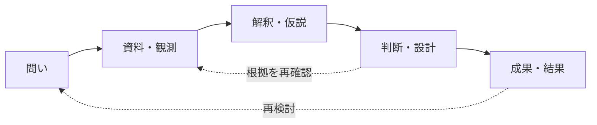
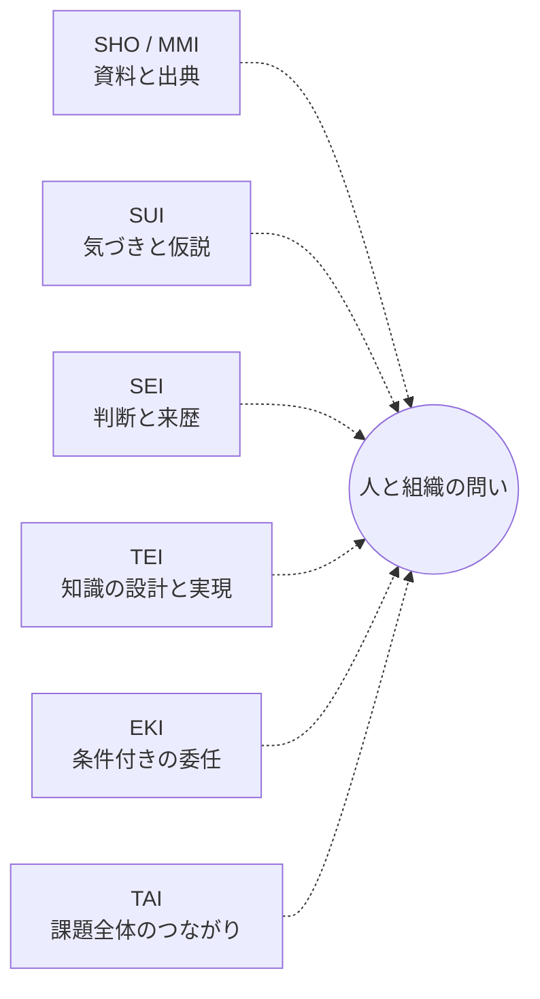
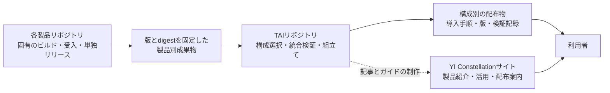

<!--
YI Constellation｜プロダクトファミリー紹介／統合・配布方針反映版 v3（2026-10-28）
用途：初見の経営・事業・開発・研究関係者への概要説明。想定20〜28分。
このファイルはPowerPoint制作のための画面原稿＋図版仕様＋発表者ノート。
境界：製品ビジョンの紹介と実装／検証の確認を区別する。ブランド・ロゴ・Product分類の正式承認を主張しない。

《デザインシステム》
［画面］13.333×7.5 in、セーフマージン左右0.55／上0.42／下0.40 in。
［12列グリッド］本文幅12.23 in。列間0.18 in。基本は7:5、6:6、4:4:4、2×3の使い分け。
［文字］見出し30–34pt／主張20–23pt／本文17–19pt／カード見出し17–18pt／補足12–14pt／出典10–11pt（近距離投影を想定。詳細は発表者ノートへ）。
［色］Deep Sky #243D54／Porcelain #F5F1E8／Earth Sage #A7B7A7／Golden Flow #C4A06D／Clear Air #789FB6。彩度を抑え、重要な線だけ淡金に。
［製品補助色：制作上の暫定案］SUI＝淡紫、SEI＝青、TEI＝金、SHO/MMI＝セージ、EKI＝青緑、TAI＝濃紺＋淡金。ロゴ正式色の指定ではない。
［統合と配布］星座図＝価値の関係。配布図＝個別製品の固定版ArtifactをTAIで選択・検証・組立てる設計案。両者を同じ線種にしない。YIの専用リポジトリは設けない。
［画面の密度］原則「1結論＋2〜3情報層」。①大見出し ②一目で読める図・表 ③価値・機能・境界の小欄。箇条書きの羅列で密度を出さない。
［図］製品の関係線は細い曲線／概念上の補完は点線／実証を述べる線は必ず対象・版・条件と併記。中央集権のハブ図を描かない。
［写真］人物や端末の写真のみに頼らず、薄明の山並み、水面、星点、交差する弧、余白のある円を背景に選ぶ。写真の上に本文を直置きせず半透明の面を敷く。
［共通フッター］左「YI Constellation | Product family overview」右「Concept / evidence distinguished」＋ページ番号。表紙・結語は番号を省略可。
［グラフの注意］Mermaidは論理構図の指示書。PowerPointでは線・ラベル・ノードを個別の編集可能図形として制作し、図内の文字をラスタ化しない。
［凡例］◯＝個別製品／点線＝役割上の補完案／実線矢印＝例示上の作業の流れ（実API接続を意味しない）／細い金線＝時間をまたぐ理由の継承。
［読み方］各スライドの「画面に表示する本文」は見出しから次の水平線まで。HTMLコメントは制作指示／発表者ノートで、投影しない。
-->

<!-- Slide 01｜HERO｜明け方の空と連なる山影を下1/3、六つの星点を中央上方。英語ファミリー名を大きく、日本語は一行。ロゴ候補の交差弧は透かし扱い。 -->

# 01　YI Constellation

## 考えた理由を、未来へつなぐ。

**異なる知の力がつながり、人とAIの仕事を前へ進める。**

*Intelligence that carries its reasons forward.*

TAI Pleroma / SUI Sensemaking / SEI Cognition / TEI Platform / SHO・MMI / EKI Fabric

*YI Constellationはシリーズのブランドとウェブサイト名。統合・配布の制作拠点はTAIリポジトリ。*

<!-- note:
「YI Constellation」はファミリーブランドとウェブサイトの名称案で、独立リポジトリは作らない。TAI Pleromaはその一製品であり、その既存リポジトリをシリーズ配布の制作拠点とする構想。表紙の星点は地位の上下を表さず、独立した力を象徴する。名前の商標・正式ロゴの採用は未確認。
参照：別チャット「TAIブランド設計と命名案」、TAIブランドボード2枚。
-->

---

<!-- Slide 02｜EXECUTIVE GRID｜左上に一文の価値、下段に「課題→しくみ→受け取る価値」の3カラム。右端に小型の星座印。 -->

# 02　このシリーズが目指すもの

**資料だけでなく、問い、判断の理由、実現した結果まで引き継げるようにする。**

| いま起こりやすいこと | 製品群が支えること | 生まれると期待する価値 |
| --- | --- | --- |
| 資料と判断が離れる | 出典・仮説・判断をたどれる | 説明と再検討がしやすい |
| 人やAIが替わるとやり直し | 知識と実現方法を切り分ける | 引継ぎ・改善を続けやすい |
| 実行したか、成功したか曖昧 | 委任・実行・結果を区別する | 安心して協働の範囲を広げられる |

**目標は「何でも一つのAIに任せること」ではありません。**

<!-- note:
人やAIが複数関わる仕事に、判断の継続性と専門機能の組合せを提供する構想。現時点で全ファミリーを横断した商用運用が完成したとの主張ではない。
出典：TAI README、SEI Product Value、TEI Product Value、EKI Product Value。
-->

---

<!-- Slide 03｜PROBLEM MAP｜左に書類、会話、実装、結果の四つの断片。右に「失われる問い」を大きく。断片の間の途切れた線を使う。 -->

# 03　仕事が途切れる四つの境界

| 境界 | 起こりがちな断絶 | 本来、残したいこと |
| --- | --- | --- |
| **資料 ⇄ 理解** | 原資料が残っても解釈の理由が消える | どの情報から考えたか |
| **議論 ⇄ 判断** | AIの提案と承認済みの方針が混ざる | 誰が、どこまで決めたか |
| **知識 ⇄ 実装** | システムを作り直すと業務の意味も失う | 変わらない規則と例外 |
| **依頼 ⇄ 結果** | 受付や実行を成果の達成と取り違える | 何を実行し、何を確かめたか |

**速く答えを出すだけでは、仕事の継続性は守れません。**

<!-- note:
四つは典型的な問題の整理であり、全現場で同時に生じるという断定ではない。左の断片は道具の優劣を表さず、情報の境界を示す。
-->

---

<!-- Slide 04｜FUTURE LOOP｜中央に大きな開いた輪。5つの段階を円周に、輪の外側に「人・AI・組織」。往復する小矢印を複数配置。 -->

# 04　望むのは、仕事が続く体験

**問いを立て、材料を確かめ、意味を考え、判断し、形にする。結果が新しい問いを生む。**

| 途中で変わっても | 残しておきたいもの |
| --- | --- |
| 担当者・AIモデル | 当時の根拠、未解決点、判断の所在 |
| ソフトウェア・実行環境 | 業務上の意味と、変更した実現方法 |

<!-- note:
固定的な一方向ワークフローではない。問いからすぐ実行が必要な場面も、仮説へ戻る場面もある。SEIの判断継続性、TEIの意味と技術の分離、TAIの課題追跡を一般向けに翻訳した。
-->

---

<!-- Slide 05｜BRAND ARCHITECTURE｜左40%に YI Constellation / 六つの独立星。右60%に「ファミリー名」「製品名」「接続の意味」3カード。 -->

# 05　YI Constellationという名前

**星はそれぞれに輝き、星座は関係を見いだすことで姿を現します。**

| ブランド上の言葉 | 意味 |
| --- | --- |
| **YI Constellation** | 製品ファミリーのブランドと、製品ウェブサイトの表示名 |
| **TAI Pleroma** | 課題と成果を横断して扱う、独立した統合製品 |
| **TAIリポジトリ** | 活用知識と、構成別の統合検証・配布・サイト制作を担う構想上の拠点 |
| **SUI・SEI・TEI・SHO/MMI・EKI** | 固有のソース・契約・受入・単独リリースを持つ関連基盤 |

**YI専用リポジトリは作りません。ブランドの星座と、開発・配布の構成は別の図で説明します。**

<!-- note:
TAI Issue #74／Draft PR #75にブランドと配布の役割案があり、正式な統合リリースは未実装。ファミリー名はチャットのブランド構想に基づく。星座の線は意図された関係・補完を示す比喩で、所有構造や通信トポロジーではない。「YI」に漢字の読みや特定の易卦を一意に割り当てない。
-->

---

<!-- Slide 06｜CONSTELLATION MAP｜大きな図を65%、右に凡例と一文価値35%。中心は「人と組織の問い」であってTAI製品ではない。製品間は輪郭を共有せず独立点。 -->

# 06　六つの力が、一つの問いを支える

**各製品は単独でも価値を持ちます。組み合わせ方は課題によって変わります。**

*点線＝役割上の補完。実装済みAPI、管理上の主従、実行依存を示さない。*

<!-- note:
PowerPointでは製品六点を不均等な星座状に置き、中心Qは大きな白い余白として表現。すべての点を一本の輪へ結ばず、星座の未完成感を残す。正式な製品分類と接続関係はTAI Issue #73で未確定。
-->

---

<!-- Slide 07｜ROLE TIMELINE｜上2/3「流れ」、下1/3「時間を横断するSEIと課題を見渡すTAI」。各段階に製品名を小さなタグで表示。 -->

# 07　使い方は一つではない

| 仕事の場面 | 前に進める問い | 関わる力の例 |
| --- | --- | --- |
| **資料を読む** | 何が書かれ、どの版が正しいか | SHO / MMI |
| **理解を深める** | どんな解釈があり、何が未解決か | SUI |
| **判断を引き継ぐ** | 何を根拠に誰が決めたか | SEI |
| **形にする** | どんな規則・設計・実装が必要か | TEI |
| **処理を任せる** | 誰に、どの条件で実行を委ねるか | EKI |
| **課題を振り返る** | 何が変わり、次に何を問うか | TAI |

**SEIは判断の時間的なつながりを、TAIは課題全体のつながりを支えます。**

<!-- note:
「場面の順」は理解のための例示。すべてのProductを毎回使う必要はなく、SEIやTAIも他製品を統制する中央Hostではない。下段は淡金の時間軸と青緑のプロジェクト帯を並行して描く。
-->

---

<!-- Slide 08｜PORTFOLIO MATRIX｜6枚の製品カード×2行。各カード「誰のどんな課題／何を支える／届けたい価値」の3段。比較可能だが階層を作らない。 -->

# 08　六つの役割を一枚で見る

| プロダクト | 主に向き合う課題 | 中核となる働き | 利用者が得たい価値 |
| --- | --- | --- | --- |
| **SHO / MMI** | 資料と説明が離れる | 元データへの参照、文書化 | 出典へ戻れる |
| **SUI** | 考える前に結論が固定される | 観測・カード・仮説の構造化 | 見落としを減らす |
| **SEI** | 判断の文脈が失われる | 意味・根拠・未解決・履歴の保持 | 判断を再開できる |
| **TEI** | 知識が特定技術に縛られる | 意味のモデル化、検証、実現 | 変化に対応できる |
| **EKI** | 計算を任せる条件が曖昧 | 限定委任、配置、結果確認 | 安全に余力を活用 |
| **TAI** | 課題が道具ごとに分断される | 役割と成果の横断的な追跡 | 一つの問いを見失わない |

*目的・役割の比較です。全行が同じ成熟度で製品化されたという意味ではありません。*

<!-- note:
ビジネス・技術の混合聴衆に向けた最重要スライド。表の行は交互に薄い背景を敷く。投影時に表の見出し17pt、本文15–16pt未満へ縮小しない。SHOとMMIの同一性は未確定。
-->

---

<!-- Slide 09｜PRODUCT DOUBLE PAGE STYLE A｜左=原表→参照→文書の小図、右=3段（価値／できること／境界）。アクセントEarth Sage。 -->

# 09　SHO / MMI｜資料と成果のつながりを保つ

**資料を写し直さず、原本に戻れる文書へ。**

| 観点 | 内容 |
| --- | --- |
| **必要性** | 要件表や試験表を文書へ転記すると、原本との食い違いや更新漏れが生まれやすい |
| **現在のMMI** | Excel・CSV等の必要な範囲をMarkdownで参照表示。元ファイルを変更せず、別紙・参照先を確かめる |
| **SHOの構想** | 資料の作成・参照から成果物の提示までを、出典とともに扱う、より広い文書の役割 |
| **社会的な価値** | 説明責任と引継ぎの土台となる文書の信頼性を高める可能性 |

**境界：MMIの参照機能は、周囲の文章の正しさまで自動保証しません。**

<!-- 図版仕様：左に「原本（表）」、中央に細い金線の参照、右に「設計文書」。更新時の矢印は原本→再参照のみ。文意の自動修正を示す逆矢印は置かない。 -->
<!-- note:
SHOは構想上の役割、MMIは公開ツール。イコールではない。MMIのVS Code拡張、参照記法、出典/範囲の指定に言及。公的制度上の真正性を保証すると言わない。
出典：https://github.com/hat47x/markdown-matrix-injector/blob/main/README.md
-->

---

<!-- Slide 10｜PRODUCT DOUBLE PAGE STYLE B｜左=多数のカード→複数の島→複数の仮説、右=三つの価値層。淡紫×Clear Air。 -->

# 10　SUI｜まだ形にならない気づきから考える

**違和感や断片を消さず、人とAIで意味の可能性を探る。**

| 観点 | 内容 |
| --- | --- |
| **必要性** | ばらばらの観測を早く一つの結論へまとめると、少数意見や弱い兆候が埋もれやすい |
| **中核** | 観測をカードで並べ、まとまりや関係を見つける。仮説を比べ、未解決の点を残す |
| **人とAIの協働** | AIは整理・提案を助け、人は材料を読み、解釈と採否を確かめる |
| **社会的な価値** | 調査・研究・合意形成に、異なる見方を残したまま考える余地をつくる |

**境界：見いだした仮説は、そのまま確定した事実にはなりません。**

<!-- 図版仕様：20枚程度の小カードを3つの緩い群へ。群に含まれないカードを1枚残す。「余白＝未解決」を肯定的に描く。 -->
<!-- note:
現行の中心は親和図法/KJ法に着想を得たキャンバス。KJ法の公式実装や、人の議論より必ず優れる成果を示すものではない。
出典：https://github.com/hat47x/sui-sensemaking/blob/main/README.md
-->

---

<!-- Slide 11｜PRODUCT DOUBLE PAGE STYLE C｜左=時間の三層「当時の材料／判断／その後の変更」、右=特徴。深い青と光る水面／井戸の円。 -->

# 11　SEI｜判断の理由を未来へ渡す

**「そのとき、何を知っていたか」へ戻れるようにする。**

| 観点 | 内容 |
| --- | --- |
| **必要性** | 会話やログが残っていても、提案・決定・権限・結果の区別は後から分かりにくい |
| **中核** | 観測、問い、未解決、根拠、判断、責任、来歴を意味の違いとして扱う |
| **継続性** | 担当者やAIが交代しても、過去を作り変えずに検討の続きへ戻ることを目指す |
| **社会的な価値** | 長期の仕事や公共的な判断を、説明し、問い直せる余地を保つ |

**境界：判断を記録できることと、その判断が正しいことは別です。**

<!-- 図版仕様：同心円を単純なデータベース印にせず、深さのある水面／時間の地層として扱う。中央の光点は「継続できる認識」。 -->
<!-- note:
SEIは「全製品を指揮する頭脳」ではない。Product ValueにあるDecision Continuityを平易に翻訳。SEIの「ファミリー統合の頂点」表現は提案ADR-0035の審議対象であり本編では採用済みと扱わない。
出典：https://github.com/hat47x/sei-cognition/blob/main/product/value/SEI_PRODUCT_VALUE.md
-->

---

<!-- Slide 12｜PRODUCT DOUBLE PAGE STYLE D｜左=中央に分野の意味、右に複数実現先。設計言語と実装言語を混ぜない。金と濃紺。 -->

# 12　TEI｜知識を、次の技術でも生かす

**業務や分野の意味を保ちながら、設計・実装・検証をつなぐ。**

| 観点 | 内容 |
| --- | --- |
| **必要性** | 画面やDBが変わるたび、業務の規則・例外・判断理由まで作り直したくない |
| **中核** | データ、関係、制約、手順をモデル化し、整合性を確かめる |
| **実現手段** | プラグインと既存技術を選び、アプリ、サービス、検証、生成物へつなぐ構想 |
| **社会的な価値** | 人と技術の世代交代を越えて、専門知識を受け継ぎ、再利用できる |

**境界：知識の正本と、特定のDB・画面・実行環境は同じものではありません。**

<!-- 図版仕様：中央の半透明の金色「意味」から、画面・API・DB・文書・検証という異なる実現先を放射状に描く。中央をHost／Serverの絵にしない。 -->
<!-- note:
TEIは業務アプリケーション以外の多様なビルド・検証・成果物生成にも応用を想定。現在の実証範囲は分野と機能で異なる。TEI Studioは編集・表示の開発プロジェクトで、独立正式Productとしては未分類。
出典：https://github.com/hat47x/tei-platform/blob/main/product/value/TEI_PRODUCT_VALUE.md
-->

---

<!-- Slide 13｜PRODUCT DOUBLE PAGE STYLE E｜左=端末・サーバー・クラウドの島と細い橋、各島に保護円。右=委任の5段。青緑＋淡金。 -->

# 13　EKI｜計算を任せる条件を明確にする

**仕事を安全な範囲で委ね、実行と結果を確かめる。**

| 観点 | 内容 |
| --- | --- |
| **必要性** | 計算資源が余っていても、持ち主の仕事、安全、費用、信頼条件を無視して共有できない |
| **中核** | 委任先の条件・期限・権限を定め、依頼・受理・実行・結果確認を区別する |
| **対象** | 個人端末、管理サーバー、クラウドなど。必要なら資源を組み合わせて使う |
| **社会的な価値** | 眠っている計算力を研究・検証・公益的な仕事にも活用できる可能性 |

**境界：Taskの受付は実行完了ではなく、結果の返却も意味上の正しさの証明ではありません。**

<!-- 図版仕様：各計算資源の「持ち主の境界」を同じ細さの円で描く。中央の全能Schedulerや無限に広がるクラウドを描かない。 -->
<!-- note:
最大の差別化は「分散そのもの」より条件付き委任。端末の持ち主の停止や資源安全の判断を優先。TAI参照実装のEKI接続は合成Task受付等の限定範囲で、実Workerと結果検証の一般的完成を主張しない。
出典：https://github.com/hat47x/eki-fabric/blob/main/product/value.md
-->

---

<!-- Slide 14｜PRODUCT DOUBLE PAGE STYLE F｜左=活用知識と統合配布の二層、右=目的・成果物・責務境界。二層を同一実行基盤に描かない。 -->

# 14　TAI Pleroma｜知の活用と、製品群の統合

**一つの課題の筋道を見渡し、必要な製品を使える形で届ける。**

| 二つの役割 | 目指すこと | 主な機能・成果物 |
| --- | --- | --- |
| **利用者に向けて** | 課題、観測、判断、成果、見直しを関連づける | 活用知識、ユースケース、横断的な参照・統合体験 |
| **開発・配布に向けて** | 独立した製品の版を選び、構成ごとに組み立てて届ける | 版固定、統合検証、配布構成、導入手順（設計案） |
| **社会的な価値** | 人・AI・技術が替わっても、知的活動を続けられる | 根拠をたどれる協働、既存資産の活用、選択の自由 |

**各製品のソース、意味の正本、単独リリースと実行権限は、その製品に残します。**

<!-- 図版仕様：金の開いた弧は複数の問いの軌跡。「中心サーバー」は置かず、利用者と成果物が共通して見える風景を描く。 -->
<!-- note:
TAIという製品とYI Constellationというファミリー名称を混同しない。TAIリポジトリの統合ビルド・配布・サイト制作はIssue #74／Draft PR #75で検討中。現行CIはGo/Pythonの参照試験であり、シリーズ全体のrelease pipelineが完成していると述べない。
出典：https://github.com/hat47x/tai-pleroma/blob/main/README.md ; https://github.com/hat47x/tai-pleroma/pull/72 ; https://github.com/hat47x/tai-pleroma/pull/75
-->

---

<!-- Slide 15｜DELIVERY ARCHITECTURE｜上段65%は製品別の固定版→TAIの統合検証・構成別Bundle→利用者への導線の横長図。下段35%は4つの責務カード。星座の点線は使わず、成果物の受渡しは実線で。ただし提案段階は破線枠と明記。 -->

# 15　独立した製品を、一つの体験として届ける

**製品ごとの開発と、シリーズとしての配布を分けます。**

| 主体 | 担うこと | 担わないこと |
| --- | --- | --- |
| **各製品** | ソース・技術契約・独立テスト・個別リリース | TAIによる一律の同梱義務 |
| **TAIリポジトリ** | 固定版の組合せ、横断試験、配布構成と活用ガイド | 他製品の意味・権限・受入の代行 |
| **YIサイト** | ブランド、製品紹介、使い方、版付き配布の入口 | 独立したGitHubリポジトリや実行Host |

**現状：シリーズの統合リリースとYIサイトは設計段階。完成済みの配布経路を示す図ではありません。**

<!-- 図版仕様：上段を「開発・配布」の実線レーン、下段を「知識・ウェブサイト」の薄い青のレーンに分ける。TAIの箱は配布作業の場に限り配置し、ブランド星座図の中央には置かない。実装前の構成は枠を破線にして、計画と現在地の違いを視覚化する。 -->
<!-- note:
YI Constellationはブランドと製品ウェブサイトの名前で、専用リポジトリは作らない。TAI Pleromaは独立した統合製品で、既存のTAIリポジトリが統合ビルド・シリーズ配布・活用知識・サイト制作の拠点となる構想。各製品の固有releaseとシリーズbundle releaseを分ける。source revision・artifact digest・platform・profile・権利・検証記録をマニフェストで扱う案であり、仕組みは未実装。全製品を同じHostで走らせるという主張ではない。
出典：https://github.com/hat47x/tai-pleroma/issues/74 ; https://github.com/hat47x/tai-pleroma/pull/75 ; https://github.com/hat47x/tai-pleroma/blob/main/.github/workflows/tai-reference.yml
-->

---

<!-- Slide 16｜RELATION MAP｜製品間の関係を「補完」「参照」「実現」「委任」「横断」の5関係として水平に。1本線に畳み込まない。 -->

# 16　役割を分けるから、補い合える

| 関係の例 | 生まれる可能性のある価値 | 区別したいこと |
| --- | --- | --- |
| **SHO/MMI × SUI** | 元資料を確かめながら、多様な解釈を考える | 原資料と仮説は別 |
| **SUI × SEI** | 未解決の問いと、採用した判断の履歴を保つ | 仮説とDecisionは別 |
| **SEI × TEI** | 判断の背景を参照し、意味を設計・検証へつなぐ | 合意と実装は別 |
| **TEI × EKI** | 仕事の意味を保ったまま、適切な場所へ計算を任せる | 実装と配置・委任は別 |
| **TAI × 各基盤** | 一つの課題の中で、各成果の関係を見渡す | 横断索引と各正本は別 |

**ここに描くのは、互いを置き換えずに補い合う関係です。**

*前ページは配布物の組立て、このページは知的活動での役割分担。異なる種類の「つながり」です。*

*概念上の組合せ例です。すべての行が実APIで結線・検証済みという意味ではありません。*

<!-- note:
製品間関係を有機的に語るための重要ページ。左列に製品色の小点2つを置き、間に線を引く。利用実績の比較表ではない。実接続の対象・版は各製品の文書とTAI integrations/capability-inventoryを参照。
-->

---

<!-- Slide 17｜CASE START｜左の紙に「予約不要」、右の紙に「会議室は事前予約」。中央に余白の大きい「？」、下部に三つの仮説。 -->

# 17　例えば、案内が食い違っていたら

> 掲示A「予約不要」　／　案内B「会議室は事前予約が必要」

**どちらかが間違いなのか。それとも、利用条件が違うのか。**

| 考えられる説明 | まだ確かめる必要があること |
| --- | --- |
| Aが古い情報 | 発行日・改訂日・適用期間 |
| 会議室だけ例外 | 対象設備・利用区分・例外規則 |
| 資料の言葉が不正確 | 原本の条文・担当者の確認 |

**答えを出す前に、判断の根拠をそろえるところから始めます。**

<!-- note:
TAIのSCN-001（架空の共同利用スペース案内）に基づく説明用事例。仮説はケースを理解するための例であり実施設の調査結果ではない。現実の公表には権限者の確認が必要。
出典：https://github.com/hat47x/tai-pleroma/blob/main/scenarios/SCN-001-shared-space-guidance.md
-->

---

<!-- Slide 18｜CASE 6-STAR WORKSPACE｜画面を6つの小さなカードに分け、各カードに入力→処理→出力を矢印で示す。下段にSEI継続性とTAI横断索引を帯状に。 -->

# 18　六つの力で、問いの前後をたどる

| 製品 | この例で担う役割 | 次に渡すもの |
| --- | --- | --- |
| **SHO / MMI** | 掲示や表の該当箇所を参照 | 出典・版・参照範囲 |
| **SUI** | 「旧版」「例外」「表現違い」の仮説を並べる | 候補と未解決点 |
| **SEI** | 判断時点の根拠と、後で見直す条件を残す | 判断の経緯 |
| **TEI** | 案内規則と変更案の整合性を確かめる | 検証可能な変更案 |
| **EKI** | 必要な作業を決められた条件で委任する | 受付・実行・結果の記録 |
| **TAI** | 原資料から改訂案と再検討まで関連づける | 課題全体の見通し |

*例示上の役割であり、完成済みの一体型アプリケーション画面ではありません。*

<!-- note:
既存のTAI SCN-001は合成fixtureを使う限定的な接続。EKIでWorker実行が完了した、あるいは人が正式に意味受理したとは言わない。6カードはPowerPoint図形として同幅の2×3グリッドへ。
-->

---

<!-- Slide 19｜EVIDENCE LADDER｜左「資料→仮説→判断→案内改訂」、右「確認の階段」。目立つ部分だけ金。 -->

# 19　成果だけでなく、確かめた範囲を残す

| 段階 | 残す・確かめる情報 | それだけでは言えないこと |
| --- | --- | --- |
| **資料を参照** | ファイル、版、該当箇所 | 資料の内容が正しいとは限らない |
| **案を作成** | 仮説、根拠、変更点 | 案が承認されたとは限らない |
| **処理を依頼** | 条件、依頼先、受付状態 | 実行や結果が完了したとは限らない |
| **結果を確認** | 観測結果、試験範囲 | 実世界での効果まで保証しない |
| **公表を判断** | 責任者、承認条件、未解決点 | ツールのPASSだけで公開可にならない |

**YI Constellationが大切にするのは、成果と確かさを混同しないことです。**

<!-- note:
TAIの公開ゲートは保留中。誠実な成熟度表現をブランドとして語るページ。複数の製品で同じ共通認証やDecision Authorityが成立しているという意味ではない。
-->

---

<!-- Slide 20｜USE CASE MOSAIC｜4つの利用現場を異なる風景・図像で象徴し、各々に利用者の問いを一文。 -->

# 20　価値が広がる四つの場面

| 場面 | 利用者の問い | 製品群が支える方向 |
| --- | --- | --- |
| **調査・研究** | 観測の違いから、見逃している説明はないか | SUIの探索、SEIの根拠、EKIの計算 |
| **業務システムの刷新** | 技術を替えても、仕事の意味を守れるか | TEIのモデル、SHO/MMIの資料、SEIの判断履歴 |
| **組織の引継ぎ** | 人やAIが替わっても、続きから始められるか | SEIの継続性、TAIの課題俯瞰 |
| **公共性の高い協働** | なぜそう決め、誰が何を担い、何が起きたか | 資料・判断・委任の境界を明らかにする |

**製品を全部そろえることより、必要な能力を選べることが重要です。**

<!-- note:
将来の利用可能性を示す事例。自治体・研究機関・企業への導入実績を示さない。4つの場面は実際のユーザーインタビュー結果ではなく価値仮説。
-->

---

<!-- Slide 21｜SOCIAL IMPACT 3 LEVELS｜個人／組織／社会の3カラム、それぞれ二段のカード。背景の淡い山の層は時間の広がりを象徴。 -->

# 21　価値は個人から組織、社会へ

| 個人に | 組織に | 社会に |
| --- | --- | --- |
| **考えの続きを取り戻す** | **専門知識を引き継ぐ** | **判断の経緯を検証できる** |
| 中断しても、問い・資料・決めた理由へ戻れる | 担当者や実装技術が替わっても意味を保つ | 何を知り、どの範囲で判断したか説明できる |
| **AIを選び直せる** | **異なる専門基盤を活用できる** | **条件付きで能力を分かち合える** |
| ひとつの会話や提供元へ過度に依存しない | 既存資産を活かし、必要な機能だけを接続する | 知見や計算資源の協力を安全条件のもとで広げる |

**目指すのは効率だけでなく、知識の継承と、説明できる協働です。**

<!-- note:
ここで示す社会的効果は目標であり、測定済み成果や普遍的な保証ではない。共有＝無制限公開ではなく、プライバシー、情報アクセス、権限、責任を区別する。
-->

---

<!-- Slide 22｜PRINCIPLES ROW｜5つの守る境界を五角形にせず、5本の水平線へ。見出しは短く、右に一行の意味。 -->

# 22　つながるために、違いを守る

| 設計で守る境界 | 何を防ぐか |
| --- | --- |
| **正本を奪わない** | 各製品の意味・契約・実装を、TAIの第二正本にしない |
| **仮説を事実にしない** | AIの提案や未解決の解釈を、確定情報として扱わない |
| **判断と実行を分ける** | 承認・権限・受付・実行・結果を、一つの成功へまとめない |
| **共有に境界を持つ** | 情報や計算資源を、持ち主の条件を無視して広げない |
| **変化に耐える** | 人・技術・モデルの入替えで、理由と出典を失わない |

**独立性を保った連携こそ、YI Constellationの設計思想です。**

<!-- note:
技術的には正本・Scope・Source Revision・Authority・Evidence等の区別を要する。ブランド上の星座の線を「実接続済みのAPI」と勘違いさせない。主張はTAI横断設計Draftと各Product Valueに整合。
-->

---

<!-- Slide 23｜MATURITY ROADMAP｜左に「現在の土台」、右に「これから検証」。各層を積木として描き、完成を暗示するチェックマークを乱用しない。 -->

# 23　構想から、確かめられる製品へ

| すでに取り組んでいること | これから確かめること |
| --- | --- |
| 各製品の価値・要求・設計の公開 | 初見の人に価値が伝わるか、継続利用したいか |
| SUI・SEI・TEI・MMI等の参照実装や試験 | 現実の資料・利用者・権限で一貫して使えるか |
| TAIの架空シナリオを使った限定接続 | 業務の開始から実際の結果まで、適切に追跡できるか |
| EKIのTask受付等の限定的な実証 | 実Worker・結果検証・運用時の安全が成立するか |
| Product LandscapeのDraft | シリーズ内の製品分類と公開範囲を承認できるか |
| TAIのGo/Python参照試験とSCN-001検証 | 版を固定した構成別Bundle・製品間互換試験・シリーズ公開Gateを検証する |
| YI Constellationのブランド／サイト構想 | TAIリポジトリ内でサイトを制作し、導入ガイドと公開の審査を行う |

**進捗は製品ごとに異なります。ブランドの完成度と、機能の検証状況を混同しません。**

<!-- note:
ここでは数字の進捗率を捏造しない。TAI公開ゲートは保留。YIサイト、Bundle release pipeline、Ownerの公開承認は未実行。SEIのLocal Reference、MMIの検証版、EKIのM0等、製品ごとに基準が異なる。最新の個別リポジトリで再確認してから外部公表する。
-->

---

<!-- Slide 24｜ENDING｜表紙の地平線を再登場。6点のうちいくつかを未接続のまま残し、「可能性が開かれている」を表す。コピーは最小限。 -->

# 24　YI Constellation

## 考えた理由を、未来へつなぐ。

**違う力が、違うまま協力できる。**

資料から気づきへ。判断から実現へ。結果から次の問いへ。

人とAIが、知を引き継ぎながら前へ進めるために。

*Intelligence that carries its reasons forward.*

<!-- note:
結語では個別機能の名称を繰り返さず、最初の問い「理由を継続できるか」へ戻る。過剰な約束を避け、ビジョンとして締める。
-->

---

<!-- Slide 25｜APPENDIX 1｜ファミリーと隣接研究の分類マップ。ここでの分類は正式Registryではない。 -->

# 25　付録｜関連する研究と開発の位置づけ

| 対象 | この資料での扱い | 現在の注意点 |
| --- | --- | --- |
| **CSW — Cultural Substrate Weaving** | 文化的体系を探索の触媒として使う研究方法・AIスキル | SUIと似た探索価値があっても同一製品・実API連携とは限らない |
| **TEI Studio** | TEIの意味・モデルを表・図・編集操作から扱う開発・評価の取り組み | TEIから独立した正式Productかは未確定 |
| **SHO と MMI** | SHOは広い文書役割、MMIは具体的な公開ソフトウェア | SHO=MMIという識別や置換を確定しない |
| **TAI Product Landscape** | 横断的な関係と役割を整理する設計Draft | 公開リポジトリ一覧が全製品を網羅するわけではない |
| **YI Constellation** | ブランドとウェブサイト。ソース管理はTAIリポジトリ（方針案） | YI専用リポジトリは設けない。サイト公開や統合リリースは未実施 |

*正式な範囲・分類・公開範囲はTAI Issue #73でレビュー対象です。*

<!-- note:
製品数の断定を避ける。CSWを新しい第七の基盤と紹介しない。図では実線円=本文で紹介する6つの役割、外周の小さな点=関連研究・開発、と凡例を付す。
出典：https://github.com/hat47x/tai-pleroma/issues/73
-->

---

<!-- Slide 26｜APPENDIX 2｜製作チーム向け1枚。左に版面ミニグリッド、右に写真・図・文字の役割。 -->

# 26　付録｜PowerPointデザイン設計

| 項目 | 制作指示 |
| --- | --- |
| **グリッド** | 16:9／12カラム、左右0.55in、上0.42in。主張＋図表＋補足を明確に分ける |
| **文字** | 見出し30–34pt、本文17–19pt、比較表15–17pt、注記12–14pt。小さくする前に文章を削る |
| **背景** | 暗色：表紙・星座・SEI・結語。明色：比較・事例・社会的価値。連続3枚以上同じ構図にしない |
| **モチーフ** | 星点＝独立した能力／曲線＝関係の可能性／開いた円＝継続と再解釈／層＝時間と知識 |
| **ブランド色** | Deep Sky #243D54／Earth Sage #A7B7A7／Porcelain #F5F1E8／Golden Flow #C4A06D／Clear Air #789FB6 |
| **禁止表現** | 中央Hostのような星座、実接続に見える装飾線、読みづらい写真上テキスト、正式未採用ロゴの断定 |

**星座図（価値の補完）と配布図（Artifactの受渡し）は、凡例も矢印も分けて描きます。**

**図と文字はPowerPoint上で編集可能に。装飾だけを背景画像として扱います。**

<!-- note:
同じエレメントを全スライドに貼るだけでなく、スライドタイプごとに情報構造を変える。密度を高めても本文16ptを割らないよう、実際に投影したサイズで確認する。原稿は図版仕様であり、完成したPPTXデザインの実描画テストは未実施。
-->

---

<!-- Slide 27｜APPENDIX 3｜出典。必要ならPowerPointでは2枚へ分割。 -->

# 27　付録｜一次資料と検証上の注意

**ブランド** — 別チャット「TAIブランド設計と命名案」／「調和と共創のブランドコンセプトボード.png」／「TAI Pleroma ブランドムードボード.png」

**統合ビルド・配布・ウェブサイトの責務案** — [TAI Issue #74](https://github.com/hat47x/tai-pleroma/issues/74)／[Draft PR #75](https://github.com/hat47x/tai-pleroma/pull/75)。TAI現行mainにはシリーズ統合リリースのworkflow・YIサイトの完成実装はない。

**製品資料**
- [TAI README](https://github.com/hat47x/tai-pleroma/blob/main/README.md)／[Product Landscape Draft PR #72](https://github.com/hat47x/tai-pleroma/pull/72)／[分類レビュー Issue #73](https://github.com/hat47x/tai-pleroma/issues/73)
- [SUI](https://github.com/hat47x/sui-sensemaking)／[SEI Product Value](https://github.com/hat47x/sei-cognition/blob/main/product/value/SEI_PRODUCT_VALUE.md)
- [TEI Product Value](https://github.com/hat47x/tei-platform/blob/main/product/value/TEI_PRODUCT_VALUE.md)／[TEI Product Vision](https://github.com/hat47x/tei-platform/blob/main/product/vision/TEI_PRODUCT_VISION.md)
- [MMI](https://github.com/hat47x/markdown-matrix-injector)／[EKI Product Value](https://github.com/hat47x/eki-fabric/blob/main/product/value.md)／[CSW](https://github.com/hat47x/cultural-substrate-weaving)

**表現の取り扱い** — 価値・構想、設計上の提案、参照実装の観測、人による受入、実環境での成果を別々のものとして読む。

<!-- note:
資料のブランド上の言い方は外部向けの編集案。引用元の主張を拡張してはいけない。正式ロゴ、Product分類、製品間契約、導入実績、社会的なアウトカムは適切なOwnerレビュー後に別途確定する。
-->